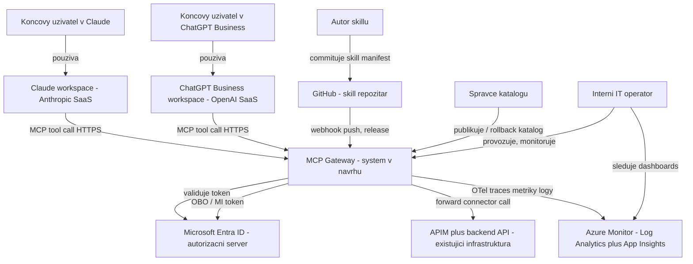
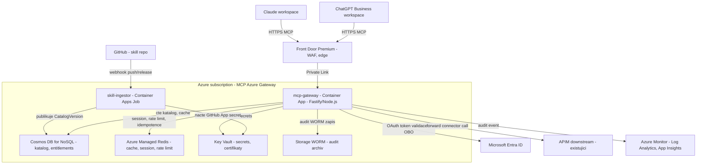
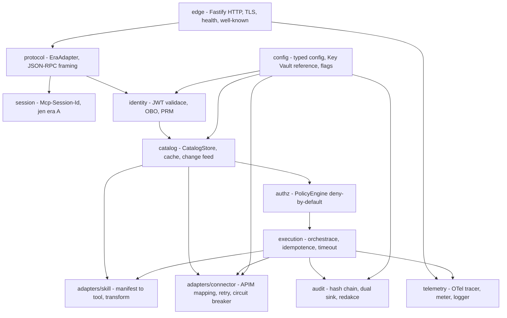

# 02 — Architektura řešení

Verze 1.0 · 2026-09-17 · Stav: Návrh · Vztahuje se k: ADR-001, ADR-003, ADR-004, ADR-005, ADR-008, ADR-009, ADR-010, ADR-013, ADR-014, ADR-015

---

## 1. Architektonické principy

| # | Princip | Důsledek | Co se obětuje |
|---|---|---|---|
| 1 | Dual-era protokol je jádrová vlastnost, ne dodatek (ADR-001) | Veškerá protokolová logika prochází vrstvou `protocol/` a je normalizována na `CanonicalRequest`/`CanonicalResult`, kterou zbytek jádra (authz, catalog, execution) vůbec nevidí | Vyšší počáteční komplexita a zdvojená testovací matice (legacy handshake i stateless režim) oproti řešení pro jednu éru |
| 2 | Deny-by-default, dvouvrstvá autorizace (ADR-007) | Nový nástroj je bez explicitního entitlement záznamu nedostupný nikomu, včetně administrátorů | Pomalejší onboarding nových nástrojů, dokud není entitlement proces automatizovaný |
| 3 | APIM je downstream, nikdy ingress (ADR-003) | Gateway vlastní celý edge stack — TLS terminaci downstream, WAF (přes Front Door), autentizaci a rate limiting — nezávisle na APIM | Duplicitní implementace části governance funkcí, které by APIM jako brána nabídlo bez dalšího vývoje |
| 4 | Žádný uživatelský kód v request cestě gateway (ADR-013) | `adapters/skill` umí jen deklarativní `http` volání a `transform` (JSONata/JMESPath) | Nižší flexibilita autorů skillů; složitější logika musí do odděleného izolovaného workeru mimo hlavní tok |
| 5 | Katalog je immutable a verzovaný (ADR-012) | Rollback je atomické přepnutí ukazatele `activePointer`, bez downtime a bez destruktivní operace | Vyšší nároky na úložiště (staré verze se archivují) a nutnost garbage-collection politiky pro staré `CatalogVersion` |
| 6 | Identita se nikdy nepředává beze změny (ADR-008) | Každé downstream volání prochází OBO nebo Managed Identity výměnou tokenu | Dodatečná latence (token acquisition, i s cache) a komplexita správy token lifecycle |
| 7 | Audit je dual-sink, hash-chained, append-only (ADR-010) | Žádný auditní záznam nelze tiše smazat ani upravit bez detekce při validaci řetězce | Vyšší provozní náklady (dual write, WORM storage) a nutnost řešit opravu chybného záznamu doplňkovým záznamem, ne editací |
| 8 | Síťová izolace je výchozí stav | Žádná datová služba (Cosmos, Redis, Key Vault, Storage) nemá public endpoint; přístup jen přes Private Link | Vyšší operační komplexita (privátní DNS zóny, NSG, řízený egress) a závislost na síťovém týmu při provozu |
| 9 | Jeden multi-tenant deployment, ne per-workspace silo (ADR-015) | Sdílená infrastruktura snižuje náklady a provozní zátěž | Sdílený blast-radius — chyba v izolaci dat/entitlements jednoho workspace může zasáhnout jiný, což vyžaduje přísné testování hranic |
| 10 | Fázovaný rollout s tvrdými branami (ADR-018) | Write nástroje se otevírají až po ověření provozu na read-only sadě v reálném pilotu | Pomalejší time-to-value pro plnou funkcionalitu ve prospěch nižšího rizika |
| 11 | Éra B zrcadlí metodu a nástroj do hlaviček (ADR-001) | `edge/` a Front Door WAF čtou `MCP-Protocol-Version`, `Mcp-Method` a `Mcp-Name` a mohou podle nich routovat, měřit a rate-limitovat per-metodu a per-nástroj ještě **před** deserializací JSON-RPC těla | Optimalizace platí jen pro éru B; pro éru A (bez těchto hlaviček) musí edge vrstva stále parsovat tělo |

---

## 2. C4 úroveň 1 — System Context

**Co diagram říká:** Gateway je jediný systém, na který ukazují obě SaaS platformy (Claude i ChatGPT Business) — z pohledu klienta vypadá jako jeden MCP server, i když uvnitř obsluhuje dvě protokolové éry (ADR-001). Autorizační rozhodnutí (kdo smí co) se neděje v samotném volání nástroje, ale je vyvedeno do samostatného vztahu s Entra ID — token se validuje před vykonáním a znovu se vyměňuje (OBO/MI) při volání downstream. GitHub a Entra ID jsou z pohledu gateway rovnocenné vnější závislosti: jedna dodává *co* lze volat (katalog), druhá *kdo* to smí volat. APIM je odběratel (downstream), nikoli zdroj příchozího provozu — šipka „forward connector call" míří od gateway k APIM, ne obráceně. Interní IT operátor a správce katalogu jsou oddělené role s odlišnou frekvencí zásahu: operátor sleduje provoz kontinuálně, správce katalogu publikuje/rollbackuje verze nárazově.

---

## 3. C4 úroveň 2 — Containers

**Co diagram říká:** Uvnitř Azure subscription jsou jen dva výpočetní kontejnery — `mcp-gateway` (obsluhuje request cestu, musí být rychlý a dostupný) a `skill-ingestor` (běží jako Container Apps Job, spouští se událostí nebo časem, latence nevadí). Obě sdílejí stejná datová úložiště, ale s jinou frekvencí přístupu: `mcp-gateway` čte katalog na každý `tools/list`/`tools/call` (proto cache v Redis), `skill-ingestor` do katalogu jen zapisuje při publikaci nové verze. Klíčové je, že `mcp-gateway` nikdy nevolá GitHub přímo — tuto závislost má výhradně ingestor, což znamená, že výpadek GitHubu nezastaví obsluhu již publikovaného katalogu. Key Vault je sdílená závislost obou kontejnerů (gateway pro OAuth client secrets a TLS, ingestor pro GitHub App private key), a je to jediné místo, kde se citlivé credentials fyzicky ukládají.

---

## 4. C4 úroveň 3 — Components gateway

**Co diagram říká:** Požadavek prochází gateway lineárně shora dolů — `edge` → `protocol` → (`session` jen éra A) → `identity` → `catalog` → `authz` → `execution`. Toto pořadí je záměrně pevné a odpovídá kanonické pipeline v [`./03-kodova-architektura.md`](./03-kodova-architektura.md#7-zpracování-requestu-krok-za-krokem): `catalog` nejdřív dohledá nástroj a validuje argumenty proti `inputSchema` (kroky 10–11), protože `authz` (krok 12) potřebuje konkrétní `ToolDefinition` a konkrétní argumenty, aby mohl vyhodnotit parametrové constrainty — autorizace se tedy vyhodnocuje **nad** katalogem, ne před ním. Teprve autorizované `allow` pokračuje do `execution`, které jako jediné volá oba typy adaptérů (`adapters/skill` i `adapters/connector`) a jako jediné zapisuje do `audit` — to znamená, že audit záznam vzniká vždy v jednom místě kódu, ne roztroušeně po adaptérech, což zjednodušuje záruku úplnosti auditu (100 % pokrytí, viz `./01-analyza-zadani-a-plan.md#8-metriky-uspechu-projektu`). `config` nejde v požadavkové cestě — je to průřezová závislost, kterou využívají komponenty potřebující tajemství nebo feature flag (Key Vault reference), ne stav specifický pro jeden request.

### Odpovědnosti komponent

| Komponenta | Odpovědnost | Vstup | Výstup | Závisí na | Jak selhává |
|---|---|---|---|---|---|
| `edge` | HTTP vrstva: TLS termination downstream, health/ready probes, `/.well-known/*`, routing na `/mcp[/{workspace}]`; u éry B čte `MCP-Protocol-Version`, `Mcp-Method`, `Mcp-Name` a routuje/rate-limituje podle nich bez parsování těla | Syrový HTTP request z Front Door (Private Link) | Předaný request do `protocol`, nebo přímá odpověď (health, PRM) | Fastify runtime, `config` (porty, limity) | Vrací `503` při přetížení; `/readyz` selže, pokud selže Cosmos/Redis/JWKS cache — viz tento návrh |
| `protocol` | Detekce éry (A/B), JSON-RPC framing, validace proti schématu, chybová taxonomie, `server/discover` | HTTP request z `edge` | `CanonicalRequest` nebo protokolová chyba (`-32xxx`) | `session` (jen éra A) | Neplatné JSON-RPC tělo → `400`; nesoulad `MCP-Protocol-Version` vs. `_meta` → `400` `HeaderMismatch` (`-32020`) |
| `session` | Správa `Mcp-Session-Id`, resumability, replay buffer pro `Last-Event-ID` — jen éra A, **volitelný modul** | Handshake `initialize`, existující session ID | Vázaný stav session nebo chyba neplatné/expirované session | Redis (session store, volitelný modul) | Ztráta Redis → nové session nelze obnovit, probíhající éra A spojení se ukončí; jádro (authz, execution) tím není ovlivněno |
| `identity` | JWT validace (JWKS cache), mapování claims → `Principal`, PRM endpoint, OBO token service, token cache | Bearer token, `resource` parametr | `Principal` s `oid`, `roles[]`, `tid`; nebo `401` s `WWW-Authenticate` | Entra ID (JWKS, OBO endpoint), `config` (audience, tenant) | Neplatný/expirovaný token → `401`; výpadek OBO endpointu → chyba propaguje jako `toolError`, ne jako neúspěch autentizace |
| `authz` | PolicyEngine: deny-by-default vyhodnocení proti entitlements, parametrové constrainty, decision log | `Principal`, cílový nástroj, argumenty | `allow`/`deny` rozhodnutí s `matchedRuleId` a důvodem | `catalog` (entitlements), `config` | Chybějící/nejednoznačný entitlement → `deny` (bezpečný default); rozhodnutí se loguje vždy, i při `allow` |
| `catalog` | `CatalogStore`, resolver aktivní/pinned verze, projekce `tools/list`, cache + invalidace přes change feed | Dotaz na nástroj/verzi, change feed event z Cosmos | Definice nástroje (`inputSchema`, anotace), stránkovaný seznam | Cosmos DB, Redis (cache) | Výpadek Cosmos → cache slouží ze stale dat do vypršení TTL, pak `tools/list` selže; chybějící `CatalogVersion` → prázdný katalog, ne pád |
| `adapters/skill` | Manifest → definice nástroje, provedení deklarativního `transform` (JSONata/JMESPath) | Skill manifest, argumenty volání | Výsledek transformace jako `structuredContent` | `catalog` (manifest) | Neplatný/nebezpečný transform výraz je odmítnut už při validaci v ingestoru (ADR-013), za běhu selže jako `toolError` |
| `adapters/connector` | Mapování nástroj → operace APIM, retry politika, circuit breaker, tvarování odpovědi | Argumenty volání, OBO token | HTTP odpověď z APIM přetvořená na MCP `content`/`structuredContent` | APIM (downstream), `identity` (OBO token) | Timeout/5xx z APIM → retry dle politiky, poté `toolError` nebo `CircuitOpen` (ADR-017, stav. automat v architektonických rozhodnutí v [`09-adr-a-zdroje.md`](./09-adr-a-zdroje.md)) |
| `execution` | Orchestrace celého tool invocation: idempotence check, timeout/cancel, progress, redakce výsledku | `CanonicalRequest` po autorizaci | `CanonicalResult` (success/toolError/timeout/cancelled) | Redis (idempotence cache), `adapters/*`, `audit` | Duplicitní `Idempotency-Key` → replay uloženého výsledku bez opětovného volání downstream (ADR-016) |
| `audit` | Kanonizace záznamu, výpočet hash chain, dual-sink zápis (Log Analytics DCR + WORM blob), PII redakce | Terminální stav z `execution` | Zapsaný auditní záznam v obou sincích | Log Analytics (DCR), Storage (WORM), `config` (retenční politika) | Selhání jednoho sinku nesmí zablokovat odpověď klientovi (asynchronní zápis); trvalé selhání obou = alert, ne tichá ztráta |
| `telemetry` | OTel tracer/meter/logger, korelace `traceId` napříč vrstvami, health/readiness signály | Spans a metriky ze všech komponent | Export do Application Insights | Application Insights/OTLP endpoint, `config` | Výpadek exportu nezastaví request cestu (fire-and-forget), jen se ztrácí pozorovatelnost |
| `config` | Typovaná konfigurace, reference na Key Vault, feature flags | Environment/Key Vault reference při startu | Validovaná konfigurace pro ostatní komponenty | Key Vault, Managed Identity | Neplatná/chybějící povinná konfigurace → gateway odmítne nastartovat (fail-fast), ne běh s výchozími hodnotami u bezpečnostně kritických polí |

**Bezstavovost éry A je architektonicky možná, ne jen provozní nouzové řešení.** Specifikace `2025-11-25` (Session Management) definuje přidělení `Mcp-Session-Id` jako **MAY**, ne MUST — server éry A smí `initialize` obsloužit zcela bez trvalého stavu. `session/` je proto v tomto návrhu od počátku modelovaný jako **volitelný modul**: existuje, protože resumability (`Last-Event-ID` replay) a diagnostika dlouhotrvajících éry A spojení jsou užitečné vlastnosti, ne protože by je spec vyžadovala. Důsledek pro zbytek architektury: Redis pro session store lze v jakékoli fázi vypnout, aniž by přestala fungovat autentizace, autorizace, idempotence nebo audit — tyto vrstvy na `session/` nezávisí (viz kanonická pipeline výše, kroky 6–19). To také znamená, že argument pro Premium ingress (ADR-004, §5 níže) stojí na skutečné potřebě delších spojení éry A, ne na tom, že by session store sám o sobě vyžadoval delší ingress timeout — session store a ingress timeout jsou dvě nezávislá rozhodnutí, která se jen shodou okolností týkají stejné éry protokolu.

---

## 5. Azure topologie / rozmístění komponent

```mermaid
flowchart TB
    subgraph SUB["Azure Subscription - MCP Gateway Prod"]
        subgraph RG_EDGE["Resource Group rg-mcpgw-edge"]
            FD["Front Door Premium plus WAF - global edge"]
            FDPL["Front Door Private Link origin"]
        end

        subgraph RG_NET["Resource Group rg-mcpgw-network"]
            subgraph VNET["VNet vnet-mcpgw-prod 10.60.0.0/22 - navrh"]
                subgraph SNET_ACA["Subnet snet-aca-infra 10.60.0.0/24 - navrh, delegovano Microsoft.App/environments"]
                    ACAENV["Container Apps Environment - internal, workload profile, Premium ingress"]
                end
                subgraph SNET_PE["Subnet snet-pe 10.60.1.0/27 - navrh"]
                    PE_COS["Private Endpoint Cosmos DB"]
                    PE_RED["Private Endpoint Managed Redis"]
                    PE_KV["Private Endpoint Key Vault"]
                    PE_ST["Private Endpoint Storage WORM"]
                end
                subgraph SNET_EGRESS["Subnet snet-egress 10.60.1.32/28 - navrh"]
                    NATGW["NAT Gateway"]
                end
            end
            NSG_ACA["NSG snet-aca-infra"]
            NSG_PE["NSG snet-pe"]
        end

        subgraph RG_COMPUTE["Resource Group rg-mcpgw-compute"]
            GWAPP["Container App mcp-gateway - Fastify Node.js"]
            INGJOB["Container Apps Job skill-ingestor"]
        end

        subgraph RG_DATA["Resource Group rg-mcpgw-data"]
            COS["Cosmos DB for NoSQL - katalog, entitlements"]
            RED["Azure Managed Redis - cache, session, rate limit"]
            KV["Key Vault - secrets, certifikaty"]
            ST["Storage account WORM - audit archiv"]
            PDNS_COS["Private DNS zone privatelink.documents.azure.com"]
            PDNS_RED["Private DNS zone privatelink.redis.azure.net"]
            PDNS_KV["Private DNS zone privatelink.vaultcore.azure.net"]
            PDNS_ST["Private DNS zone privatelink.blob.core.windows.net"]
        end

        subgraph RG_MON["Resource Group rg-mcpgw-monitoring"]
            LAW["Log Analytics workspace"]
            AI["Application Insights"]
        end

        PDNS_ACA["Private DNS zone privatelink.region.azurecontainerapps.io"]
    end

    ENTRA["Microsoft Entra ID - externi tenant service"]
    GH["GitHub - externi skill repo"]
    APIM["APIM plus backend API - existujici, downstream"]

    FD -->|"verejny internet"| FDPL
    FDPL -->|"Private Link"| ACAENV
    ACAENV --> GWAPP
    GWAPP -.->|"resolve"| PDNS_ACA
    GWAPP -->|"Private Link"| PE_COS
    PE_COS --> COS
    GWAPP -->|"Private Link"| PE_RED
    PE_RED --> RED
    GWAPP -->|"Private Link"| PE_KV
    PE_KV --> KV
    GWAPP -->|"Private Link"| PE_ST
    PE_ST --> ST
    PE_COS -.->|"resolve"| PDNS_COS
    PE_RED -.->|"resolve"| PDNS_RED
    PE_KV -.->|"resolve"| PDNS_KV
    PE_ST -.->|"resolve"| PDNS_ST
    INGJOB -->|"Private Link"| PE_COS
    INGJOB -->|"Private Link"| PE_KV
    GWAPP -->|"odchozi"| NATGW
    NATGW -->|"verejny internet TLS"| ENTRA
    NATGW -->|"verejny internet TLS"| GH
    NATGW -->|"verejny internet nebo Private Link varianta B"| APIM
    GWAPP -->|"OTel export"| AI
    AI --> LAW
    GWAPP -->|"diagnostic logs"| LAW
    NSG_ACA -.->|"chrani"| SNET_ACA
    NSG_PE -.->|"chrani"| SNET_PE
```

**Co diagram říká:** Rozdělení do pěti resource groups (`rg-mcpgw-edge`, `-network`, `-compute`, `-data`, `-monitoring`) odděluje životní cyklus a vlastnictví zdrojů — síťové a datové zdroje mění málokdo a zřídka, výpočet (`compute`) se mění při každém nasazení. Žádná datová služba nemá cestu ven z `SNET_PE` jinou než přes svůj Private Endpoint — to je vynuceno tím, že v diagramu neexistuje žádná šipka z `COS`, `RED`, `KV` nebo `ST` směrem ven mimo přes `PE_*`. Privátní DNS zóny (`PDNS_*`) jsou samostatné uzly proto, že bez nich by se jméno služby (např. `*.documents.azure.com`) přeložilo na veřejnou IP i uvnitř VNet — přerušovaná čára „resolve" ukazuje, že jde o DNS závislost, ne o datový tok. `mcp-gateway` má jedinou cestu ven ze sítě — přes `NAT Gateway` v `snet-egress` — což znamená, že veškerý odchozí provoz (k Entra ID, GitHubu i k APIM ve výchozí variantě A) je z pohledu cílových služeb viditelný z jedné predikovatelné sady IP adres, což usnadňuje allowlisting na straně APIM nebo GitHubu. `skill-ingestor` má záměrně jen dvě závislosti (Cosmos, Key Vault) — nikdy nevolá Redis ani APIM, protože nepatří do request cesty.

`ACAENV` běží v **Premium ingress módu** s `requestIdleTimeout` nastaveným na **10 minut (600 s)** [Zdroj 6]. Toto není kosmetická volba: výchozí (non-Premium) ingress má idle timeout jen 4 minuty (240 s) — stejně jako App Service — takže bez explicitního zapnutí Premium ingress módu by ADR-004 ztratil svůj hlavní argument (delší konfigurovatelný ingress timeout) a dlouhoběžící session éry A i nástroje jako `finance_export_ledger` by na 240 s narážely. Premium ingress má vlastní cenový dopad (vyhrazené vCPU/paměť pro ingress proxy instance na zvoleném workload profilu) — ⚠️ TODO — ověřit v Azure Pricing Calculator.

Adresní prostor `10.60.0.0/22` a jeho rozpad na subnety jsou **návrh k ověření se síťovým týmem** (viz `./01-analyza-zadani-a-plan.md` G2). Velikost `snet-aca-infra` na `/24` vychází z toho, že Container Apps Environment s workload profilem vyžaduje subnet delegovaný na `Microsoft.App/environments` s minimální velikostí `/27`, ale při zvoleném stropu 30 replik v produkci a zdvojení adresního prostoru během zero-downtime nasazení revize je `/27` (max. ~21 použitelných adres) nedostatečný — `/24` dává dostatečnou rezervu [Zdroj 5].

### Tabulka Azure resources

| Zdroj | Typ | SKU / tier | Účel | Závislosti | Redundance |
|---|---|---|---|---|---|
| Front Door Premium | `Microsoft.Cdn/profiles` | Premium_AzureFrontDoor | Globální edge, WAF (DRS 2.2), Private Link origin k ACA | ACA environment (origin), WAF policy | Nativně globální, 192+ edge PoP [Zdroj 4] |
| WAF Policy | součást Front Door Premium | Premium | Spravovaná pravidla DRS 2.2 (OWASP CRS 3.3.4 + MS Threat Intel), hrubý rate limiting | Front Door profil | Sdílí redundanci Front Door |
| Container Apps Environment | `Microsoft.App/managedEnvironments` | Workload profile (Dedicated, D4–D32), internal, zone-redundant, **Premium ingress mode** (`ingressConfiguration.requestIdleTimeout = 10` min = 600 s) | Hostitelské prostředí gateway a ingestoru | `snet-aca-infra` (delegovaný subnet), NAT Gateway (egress) | Zone redundancy zapnutá při vytvoření (nelze změnit dodatečně) [Zdroj 5] |
| Container App `mcp-gateway` | `Microsoft.App/containerApps` | min 2 / max 30 replik | Request cesta MCP protokolu | ACA environment, Cosmos, Redis, Key Vault, Entra ID, APIM | Multiple revisions mode pro blue/green a canary (ADR-012, ADR-018) |
| Container Apps Job `skill-ingestor` | `Microsoft.App/jobs` | Event/schedule trigger | Zpracování GitHub webhooků, publikace katalogu | GitHub App, Cosmos, Key Vault | Bez vlastní redundance nutné — idempotentní úloha, reconcile jako pojistka (ADR-011) |
| Cosmos DB for NoSQL | `Microsoft.DocumentDB/databaseAccounts` | Provisioned nebo serverless RU — ⚠️ TODO upřesnit dle A09/A10; session consistency (ADR-009) | Katalog, entitlements, policy decisions | Private Endpoint, `privatelink.documents.azure.com` | Zónová redundance uvnitř regionu volitelně; geo-redundance viz kap. 8 |
| Azure Managed Redis | `Microsoft.Cache/redisEnterprise` | SKU ⚠️ TODO upřesnit dle objemu | Session éry A, rate-limit countery, idempotence cache | Private Endpoint, `privatelink.redis.azure.net` [Zdroj 1] | Zone redundancy dle zvoleného tieru — ⚠️ TODO ověřit před finálním IaC |
| Key Vault | `Microsoft.KeyVault/vaults` | Standard (RBAC autorizace — výchozí od API 2026-02-01 [Zdroj 7]) | Secrets, GitHub App klíč, TLS certifikáty | Private Endpoint, `privatelink.vaultcore.azure.net` | Zajištěno platformou Azure |
| Storage account (WORM) | `Microsoft.Storage/storageAccounts` | Standard GPv2, immutable storage (time-based retention) | Audit archiv, hash-chained WORM zápisy | Private Endpoint, `privatelink.blob.core.windows.net` | GRS/RA-GRS doporučeno pro DR čitelnost auditu (návrh) |
| Log Analytics workspace | `Microsoft.OperationalInsights/workspaces` | Analytics/Basic/Auxiliary per-table [Zdroj 8] | `McpToolInvocation_CL` custom tabulka, provozní logy, alerting | DCR, Application Insights | Regionální služba, bez vestavěné cross-region redundance |
| Application Insights | `Microsoft.Insights/components` | Workspace-based | OTel trace/metriky ingestion, Live Metrics | Log Analytics workspace | Sdílí redundanci LA workspace |
| NAT Gateway | `Microsoft.Network/natGateways` | Standard | Predikovatelný odchozí egress z `snet-egress` | Standard veřejná IP, `snet-egress` | Zone-redundant SKU dostupný (volba při vytvoření) |
| Private DNS zóny (5×) | `Microsoft.Network/privateDnsZones` | — | Rozlišení privátních jmen pro Cosmos, Redis, Key Vault, Storage, ACA environment | Propojení (VNet link) na `vnet-mcpgw-prod` | Globální služba Azure |
| NSG (2×) | `Microsoft.Network/networkSecurityGroups` | — | Síťová segmentace `snet-aca-infra` a `snet-pe` | Přidruženy k subnetům | — |

---

## 6. Datové toky

### Tok tool callu

Požadavek `tools/call` prochází kanonickou 20krokovou pipeline, normativně popsanou v [`./03-kodova-architektura.md`](./03-kodova-architektura.md#7-zpracování-requestu-krok-za-krokem) — zde je jako datový tok napříč komponentami, ve stejném pořadí a se stejnými názvy kroků.

Front Door Premium (krok 1: TLS, WAF, DDoS) předá požadavek přes Private Link do `edge/`, kde proběhne ingress kontrola těla a hlaviček (krok 2) a korelace `traceparent`/`requestId` (krok 3). `protocol/` detekuje éru a ověří verzi (krok 4) a naparsuje JSON-RPC obálku (krok 5). `identity/` validuje bearer token (krok 6: autentizace — jediné místo, kde selhání vrací HTTP `401` místo tool erroru) a sestaví `Principal` z claimů (krok 7). `protocol/` společně s `catalog/` rozliší workspace a capability (krok 8), `protocol/` provede routing metody (krok 9) a `catalog/` dohledá aktivní nebo pinned katalogovou verzi (krok 10), nástroj a validuje argumenty proti `inputSchema` (krok 11). Teprve nyní přichází na řadu `authz/` `PolicyEngine` (krok 12: autorizace, deny-by-default) — rozhodnutí se loguje bez ohledu na výsledek. Při `allow` `execution/` postupně vyhodnotí rate limit a kvótu (krok 13), zkontroluje idempotenci v Redis (krok 14 — **až po autorizaci**, viz invariant níže) a potvrzovací bránu `confirm` (krok 15), než předá volání příslušnému adaptéru. `adapters/connector` si od `identity/` vyžádá OBO token (krok 16) a zavolá APIM po síti popsané v kap. 5.1 (krok 17, s retry a circuit breakerem); `adapters/skill` provede deklarativní transformaci bez odchozí síťové závislosti mimo `catalog`. `execution/` výsledek tvaruje, redukuje a ořízne (krok 18), `audit/` ho zapíše dle dvoustupňového modelu (krok 19, viz „Tok auditu" níže) a `protocol/` ho serializuje do tvaru dané éry (krok 20).

**Bezpečnostní invariant:** idempotence cache (krok 14) se čte až po úspěšném autorizačním rozhodnutí (krok 12), nikdy před ním, a autorizace se vyhodnocuje znovu při každém přehrání uloženého výsledku — zrušené oprávnění se tak projeví okamžitě, a ne až po vypršení 24h TTL idempotence záznamu.

### Tok publikace katalogu

Autor skillu commitne manifest do chráněné větve nebo vytvoří release; GitHub App webhook (HMAC ověřený) spustí `skill-ingestor`. `validate/` provede schema validaci, lint a policy kontroly (zakázané cíle, povinné anotace); při úspěchu `build/` sestaví novou `CatalogVersion` (`id = gitSha-buildHash`) a spočítá diff proti aktivní verzi. `publish/` zapíše novou verzi do Cosmos a atomicky přepne `activePointer` (nebo nastaví `pinnedVersion` pro konkrétní workspace při canary publikaci). Change feed Cosmos DB tuto změnu propaguje do `catalog/` modulu všech běžících replik gateway, které invalidují lokální cache. Nezávisle běžící reconcile job (každých 15 minut) porovnává poslední Git SHA s aktivní verzí jako pojistku proti ztracenému webhooku (ADR-011).

### Tok auditu

Každý terminální stav tool invocation (`Succeeded`, `ToolError`, `TimedOut`, `Cancelled`, `CircuitOpen`) generuje v `execution/` událost s povinnými poli dle tento návrh. Audit je **dvoustupňový**:

1. **Synchronní zápis do durable outboxu** — `audit/` záznam kanonizuje do deterministického JSON tvaru, spočítá `SHA-256` a připojí jej k řetězci (`prevHash` → `hash`), poté ho zapíše do outboxu (append do Redis Streamu s AOF, plus lokální fallback na disk repliky). Tento krok proběhne **před vydáním odpovědi** klientovi a nelze ho přeskočit. Selže-li: u nástrojů s `readOnlyHint: true` a `riskTier ∈ {low, medium}` se odpověď přesto vydá (`failOpen`), incident jde do telemetrie a spustí alert; u ostatních (`readOnlyHint: false` nebo `riskTier ∈ {high, critical}`) se nástroj **neprovede** (`failClosed`) a klient dostane tool error „audit nedostupný".
2. **Asynchronní doručení** z outboxu do Log Analytics custom tabulky (přes DCR, pro dotazování a alerting) a do WORM blobu (`audit/{yyyy}/{MM}/{dd}/{hh}.jsonl`) s immutability policy. Toto **neblokuje odpověď** — běží v odděleném pracovníkovi, at-least-once, s deduplikací podle `eventId`.

Jednou denně vzniká checkpoint záznam s kořenovým hashem celého dne, který umožňuje ověřit integritu řetězce zpětně bez nutnosti číst všechny záznamy.

---

## 7. Varianta B — APIM jako ingress

Zadání i ADR-003 staví APIM jako downstream cíl. Existuje ale legitimní varianta, kdy organizace vyžaduje, aby **veškerý** externí provoz procházel centrální APIM vrstvou jako jediným schvalovacím bodem API governance (subscription keys, produkty, centralizované policy). V takovém případě by APIM fungoval jako MCP passthrough — funkce „Expose existing MCP server" [Zdroj 2], která proxíuje existující MCP-kompatibilní server (zde: Container App `mcp-gateway`) a přidává governance vrstvu nad ním. Front Door by pak mířil na APIM místo přímo na ACA a APIM by prováděl hrubou předautorizaci (`validate-jwt`, `validate-azure-ad-token`) ještě před předáním na gateway.

**Co se změní:** vstupní bod se posune z Front Door → ACA na Front Door → APIM → ACA (dvojitý hop); rate limiting hrubé úrovně by se přesunul z Front Door + gateway na APIM policy (`rate-limit-by-key`); governance nástrojů (subscription, approval workflow) by využívala APIM Products [Zdroj 2] namísto/vedle vlastního entitlement modelu gateway.

**Úskalí:** nejzávažnější je vliv APIM diagnostic loggingu na streaming. Pokud je na úrovni „All APIs" (globální scope) zapnuté logování přes Application Insights/Azure Monitor s nenulovým „Number of payload bytes to log" pro Frontend Response, dochází k bufferování odpovědi, které **rozbíjí MCP streaming** (SSE odpovědi éry A i request-scoped streamy éry B) — nutné je nastavit tuto hodnotu na `0` explicitně, ideálně selektivně jen pro non-MCP API, nikoli globálně. Stejně tak žádná MCP server policy nesmí přistupovat k `context.Response.Body`, protože to vyvolá stejné bufferování [Zdroj 3]. Dalším úskalím je, že APIM Consumption tier MCP funkce nepodporuje vůbec — nutný je minimálně Developer/Basic tier [Zdroj 3], což je omezení, které varianta A (gateway jako přímý ingress) nemá, protože se na APIM MCP funkce vůbec nespoléhá.

**Proč není výchozí:** zadání explicitně popisuje, že gateway „forwards connector calls to the existing APIM" — APIM je tedy popsán jako cíl volání, ne jako vstupní brána. Gateway již implementuje vlastní OAuth 2.1 Resource Server (ADR-005), WAF (Front Door Premium) a třívrstvý rate limiting (ADR-017); přidání APIM jako ingress by tyto vrstvy z větší části duplikovalo a přidalo latenci bez odpovídajícího přínosu, pokud organizace nemá tvrdý governance požadavek popsaný výše.

---

## 8. Multi-region / DR pohled

Výchozí návrh pro Fáze 0–1 je **single-region** (A15 v `./01-analyza-zadani-a-plan.md`); multi-region aktivní/pasivní rozšíření je posouzeno jako součást Fáze 2 v závislosti na odpovědi na otázku G13. Z topologického pohledu:

- **Front Door** je už ze své podstaty globální anycast služba se 192+ edge PoP [Zdroj 4] — vrstva edge tedy DR neřeší sama, failover se odehrává až na úrovni originu (ACA prostředí v sekundárním regionu).
- **Cosmos DB** podporuje geo-redundanci bez výpadku — provisioned RU se replikují do každého přidaného regionu (RU × počet regionů) [Zdroj research `azure-platform.md` §5]. Zvolená úroveň konzistence `Session` (ADR-009) je kompatibilní s multi-region čtením při zachování vyššího throughputu než u `Strong`/`Bounded Staleness`.
- **Katalog jako zdroj pravdy je Git**, ne Cosmos DB — obnova katalogové vrstvy po DR události neznamená obnovu ze zálohy databáze, ale opětovný běh `skill-ingestor` proti poslednímu známému Git SHA, což zjednodušuje RTO katalogové vrstvy na dobu jednoho běhu ingestoru.
- **Azure Managed Redis** drží jen efemérní stav (session éry A, rate-limit countery, idempotence cache s TTL) — ztráta při failoveru znamená degradaci UX (nutnost nového handshake u éry A, dočasné oslabení ochrany proti duplicitním zápisům), ne ztrátu trvalých dat.
- **WORM audit blob** by měl v multi-region scénáři používat GRS/RA-GRS replikaci (návrh, ⚠️ TODO potvrdit s compliance) — imutabilní politika musí být nastavena shodně v obou regionech, protože retenci lze podle definice WORM jen prodloužit, nikdy zkrátit [Zdroj research `azure-platform.md` §4].
- **RPO/RTO:** ⚠️ TODO — konkrétní cílové hodnoty nejsou v zadání a nebyly potvrzeny zadavatelem (G13). Pracovní návrh: RPO blízké nule pro katalog (rekonstruovatelný z Gitu), RPO v řádu minut pro Cosmos (kontinuální geo-replikace), RTO v řádu desítek minut pro plný regionální failover v modelu aktivní/pasivní s poloautomatickým přepnutím.

---

## 9. Hranice systému

Gateway **NEDĚLÁ**:

- **Neukládá obsah konverzací.** Auditní záznam obsahuje hash argumentů a výsledku (`argumentsHash`, `contentHash`), případně redigovaná data — ne plný transkript konverzace uživatele s modelem, který zůstává výhradně na straně Claude/ChatGPT.
- **Neimplementuje vlastní Authorization Server** (ADR-005). Microsoft Entra ID je jediný zdroj identity a tokenů; gateway je čistě OAuth 2.1 Resource Server a nikdy nevydává vlastní přístupové tokeny.
- **Nespouští uživatelský kód** (ADR-013). `adapters/skill` provádí jen deklarativní `http` volání a `transform` výrazy; cokoliv, co vyžaduje spustitelný kód, patří mimo request cestu gateway do odděleného izolovaného workeru (budoucí rozšíření, ne součást tohoto návrhu).
- **Není datové jezero ani analytická platforma.** Cosmos DB uchovává jen katalog, entitlements a cache rozhodnutí — byznysová data zůstávají v systémech za APIM a gateway k nim nemá trvalý přístup mimo dobu trvání jednoho tool callu.
- **Neřídí lifecycle downstream API.** Verzování API, produkty a subscription keys v APIM zůstávají v gesci jejich vlastníka; gateway na ně jen odkazuje z `adapters/connector`.
- **Není obecná API brána.** Obsluhuje výhradně MCP protokol na `/mcp*` cestách a administrativní/webhook cesty z tento návrh — ne libovolný REST provoz.

### 9.1 Síťový tok požadavku

```mermaid
flowchart LR
    subgraph PUB["Verejny internet"]
        CLIENT["Claude nebo ChatGPT Business klient"]
        DNSPUB["Verejny DNS mcp.contoso.com"]
    end

    subgraph EDGE["Front Door Premium POP - edge"]
        WAF["WAF - DRS 2.2 managed rules"]
        FDRL["Front Door rate limit - hruba vrstva"]
    end

    subgraph PRIV["Privatni Azure backbone - Private Link / VNet"]
        FDPL["Front Door Private Link origin"]
        ACAENV["ACA internal ingress - Envoy"]
        GWAPP["mcp-gateway Container App"]
        PE_KV["Private Endpoint Key Vault"]
        NATGW["NAT Gateway - odchozi"]
    end

    subgraph EXT["Externi sluzby"]
        ENTRA["Microsoft Entra ID"]
        GH["GitHub"]
        APIM["APIM plus backend API - downstream"]
    end

    CLIENT -->|"HTTPS verejny internet"| DNSPUB
    DNSPUB -->|"HTTPS verejny internet"| WAF
    WAF --> FDRL
    FDRL -->|"Private Link"| FDPL
    FDPL -->|"privatni paterni sit"| ACAENV
    ACAENV -->|"internal ingress"| GWAPP
    GWAPP -->|"Private Link"| PE_KV
    GWAPP -->|"odchozi pres NAT Gateway"| NATGW
    NATGW -->|"HTTPS verejny internet"| ENTRA
    NATGW -->|"HTTPS verejny internet"| GH
    NATGW -->|"HTTPS verejny internet nebo Private Link varianta B"| APIM
```

**Co diagram říká:** Paket od klienta opouští veřejný internet přesně jednou — na hranici Front Door edge (WAF + hrubý rate limit) — a od tohoto bodu až po `mcp-gateway` cestuje výhradně po privátní páteřní síti Azure (Private Link, interní ingress ACA). Cesta zpátky ven je oddělená a záměrně úzká: jediný odchozí bod je NAT Gateway, přes který jde provoz na tři externí cíle (Entra ID pro token operace, GitHub jen z `skill-ingestor`, APIM jako downstream). Ve výchozí variantě A jde volání na APIM přes veřejný internet stejně jako k Entra ID a GitHubu — to je vědomý kompromis (APIM je „existující infrastruktura", ne nutně privátně napojitelná bez zásahu jejího vlastníka); pokud APIM Private Link podporuje a organizace jej zpřístupní, stejná hrana se přepne na privátní páteř beze změny zbytku topologie. Key Vault je jediná datová závislost zakreslená v tomto diagramu jako reprezentant vzoru, kterým gateway přistupuje ke všem svým privátním datovým službám (Cosmos, Redis, Storage se chovají shodně, viz diagram v kap. 5).

Na hranici `WAF`/`FDRL` i uvnitř `GWAPP` (`edge/` vrstva) se u éry B rozhoduje o routování a hrubém rate limitu podle hlaviček `MCP-Protocol-Version`, `Mcp-Method` a `Mcp-Name` — tyto tři hlavičky jsou u éry B povinné na každém požadavku a nesou metodu i název nástroje čitelně, takže edge vrstva je může vyhodnotit **předtím**, než začne deserializovat JSON-RPC tělo. To umožňuje per-metodu a per-nástroj rate limiting a routing bez nákladu na parsování; pro éru A (bez těchto hlaviček) tato optimalizace neplatí a edge musí tělo přečíst.

---

## Otevřené otázky

1. Přesné SKU Cosmos DB (provisioned vs. serverless RU) a Azure Managed Redis (tier) nelze stanovit bez odpovědi na A09/A10 (počet uživatelů a nástrojů) — viz `./01-analyza-zadani-a-plan.md` kap. 3–4.
2. Zda je APIM v organizaci dosažitelné přes Private Link (ovlivňuje poslední hranu diagramu v kap. 9.1) — ⚠️ TODO, závisí na odpovědi vlastníka APIM (A17, G1).
3. Konkrétní RPO/RTO cíle pro multi-region DR (kap. 8) nejsou stanoveny — čekají na odpověď G13.
4. Volba mezi NAT Gateway a Azure Firewall pro egress (v úvahu přicházejí obě možnosti) — tento dokument volí NAT Gateway jako jednodušší výchozí řešení pro predikovatelný egress; Azure Firewall by přinesl FQDN-based filtrování odchozího provozu (omezení jen na domény Entra/GitHub/APIM) za cenu vyšší provozní složitosti a nákladů — ⚠️ TODO k posouzení s bezpečnostním týmem, pokud je FQDN egress filtering vyžadován politikou.

---

## Zdroje

1. Azure Managed Redis — Private Link, privátní DNS zóna `privatelink.redis.azure.net` — https://learn.microsoft.com/azure/redis/private-link
2. Azure API Management — MCP server support (Expose REST API jako MCP, Expose existing MCP server, Products/governance) — https://learn.microsoft.com/azure/api-management/export-rest-mcp-server, https://learn.microsoft.com/azure/api-management/expose-existing-mcp-server, https://learn.microsoft.com/azure/api-management/govern-mcp-server-products
3. Azure API Management — kritická past streamingu a diagnostic loggingu, Consumption tier bez MCP podpory — https://learn.microsoft.com/azure/api-management/export-rest-mcp-server#prerequisites
4. Azure Front Door vs. Application Gateway WAF, Private Link origin jen na Premium — https://learn.microsoft.com/azure/networking/design-guide/web-application-firewall#azure-waf-platform-comparison
5. Container Apps — velikost subnetu pro workload profile prostředí (min. `/27`), rezervace adres, dopad zdvojení při zero-downtime nasazení — https://learn.microsoft.com/azure/container-apps/custom-virtual-networks#subnet, https://learn.microsoft.com/azure/reliability/reliability-container-apps#resilience-to-availability-zone-failures
6. Container Apps — Premium ingress idle timeout 4–30 minut (výchozí 4) — https://learn.microsoft.com/azure/container-apps/ingress-environment-configuration#premium-ingress-mode
7. Azure Key Vault — RBAC jako výchozí autorizační model od API 2026-02-01 — https://learn.microsoft.com/azure/key-vault/general/access-control-default
8. Azure Monitor Logs — table plans (Analytics/Basic/Auxiliary), retence až 12 let — https://learn.microsoft.com/azure/azure-monitor/logs/data-platform-logs#table-plans
9. Azure Private Endpoint — kompletní tabulka privátních DNS zón (Cosmos DB `privatelink.documents.azure.com`, Key Vault `privatelink.vaultcore.azure.net`, Storage Blob `privatelink.blob.core.windows.net`, Container Apps `privatelink.{region}.azurecontainerapps.io`) — https://learn.microsoft.com/azure/private-link/private-endpoint-dns
10. Azure Cache for Redis — oznámené vyřazení všech SKU ve prospěch Azure Managed Redis — https://learn.microsoft.com/azure/azure-cache-for-redis/retirement-faq
12. MCP specification a chování Claude/ChatGPT connectorů —  (zejména §1–§2, §8)
