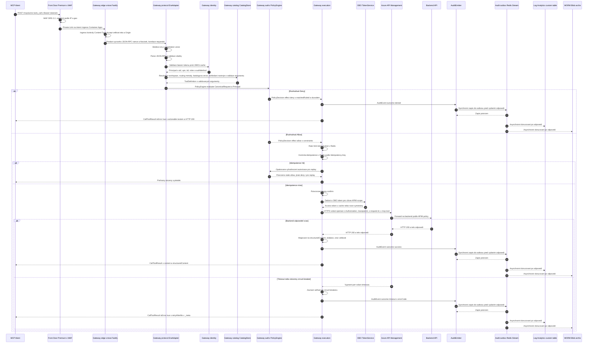

# 03 — Kódová architektura

**Verze:** 1.0 · **Datum:** 2026-09-17 · **Stav:** Návrh
**Dotčená ADR:** ADR-001 (dual-era), **ADR-002 (stack)**, ADR-004 (Container Apps), ADR-007 (authz), ADR-008 (OBO), ADR-009 (Cosmos + Redis), ADR-012 (immutable katalog), ADR-013 (sandbox skillů), ADR-014 (OTel), ADR-016 (idempotence), ADR-017 (rate limiting), ADR-018 (rollout)
**Souvisí:** [`./02-architektura-reseni.md`](./02-architektura-reseni.md) · [`./05-api-a-protokoly.md`](./05-api-a-protokoly.md) · [`./07-bezpecnost-a-autorizace.md`](./07-bezpecnost-a-autorizace.md)

---

## 1. Volba stacku a odůvodnění (ADR-002)

### 1.1 Rozpiska s verzemi

| Komponenta | Verze | Ověřeno k 2026-09-17 | Poznámka |
|---|---|---|---|
| Node.js | **24 (Active LTS)** (`24.x`, kódové jméno Krypton) | Release schedule [7] | oprava ADR-002 dle kanonického rozhodnutí — viz §1.3 |
| TypeScript | `5.x`, `strict: true`, `exactOptionalPropertyTypes`, `noUncheckedIndexedAccess` | — | ⚠️ ověřit při implementaci |
| Fastify | **5.12.x** | npm registry [8] | ověřit při implementaci |
| MCP SDK — éra B | **`@modelcontextprotocol/server` 2.0.0** + `@modelcontextprotocol/client` 2.0.0 | npm registry [9] | ⚠️ **ROZPOR** — jiný název balíčku, viz §1.2 |
| MCP SDK — Fastify most | **`@modelcontextprotocol/fastify` 2.0.0** | npm registry [9] | oficiální „middleware" balíček SDK |
| MCP SDK — éra A | **`@modelcontextprotocol/sdk` 1.30.0** | npm registry [9] | v1.x dostává opravy min. 6 měsíců po vydání v2 [10] |
| Zod | **4.6.x** | npm registry [8] | `z.toJSONSchema()` nativně od `zod@4.0` [11] |
| Validace JWT | `jose` | — | ověřit při implementaci |
| Azure SDK | `@azure/identity`, `@azure/cosmos`, `@azure/storage-blob`, `@azure/monitor-opentelemetry` | — | ověřit při implementaci |
| Redis klient | `iovalkey` nebo `ioredis` | — | ⚠️ TODO — ověřit proti Azure Managed Redis; cílová služba je Azure Managed Redis, ne starší Azure Cache for Redis (převzato, ověřit) [22] |
| Observabilita | OpenTelemetry SDK + Azure Monitor OTel Distro | MS Learn [12] | ADR-014 |

Verze v tabulce jsou **stav k datu dokumentu**; implementační tým je při zakládání repozitáře znovu ověří a zamkne přes `package-lock.json` + Renovate/Dependabot s automatickým testovacím gate.

### 1.2 ⚠️ ROZPOR s ADR-002: „MCP TypeScript SDK v2 linie"

ADR-002 předpokládá, že v2 linie SDK je nová major verze balíčku `@modelcontextprotocol/sdk`. **Není.** Ověřeno přímo v npm registry a v `README.md` na `main` větvi repozitáře [9][10]:

- `@modelcontextprotocol/sdk` má na npm dist-tag `latest` = **1.30.0**; **žádný dist-tag `v2` ani verze 2.x neexistuje**.
- v2 je publikovaná jako **dvojice nových balíčků** `@modelcontextprotocol/server` a `@modelcontextprotocol/client` (obě 2.0.0), plus tenké middleware balíčky `@modelcontextprotocol/fastify`, `@modelcontextprotocol/express`, `@modelcontextprotocol/node`.
- README explicitně: *„v2 is the stable release line, released alongside the 2026-07-28 spec. v1.x continues to receive bug fixes and security updates for at least 6 months after v2's release."* [10]

**Důsledek pro kód:** oba SDK jdou nainstalovat vedle sebe bez konfliktu názvů, což je pro ADR-001 (dual-era) ideální — nepotřebujeme npm aliasy ani dva workspace balíčky kvůli kolizi verzí. Každý `EraAdapter` si přitáhne svůj SDK a jádro nevidí ani jeden.

**Druhý důsledek:** „v1.x dostává opravy nejméně 6 měsíců po vydání v2" je **tvrdá deadline na éru A**. Pokud Claude a ChatGPT nemigrují na éru B do doby, než v1.x přestane dostávat bezpečnostní opravy, bude nutné buď éru A udržovat vlastními silami, nebo ji reimplementovat bez SDK (což je proveditelné — éra A je na drátě jednodušší než éra B, viz [`./05-api-a-protokoly.md`](./05-api-a-protokoly.md#2-http-povrch)). Patří do rizikového registru.

### 1.3 Oprava ADR-002: Node.js 24 (Active LTS), ne „22 LTS"

Volba runtime vychází z oficiálního Node.js release schedule [7], ověřeného k datu tohoto dokumentu:

| Linie | Active LTS od | Maintenance od | End-of-life |
|---|---|---|---|
| Node 22 „Jod" | 2024-10-29 | **2025-10-21** | **2027-04-30** |
| Node 24 „Krypton" | 2025-10-28 | 2026-10-20 | 2028-04-30 |
| Node 26 | 2026-10-28 (plán) | 2027-10-20 | 2029-04-30 |

Node 22 je k datu dokumentu **v režimu Maintenance** (jen kritické opravy a bezpečnostní záplaty) a končí **2027-04-30**. Systém, který jde do pilotu v roce 2026 a do celofiremního provozu v roce 2027, by na Node 22 startoval na runtime, který mu vyprší během prvního roku provozu.

Oba MCP SDK v2 balíčky mají `engines.node: ">=20"` [9] — Node 24 je tedy plně podporovaný.

**Kanonické rozhodnutí:** runtime je **Node.js 24 (Active LTS)**. ADR-002 se tímto opravuje na tento tvar. `package.json` nastavuje `"engines": { "node": ">=24.0.0" }` s CI na `24.x`; Node 22 se dál nepodporuje jako cílový runtime nasazení.

**Riziko navázané na volbu SDK (§1.2) — konec podpory éry A:** `@modelcontextprotocol/sdk` v1.x (na kterém stojí `LegacyHandshakeAdapter`) dostává opravy jen **minimálně 6 měsíců po vydání v2**, tedy nejpozději do **1. pololetí 2027**. Pokud do té doby Claude ani ChatGPT nepřejdou na éru B, bude gateway muset buď udržovat éru A na neudržovaném SDK vlastními silami, nebo si adaptér éry A přepsat bez SDK (proveditelné — éra A je na drátě jednodušší než éra B, viz [`./05-api-a-protokoly.md`](./05-api-a-protokoly.md#2-http-povrch)). Zařazeno do rizikového registru (mitigace: M1) a do roadmapy jako bod rozhodnutí nejpozději v 1. pololetí 2027 — viz [§13.3](#133-odchod-éry-a).

| Riziko | Termín | Dopad | Mitigace (M1) | Vlastník |
|---|---|---|---|---|
| Konec podpory `@modelcontextprotocol/sdk` v1.x pro éru A | nejpozději 1. pol. 2027 | Éra A běží na neudržovaném SDK bez bezpečnostních oprav, pokud klienti nemigrovali na éru B | Sledovat metriku `mcp_requests_by_era`; do 1. pol. 2027 rozhodnout mezi (a) fork SDK v1 s vlastním patchováním, (b) reimplementace `LegacyHandshakeAdapter` bez SDK; rozhodnutí je bodem roadmapy, ne otevřenou otázkou bez vlastníka | platformní tým |

### 1.4 Proč TypeScript a ne alternativy

- **Nejlepší SDK podpora.** Referenční implementace spec je TypeScript; v2 vyšla současně se spec revizí 2026-07-28 [10]. Python/C#/Java SDK běžně zaostávají o týdny až měsíce.
- **Jeden zdroj pravdy pro schémata.** Zod 4 umí nativně `z.toJSONSchema()` s cílem `draft-2020-12` [11] — což je **přesně** výchozí dialekt, který MCP pro `inputSchema`/`outputSchema` předepisuje [4]. Ze stejné definice tedy vzniká runtime validátor i `inputSchema` publikovaný v `tools/list`. V Pythonu to jde přes Pydantic, ale mapování na 2020-12 je méně přímočaré.
- **Standard Schema.** SDK v2 přijímá pro tool schémata jakoukoli knihovnu implementující [Standard Schema](https://standardschema.dev/) — Zod v4, Valibot, ArkType [10]. Nejsme uzamčeni na Zod, což snižuje riziko ADR-002.
- **Streaming ergonomie.** Éra A vyžaduje SSE se server-iniciovanými zprávami; Node má pro to přirozený model (`Readable`, `AsyncIterable`) a Fastify 5 ho nebufferuje.

**Zamítnuté alternativy** viz ADR-002. Doplňujeme jen jednu poznámku: C#/.NET byl v ADR označen jako „méně zralé MCP SDK — NEOVĚŘENO"; toto tvrzení jsme v tomto průchodu **neověřovali** a zůstává `⚠️ TODO — neověřeno`.

### 1.5 Proč Fastify 5 a ne Express

1. SDK publikuje oficiální most `@modelcontextprotocol/fastify` [9] — nemusíme psát vlastní adaptér mezi `IncomingMessage` a MCP transportem.
2. Fastify má **schema-first** validaci a serializaci na úrovni routy; hlavičkové kontrakty éry B (`MCP-Protocol-Version`, `Mcp-Method`, `Mcp-Name`) lze deklarovat jako JSON Schema hlaviček a nechat je vynutit ještě před vstupem do handleru.
3. Nativní hooky (`onRequest`, `preValidation`, `preHandler`, `onSend`, `onError`) mapují 1:1 na pipeline v §7 a drží auth/authz/audit mimo business kód.
4. `request.raw` zůstává dostupný pro SSE bez bufferování odpovědi.

---

## 2. Vrstvení a hranice — hexagonální architektura

Jádro návrhu je **ports & adapters**. Důvod není estetika: éra protokolu je podle ADR-001 dočasná (éra A zanikne) a Azure služby podle ADR-009 mohou být nahrazeny (Cosmos ↔ PostgreSQL). Obě změny musí být proveditelné bez dotyku doménové logiky.

```
 ┌──────────── PRIMÁRNÍ (driving) ADAPTÉRY ────────────┐
 │ edge/ (Fastify) protocol/ (EraAdapter) │
 │ admin HTTP webhooks/github │
 └──────────────────────┬──────────────────────────────┘
 │ volá PORTY
 ┌──────────────────────────▼──────────────────────────────┐
 │ DOMÉNA │
 │ ExecutionOrchestrator · PolicyEngine · CatalogResolver │
 │ IdempotencyGuard · Redactor · AuditRecordBuilder │
 │ Model: CanonicalRequest, CanonicalResult, Principal, │
 │ ToolDefinition, PolicyDecision, AuditEvent │
 │ ŽÁDNÉ I/O, žádné `await fetch`, žádný Azure SDK │
 └──────────────────────────┬──────────────────────────────┘
 │ definuje PORTY (interface)
 ┌──────────────────────────▼──────────────────────────────┐
 │ SEKUNDÁRNÍ (driven) ADAPTÉRY │
 │ CosmosCatalogStore · RedisIdempotencyStore │
 │ EntraTokenService · ApimToolAdapter · SkillToolAdapter │
 │ DcrAuditSink · WormBlobAuditSink · OtelTelemetry │
 └──────────────────────────────────────────────────────────┘
```

### 2.1 Co je doména

Vše, co by platilo i kdyby MCP neexistovalo a Azure nebyl: *„přišel požadavek od nějakého principála na provedení nějakého nástroje s nějakými argumenty; rozhodni, jestli smí, proveď a zaznamenej výsledek."* Doména je **synchronní, čistá a plně testovatelná bez sítě**. Konkrétně:

- `ExecutionOrchestrator` — orchestrace kroků tool callu 12–19 (§7): vyhodnocení autorizace, rate limit, idempotence, potvrzovací brána, OBO, downstream volání, tvarování odpovědi, audit.
- `PolicyEngine` — deny-by-default vyhodnocení entitlementů (ADR-007).
- `CatalogResolver` — výběr `CatalogVersion` pro workspace (pinned vs. active, ADR-012).
- `IdempotencyGuard` — rozhodnutí, zda je volání replay (ADR-016).
- `Redactor` — odstranění PII a tajemství z argumentů a výsledku před auditem (ADR-010).
- `AuditRecordBuilder` — kanonizace JSON a výpočet `hash`/`prevHash`.

### 2.2 Co je port

Port je **TypeScript interface definovaný v doméně**, vyjádřený doménovými typy. Nikdy ne `CosmosClient`, nikdy ne `FastifyRequest`. Porty jádra: `CatalogStore`, `PolicyStore`, `IdempotencyStore`, `TokenService`, `ToolAdapter`, `AuditEmitter`, `RateLimiter`, `Clock`, `IdGenerator`, `Telemetry`.

`Clock` a `IdGenerator` vypadají jako přehnané, ale bez nich nejde deterministicky testovat hash chain a TTL logiku — a hash chain je podle ADR-010 compliance artefakt.

### 2.3 Co je adaptér

Implementace portu proti konkrétní technologii. Adaptér smí znát Azure SDK, HTTP, Redis protokol. **Adaptér nesmí obsahovat rozhodování** — když v `ApimToolAdapter` vznikne `if (principal.roles.includes(...))`, je to chyba návrhu; takové rozhodnutí patří do `PolicyEngine`.

### 2.4 Proč jádro nevidí éru protokolu

`EraAdapter` je primární adaptér. Jeho jediná odpovědnost je obousměrný překlad:

- **dovnitř:** syrový JSON-RPC rámec + HTTP hlavičky → `CanonicalRequest`,
- **ven:** `CanonicalResult` → JSON-RPC odpověď ve tvaru dané éry (včetně `resultType: "complete"` pro éru B, který éra A nezná).

Spec sama tuto konstrukci předpokládá: dual-era server vybírá chování podle toho, jak klient otevře komunikaci, a **MAY** obsluhovat obě éry současně na jednom endpointu [6]. Jádro dostane `CanonicalRequest` a **nemá jak zjistit**, z jaké éry přišel — `protocolVersion` je v něm přítomný jen jako neprůhledný řetězec pro audit a telemetrii, ne jako větvící podmínka. Test tohoto invariantu je mechanický: v `packages/mcp-core` a doménových modulech **nesmí padnout grep na `2025-` ani `2026-`** (lint pravidlo, viz §11.2).

Když éra A zanikne, smaže se `LegacyHandshakeAdapter`, `session/` modul a jeden řádek v kompozičním kořeni. Jádro se nedotkne.

### 2.5 Proč jádro nevidí Azure

`ExecutionOrchestrator` volá `toolAdapter.execute(binding, args, ctx)`. Jestli za tím je HTTP volání do APIM, JSONata transformace nad odpovědí jiného nástroje, nebo in-memory fixture v testu, je pro něj neviditelné. Stejně `auditEmitter.emit(event)` — dual-sink z ADR-010 je implementační detail adaptéru `CompositeAuditEmitter`, ne doménová logika.

---

## 3. Adresářová struktura monorepa

Struktura vychází z architektonických rozhodnutí v [`09-adr-a-zdroje.md`](./09-adr-a-zdroje.md) a rozšiřuje ji o `infra/`, `tests/`, `tools/`, `docs/`.

```
mcp-azure-gateway/
├─ apps/
│ ├─ gateway/ # Container App: mcp-gateway — jediný běžící HTTP proces
│ │ ├─ src/
│ │ │ ├─ edge/ # Fastify: routy, hooky, Origin/Accept/velikost těla,
│ │ │ │ # /healthz, /readyz, /metrics, /.well-known/*
│ │ │ ├─ protocol/ # EraAdapter a jeho dvě implementace, JSON-RPC framing,
│ │ │ │ # negotiation, mapování chyb na JSON-RPC kódy
│ │ │ │ ├─ legacy/ # LegacyHandshakeAdapter (2025-11-25, 2025-06-18) + SDK v1
│ │ │ │ ├─ stateless/ # StatelessAdapter (2026-07-28) + SDK v2
│ │ │ │ └─ negotiation.ts # detekce éry, §5 dokumentu 05
│ │ │ ├─ session/ # VOLITELNÝ modul: Mcp-Session-Id, Redis
│ │ │ │ # session store, Last-Event-ID replay buffer. Aktivní jen
│ │ │ │ # při `protocol.eraA.sessionMode: "stateful"` — nezavisle
│ │ │ │ # na `eraA.enabled` (podpora protokolu éry A vůbec).
│ │ │ │ # Výchozí `sessionMode: "stateless"` modul nevolá vůbec.
│ │ │ ├─ identity/ # JWKS cache, validace JWT, claims → Principal,
│ │ │ │ # PRM dokument, TokenService (OBO), token cache
│ │ │ ├─ authz/ # PolicyEngine, evaluace entitlementů, decision log
│ │ │ ├─ catalog/ # CatalogStore adaptér, resolver verzí, per-workspace
│ │ │ │ # pinning, projekce do tools/list, change-feed invalidace
│ │ │ ├─ adapters/
│ │ │ │ ├─ skill/ # SkillAdapter: manifest → ToolDefinition, JSONata/JMESPath
│ │ │ │ └─ connector/ # ConnectorAdapter: tool → APIM operace, retry, CB
│ │ │ ├─ execution/ # ExecutionOrchestrator: idempotence, timeout/cancel,
│ │ │ │ # progress, redakce, sestavení výsledku
│ │ │ ├─ audit/ # AuditEmitter: kanonizace, hash chain, synchronní XADD do
│ │ │ │ # Redis outboxu. NEOBSAHUJE doručení do DCR/WORM —
│ │ │ │ # to dělá samostatný `apps/audit-dispatcher`
│ │ │ ├─ telemetry/ # OTel tracer/meter/logger, korelace, health checky
│ │ │ ├─ config/ # Typovaná konfigurace, Key Vault reference, feature flags
│ │ │ ├─ composition/ # Kompoziční kořen — JEDINÉ místo, kde se instancují adaptéry
│ │ │ └─ main.ts # bootstrap: načti config → sestav → poslouchej
│ │ ├─ Dockerfile # multi-stage, distroless runtime, non-root uid
│ │ └─ package.json
│ ├─ ingestor/ # Container Apps Job: skill-ingestor (ADR-011)
│ │ ├─ src/
│ │ │ ├─ github/ # GitHub App auth, HMAC verifikace webhooku, fetch po SHA
│ │ │ ├─ validate/ # JSON Schema validace manifestů, lint, policy checks
│ │ │ ├─ build/ # sestavení CatalogVersion, build hash, diff proti aktivní
│ │ │ └─ publish/ # zápis do Cosmos, atomický pointer swap, rollback
│ │ └─ package.json
│ ├─ audit-dispatcher/ # Container Apps Job: SAMOSTATNÝ proces, VLASTNÍ
│ │ │ # identita `id-mcpgw-audit-shipper` — odděleno od gateway
│ │ │ # runtime schválně (viz `07` §8), aby RCE v gateway
│ │ │ # nedávalo zároveň právo ovlivnit, co se doručí do
│ │ │ # Log Analytics / WORM blobu (viz `04` §6.5, §5.7)
│ │ ├─ src/
│ │ │ ├─ outbox-reader/ # XREADGROUP nad `audit:outbox:{tenantId}` (Redis Stream, K5)
│ │ │ ├─ sinks/ # DCR ingest klient (Log Analytics), WORM blob append klient
│ │ │ └─ fallback-replay/ # přehrávání lokálního disk fallbacku (`04` §5.7) po obnovení Redis
│ │ └─ package.json
│ └─ reconciliation-worker/ # Container Apps Job: rekonciliace `UnknownOutcome`
│ │ # (`04` §12.4) — VLASTNÍ least-privilege identita, čte/píše
│ │ # jen `writeAttempts`, volá downstream stejným kontraktem
│ │ # jako běžný tool call (idempotency replay/lookup)
│ ├─ src/
│ │ ├─ change-feed/ # naslouchá Cosmos change feedu na `writeAttempts` (stav unknown)
│ │ └─ reconcile/ # backoff cyklus, přechody Reconciled/ReconcileFailed (`06` automat 4)
│ └─ package.json
├─ packages/
│ ├─ contracts/ # Zod schémata + odvozené TS typy. JEDINÝ zdroj pravdy pro
│ │ # tvar manifestu, konfigurace a audit záznamu.
│ ├─ mcp-core/ # CanonicalRequest/Result, Principal, PolicyDecision,
│ │ # ToolDefinition, chybová hierarchie, porty. ŽÁDNÉ I/O.
│ └─ testkit/ # in-memory implementace všech portů, fixtures,
│ # MCP conformance harness, generátor testovacích JWT
├─ infra/ # Bicep (ADR-003/004/009/010)
│ ├─ main.bicep # subscription-scope orchestrátor
│ ├─ modules/ # AVM moduly: container-app, front-door, cosmos,
│ │ # managed-redis, key-vault, log-analytics, storage-worm
│ ├─ env/ # dev.bicepparam, pilot.bicepparam, prod.bicepparam
│ └─ policy/ # Azure Policy definice (deny public endpoint apod.)
├─ tests/
│ ├─ contract/ # kontraktní testy portů — každý adaptér i in-memory dvojník
│ │ # běží proti STEJNÉ sadě testů
│ ├─ conformance/ # MCP conformance: obě éry proti spec fixturám
│ ├─ integration/ # Testcontainers: Cosmos emulator, Redis, WireMock jako APIM
│ ├─ e2e/ # MCP Inspector CLI + reálný Entra dev tenant (nightly)
│ └─ load/ # k6 scénáře: tools/list burst, tools/call sustained
├─ tools/
│ ├─ skill-lint/ # CLI pro interní IT: validace manifestu před commitem
│ ├─ catalog-diff/ # diff dvou CatalogVersion, výstup pro PR komentář
│ ├─ token-mint/ # lokální vydávání testovacích JWT (jen dev, viz §12)
│ └─ blind-test/ # skript pro „blind" test agentem (§11.6)
├─ docs/ # tato dokumentace + ADR + runbooky
├─.github/workflows/ # CI/CD (OIDC federace, bez uložených secretů)
├─ package.json # npm workspaces
├─ tsconfig.base.json # strict, composite projects
└─ turbo.json / nx.json # orchestrace buildu — ⚠️ ověřit při implementaci
```

**Pravidla hranic, vynucená lintem** (`eslint-plugin-boundaries` nebo `dependency-cruiser` — ⚠️ ověřit při implementaci):

1. `packages/mcp-core` nesmí importovat nic z `apps/` ani žádný Azure/HTTP balíček.
2. `packages/contracts` smí importovat jen `zod`.
3. `apps/gateway/src/execution` nesmí importovat z `edge/`, `protocol/` ani `session/`.
4. Do `apps/gateway/src/composition` smí importovat kdokoli, ale ono samo nesmí být importováno odnikud kromě `main.ts` a testů.
5. Import `@azure/*` je povolen jen v `catalog/`, `identity/`, `audit/`, `telemetry/`, `config/` a `adapters/connector/`.

---

## 4. Klíčová rozhraní (TypeScript)

Následující deklarace jsou určené k doslovnému zkopírování do `packages/mcp-core/src/`. Jsou psané pro `strict: true` + `exactOptionalPropertyTypes: true`.

```typescript
// ─── packages/mcp-core/src/brand.ts ─────────────────────────────────────────
/** Branded type: brání záměně dvou řetězcových identifikátorů v signaturách. */
declare const __brand: unique symbol;
export type Brand<T, B extends string> = T & { readonly [__brand]: B };

export type TraceId = Brand<string, 'TraceId'>;
export type SpanId = Brand<string, 'SpanId'>;
export type RequestId = Brand<string, 'RequestId'>;
export type WorkspaceSlug = Brand<string, 'WorkspaceSlug'>;
export type ToolName = Brand<string, 'ToolName'>;
export type CatalogVersionId = Brand<string, 'CatalogVersionId'>;
export type PrincipalOid = Brand<string, 'PrincipalOid'>;
export type TenantId = Brand<string, 'TenantId'>;
export type IdempotencyKey = Brand<string, 'IdempotencyKey'>;
export type Sha256Hex = Brand<string, 'Sha256Hex'>;
/** Neprůhledný řetězec verze protokolu. Jádro ho NIKDY neinterpretuje. */
export type ProtocolVersion = Brand<string, 'ProtocolVersion'>;

// ─── packages/mcp-core/src/canonical.ts ─────────────────────────────────────
export type ClientType = 'claude' | 'chatgpt' | 'inspector' | 'other';
export type ProtocolEra = 'legacy' | 'stateless';

/** Vše, co jádro o příchozím požadavku potřebuje vědět. Bez HTTP, bez JSON-RPC. */
export interface CanonicalRequest {
  readonly requestId: RequestId;
  readonly workspace: WorkspaceSlug;
  readonly operation: CanonicalOperation;
  /** Jen pro audit a telemetrii — nesmí být použito k větvení logiky. */
  readonly protocol: {
    readonly era: ProtocolEra;
    readonly version: ProtocolVersion;
    readonly clientType: ClientType;
    readonly clientName?: string;
    readonly clientVersion?: string;
  };
  readonly trace: { readonly traceId: TraceId; readonly spanId: SpanId };
  readonly receivedAt: Date;
  /** Přítomen jen tam, kde klient o progres požádal. */
  readonly progressToken?: string | number;
  readonly idempotencyKey?: IdempotencyKey;
  readonly deadline: Date;
}

/** Discriminated union — přidání operace je typová chyba všude, kde se nepokryje. */
export type CanonicalOperation =
| { readonly kind: 'discover' }
| { readonly kind: 'listTools'; readonly cursor?: string; readonly pageSize: number }
| { readonly kind: 'callTool'; readonly tool: ToolName; readonly args: Readonly<Record<string, unknown>> }
| { readonly kind: 'ping' };

/** Výsledek v doménovém tvaru. Mapování na JSON-RPC dělá EraAdapter. */
export type CanonicalResult =
| { readonly kind: 'discover'; readonly supportedVersions: readonly ProtocolVersion[];
  readonly capabilities: Readonly<Record<string, unknown>>;
  readonly serverInfo: { readonly name: string; readonly version: string };
  readonly instructions?: string; readonly ttlMs?: number }
| { readonly kind: 'toolList'; readonly tools: readonly ToolDefinition[];
  readonly nextCursor?: string; readonly catalogVersionId: CatalogVersionId; readonly ttlMs: number }
| { readonly kind: 'toolResult'; readonly content: readonly ContentBlock[];
  readonly structuredContent?: unknown; readonly isError: boolean;
  readonly meta?: Readonly<Record<string, unknown>> }
| { readonly kind: 'empty' };

export type ContentBlock =
| { readonly type: 'text'; readonly text: string }
| { readonly type: 'image'; readonly data: string; readonly mimeType: string }
| { readonly type: 'audio'; readonly data: string; readonly mimeType: string }
| { readonly type: 'resource_link'; readonly uri: string; readonly name: string;
  readonly description?: string; readonly mimeType?: string };

// ─── packages/mcp-core/src/ports/era.ts ─────────────────────────────────────
/** Syrový vstup z edge vrstvy — jediné místo, kde se objeví HTTP. */
export interface RawEnvelope {
  readonly headers: Readonly<Record<string, string | undefined>>;
  readonly body: unknown;
  readonly method: 'POST' | 'GET' | 'DELETE';
  readonly path: string;
}

export interface EraAdapter {
  readonly era: ProtocolEra;
  /** Vrací true, pokud tento adaptér obálku obslouží. Vyhodnocuje se v pořadí. */
  claims(envelope: RawEnvelope): boolean;
  /** Vyhodí ProtocolError, pokud je obálka pro tuto éru neplatná. */
  decode(envelope: RawEnvelope, ctx: DecodeContext): Promise<CanonicalRequest>;
  encodeResult(result: CanonicalResult, req: CanonicalRequest): WireResponse;
  encodeError(error: GatewayError, req?: CanonicalRequest): WireResponse;
  /** Éra A vrací true; éra B vždy false. */
  supportsServerInitiatedStream(): boolean;
}

export interface DecodeContext {
  readonly workspace: WorkspaceSlug;
  readonly supportedVersions: readonly ProtocolVersion[];
  readonly now: Date;
}

export interface WireResponse {
  readonly httpStatus: number;
  readonly headers: Readonly<Record<string, string>>;
  readonly body: unknown | AsyncIterable<SseEvent>;
}

export interface SseEvent { readonly id?: string; readonly event?: string; readonly data: string }

// ─── packages/mcp-core/src/principal.ts ─────────────────────────────────────
export type AuthMethod = 'oauth_user' | 'oauth_client_credentials' | 'static_header' | 'anonymous';

export interface Principal {
  readonly oid: PrincipalOid;
  readonly tenantId: TenantId;
  readonly upn?: string;
  readonly displayName?: string;
  /** Claim `roles` z Entra app roles (ADR-007, hrubá vrstva). */
  readonly roles: readonly string[];
  /** Claim `groups`; prázdné pole při group overage — viz doc 07. */
  readonly groups: readonly string[];
  readonly scopes: readonly string[];
  readonly appId: string;
  readonly authMethod: AuthMethod;
  readonly tokenExpiresAt: Date;
  /** Syrový token NIKDY neopouští identity/ — drží se mimo Principal záměrně. */
}

// ─── packages/mcp-core/src/ports/policy.ts ──────────────────────────────────
export type PolicyEffect = 'allow' | 'deny';

export type PolicyDecision =
| { readonly effect: 'allow'; readonly matchedRuleId: string;
  readonly constraints: readonly ParameterConstraint[];
  readonly requiresConfirmation: boolean; readonly evaluatedAt: Date }
| { readonly effect: 'deny'; readonly matchedRuleId: string | null;
  readonly reason: DenyReason; readonly userMessage: string; readonly evaluatedAt: Date };

// Kanonická sada — jediná v celém návrhu; `07-bezpecnost-a-autorizace.md`
// a `08-provoz-observabilita-rollout.md` tyto hodnoty jen citují, nedefinují vlastní. `05-api-a-protokoly.md`
// §3.3 má sloupec `DenyReason`, kde se stejné hodnoty objevují jako `_meta.errorCode` v tool error odpovědi.
export type DenyReason =
| 'toolset_not_mapped' // hrubá vrstva (07 §5.3 krok 1): principal nemá žádnou funkční NEBO žádnou
// doménovou roli odpovídající operaci/doméně nástroje — efektivní tool set je prázdný
| 'no_matching_entitlement' // jemná vrstva (07 §5.3 krok 3): role existuje, ale žádné konkrétní entitlement
// pravidlo neodpovídá nástroji — deny-by-default
| 'explicit_deny_rule'
| 'tool_not_in_catalog'
| 'tool_deprecated_removed'
| 'risk_tier_requires_role'
| 'parameter_constraint_violated'
| 'workspace_not_entitled'
| 'rate_limit_exceeded'
| 'entitlement_expired'
| 'runtime_block_active'; // RuntimeBlock aktivní na global/workspace/principal/tool scope,
// NEBO blokovací úložiště bylo nedostupné (fail-closed) — viz `07` §5.6.
// Vyhodnocuje se MIMO PolicyEngine.evaluate() (dřív, na 3 různých bodech
// pipeline — §7), ale sdílí stejný DenyReason enum a stejnou audit cestu.

export type ParameterConstraint =
| { readonly kind: 'enum'; readonly path: string; readonly allowed: readonly string[] }
| { readonly kind: 'maxRows'; readonly path: string; readonly max: number }
| { readonly kind: 'prefix'; readonly path: string; readonly prefix: string }
| { readonly kind: 'forbidden'; readonly path: string };

export interface PolicyEngine {
  evaluate(input: {
      readonly principal: Principal;
      readonly tool: ToolDefinition;
      readonly args: Readonly<Record<string, unknown>>;
      readonly workspace: WorkspaceSlug;
      readonly now: Date;
  }): Promise<PolicyDecision>;
}

/**
* Port pro nouzové zablokování s okamžitým účinkem — entita `runtimeBlocks`
* (úložiště a TTL-0 sémantika v `04-datova-architektura.md` §3.17, rozhodovací
  * body v diagramu `diagramy/17-authz-rozhodovaci-tok.mmd` a v `07-bezpecnost-a-autorizace.md`
  * §5.6). Volá se jako VŮBEC PRVNÍ krok autorizace — dřív než validace tokenu u globálního/
* workspace scope, dřív než hrubá vrstva u principal scope, dřív než jemná vrstva u tool scope —
* protože platný token principala normální revokaci entitlementu neřeší okamžitě (token žije
  * do expirace/CAE), ale `RuntimeBlock` musí zabrat i s dosud platným tokenem.
*/
export interface RuntimeBlockStore {
  /** Musí být rychlé (Redis, řádově jednotky ms) — je na kritické cestě KAŽDÉHO requestu. */
  isBlocked(scope:
    | { readonly kind: 'global' }
    | { readonly kind: 'workspace'; readonly workspace: WorkspaceSlug }
    | { readonly kind: 'principal'; readonly oid: PrincipalOid }
    | { readonly kind: 'tool'; readonly workspace: WorkspaceSlug; readonly tool: ToolName }): Promise<boolean>;
  /** `true` = blokovací seznam byl v okamžiku dotazu nedostupný → volající MUSÍ interpretovat jako blokováno (fail-closed). */
  isUnavailable(): boolean;
  setBlock(input: { readonly scope: unknown; readonly reason: string; readonly setBy: PrincipalOid; readonly expiresAt?: Date }): Promise<void>;
  clearBlock(input: { readonly scope: unknown; readonly clearedBy: PrincipalOid; readonly reason: string }): Promise<void>;
}

// ─── packages/mcp-core/src/catalog.ts ───────────────────────────────────────
export type RiskTier = 'low' | 'medium' | 'high' | 'critical';
export type ToolKind = 'skill' | 'connector';

export interface ToolAnnotations {
  readonly title?: string;
  readonly readOnlyHint: boolean; // v katalogu POVINNÉ, i když spec má default false
  readonly destructiveHint: boolean; // v katalogu POVINNÉ, i když spec má default true
  readonly idempotentHint: boolean;
  readonly openWorldHint: boolean;
}

export interface ToolDefinition {
  readonly name: ToolName;
  readonly title: string;
  readonly description: string;
  readonly inputSchema: Readonly<Record<string, unknown>>; // JSON Schema 2020-12
  readonly outputSchema?: Readonly<Record<string, unknown>>;
  readonly annotations: ToolAnnotations;
  readonly kind: ToolKind;
  readonly riskTier: RiskTier;
  readonly entitlementTags: readonly string[];
  readonly binding: ToolBinding;
  readonly catalogVersionId: CatalogVersionId;
  readonly deprecated?: { readonly since: string; readonly removeAfter: string; readonly replacedBy?: ToolName };
  /**
  * Třetí, objektová vrstva autorizace — kdo vynucuje přístup ke KONKRÉTNÍMU záznamu,
  * ne jen k nástroji jako celku. Gateway sama záznamová práva NEDUPLIKUJE (viz
    * `07-bezpecnost-a-autorizace.md` §5.7); toto pole je jen deklarace, na čem katalog trvá
  * při publikaci nástroje, a validátor katalogu (§9.3) publikaci odmítne, pokud chybí u
  * nástroje s `annotations.openWorldHint: true` nebo s `list`/`search` v názvu.
  */
  readonly objectAuthorization:
  | { readonly mode: 'downstream_enforced' } // downstream sám filtruje/autorizuje per-record (výchozí a preferované)
  | { readonly mode: 'hard_scope_filter'; readonly filterExpression: string } // gateway vždy přidá pevný filtr (např. jen vlastní tenant/workspace), když downstream filtrování nenabízí
  | { readonly mode: 'not_applicable'; readonly reason: string }; // nástroj nevrací/nemění záznamy třetích stran — musí být zdůvodněno
}

export type ToolBinding =
| { readonly kind: 'apim'; readonly apiId: string; readonly operationId: string;
  readonly method: 'GET' | 'POST' | 'PUT' | 'PATCH' | 'DELETE';
  readonly pathTemplate: string; readonly timeoutMs: number;
  readonly auth: { readonly mode: 'obo'; readonly scope: string }
  | { readonly mode: 'managed_identity'; readonly resource: string }
  | { readonly mode: 'subscription_key'; readonly secretRef: string };
  readonly requestMapping?: string; readonly responseMapping?: string }
| { readonly kind: 'transform'; readonly engine: 'jsonata' | 'jmespath';
  readonly expression: string; readonly source: ToolName }
// Každá `transform` vazba běží pod globálními guardrails z `TransformGuardrailsConfig`
// (§10.6) — evaluační timeout, limity velikosti vstupu/výstupu, hloubky a délky výrazu,
// allowlist funkcí. Katalogový validátor (§9.3) ODMÍTNE publikaci `transform` nástroje
// bez `outputSchema` — u deklarativní transformace bez explicitního výstupního tvaru
// nejde ověřit, že výraz nevrací něco jiného, než agent očekává.
| { readonly kind: 'composite'; readonly steps: readonly ToolBinding[] };

export interface CatalogStore {
  getActiveVersionId(workspace: WorkspaceSlug): Promise<CatalogVersionId>;
  listTools(v: CatalogVersionId, page: { cursor?: string; limit: number }):
  Promise<{ tools: readonly ToolDefinition[]; nextCursor?: string }>;
  getTool(v: CatalogVersionId, name: ToolName): Promise<ToolDefinition | null>;
  /** Push invalidace z Cosmos change feedu (ADR-009). */
  onVersionChanged(handler: (w: WorkspaceSlug, v: CatalogVersionId) => void): () => void;
}

// ─── packages/mcp-core/src/ports/tool-adapter.ts ────────────────────────────
export interface ExecutionContext {
  readonly requestId: RequestId;
  readonly trace: { readonly traceId: TraceId; readonly spanId: SpanId };
  readonly principal: Principal;
  readonly workspace: WorkspaceSlug;
  readonly tool: ToolDefinition;
  readonly decision: Extract<PolicyDecision, { effect: 'allow' }>;
  readonly deadline: Date;
  readonly idempotencyKey?: IdempotencyKey;
  readonly signal: AbortSignal;
  readonly reportProgress: (p: { progress: number; total?: number; message?: string }) => void;
  readonly logger: ScopedLogger;
}

export interface ToolExecutionOutcome {
  readonly status: 'ok' | 'toolError';
  readonly content: readonly ContentBlock[];
  readonly structuredContent?: unknown;
  readonly downstream?: {
    readonly apimApiId: string; readonly operationId: string;
    readonly httpStatus: number; readonly durationMs: number; readonly attempts: number;
  };
}

export interface ToolAdapter {
  readonly handles: ToolBinding['kind'];
  execute(binding: ToolBinding, args: Readonly<Record<string, unknown>>, ctx: ExecutionContext):
  Promise<ToolExecutionOutcome>;
}

// ─── packages/mcp-core/src/ports/token.ts ───────────────────────────────────
export interface DownstreamToken {
  readonly value: string;
  readonly expiresAt: Date;
  readonly scope: string;
  readonly fromCache: boolean;
}

export interface TokenService {
  /** ADR-008: OBO výměna. `incomingToken` se NIKDY nepřeposílá beze změny. */
  acquireOnBehalfOf(input: {
      readonly incomingToken: string;
      readonly scope: string;
      readonly principal: Principal;
  }): Promise<DownstreamToken>;
  /** App-only pro infrastrukturní volání (Key Vault, Cosmos, Storage). */
  acquireAppOnly(resource: string): Promise<DownstreamToken>;
  invalidate(principal: PrincipalOid, scope: string): Promise<void>;
}

// ─── packages/mcp-core/src/ports/write-attempt-store.ts ────────────────────
/**
* Port pro perzistentní evidenci zápisových pokusů — entita `writeAttempts`
* (definice a úložiště v `04-datova-architektura.md` §3.16). Zapisuje se VŽDY před
* odesláním downstream volání pro nástroj s `readOnlyHint: false`, ne až po odpovědi —
* jinak by při výpadku mezi odesláním a odpovědí nebylo co rekonciliovat.
*/
export interface WriteAttemptRecord {
  readonly attemptId: string;
  readonly idempotencyKey: IdempotencyKey;
  readonly principalOid: PrincipalOid;
  readonly toolName: ToolName;
  readonly catalogVersionId: CatalogVersionId;
  readonly downstreamOperation: { readonly apimApiId: string; readonly operationId: string };
  readonly requestHash: Sha256Hex;
  readonly state: 'pending' | 'succeeded' | 'failed' | 'unknown' | 'reconciled' | 'reconcileFailed';
  readonly evidence?: Readonly<Record<string, unknown>>; // korelační ID, HTTP status, downstream idempotency-key echo apod.
  readonly createdAt: Date;
  readonly resolvedAt?: Date;
}

export interface WriteAttemptStore {
  /** Musí se dokončit PŘED voláním downstream — viz `ExecutionOrchestrator` v §7. */
  recordPending(input: Omit<WriteAttemptRecord, 'state' | 'resolvedAt'>): Promise<void>;
  resolve(attemptId: string, outcome: 'succeeded' | 'failed' | 'unknown',
    evidence?: Readonly<Record<string, unknown>>): Promise<void>;
  /** Používá `ReconciliationWorker` (`04` §12.4) k nalezení nedořešených pokusů. */
  listUnresolved(olderThanMs: number, limit: number): Promise<readonly WriteAttemptRecord[]>;
  markReconciled(attemptId: string, finalState: 'succeeded' | 'failed'): Promise<void>;
  markReconcileFailed(attemptId: string, reason: string): Promise<void>;
}

// ─── packages/mcp-core/src/audit.ts ─────────────────────────────────────────
export type InvocationOutcome =
| 'success' | 'toolError' | 'denied' | 'timeout' | 'cancelled' | 'circuitOpen'
| 'unknownOutcome'; // request byl odeslán downstream, ale výsledek nelze zjistit (timeout/disconnect/5xx PO odeslání) — viz `06` automat 4

export interface AuditEvent {
  readonly eventId: string;
  readonly eventTime: Date;
  readonly traceId: TraceId;
  readonly spanId: SpanId;
  readonly workspaceSlug: WorkspaceSlug;
  readonly clientType: ClientType;
  readonly protocolVersion: ProtocolVersion;
  readonly principal: {
    readonly oid: PrincipalOid; readonly upn?: string; readonly tid: TenantId;
    readonly appId: string; readonly roles: readonly string[]; readonly authMethod: AuthMethod;
  };
  readonly tool: {
    readonly name: ToolName; readonly catalogVersionId: CatalogVersionId;
    readonly kind: ToolKind; readonly riskTier: RiskTier;
  };
  readonly request: {
    readonly argumentsHash: Sha256Hex;
    readonly argumentsRedacted: Readonly<Record<string, unknown>>;
    readonly idempotencyKey?: IdempotencyKey;
  };
  readonly decision: { readonly effect: PolicyEffect; readonly matchedRuleId: string | null; readonly reason: string };
  readonly execution: {
    readonly downstream?: { readonly apimApiId: string; readonly operationId: string; readonly httpStatus: number };
    readonly durationMs: number;
    readonly outcome: InvocationOutcome;
    readonly errorCode?: string;
  };
  readonly result: { readonly contentHash: Sha256Hex; readonly sizeBytes: number; readonly truncated: boolean };
  readonly prevHash: Sha256Hex;
  readonly hash: Sha256Hex;
}

export interface AuditEmitter {
  /** MUSÍ být volán právě jednou pro každý terminální stav tool invocation. */
  emit(event: Omit<AuditEvent, 'prevHash' | 'hash'>): Promise<void>;
  /** Denní checkpoint s kořenovým hashem (ADR-010). */
  checkpoint(day: string): Promise<Sha256Hex>;
}

// ─── packages/mcp-core/src/ports/infra.ts ───────────────────────────────────
export interface IdempotencyStore {
  tryClaim(key: IdempotencyKey, ttlMs: number): Promise<'claimed' | 'in_flight' | { replay: CanonicalResult }>;
  complete(key: IdempotencyKey, result: CanonicalResult, ttlMs: number): Promise<void>;
  release(key: IdempotencyKey): Promise<void>;
}

export interface RateLimiter {
  consume(key: string, cost: number): Promise<{ allowed: true } | { allowed: false; retryAfterMs: number }>;
}

export interface Clock { now(): Date }
export interface IdGenerator { newId(): string }

export interface ScopedLogger {
  debug(msg: string, fields?: Record<string, unknown>): void;
  info(msg: string, fields?: Record<string, unknown>): void;
  warn(msg: string, fields?: Record<string, unknown>): void;
  error(msg: string, fields?: Record<string, unknown>): void;
  child(fields: Record<string, unknown>): ScopedLogger;
}
```

Tři návrhová rozhodnutí, která z kódu nemusí být zřejmá:

1. **`Principal` nenese syrový token.** Token zůstává v `identity/` a do `TokenService.acquireOnBehalfOf` se předává explicitně. Tím je nemožné omylem zalogovat token přes `logger.info('req', { principal })`.
2. **`PolicyDecision` je union, ne objekt s `allowed: boolean`.** Varianta `allow` nese `constraints`, varianta `deny` nese `userMessage`. Kompilátor tak vynutí, že se `constraints` nečtou na zamítnutém rozhodnutí a naopak.
3. **`ToolAnnotations` má `readOnlyHint` a `destructiveHint` povinné**, ačkoli spec je má volitelné s defaulty `false`/`true` [4]. Důvod: Anthropic v dokumentaci pro tvůrce konektorů požaduje, aby je **každý** nástroj deklaroval [13]. Ingestor manifest bez nich odmítne.

---

## 5. Zod schémata: jeden zdroj, dva výstupy

MCP předepisuje pro `inputSchema`/`outputSchema` JSON Schema **2020-12 jako výchozí dialekt** [4]. Zod 4 umí `z.toJSONSchema()` nativně a **výchozí cíl je právě `draft-2020-12`** [11] — konverzní knihovna třetí strany (`zod-to-json-schema`) už není potřeba.

```typescript
// packages/contracts/src/tool-schema.ts
import * as z from 'zod';

export const CrmListAccountsInput = z.object({
    query: z.string().min(1).max(200).describe('Fulltextový dotaz nad názvem a IČO účtu. Nepodporuje zástupné znaky.'),
    segment: z.enum(['enterprise', 'mid_market', 'smb']).optional().describe('Filtr segmentu. Vynecháním se vrátí všechny segmenty.'),
    limit: z.number().int().min(1).max(100).default(25).describe('Maximální počet vrácených účtů. Výchozí 25, strop 100.'),
    cursor: z.string().max(512).optional().describe('Neprůhledný kurzor z pole nextCursor předchozí odpovědi.'),
}).strict();

export type CrmListAccountsInput = z.infer<typeof CrmListAccountsInput>; // ① TS typ

export const CrmListAccountsInputJsonSchema = z.toJSONSchema(CrmListAccountsInput, {
    target: 'draft-2020-12', // shoda s výchozím dialektem MCP
    io: 'input', // POZOR: bez tohoto by `.default()` zmizel z povinných polí
    reused: 'inline', // žádné $defs → žádné $ref → žádná pravidla o dereferenci
}); // ② JSON Schema
```

Tři pasti, které stojí za explicitní pravidla v code review:

- **`io: 'input'`.** `z.toJSONSchema()` implicitně popisuje *výstupní* typ schématu [11]. U `.default()` a `.transform()` se vstupní a výstupní tvar liší; pro `inputSchema` chceme vždy vstupní. Pro `outputSchema` naopak výchozí (výstupní) chování.
- **`reused: 'inline'`.** MCP zakazuje implementacím automaticky dereferencovat síťové `$ref` a doporučuje se jim vyhnout [4]. Inline expanze problém odstraní úplně, za cenu delšího schématu.
- **Nereprezentovatelné typy.** `z.date()`, `z.bigint()`, `z.map()`, `z.set()`, `z.transform()` a další `z.toJSONSchema()` **odmítne výjimkou** [11]. Pro data používáme `z.string().datetime()` (→ `format: "date-time"`), pro velká čísla `z.string().regex(...)`.

Rovnocenné použití má `contracts` i pro **konfiguraci** (§9), **skill manifest** (viz [`./05-api-a-protokoly.md`](./05-api-a-protokoly.md#8-mapování-skill-manifestu-na-mcp-tool)) a **audit záznam**. U manifestu je odvozené JSON Schema zároveň artefaktem, který se publikuje do skill repozitáře, aby si interní IT mohlo manifest validovat v IDE i v pre-commit hooku.

Runtime validace argumentů běží na **Zod schématu, ne na JSON Schema**, u skillů pocházejících z katalogu ale žádné Zod schéma neexistuje — manifest nese JSON Schema. Proto má gateway dvě cesty:

| Původ nástroje | `inputSchema` v `tools/list` | Runtime validace argumentů |
|---|---|---|
| Vestavěný (kód) | `z.toJSONSchema(zodSchema)` | přímo Zod `.safeParse()` |
| Ze skill manifestu | JSON Schema z manifestu, doslova | Ajv 2020-12 s `strict: true`, kompilovaný a cachovaný per `catalogVersionId` |

Obě cesty produkují stejný doménový výsledek: `{ ok: true, value } | { ok: false, issues }`. Rozdíl je skrytý za rozhraním `ArgumentValidator` v `mcp-core`.

---

## 6. Dependency injection a kompozice

**Žádný DI kontejner.** Aplikace se skládá ručně v jediném souboru `apps/gateway/src/composition/build.ts`. Důvody: kontejner přesouvá chyby z compile-time do runtime, znesnadňuje tree-shaking a v Node projektu této velikosti nepřináší nic, co by konstruktor nezvládl.

```typescript
// apps/gateway/src/composition/build.ts
export interface Ports {
  readonly clock: Clock;
  readonly ids: IdGenerator;
  readonly catalog: CatalogStore;
  readonly policy: PolicyEngine;
  readonly runtimeBlocks: RuntimeBlockStore; // — konzultován jako první krok autorizace
  readonly idempotency: IdempotencyStore;
  readonly writeAttempts: WriteAttemptStore; // — zapisován před každým nástrojem s readOnlyHint: false
  readonly rateLimiter: RateLimiter;
  readonly tokens: TokenService;
  readonly toolAdapters: readonly ToolAdapter[];
  readonly audit: AuditEmitter;
  readonly telemetry: Telemetry;
}

export function buildDomain(ports: Ports): { orchestrator: ExecutionOrchestrator; listing: ToolListingService } {
  const orchestrator = new ExecutionOrchestrator(ports); // čistá doména, žádné I/O v konstruktoru
  const listing = new ToolListingService(ports.catalog, ports.policy, ports.telemetry);
  return { orchestrator, listing };
}

export async function buildAzurePorts(cfg: Config): Promise<Ports> { /* jediné místo s `new CosmosClient` */ }
export function buildInMemoryPorts(seed: Seed): Ports { /* testkit */ }
```

Rozhraní `Ports` je **jediná** hranice mezi „co aplikace umí" a „na čem běží". Produkční `main.ts` volá `buildDomain(await buildAzurePorts(cfg))`, unit test volá `buildDomain(buildInMemoryPorts(fixtures))`.

### 6.1 Testování bez Azure

`packages/testkit` obsahuje in-memory implementaci **každého** portu:

| Port | In-memory dvojník | Co navíc umí |
|---|---|---|
| `CatalogStore` | `MemoryCatalogStore` | `publishVersion()` a `swapPointer()` pro test rollbacku |
| `PolicyEngine` | `RuleTablePolicyEngine` | tatáž implementace jako produkční — mění se jen `PolicyStore` pod ní |
| `IdempotencyStore` | `MemoryIdempotencyStore` | vynutitelný `in_flight` stav pro test závodu |
| `WriteAttemptStore` | `MemoryWriteAttemptStore` | vynutitelný přechod do `unknown` pro test rekonciliace bez skutečného timeoutu |
| `RuntimeBlockStore` | `MemoryRuntimeBlockStore` | `simulateUnavailable()` pro test fail-closed větve |
| `TokenService` | `FakeTokenService` | vrací podepsané JWT z lokálního klíče; `expireNext()` pro test refreshe |
| `ToolAdapter` | `ScriptedToolAdapter` | scénář `[ok, 500, timeout, ok]` pro test retry a circuit breakeru |
| `AuditEmitter` | `MemoryAuditEmitter` | drží řetěz v poli → přímá asercia `prevHash` návaznosti |
| `Clock` | `ManualClock` | `advance(ms)` bez `setTimeout` a bez fake timerů |
| `RateLimiter` | `MemoryTokenBucket` | deterministický, řízený `ManualClock` |

Klíčové je, že `PolicyEngine` se **netestuje dvojníkem** — produkční implementace je čistá funkce nad daty z `PolicyStore` a testuje se přímo. Dvojník má jen `PolicyStore`.

---

## 7. Zpracování requestu krok za krokem

Toto je **kanonická 20kroková request pipeline**, závazná v dokumentech 02, 03, 05, 06, 07 a v diagramech 07, 13, 17, 20 — kdekoli se pořadí zpracování požadavku popisuje jinde, cituje se **tato tabulka**, nekopíruje se s odchylkami. Pipeline pro `POST /mcp/{workspaceSlug}` s metodou `tools/call`; pro ostatní metody se kroky 10–18 přiměřeně zjednoduší (viz [`./05-api-a-protokoly.md`](./05-api-a-protokoly.md)).

| # | Krok | Komponenta | Selhání |
|---|---|---|---|
| 1 | TLS terminace, WAF, DDoS | Front Door Premium | `403` / blokace na edge; loguje FD, ne gateway |
| 2 | Ingress: `Content-Type`, velikost těla, `Accept`, `Origin` | `edge/` | `400` / `413` / `415` |
| 3 | Korelace: `traceparent`, `requestId`, `Mcp-Session-Id` (éra A) | `telemetry/` | nelze selhat; při chybějícím `traceparent` se generuje nový `traceId`; zde se nastavuje i `deadline` |
| 4 | Detekce éry a negotiation verze | `protocol/` | `400` + `-32020`, nebo `-32022` |
| 5 | Parse JSON-RPC a validace obálky | `protocol/` | `-32700` / `-32600` |
| 6 | **Autentizace**: validace bearer tokenu (podpis proti JWKS cache, `aud` = `https://mcp.contoso.com/mcp`, `iss` = v2.0 issuer tenantu, `exp`/`nbf` s tolerancí 60 s) | `identity/` | **HTTP `401` + `WWW-Authenticate`** [3]; audit se nezapisuje |
| 7 | Sestavení `Principal` z claimů; při group overage (`_claim_names`) se `groups` nechá prázdné a autorizace jede jen přes `roles` | `identity/` | `401` při nečitelných claimech |
| 8 | Resolution workspace, kontrola podporované éry a capability | `protocol/` + `catalog/` | `404` / `-32021` |
| 9 | Routing metody | `protocol/` | `404` + `-32601` |
| 10 | Resolution katalogové verze (aktivní nebo `pinnedVersion`) | `catalog/` | tool error |
| 11 | Dohledání nástroje a validace argumentů proti `inputSchema` (kanonizace: trim, normalizace čísel, NFC) | `catalog/` | `-32602` neexistuje-li nástroj v katalogu vůbec; jinak **tool error** s výpisem konkrétních polí — model se z toho umí opravit [4] |
| 12 | **Autorizace** (PolicyEngine, deny-by-default) | `authz/` | tool error `isError: true`, audit `outcome: 'denied'` |
| 13 | Rate limit a kvóta | `execution/` | tool error s `retryAfterMs` v `_meta` (ADR-017), audit `denied` s reason `rate_limit_exceeded` |
| 14 | **Kontrola idempotence** — až ZDE, po autorizaci | `execution/` | replay výsledku |
| 15 | Potvrzovací brána (`confirm`) | `execution/` | tool error „vyžaduje potvrzení" |
| 16 | Získání OBO tokenu | `identity/` | `interaction_required` → tool error s pokynem znovu připojit konektor; audit `toolError` |
| 17 | Volání downstream APIM: timeout, retry, circuit breaker | `adapters/connector/` | mapování HTTP stavů (viz [`./05-api-a-protokoly.md`](./05-api-a-protokoly.md#7-downstream-kontrakt-na-apim)); timeout → audit `timeout` |
| 18 | Tvarování odpovědi, validace `outputSchema`, redakce, limit velikosti | `execution/` | ořez nastaví `result.truncated: true`, nikdy nechybuje |
| 19 | **Zápis auditu** (dvoustupňový model — viz §8.5) | `audit/` | selhání kroku 1 (synchronní zápis do outboxu) je fatální pro nástroje s `readOnlyHint: false` nebo `riskTier ∈ {high, critical}`; jinak `failOpen` — viz §8.5 |
| 20 | Serializace odpovědi podle éry (`EraAdapter.encodeResult`) | `protocol/` | `500`; při neznámé variantě je to typová chyba už při buildu |

**Bezpečnostní invariant:** idempotence cache (krok 14) se čte až **po** úspěšné autorizaci (krok 12), nikdy před ní. Klíč cache obsahuje `principal.oid`, takže výsledek nelze přehrát jiným uživatelem — formát klíče je `idem:{tenantId}:{workspaceSlug}:{principalOid}:{toolName}:{idempotencyKey}`. Autorizace se vyhodnocuje **znovu při každém přehrání** (krok 12 se pro replay nepřeskakuje jako celek — `PolicyEngine` se volá i pro cestu, která skončí replayem), takže zrušené oprávnění se projeví okamžitě, nikoli až po vypršení 24h TTL idempotence záznamu.

Kroky 14–17 (idempotence, potvrzovací brána, OBO, downstream) běží uvnitř jednoho `AbortController` s deadline nastavenou při korelaci požadavku (krok 3). Součástí serializace v kroku 20 je i `edge/` `onSend` hook, který nastaví `X-Accel-Buffering: no` u SSE [2] a `Cache-Control: no-store`.

**Doplnění k pipeline.** `RuntimeBlockStore.isBlocked()` (§4, port `RuntimeBlockStore`) se volá na **třech různých bodech** pipeline, ne jen v kroku 12 — vždy co nejdřív, jakmile je potřebný rozsah (scope) blokace vůbec znám, viz `diagramy/17-authz-rozhodovaci-tok.mmd` a [`07-bezpecnost-a-autorizace.md`](./07-bezpecnost-a-autorizace.md) §5.6:

- **Workspace/global scope** — hned na začátku, **ještě před krokem 6 (autentizace)** — proto, že tento rozsah blokace nepotřebuje token ani principal vůbec, a nejrychlejší možný kill-switch (např. bezpečnostní incident na celém workspace) nemá smysl zdržovat validací tokenu, která by při plošném zablokování stejně vedla k zamítnutí.
- **Principal scope** — hned po kroku 7 (sestavení `Principal` z claimů), před kroky 8–11 a před hrubou vrstvou kroku 12 — dřív, než cokoli jiného v `PolicyEngine`, protože řeší jiný problém než zbytek autorizace: okamžité zablokování konkrétního principala i s dosud platným tokenem.
- **Tool scope** — po kroku 11 (dohledání nástroje), před jemnou vrstvou kroku 12.

Tabulka K4 v `CANONICAL-DECISIONS.md` se tím neposouvá ani nemění o krok navíc — RuntimeBlock kontroly jsou vloženy DO existujících kroků (resp. těsně před krok 6 jako část korelace/ingressu, krok 3), ne jako nová číslovaná položka tabulky.

**Doplnění ke kroku 17.** Než `adapters/connector/` odešle HTTP volání na APIM, `execution/` orchestrátor napřed zapíše `WriteAttemptStore.recordPending()` (§4) se stavem `pending` — teprve pak proběhne samotné odeslání. Pokud po odeslání nastane timeout, přerušení spojení nebo 5xx, `execution/` přejde do stavu `UnknownOutcome` (automat 4, [`06-stavova-logika-a-workflow.md#4-tool-invocation`](./06-stavova-logika-a-workflow.md#4-tool-invocation)) místo prostého `timeout`/`toolError`; audit (krok 19) pak nese `outcome: 'unknownOutcome'` a `attemptId`. I toto je uvnitř kroku 17 K4 tabulky, ne nový krok.

### 7.1 Diagram: end-to-end `tools/call`



**Co diagram říká.** Šest věcí, které v tabulce nejsou vidět:

1. **Odmítnutí není chyba přenosu.** Větev `Deny` končí odpovědí s HTTP `200` a `isError: true`. Agent tedy dostane text, se kterým může pracovat — „nemáte oprávnění k `finance_post_journal`, požádejte o role `Mcp.Approver` a `Mcp.Domain.Finance.Write`" — místo `403`, které by se mu v mnoha klientech ztratilo v transportní vrstvě. Jediná výjimka je chybějící nebo neplatný token: ten **musí** být HTTP `401`, protože jinak by se nerozběhl OAuth flow (architektonických rozhodnutí v [`09-adr-a-zdroje.md`](./09-adr-a-zdroje.md), [3]).
2. **Audit je na terminálním stavu, ne na úspěchu — a je dvoustupňový.** Všechny tři terminální větve — `denied`, `success`, `timeout` — procházejí `AuditEmitter`, který **synchronně** zapíše do durabilního outboxu (Redis Stream s AOF, plus lokální fallback na disk repliky — K5) **před** vydáním odpovědi klientovi; teprve poté, asynchronně a mimo request cestu, outbox doručí záznam do Log Analytics (přes DCR) i do WORM blobu, at-least-once, s deduplikací podle `eventId`. Neexistuje cesta ven z `execution/`, která by zápis do outboxu obešla; `ExecutionOrchestrator` je napsaný tak, že `emit()` volá v `finally` větvi a typ `InvocationOutcome` pokrývá i `cancelled` a `circuitOpen`. Podrobná sémantika selhání outboxu je v §8.5. Tento zápis do outboxu NENÍ ve stejné transakci jako doménová data zapsaná downstream v tomtéž requestu (jiný systém, jiný protokol) — zbytkové riziko a mitigace jsou popsány v `04-datova-architektura.md` §6.6.
3. **Idempotence stojí PŘED OBO, ale PO autorizaci — a replay se autorizuje znovu.** Kontrola idempotence (krok 14) se čte až po autorizačním rozhodnutí (krok 12), nikdy před ním, a `PolicyEngine` se volá znovu i na cestě, která skončí přehráním uloženého výsledku — zrušené oprávnění se tak projeví okamžitě, ne až po vypršení 24h TTL idempotence záznamu. Teprve při potvrzeném `allow` a idempotence miss se sáhne na Entra a APIM; agent, který retryuje po timeoutu, tedy nevyvolá druhý zápis do produkčního systému ani druhou výměnu tokenu (ADR-016).
4. **Potvrzovací brána (`confirm`) běží mezi idempotence miss a OBO.** Nástroj, který vyžaduje potvrzení (`destructiveHint: true` nebo `riskTier ∈ {high, critical}`), se zastaví dřív, než gateway utratí náklad na výměnu tokenu a volání downstream.
5. **Rate limit (krok 13) běží hned po autorizaci, před idempotencí.** Zamítnutí kvůli kvótě se tak nikdy neúčtuje jako spotřebovaná idempotence claim.
6. ** Timeout downstream PO odeslání requestu není totéž jako timeout PŘED odesláním.** Diagram i tabulka kreslí jedinou větev `timeout` na kroku 17, ale sémanticky jde o dvě různé situace: pokud APIM/backend nestihne odpovědět a nástroj je `readOnlyHint: false`, `execution/` nekončí v obyčejném `timeout` — přechází do `UnknownOutcome` (automat 4, [`06-stavova-logika-a-workflow.md#4-tool-invocation`](./06-stavova-logika-a-workflow.md#4-tool-invocation)), protože gateway neví, jestli downstream požadavek přesto zpracoval. `WriteAttemptStore` záznam (zapsaný těsně před odesláním, viz doplnění ke kroku 17 výše) je to, co odlišuje „bezpečně víme, že se nic nestalo" (read-only timeout) od „nevíme, co se stalo" (write timeout po odeslání) — a jen druhý případ vede do rekonciliace.

Větev timeoutu záměrně nevrací JSON-RPC chybu: `retryAfterMs` v `_meta` dá agentovi strukturovanou informaci o tom, kdy to zkusit znovu, zatímco JSON-RPC `error` by pro něj byl neprůhledný (ADR-017).

---

## 8. Chybová strategie

### 8.1 Hierarchie

```typescript
// packages/mcp-core/src/errors.ts
export abstract class GatewayError extends Error {
  abstract readonly kind: 'protocol' | 'transport' | 'auth' | 'tool' | 'internal';
  abstract readonly httpStatus: number;
  abstract readonly jsonRpcCode?: number;
  /** Text, který SMÍ vidět agent a uživatel. Bez interních detailů. */
  abstract readonly publicMessage: string;
  /** Strojový kód pro audit a alerting. Stabilní napříč verzemi. */
  abstract readonly code: string;
  /** Detaily JEN pro log. Nikdy se neserializují do odpovědi. */
  readonly internal?: Record<string, unknown>;
}

export class HeaderMismatchError extends GatewayError { kind = 'protocol' as const; httpStatus = 400; jsonRpcCode = -32020; /*... */ }
export class UnsupportedVersionError extends GatewayError { kind = 'protocol' as const; httpStatus = 400; jsonRpcCode = -32022; /*... */ }
export class MissingCapabilityError extends GatewayError { kind = 'protocol' as const; httpStatus = 400; jsonRpcCode = -32021; /*... */ }
export class InvalidParamsError extends GatewayError { kind = 'protocol' as const; httpStatus = 400; jsonRpcCode = -32602; /*... */ }
export class UnauthenticatedError extends GatewayError { kind = 'auth' as const; httpStatus = 401; /* WWW-Authenticate */ }
export class InsufficientScopeError extends GatewayError { kind = 'auth' as const; httpStatus = 403; /* WWW-Authenticate */ }
export class ToolDeniedError extends GatewayError { kind = 'tool' as const; httpStatus = 200; /* → isError: true */ }
export class DownstreamError extends GatewayError { kind = 'tool' as const; httpStatus = 200; }
export class DownstreamTimeoutError extends GatewayError { kind = 'tool' as const; httpStatus = 200; }
export class CircuitOpenError extends GatewayError { kind = 'tool' as const; httpStatus = 200; }
/** Downstream volání bylo odesláno, ale výsledek nelze zjistit — viz `06` automat 4, stav `UnknownOutcome`. */
export class UnknownOutcomeError extends GatewayError { kind = 'tool' as const; httpStatus = 200; /* → isError: true, obsahuje attemptId */ }
/** `transform` binding překročil evaluační timeout, limit velikosti/hloubky, nebo použil zakázanou funkci — viz §10.6. */
export class TransformGuardrailError extends GatewayError { kind = 'tool' as const; httpStatus = 200; }
export class InternalError extends GatewayError { kind = 'internal' as const; httpStatus = 500; jsonRpcCode = -32603; }
```

### 8.2 Rozhodovací pravidlo: JSON-RPC `error` vs. `isError: true`

Spec definuje dvouúrovňový model: **protokolové chyby** (vadná struktura požadavku, neznámý nástroj, chyba serveru) jako JSON-RPC `error`; **chyby provedení nástroje** (selhání API, validace vstupu, business logika) uvnitř úspěšného výsledku s `isError: true`, protože z nich se model dokáže sám zotavit [4].

Praktické pravidlo pro tento projekt:

> **Pokud existuje smysluplná věta, kterou by agent mohl použít k opravě svého dalšího pokusu, je to `isError: true`. Pokud je požadavek vadný na úrovni rámce nebo verze protokolu, je to JSON-RPC `error`.**

Zkrácený výtah pro tuto kapitolu — **kanonická a úplná tabulka (≥ 20 situací) je v [`./05-api-a-protokoly.md`](./05-api-a-protokoly.md#33-kanonická-tabulka-situace--http-status--json-rpc-kód-nebo-tool-error), odtud se jen cituje**:

| Situace | Výsledek | Kód |
|---|---|---|
| Neshoda hlavičky a `_meta` | JSON-RPC error, HTTP 400 | `-32020` |
| Nepodporovaná verze | JSON-RPC error, HTTP 400 | `-32022` |
| Chybějící povinné `_meta` pole | JSON-RPC error, HTTP 400 | `-32602` [1] |
| Chybějící client capability | JSON-RPC error, HTTP 400 | `-32021` [1] |
| Neznámá metoda | JSON-RPC error, **HTTP 404** [2] | `-32601` |
| Neznámý nástroj v katalogu | **`isError: true`, HTTP 200** — tool error, ne JSON-RPC (viz krok 11 v §7) | — |
| Chybějící/neplatný token | **HTTP 401, žádné JSON-RPC tělo** — jen `WWW-Authenticate`, ne JSON-RPC error objekt | — |
| Nedostatečný scope | HTTP 403 + `WWW-Authenticate` | — |
| **Autorizační odmítnutí konkrétního nástroje** | **`isError: true`, HTTP 200** | — |
| Vadné argumenty proti `inputSchema` | `isError: true` | — |
| APIM vrátil 4xx/5xx | `isError: true` | — |
| Timeout downstream | `isError: true` + `retryAfterMs` v `_meta` | — |
| Otevřený circuit breaker | `isError: true` + `retryAfterMs` | — |
| ** Timeout/disconnect/5xx PO odeslání zápisu downstream** | `isError: true`, obsahuje `attemptId` a text „Výsledek operace nelze potvrdit, prověřuje se." — NENÍ to `toolError` ani `timeout`, protože operace mohla na straně downstream proběhnout | `UnknownOutcomeError`, `outcome: 'unknownOutcome'` v auditu (viz `06` automat 4, `04` §12) |
| ** `transform` binding překročil guardrail** (timeout, velikost, hloubka, zakázaná funkce) | `isError: true`, text nevyzrazuje detail výrazu (viz §10.6) | `TransformGuardrailError` |
| Neošetřená výjimka v gateway | JSON-RPC error, HTTP 500 | `-32603` |

Rozdíl mezi „autorizační odmítnutí" (tool error) a „nedostatečný scope" (HTTP 403) je záměrný a plyne z architektonických rozhodnutí v [`09-adr-a-zdroje.md`](./09-adr-a-zdroje.md): **403 se vrací jen tam, kde má klient co udělat s OAuth flow** (step-up autorizace); odmítnutí konkrétního nástroje na základě entitlementu se řeší uvnitř JSON-RPC, aby agent dostal větu, kterou může ukázat uživateli.

### 8.3 Co se nikdy nesmí dostat ven

Serializace chyby má **jediné** místo: `EraAdapter.encodeError()`. Volá `error.publicMessage`; `error.message`, `error.stack` ani `error.internal` se do těla odpovědi nedostanou konstrukčně, ne disciplínou.

Zakázáno v odpovědi za všech okolností:

1. Stack trace a názvy souborů.
2. Interní URL — `*.privatelink.*`, FQDN APIM instance, jména Cosmos kontejnerů.
3. Jakýkoli token, `client_secret`, subscription key, connection string.
4. Syrové tělo chybové odpovědi z backendu (může obsahovat data jiného uživatele). Předává se jen **mapovaný** text a `httpStatus`.
5. Názvy nástrojů, na které principál nemá entitlement (jinak jde katalog enumerovat přes chybové zprávy).
6. `matchedRuleId` a `principal.oid` — patří do auditu, ne k agentovi.

Vynucení: (a) `encodeError()` má vlastní allowlist polí; (b) test v `tests/conformance/no-leak.spec.ts` prochází odpovědi na ~40 chybových scénářů a hledá regexy `/at.*\.ts:\d+/`, `/eyJ[A-Za-z0-9_-]{10,}/`, `/\.privatelink\./`, `/AccountKey=/`; (c) `redact` serializer v pino pro pole `authorization`, `token`, `secret`, `password`, `apiKey`.

### 8.4 Korelace

Každá odpověď nese `x-request-id`. Každý `publicMessage` u chyb třídy `internal` končí větou „Identifikátor požadavku: `<requestId>`." — uživatel tak má co nahlásit helpdesku, aniž by dostal jakýkoli interní detail.

### 8.5 Selhání auditu — dvoustupňový model

ADR-010 dělá z auditu compliance artefakt, ale audit **není jeden zápis** — je to dva kroky s různou sémantikou selhání:

1. **Synchronní zápis do durable outboxu** (append do Redis Streamu s AOF, plus lokální fallback na disk repliky — K5) proběhne **před vydáním odpovědi**. Tento krok **nelze přeskočit** — je to jediná operace, na které visí, jestli se odpověď vůbec vydá.
2. **Asynchronní doručení** z outboxu do Log Analytics (přes DCR) a do WORM blobu. Toto **neblokuje odpověď**, běží v odděleném pracovníkovi, at-least-once, s deduplikací podle `eventId`. Selhání kroku 2 se zaloguje, spustí alert a záznam se doručí při rekonciliaci — odpověď klientovi tím není dotčena, protože v okamžiku odpovědi už je záznam trvanlivě v outboxu.

**Když selže krok 1** (outbox nedostupný), rozhoduje `auditFailureMode` podle rizika nástroje:

| Podmínka | Výchozí chování | Odpověď klientovi |
|---|---|---|
| `readOnlyHint: true` a `riskTier ∈ {low, medium}` | `failOpen` — odpověď se vydá, incident se zaznamená do telemetrie a spustí alert | normální výsledek |
| `readOnlyHint: false` nebo `riskTier ∈ {high, critical}` | `failClosed` — nástroj se **neprovede**, odpověď je tool error | `isError: true` s textem „Operaci nelze dokončit, protože ji nelze auditovat." |

Obojí je konfigurovatelné (`config.audit.failureMode`, viz §9.1), výchozí hodnoty jsou v tabulce výše. Volbu musí potvrdit compliance — ⚠️ TODO.

Formulace „audit je plně asynchronní a nikdy neblokuje odpověď" a „odpověď se nevydá, dokud není audit v Log Analytics" jsou **obě nesprávné** a v tomto návrhu se nepoužívají: odpověď čeká jen na krok 1 (outbox), nikdy na krok 2 (doručení do LA/WORM).

---

## 9. Konfigurace

### 9.1 Typovaná, validovaná při startu

```typescript
// packages/contracts/src/config.ts
export const Config = z.object({
    env: z.enum(['local', 'dev', 'pilot', 'prod']),
    server: z.object({
        port: z.number().int().default(8080),
        bodyLimitBytes: z.number().int().default(1_048_576),
        allowedOrigins: z.array(z.string().url()).default([]),
    }),
    protocol: z.object({
        supportedVersions: z.array(z.string()).nonempty().default(['2026-07-28', '2025-11-25', '2025-06-18']),
        eraA: z.object({
            enabled: z.boolean().default(true),
            // oprava F1: session store je volitelný modul, ne architektonická nutnost éry A —
            // spec 2025-11-25 u Mcp-Session-Id používá MAY, ne MUST. Výchozí 'stateless' session/
            // modul vůbec nevolá (žádné Mcp-Session-Id, žádný Redis zápis); přepnout na 'stateful'
            // jen když konkrétní klient prokazatelně vyžaduje resumability nebo server-iniciované
            // notifikace mezi requesty (viz `06` §2.1, `04` §5.4).
            sessionMode: z.enum(['stateless', 'stateful']).default('stateless'),
            sessionTtlSeconds: z.number().int().default(3600), // relevantní jen pro sessionMode: 'stateful'
        }),
        assumeLegacyVersionWhenHeaderMissing: z.string().nullable().default(null), // '2025-03-26' povoluje [2]
    }),
    identity: z.object({
        tenantId: z.string().uuid(),
        issuer: z.string().url(), // v2.0 issuer, ne sts.windows.net
        audiences: z.array(z.string()).nonempty(),
        jwksCacheTtlSeconds: z.number().int().default(3600),
        clockSkewSeconds: z.number().int().default(60),
    }),
    timeouts: z.object({
        edgeRequestMs: z.number().int().default(120_000),
        toolCallMs: z.number().int().default(60_000),
        downstreamMs: z.number().int().default(30_000),
        oboTokenMs: z.number().int().default(5_000),
        catalogReadMs: z.number().int().default(2_000),
        jwksFetchMs: z.number().int().default(3_000),
    }),
    features: z.object({
        writeTools: z.boolean().default(false),
        structuredContentEverywhere: z.boolean().default(true),
    }),
    audit: z.object({
        // Krok 1 (synchronní zápis do outboxu) nelze vypnout — jen jeho chování při selhání je konfigurovatelné (§8.5).
        failureMode: z.object({
            readOnlyLowMedium: z.enum(['failOpen', 'failClosed']).default('failOpen'),
            writeOrHighCritical: z.enum(['failOpen', 'failClosed']).default('failClosed'),
        }),
    }),
}).strict();
export type Config = z.infer<typeof Config>;
```

`main.ts` volá `Config.parse(rawEnv)` **před** jakoukoli síťovou operací. Chyba validace = `process.exit(78)` (`EX_CONFIG`) s výpisem cesty k vadnému poli. Fail fast: proces, který nastartoval s vadnou konfigurací, projde health checkem a Container Apps mu pošle produkční provoz.

### 9.2 Key Vault reference

Tajemství se **nikdy** nečtou v aplikačním kódu. Container Apps je injektuje jako secret referencované z Key Vaultu přes `keyVaultUrl` + managed identitu [14]; do procesu přijdou jako běžná proměnná prostředí. Aplikace tedy nemá `@azure/keyvault-secrets` v závislostech a rotace tajemství je záležitost revize Container App, ne kódu.

### 9.3 Konfigurace vs. katalog — kde je hranice

Nejčastější chyba v podobných systémech je smíchání obojího. Pravidlo:

| | Konfigurace | Katalog |
|---|---|---|
| Co popisuje | jak běží *proces* | co proces *nabízí* |
| Zdroj pravdy | Bicep + Key Vault | Git (skill repo) → Cosmos |
| Změna vyžaduje | revizi Container App (redeploy) | publikaci `CatalogVersion` (bez redeploye) |
| Verzování | git tag infrastruktury | `CatalogVersionId` = `{gitSha}-{buildHash}` |
| Rollback | revert revize | přepnutí `activePointer` (ADR-012) |
| Kdo mění | platformní tým | interní IT |
| Příklad | `timeouts.downstreamMs`, `identity.audiences` | `crm_get_account`, jeho `inputSchema`, `riskTier` |

Hraniční případ — **limity**: globální strop (`server.bodyLimitBytes`) je konfigurace; per-nástrojový strop (`limit` s maximem 100) je katalog. Hraniční případ — **feature flags**: `features.writeTools` je konfigurace (platformní kill switch pro celou třídu nástrojů), ale jestli je konkrétní nástroj dostupný konkrétní roli, je entitlement (katalog).

---

## 10. Resilience patterns v kódu

### 10.1 Timeouty po vrstvách

Pravidlo: **každá vnější vrstva má delší timeout než vnitřní**, aby chybu hlásila vždy nejvnitřnější vrstva, která o ní ví nejvíc.

| Vrstva | Výchozí hodnota | Poznámka |
|---|---|---|
| Front Door origin timeout | ⚠️ TODO — ověřit, viz [`./08-provoz-observabilita-rollout.md`](./08-provoz-observabilita-rollout.md) | musí být > edge |
| Container Apps ingress idle timeout | **Premium ingress mode, `requestIdleTimeout = 10` (minut) = 600 s** | Bez explicitně zapnutého Premium ingress módu je výchozí idle timeout jen 4 min (240 s), stejně jako u App Service — Premium ingress dovoluje rozsah 4–30 min (240–1 800 s) [15]; viz Bicep níže |
| `edge.requestMs` | **120 000 ms** | tvrdý strop celého requestu |
| `execution.toolCallMs` | **60 000 ms** | deadline celého tool callu včetně retry |
| `connector.downstreamMs` | **30 000 ms** | jeden HTTP pokus na APIM |
| `token.oboMs` | **5 000 ms** | výměna tokenu |
| `catalog.readMs` | **2 000 ms** | čtení z Cosmos |
| `jwks.fetchMs` | **3 000 ms** | Claude má na discovery/token endpointy 10 s [5] — držíme se hluboko pod tím |

Per-nástrojový `binding.timeoutMs` může `downstreamMs` **jen snížit**, nikdy zvýšit. Vynuceno při validaci manifestu v ingestoru.

**Bicep — Premium ingress.** Nastavuje se na úrovni `Microsoft.App/managedEnvironments`, v `properties.ingressConfiguration`; property se jmenuje `requestIdleTimeout` a jednotka je **minuty**, ne sekundy (rozsah 4–30, default 4) [15]:

```bicep
resource acaEnv 'Microsoft.App/managedEnvironments@2025-07-01' = {
  name: 'cae-mcpgw-prod'
  location: location
  properties: {
    workloadProfiles: [
      {
        name: 'Ingress-D4'
        workloadProfileType: 'D4'
        minimumCount: 2
        maximumCount: 4
      }
    ]
    ingressConfiguration: {
      workloadProfileName: 'Ingress-D4'
      terminationGracePeriodSeconds: 500
      headerCountLimit: 100
      requestIdleTimeout: 10 // minut = 600 s, kanonická hodnota pro éru A / SSE
    }
  }
}
```

Bez tohoto bloku zůstává prostředí ve výchozím (non-Premium) ingress módu s pevným idle timeoutem 4 min a ADR-004 ztrácí hlavní argument oproti App Service. Premium ingress má vlastní cenový dopad — ⚠️ TODO — ověřit v Azure Pricing Calculator.

### 10.2 Retry

```typescript
const RETRY = { maxAttempts: 3, baseMs: 200, maxMs: 4_000, jitter: 'full' } as const;
// delay_n = random(0, min(maxMs, baseMs * 2^n)) ← full jitter
```

**Retry se provede jen tehdy, když platí všechny podmínky:**

1. `tool.annotations.readOnlyHint === true` **nebo** `tool.annotations.idempotentHint === true`;
2. chyba je v seznamu retryable: `ETIMEDOUT`, `ECONNRESET`, `EAI_AGAIN`, HTTP `429`, `502`, `503`, `504`;
3. zbývající čas do `ctx.deadline` je větší než plánovaný delay + `downstreamMs`;
4. circuit breaker pro daný `apiId` není `Open`.

HTTP `409` a `422` se **neretryují nikdy** — jsou to deterministické business odpovědi. HTTP `500` se neretryuje u ne-idempotentních operací, protože backend mohl zápis provést.

Při `429` z APIM má přednost hodnota z hlavičky `Retry-After` před vypočteným delayem.

### 10.3 Circuit breaker

Stav per `(apiId, operationId)`. Prahové hodnoty jako výchozí návrh:

| Parametr | Hodnota |
|---|---|
| Okno | 30 s klouzavě |
| Minimální počet vzorků | 20 |
| Práh selhání | 50 % |
| `Open` trvá | 15 s |
| `HalfOpen` propustí | 3 zkušební požadavky |
| Zpět do `Closed` | všechny 3 uspějí |

`Open` → `CircuitOpenError` → tool error s `retryAfterMs` = zbývající čas do `HalfOpen`. Stavový automat je nakreslený v [`./06-stavova-logika-a-workflow.md`](./06-stavova-logika-a-workflow.md).

### 10.4 Bulkhead

Oddělené fronty s vlastními limity souběžnosti, aby jeden pomalý backend neusmýkal celou repliku:

| Bulkhead | Limit souběžnosti | Fronta | Při přeplnění |
|---|---|---|---|
| per `apiId` | 20 | 50 | tool error `retryAfterMs: 1000` |
| OBO výměny | 30 | 100 | tool error |
| Cosmos čtení | 50 | 200 | `503` na `/readyz`, tool error |
| Celkem in-flight tool callů na repliku | 100 | — | HTTP `429` na edge |

Hodnoty jsou výchozí návrh; kalibrují se load testem (§11.5). ⚠️ TODO — ověřit zátěžovým testem před Gate 1.

### 10.5 Backpressure

Dva mechanismy:

1. **Na edge:** při překročení celkového limitu in-flight callů vrací gateway HTTP `429` s `Retry-After`. Zároveň to je signál pro KEDA scale rule (ADR-004).
2. **Na streamu:** u éry A se `notifications/progress` posílají s **rate limitem** — spec to explicitně doporučuje [16] — nejvýše 1 notifikace za 500 ms a nejvýše 1 za každých 5 % postupu. Bez toho pomalý klient nafoukne odchozí buffer.

Pro éru B odpadá SSE resumability — stream se při přerušení nedá navázat, klient musí požadavek podat znovu s novým `id` [2]. Proto **nesmí** být retry logika postavená na předpokladu replay-from-offset ani v éře A, kde by to spec ještě umožňovala.

### 10.6 Sandboxing deklarativního `transform`

`ToolBinding.kind === 'transform'` (§4) spouští JSONata [25] nebo JMESPath [26] výraz nad výstupem jiného nástroje (`source`) bez jakéhokoli síťového volání — na první pohled tedy „bezpečnější" než `apim` binding, protože nemluví s downstreamem. To je zavádějící: obě jazyky jsou **Turing-nekompletní, ale ne bez rizika** — JSONata podporuje uživatelské funkce, řetězení a regulární výrazy uvnitř výrazu; JMESPath je jednodušší, ale multi-select a vnořené filtry umí produkovat exponenciálně velký výstup z malého vstupu. Bez limitů je `transform` binding cesta k třem konkrétním incidentům: **(a) runaway evaluace** (pomalý/nekonečný výraz zablokuje event loop worker vlákna), **(b) ReDoS** (katastrofický regex backtracking v JSONata `$match`/`$split` nad nekontrolovaným vstupem), **(c) nekontrolovaný výstup** (výraz vrátí něco jiného tvaru, než agent očekává, protože nic nevynucuje shodu s deklarovaným `outputSchema`).

**Konkrétní limity (návrh, ne aspirace — vynucované, ne doporučené):**

| Limit | Hodnota | Proč tato hodnota |
|---|---|---|
| Evaluační timeout | **200 ms** | Řádově pod rozpočtem gateway režie (p95 < 150 ms je pro `apim` binding — `transform` binding nemá síťové I/O vůbec, takže i 200 ms je již velkorysá horní mez pro čistě výpočetní krok; cokoli déle signalizuje patologický vstup nebo výraz, ne legitimní práci). `⚠️ TODO` kalibrovat proti reálným manifestům po Gate 0. |
| Max. velikost vstupu (zdrojový výsledek `source` nástroje) | **1 MB** serializovaného JSON | Shoduje se s obecným limitem velikosti výsledku nástroje (§8.2/`05` API dokument) — transform nemá důvod dostávat víc, než co by beztak bylo oříznuto při výstupu. |
| Max. velikost výstupu | **256 KB** serializovaného JSON | Menší než vstup záměrně — transform typicky projekuje/agreguje, neroste; výraz, který z 1 MB vstupu udělá víc než 256 KB výstupu, je podezřelý (možná exploduje multi-select do kartézského součinu) a má selhat nahlas, ne proklouznout. |
| Max. hloubka vnoření výrazu | **12** | JSONata/JMESPath parser odmítne výraz s hlubším vnořením závorek/selektorů ještě před evaluací — brání jak omylem vytvořeným, tak záměrně obfuskovaným výrazům. |
| Max. délka výrazu (zdrojový text) | **4 000 znaků** | Manifest s `transform` výrazem delším než pár set znaků je already podezřele složitý pro deklarativní binding — 4 000 je benevolentní strop, ne cílová hodnota. |
| Allowlist funkcí | Ano — jen čisté, ohraničené funkce (`$sum`, `$count`, `$keys`, `$lookup`, `$map`, `$filter`, `$string`, `$number`, `$boolean`, `$exists`, `$sort` bez custom komparátoru u JSONata; standardní JMESPath funkce bez rozšíření) | **Explicitně VYLOUČENO**: `$eval` (JSONata umí evaluovat vnořený string jako kód — přímá cesta k injection, pokud by výraz kombinoval uživatelský vstup se staticky schváleným manifestem), `$match`/`$split`/cokoli s uživatelsky ovlivnitelným regulárním výrazem bez validace vzoru (ReDoS — katastrofický backtracking je znám i u „bezpečných" enginů při patologickém vzoru), jakákoliv custom/user-defined funkce (`function(){}` syntaxe JSONata) a cokoliv, co by umožnilo síťové nebo souborové I/O (žádná taková funkce v obou jazycích nativně neexistuje, ale allowlist to i tak explicitně vynucuje jako obranu do hloubky, ne spoléhání na to, že engine sám nic takového nenabízí). |
| `outputSchema` | **Povinné** pro každý `transform` binding (katalogový validátor odmítne publikaci bez něj — §4, komentář u `ToolBinding`) | Bez explicitního výstupního tvaru nejde ověřit, že výraz vrací to, co agent/downstream konzument očekává — a bez schématu nejde ani zachytit regresi při změně `source` nástroje nebo úpravě výrazu. |

**Jak se limity vynucují.** Evaluace `transform` výrazu běží v **odděleném `worker_thread`** (Node.js `node:worker_threads` [23]), ne v hlavním event loopu gateway repliky, a ne přes `vm.Script`/`vm.runInNewContext` — Node.js dokumentace k `vm` modulu explicitně varuje: „The vm module is not a security mechanism. Do not use it to run untrusted code." [24] — `vm` izoluje jmenný prostor, ne CPU/paměť/čas, takže by sám o sobě nezastavil ani runaway evaluaci, ani útěk z kontextu. `worker_thread` dává skutečnou izolaci: vlastní event loop, `terminate()` s tvrdým useknutím po vypršení timeoutu (200 ms výše), a limit paměti přes `resourceLimits.maxOldGenerationSizeMb` (návrh 64 MB na worker) [23]. Fronta workerů je součástí bulkhead sady z §10.4 (samostatný bulkhead `transform-eval`, limit souběžnosti návrh 10, aby runaway evaluace nevyčerpala celou repliku).

**Chování při překročení limitu.** Překročení kteréhokoli limitu (timeout, velikost, hloubka, zakázaná funkce) je **chyba nástroje, ne pád requestu**: `TransformGuardrailError` (nová podtřída `GatewayError`, `kind: 'tool'`, `httpStatus: 200`, §8.1) → `isError: true` s textem, který nevyzrazuje detail výrazu (jen „transformace překročila bezpečnostní limit"), audit `outcome: 'toolError'`. Worker se po `terminate()` zahodí a nahradí novým (worker pool nikdy nepokračuje v použití workeru, který byl násilně ukončen upro­střed evaluace — stav by mohl být nekonzistentní). Toto je stejný princip jako circuit breaker/timeout u `apim` bindingu (§10.2–10.3): selhání jednoho volání nikdy nesmí shodit repliku nebo zablokovat jiné requesty.

---

## 11. Testovací strategie

### 11.1 Pyramida

| Úroveň | Podíl | Kde běží | Co se testuje | Doba běhu |
|---|---|---|---|---|
| Unit (doména) | **~60 %** | v procesu, in-memory porty | `PolicyEngine`, `EraAdapter` mapování, `AuditRecordBuilder` hash chain, `Redactor`, retry rozhodování | < 30 s |
| Kontraktní testy portů | **~15 %** | Testcontainers pro reálné adaptéry | tatáž sada asercí pro `MemoryCatalogStore` i `CosmosCatalogStore` | < 3 min |
| MCP conformance | **~10 %** | v procesu, HTTP přes `inject()` | shoda s tvary zpráv obou ér | < 1 min |
| Integrační | **~10 %** | Testcontainers + WireMock | celá pipeline §7 proti Cosmos emulátoru, Redis a mock APIM | < 8 min |
| E2E + smoke | **~5 %** | reálné prostředí | MCP Inspector proti nasazené revizi, reálný Entra dev tenant | < 5 min |

### 11.2 Unit

Tři testy, které jsou pro tento projekt specifické a nesmí chybět:

1. **Invariant „jádro nezná éru".** Statický test: `grep -rE "2025-|2026-" packages/mcp-core/src apps/gateway/src/{execution,authz,catalog,audit}` musí vrátit nula shod. Selhání = někdo protlačil protokolovou znalost do domény.
2. **Hash chain.** Řetěz 1000 událostí s `ManualClock`; ověří se, že přepis libovolného pole rozbije verifikaci od daného indexu dál a že denní checkpoint odpovídá.
3. **Úplnost mapování chyb.** Test iteruje přes všechny podtřídy `GatewayError` (registr v `errors.ts`) a ověřuje, že každá má neprázdný `publicMessage`, stabilní `code` a definované mapování v obou `EraAdapter`ech. Nová chyba bez mapování = padající test.

### 11.3 Kontraktní testy portů

Každý port má sdílený soubor `tests/contract/<port>.contract.ts` exportující funkci `runContract(factory: () => Port)`. Spouští se dvakrát — pro in-memory dvojníka a pro reálný adaptér. Tím se vylučuje nejhorší třída chyb: unit testy zelené proti dvojníkovi, který se chová jinak než produkční implementace.

### 11.4 MCP conformance

`packages/testkit/conformance` obsahuje fixtury odvozené **doslovně z příkladů ve specifikaci** [1][2][4] a z 2025-11-25 [17][18]. Sada:

- éra B: `server/discover` bez a s cachováním; `tools/list` s kurzorem; `tools/call` úspěch, `isError`, `resultType` přítomný v každém výsledku; `-32020` při každé kombinaci neshody hlaviček; `-32022` s `data.supported` a `data.requested`; `404` + `-32601` na neznámou metodu; `405` na GET a DELETE.
- éra A: `initialize` s downgrade verze; `notifications/initialized`; `MCP-Session-Id` na odpovědi i následných požadavcích; `404` po expiraci session; `DELETE` ukončení; `notifications/progress` s monotónně rostoucím `progress`; `notifications/cancelled`.
- obě: odpověď na `tools/list` musí být **deterministicky seřazená** [4] — test volá dvakrát a porovnává pořadí bajt po bajtu.

### 11.5 Integrační

Testcontainers: Cosmos DB emulátor, Redis, WireMock jako APIM, lokální JWKS server. Scénáře:

- Publikace `CatalogVersion` → change feed → invalidace cache → `tools/list` vrací nový katalog do 5 s.
- Rollback pointeru → `tools/list` vrací starý katalog.
- Duplicitní `tools/call` se stejným `Idempotency-Key` → jedno volání WireMocku, dvě identické odpovědi.
- WireMock vrátí `503` 3×, pak `200` → jeden úspěšný výsledek, 3 pokusy v auditu.
- WireMock vrátí `503` 25× → circuit `Open`, další volání se k WireMocku nedostane.

Zátěžové testy (k6) v `tests/load/` kalibrují hodnoty z §10.4 a ověřují SLO z architektonických rozhodnutí v [`09-adr-a-zdroje.md`](./09-adr-a-zdroje.md).

### 11.6 Smoke a „blind" test

**Smoke po deployi** (běží automaticky po každé revizi, před přepnutím trafficu): `/healthz`, `/readyz`, `/.well-known/oauth-protected-resource` vrací validní PRM, `401` má správnou `WWW-Authenticate`, `server/discover` vrací očekávané `supportedVersions`, `tools/list` vrací neprázdný seznam s očekávaným `catalogVersionId`, jeden read-only `tools/call` proti sandbox backendu. Selhání = automatický rollback revize.

**„Blind" test agentem** — test, který nelze nahradit unit testem. Skript `tools/blind-test/` dá LLM agentovi **jen** výstup `tools/list` (žádnou další dokumentaci) a sadu úkolů formulovaných v jazyce uživatele („zjisti, kolik faktur po splatnosti má zákazník ACME"). Měří se:

| Metrika | Cílová hodnota (návrh) |
|---|---|
| Podíl úkolů splněných bez lidského zásahu | ≥ 80 % |
| Podíl volání, kde agent zvolil správný nástroj napoprvé | ≥ 90 % |
| Podíl volání odmítnutých kvůli vadným argumentům | ≤ 5 % |
| Průměrný počet pokusů na úkol | ≤ 1,5 |

Nízké skóre znamená chybu v `description` nebo `inputSchema`, ne v modelu. Test se pouští při každé změně katalogu a je exit kritériem Gate 0 a Gate 1 (ADR-018). ⚠️ TODO — cílové hodnoty potvrdit po prvním běhu na reálném katalogu.

---

## 12. Lokální PoC (Fáze 0)

Cíl fáze 0 podle ADR-018: běžící smyčka **bez jediného Azure zdroje**, aby vývojář uviděl efekt změny do sekund a aby se dala celá pipeline odladit před tím, než se cokoli nasadí.

### 12.1 Co běží

```yaml
# docker-compose.yml (výtah)
services:
  gateway:
    build: { context: ., dockerfile: apps/gateway/Dockerfile, target: dev }
    environment:
      MCPGW_ENV: local
      MCPGW_IDENTITY__ISSUER: http://stub-entra:8081/tenant/v2.0
      MCPGW_IDENTITY__AUDIENCES: https://mcp.contoso.com/mcp
      MCPGW_CATALOG__SOURCE: file:///workspace/fixtures/catalog
      MCPGW_CONNECTOR__APIM_BASE_URL: http://mock-apim:4010
    ports: ["8080:8080"]
    volumes: [".:/workspace"]

  stub-entra: # vydává testovací JWT podepsané lokálním klíčem + JWKS + AS metadata
    build: { context: ./tools/token-mint }
    ports: ["8081:8081"]

  mock-apim: # Prism: mock z OpenAPI kontraktu reálného APIM API
    image: stoplight/prism:5
    command: mock -h 0.0.0.0 -p 4010 /specs/crm-api.yaml --errors
    volumes: ["./fixtures/openapi:/specs"]

  wiremock: # scénáře chyb: 429/503/timeout/pomalá odpověď
    image: wiremock/wiremock:3
    command: ["--global-response-templating", "--verbose"]
    volumes: ["./fixtures/wiremock:/home/wiremock"]

  redis:
    image: valkey/valkey:8
    ports: ["6379:6379"]
```

Cosmos se ve fázi 0 **nepoužívá vůbec** — `CatalogStore` je `FileCatalogStore` čtoucí YAML manifesty z `fixtures/catalog/` a sledující je `fs.watch`. Změna manifestu se projeví bez restartu. Cosmos emulátor přichází až v integračních testech (§11.5).

### 12.2 Příkazy

```bash
# 0) jednorázově
npm ci
npm run build

# 1) zvedni okolí (stub Entra, mock APIM, Redis)
docker compose up -d stub-entra mock-apim wiremock redis

# 2) gateway v HTTP režimu s hot reloadem
npm run dev -w apps/gateway # tsx watch, port 8080

# 3) vydej si testovací token (funkční role Mcp.Reader + doménová role Mcp.Domain.Sales.Read)
export TOKEN=$(npm run -s token:mint -- \
  --oid 11111111-1111-1111-1111-111111111111 \
  --upn tester@example.com \
  --roles Mcp.Reader,Mcp.Domain.Sales.Read \
  --aud https://mcp.contoso.com/mcp)

# 4) éra B: discover + list + call jedním curl každý
curl -sS http://localhost:8080/mcp/local \
  -H "Authorization: Bearer $TOKEN" \
  -H 'Content-Type: application/json' \
  -H 'Accept: application/json, text/event-stream' \
  -H 'MCP-Protocol-Version: 2026-07-28' \
  -H 'Mcp-Method: server/discover' \
  -d '{"jsonrpc":"2.0","id":"d1","method":"server/discover","params":{"_meta":{"io.modelcontextprotocol/protocolVersion":"2026-07-28","io.modelcontextprotocol/clientCapabilities":{}}}}' | jq

# 5) éra A: initialize (bez _meta, bez MCP-Protocol-Version hlavičky)
curl -sS -i http://localhost:8080/mcp/local \
  -H "Authorization: Bearer $TOKEN" \
  -H 'Content-Type: application/json' \
  -H 'Accept: application/json, text/event-stream' \
  -d '{"jsonrpc":"2.0","id":1,"method":"initialize","params":{"protocolVersion":"2025-11-25","capabilities":{},"clientInfo":{"name":"curl","version":"0"}}}'
  # → v odpovědi hledej hlavičku MCP-Session-Id

# 6) MCP Inspector (doporučená verze dle MS Learn: 0.9.0) [19]
npx @modelcontextprotocol/inspector@0.9.0
  # v UI: Transport = Streamable HTTP, URL = http://localhost:8080/mcp/local,
  # Header Authorization = Bearer <token>

# 7) rychlá smyčka přes stdio — bez HTTP, bez tokenů
npm run dev:stdio -w apps/gateway # jen éra A, principal z ENV, authz v režimu 'allow-all-local'
```

### 12.3 Připojení Claude Desktop

Claude Desktop používá pro lokální MCP servery **stdio** — remote konektory v Claude.ai vyžadují veřejně dostupné `https://` URL [20][21], což lokální PoC nesplňuje. Fáze 0 tedy Claude Desktop připojuje přes stdio wrapper:

```jsonc
// ~/Library/Application Support/Claude/claude_desktop_config.json (macOS)
{
  "mcpServers": {
    "mcp-azure-gateway-local": {
      "command": "node",
      "args": ["/abs/cesta/mcp-azure-gateway/apps/gateway/dist/stdio.js"],
      "env": { "MCPGW_ENV": "local", "MCPGW_LOCAL_PRINCIPAL": "tester@example.com" }
    }
  }
}
```

⚠️ **Důležité omezení:** stdio režim **netestuje** to, co je na tomto návrhu nejrizikovější — OAuth flow, PRM discovery, `WWW-Authenticate` challenge, hlavičkovou validaci éry B. Slouží výhradně ke zrychlení smyčky nad katalogem a tool logikou. Ověření protokolového povrchu dělá MCP Inspector přes HTTP (krok 6) a conformance sada (§11.4).

Pro test **reálného** Claude konektoru proti lokálnímu běhu je potřeba tunel s veřejným HTTPS jménem a allowlist odchozích rozsahů Anthropicu na straně tunelu [21]. To je součást Gate 0, ne každodenní smyčky. ⚠️ TODO — zvolit konkrétní tunelovací službu a schválit ji bezpečnostně.

### 12.4 Exit kritéria Gate 0 (doplnění ADR-018)

1. Éra A i éra B projdou celou conformance sadou (§11.4) proti lokálnímu běhu.
2. MCP Inspector zobrazí ≥ 10 nástrojů z fixture katalogu se správnými anotacemi.
3. Změna YAML manifestu se projeví v `tools/list` bez restartu procesu.
4. Blind test (§11.6) dosáhne cílových hodnot na fixture katalogu.
5. Test „no-leak" (§8.3) je zelený.

---

## 13. Rozšiřitelnost

### 13.1 Nový connector nástroj **bez zásahu do kódu**

Toto je hlavní provozní vlastnost návrhu: interní IT přidává nástroje přes Git, ne přes pull request do gateway.

1. V skill repozitáři vytvoří soubor `tools/finance/finance_list_invoices.yaml` — plné schéma manifestu a dva kompletní příklady jsou v [`./05-api-a-protokoly.md`](./05-api-a-protokoly.md#8-mapování-skill-manifestu-na-mcp-tool).
2. Lokálně ověří `npx skill-lint tools/finance/finance_list_invoices.yaml`. Linter kontroluje: JSON Schema manifestu, konvenci pojmenování `{domain}_{action}_{object}`, délku `description`, přítomnost `readOnlyHint` a `destructiveHint`, existenci `apiId`/`operationId` v exportu APIM kontraktu, že `timeoutMs` nepřekračuje globální strop, a že `riskTier` odpovídá HTTP metodě.
3. Otevře PR. CI spustí linter znovu, vygeneruje `catalog-diff` proti aktivní verzi a **vloží ho jako komentář do PR** — reviewer vidí přesně, co se agentům objeví nebo zmizí.
4. Merge do chráněné větve s vyžadovaným podpisem commitu (ADR-011).
5. GitHub App webhook → ingestor → validace → build `CatalogVersion` → publikace → atomický pointer swap (ADR-012). Pojistkou je reconcile každých 15 minut.
6. Entitlement: bez záznamu v `entitlements` nástroj **nikdo neuvidí** (deny-by-default, ADR-007). Přiřazení tool setu roli je samostatná admin operace, typicky v jiném PR a s jiným schvalovatelem — oddělení pravomocí.
7. Rollback: přepnutí `activePointer` na předchozí `CatalogVersionId` přes `POST /admin/catalog/rollback`. Bez redeploye, v řádu sekund.

**Nulový zásah do kódu gateway.** Nový nástroj je data.

### 13.2 Nový **typ** adaptéru **se zásahem do kódu**

Příklad: přidání adaptéru pro přímé volání Azure Logic Apps mimo APIM.

1. **Model.** V `packages/mcp-core/src/catalog.ts` přidat variantu do `ToolBinding`:
 `| { readonly kind: 'logicapp'; readonly workflowUrl: string; readonly authMode: 'managed_identity'; readonly timeoutMs: number }`.
 TypeScript okamžitě ohlásí **všechna** místa, kde je `switch` nad `binding.kind` neúplný. Toto je celý smysl discriminated union — seznam míst k úpravě dá kompilátor, ne autor.
2. **Kontrakt.** V `packages/contracts` přidat Zod variantu do schématu manifestu a regenerovat publikované JSON Schema.
3. **Adaptér.** Nový soubor `apps/gateway/src/adapters/logicapp/LogicAppToolAdapter.ts` implementující `ToolAdapter` s `handles = 'logicapp'`.
4. **Kompozice.** Jeden řádek v `buildAzurePorts`: přidat instanci do pole `toolAdapters`.
5. **Validace v ingestoru.** Policy check: povolené hostitele `workflowUrl` (allowlist), zákaz `http://`, zákaz privátních a loopback adres.
6. **Testy.** Kontraktní sada pro `ToolAdapter` (§11.3) se spustí i pro nový adaptér — sdílené aserce o timeoutu, `AbortSignal`, tvaru `ToolExecutionOutcome` a chování při 4xx/5xx jsou zdarma.
7. **Bezpečnostní přezkum.** Nový typ bindingu rozšiřuje attack surface skill repozitáře; ADR-013 vyžaduje, aby každá nová varianta prošla přezkumem a měla explicitní allowlist cílů.
8. **Dokumentace.** Doplnit do §8 dokumentu 05 a do handover dokumentace pro interní IT.

Odhad: **1–2 člověkodny** včetně testů, dominantně krok 6 a 7.

### 13.3 Odchod éry A

Až Claude i ChatGPT přejdou na éru B (⚠️ NEOVĚŘENO, bez veřejného data [17]):

1. `features.eraA.enabled = false` v pilotním workspace, sledovat metriku `mcp_requests_by_era` týden.
2. Postupně ve všech workspacech.
3. Po 30 dnech nulového provozu v éře A smazat: `apps/gateway/src/protocol/legacy/`, `apps/gateway/src/session/`, závislost `@modelcontextprotocol/sdk` v1, Redis session store, éra-A conformance sadu.
4. Jádro, katalog, authz, audit a adaptéry se **nedotknou**. To je návratnost investice do hexagonální struktury z §2.

---

## Otevřené otázky

| # | Otázka | Kdo rozhoduje | Blokuje |
|---|---|---|---|
| 1 | Přesná patch verze Node.js 24 k zamknutí v `package-lock.json`/Renovate při založení repozitáře | platformní tým | založení repozitáře |
| 2 | Éra A po skončení podpory `@modelcontextprotocol/sdk` v1 — udržovat fork, nebo reimplementovat bez SDK? | platformní tým | rizikový registr, ne kód |
| 3 | `audit.failureMode` — potvrdit výchozí hodnoty (`failOpen` pro read-only low/medium, `failClosed` jinak) | compliance | Gate 1 |
| 4 | Turborepo vs. Nx vs. čisté npm workspaces | platformní tým | týden 1 |
| 5 | Redis klient (`ioredis` vs. `iovalkey`) proti Azure Managed Redis | platformní tým | fáze 1 |
| 6 | Tunelovací služba pro test reálného Claude konektoru proti lokálnímu běhu | bezpečnost | Gate 0 |
| 7 | Kalibrace bulkhead limitů (§10.4) a cílových hodnot blind testu (§11.6) | platformní tým | Gate 1 |
| 8 | Zralost C#/.NET MCP SDK — tvrzení z ADR-002 zůstává neověřené | — | nic (alternativa byla zamítnuta z jiných důvodů) |
| 9 **** | Citace Node.js `vm` modulu [24] ověřit proti aktuální verzi docs k datu implementace (Node.js 24) — formulace se mezi verzemi historicky neměnila výrazně, ale není to garantované | platformní tým | Gate 0, před implementací `transform` bindingu |
| 10 **** | Kalibrace konkrétních čísel guardrailů `transform` bindingu (200 ms timeout, 1 MB/256 KB velikostní limity, hloubka 12, délka výrazu 4000 znaků — §10.6) proti reálným skill manifestům | platformní tým | Gate 1 |
| 11 **(D1/D5)** | Rozpočet souběžnosti a škálování `apps/reconciliation-worker` a `apps/audit-dispatcher` (počet instancí, KEDA scale rule) — nejsou v §10.4 bulkhead tabulce, protože to jsou samostatné joby/procesy, ne bulkhead uvnitř gateway repliky | platformní tým | Gate 1 |

## Zdroje

1. MCP Specification 2026-07-28 — Basic / Overview (`_meta`, error codes, statelessness). https://modelcontextprotocol.io/specification/2026-07-28/basic
2. MCP Specification 2026-07-28 — Streamable HTTP transport. https://modelcontextprotocol.io/specification/2026-07-28/basic/transports/streamable-http
3. MCP Specification 2026-07-28 — Authorization. https://modelcontextprotocol.io/specification/2026-07-28/basic/authorization
4. MCP Specification 2026-07-28 — Server / Tools. https://modelcontextprotocol.io/specification/2026-07-28/server/tools
5. Anthropic — Building connectors: Authentication (timeouty 10 s / 30 s, PKCE, refresh). https://claude.com/docs/connectors/building/authentication
6. MCP Specification 2026-07-28 — Versioning and Compatibility (dual-era, compatibility matrix). https://modelcontextprotocol.io/specification/2026-07-28/basic/versioning
7. Node.js Release Working Group — release schedule. https://github.com/nodejs/Release/blob/main/schedule.json
8. npm registry — `fastify`, `zod`. https://registry.npmjs.org/fastify · https://registry.npmjs.org/zod
9. npm registry — `@modelcontextprotocol/sdk`, `@modelcontextprotocol/server`, `@modelcontextprotocol/client`, `@modelcontextprotocol/fastify`. https://registry.npmjs.org/@modelcontextprotocol/server
10. MCP TypeScript SDK — README na větvi `main` (v2 linie, Standard Schema, middleware balíčky). https://github.com/modelcontextprotocol/typescript-sdk/blob/main/README.md
11. Zod — JSON Schema (`z.toJSONSchema`, `target`, `io`, `reused`, nereprezentovatelné typy). https://zod.dev/json-schema
12. Microsoft Learn — Enable OpenTelemetry with Application Insights. https://learn.microsoft.com/azure/azure-monitor/app/opentelemetry-enable
13. Anthropic — Model Context Protocol (MCP) v konektorech: „All MCP tools must declare `readOnlyHint`, `destructiveHint`". https://claude.com/docs/connectors/building/mcp
14. Microsoft Learn — Azure Container Apps: `Microsoft.App/containerApps` (Key Vault-backed secrets, managed identities, scale rules). https://learn.microsoft.com/azure/templates/microsoft.app/containerapps
15. Microsoft Learn — Azure Container Apps ingress overview. https://learn.microsoft.com/azure/container-apps/ingress-overview
16. MCP Specification 2025-11-25 — Progress (rate limiting notifikací). https://modelcontextprotocol.io/specification/2025-11-25/basic/utilities/progress
17.  — rešerše MCP a klientů (Claude, ChatGPT Business), září 2026.
18. MCP Specification 2025-11-25 — Lifecycle. https://modelcontextprotocol.io/specification/2025-11-25/basic/lifecycle
19. Microsoft Learn — Export a REST API as an MCP server (MCP Inspector 0.9.0). https://learn.microsoft.com/azure/api-management/export-rest-mcp-server
20. Anthropic — Custom connectors: remote MCP. https://claude.com/docs/connectors/custom/remote-mcp
21. Anthropic Support — Get started with custom connectors using remote MCP. https://support.claude.com/en/articles/11175166-get-started-with-custom-connectors-using-remote-mcp
22.  — rešerše Azure platformy, září 2026.
23. Node.js docs — `worker_threads` (izolace, `resourceLimits`, `terminate()`). https://nodejs.org/api/worker_threads.html
24. Node.js docs — `vm` module security warning („The vm module is not a security mechanism. Do not use it to run untrusted code."). https://nodejs.org/api/vm.html
25. JSONata — Language reference (funkce, `$eval`). https://docs.jsonata.org/overview
26. JMESPath — Specification. https://jmespath.org/specification.html
