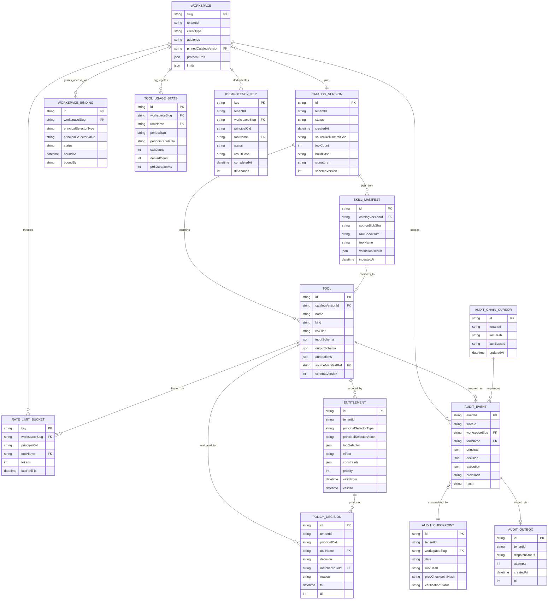

# 04 — Datová architektura

Verze 1.0 · 2026-09-17 · Stav: Návrh
Vztahuje se k: ADR-009 (Cosmos DB + Redis), ADR-010 (audit trail), ADR-011 (skill ingestion), ADR-012 (immutabilní katalog), ADR-016 (idempotence), ADR-017 (rate limiting)
Navazuje na: [`./02-architektura-reseni.md`](./02-architektura-reseni.md) (ADR kontext), [`./03-kodova-architektura.md`](./03-kodova-architektura.md) (moduly `catalog/`, `audit/`, `execution/`), doplňuje [`./06-stavova-logika-a-workflow.md`](./06-stavova-logika-a-workflow.md) (stavy, které do těchto úložišť zapisují)

---

## 1. Přehled úložišť a proč které

Gateway nepoužívá jedno univerzální úložiště — každý druh dat má jiný přístupový vzor (čtení vs. zápis, latence, konzistence) a jinou životnost. Tabulka shrnuje volbu a hlavní alternativu, kterou by tým zvažoval.

| Úložiště | Co v něm žije | Vzor přístupu | Konzistence | Latence (cíl) | Redundance | Náklady (kvalitativně) | Alternativa |
|---|---|---|---|---|---|---|---|
| **Cosmos DB for NoSQL** | Katalog nástrojů, workspacy, entitlements, policy cache, audit checkpointy, usage stats | Extrémně read-heavy (`tools/list` na každý request), zápisy nárazové (publikace) | Session (viz §4.3) | Point-read jednotky ms | Automatická replikace do všech regionů účtu | Škáluje s RU/s, u malého provozu dražší než jedna VM, ale bez provozní režie | PostgreSQL Flexible Server — plnohodnotná alternativa pro týmy se SQL provozem, ztrácí nativní change feed |
| **Azure Managed Redis** | Idempotence cache, rate-limit buckety, OBO token cache, session store éry A (**volitelný modul, vypnutý ve výchozím nastavení — oprava F1, §5.4**), JWKS cache, **audit outbox a hash-chain kurzor** (Redis Stream s AOF perzistencí — K5, §5.7; jediné datové struktury v této řádce, které NEJSOU jen krátkověká cache, ale durabilní fronta na kritické cestě zápisu auditu) | Write-heavy i read-heavy, vše krátkověké (TTL) — kromě audit outboxu, který musí přežít pád procesu | Best-effort, žádná durabilita mimo replikaci uvnitř clusteru — kromě audit outboxu, kde je AOF persistence záměrně zapnutá právě proto, aby tato výjimka platila (§5.7) | Sub-ms | OSS/Enterprise clustering, volitelně data persistence a geo-replikace [^redis-overview] | Cena za paměť, ale nahrazuje desítky RU/s, které by jinak šly do Cosmos | In-process cache bez sdíleného stavu — nefunguje napříč replikami |
| **Azure Blob Storage (WORM)** | Nezměnitelná kopie audit trailu (`audit/{yyyy}/{MM}/{dd}/{hh}.jsonl`) | Append-only zápis, sekvenční čtení při verifikaci/forenzní analýze | N/A (immutabilní po zamčení politiky) | Zápis do append blobu ms, čtení dávkové | LRS až GRS podle SLA | Nejlevnější z celé sady, cena hlavně za retenci | Log Analytics samotný — nedostačuje, protože je mazatelný správcem workspace |
| **Log Analytics (custom table, DCR)** | Dotazovatelná projekce audit trailu pro alerting a KQL | Write-heavy (ingest), read pro dashboardy/incidenty | N/A (append-only tabulka) | Ingest do minut, dotaz sekundy | Podle table plánu (Analytics/Basic/Auxiliary) [^la-plans] | Basic/Auxiliary plán násobně levnější než Analytics při vysokém objemu | Application Insights samostatně — nemá nativní custom table s DCR transformacemi |
| **Key Vault** | TLS certifikáty pro custom domény, případné OAuth client secrety, connection stringy | Read-heavy, cache s krátkou platností v procesu | Silná (per operaci) | ms | Vestavěná v rámci regionu, RBAC od API 2026-02-01 výchozí [^kv-rbac] | Nízké, cena za operaci | — (jediná rozumná volba pro tajemství na Azure) |
| **GitHub (repozitář skillů)** | Zdroj pravdy katalogu — YAML manifesty, JSON Schema, historie commitů | Read při buildu katalogu, write jen přes PR | Git historie (immutabilní commit graph) | N/A | Podle GitHub SLA, mimo Azure hranici | Součást existující licence, žádné dodatečné náklady | — (zadání explicitně žádá GitHub jako zdroj skillů) |

Cosmos DB a Redis dohromady pokrývají naprostou většinu provozního zatížení: Cosmos nese *pravdu* (i když odvozenou z Gitu, viz §2), Redis nese *rychlost* a *krátkodobý stav* — s jednou záměrnou výjimkou, kterou je audit outbox (§5.7): tam Redis nese ne krátkodobý, ale **durabilní** stav, protože K5 (`CANONICAL-DECISIONS.md`) předepisuje pro tento konkrétní zápis Redis Stream s AOF, ne Cosmos. Audit trail (finální sinky) je záměrně mimo Cosmos úplně — jde o jiný přístupový vzor (write-once, sekvenční, nikdy se needituje) a jiný požadavek na nemazatelnost, který WORM blob řeší nativně, zatímco Cosmos dokument by šlo vždy přepsat.

## 2. Zásada „Git je zdroj pravdy"

Katalog nástrojů v Cosmos DB (`catalogVersions`, `tools`, `skillManifests`) je **odvozená, plně reprodukovatelná projekce** obsahu GitHub repozitáře k danému commitu. Gateway do katalogu nikdy nezapisuje nic, co by v Gitu nemělo protějšek — jediný povolený zápis je výstup ingestoru (`apps/ingestor`, viz [`./03-kodova-architektura.md`](./03-kodova-architektura.md)) spuštěného nad konkrétním `gitSha`.

Důsledky:

- **DR**: Cosmos je možné ztratit celý (výpadek regionu, chyba migrace) a katalog se **znovu sestaví** opětovným spuštěním ingestoru nad historií chráněných větví — bez ztráty dat, protože Git sám je durabilní. RPO katalogu je tedy fakticky nulové vůči poslednímu publikovanému commitu, nezávisle na zálohovací politice Cosmos (viz §11).
- **Rollback**: `CatalogVersion` je immutabilní snapshot (ADR-012), takže rollback je vždy jen přesun ukazatele, nikdy oprava dat. Pokud by přesto Cosmos dokument obsahoval nekonzistenci vůči Gitu (bug v build kroku), oprava je **rebuild ze stejného `gitSha`**, ne ruční patch dokumentu — ruční patch by rozbil vazbu `buildHash` → obsah a odstranil by důvěryhodnost `signature` pole.
- **Compliance**: auditor, který chce ověřit „proč nástroj `crm_get_account` v daný den dělal X", může dohledat přesný commit (`sourceRef.commitSha` v `catalogVersions`) a nezávisle na Azure prostředí si obsah manifestu ověřit v Gitu — Cosmos zde slouží jen jako rychlá cache pro runtime, ne jako jediný zdroj důkazu.
- **Nikdy neplatí opačný směr**: administrátorské UI nad katalogem (pokud vznikne) nesmí umožnit editaci `tools` dokumentu přímo v Cosmos — jedině přes nový commit a nový běh ingestoru. Toto je bezpečnostní i auditní invariant, ne jen doporučení.

## 3. Logický datový model

Entity vycházejí z architektonických rozhodnutí v [`09-adr-a-zdroje.md`](./09-adr-a-zdroje.md) a jsou doplněné o pole nutná pro plný provoz (schema evolution, traceabilitu ke skillu) a o pět entit, které si datový model vyžádal navíc: `skillManifests`, `workspaceBindings`, `rateLimitBuckets`, `auditCheckpoints`, `toolUsageStats`. Nad rámec původního zadání přidává tento dokument ještě `auditOutbox` a `auditChainCursor` (§3.12–3.13) — obě jsou nutné, aby dvoustupňový zápis auditu (§6.5) měl skutečné úložiště, ne jen popis v textu. Kompletní ERD je v [`diagramy/15-datovy-model-erd.mmd`](./diagramy/15-datovy-model-erd.mmd) a vysvětlení pod ním v §3.15.

### 3.1 `catalogVersions`

| Pole | Typ | Povinné | Popis | Příklad | PII |
|---|---|---|---|---|---|
| `id` | string | ano | `{gitSha}-{buildHash}`, primární klíč | `a3f9c1e-7b2d4f1` | ne |
| `tenantId` | string | ano | partition key | `contoso` | ne |
| `status` | enum | ano | viz stavový automat v [`./06-stavova-logika-a-workflow.md#1-katalogova-verze`](./06-stavova-logika-a-workflow.md#1-katalogova-verze) | `Published` | ne |
| `createdAt` | datetime (ISO 8601) | ano | čas vzniku dokumentu | `2026-09-10T08:12:00Z` | ne |
| `sourceRef` | object `{repo, ref, commitSha}` | ano | odkaz na Git | `{repo:"org/skills", ref:"main", commitSha:"a3f9c1e..."}` | ne |
| `toolCount` | int | ano | počet nástrojů v této verzi | `47` | ne |
| `buildHash` | string | ano | hash výstupu build kroku, ne jen vstupu | `sha256:...` | ne |
| `signature` | string | ano pro `Published` | ověření commit signature dle ADR-011 | `sig:...` | ne |
| `diffSummary` | object `{added,removed,changed}` | ne | rychlý přehled změny oproti předchozí `Published` verzi | `{added:2,removed:0,changed:1}` | ne |
| `schemaVersion` | int | ano | verze schématu dokumentu, viz §10 | `1` | ne |

### 3.2 `tools`

| Pole | Typ | Povinné | Popis | Příklad | PII |
|---|---|---|---|---|---|
| `id` | string | ano | rovno `name` v rámci verze | `crm_get_account` | ne |
| `catalogVersionId` | string | ano | partition key | `a3f9c1e-7b2d4f1` | ne |
| `name` | string | ano | `{domain}_{action}_{object}`, viz [`./05-api-a-protokoly.md`](./05-api-a-protokoly.md) | `crm_get_account` | ne |
| `title` | string | ne | zobrazovaný název | `Získat účet CRM` | ne |
| `description` | string | ano | popis pro model | `Vrátí detail účtu podle ID.` | ne |
| `inputSchema` | JSON Schema | ano | validační schéma vstupu | `{type:"object",...}` | ne (může nést PII v datech runtime, ne ve schématu samotném) |
| `outputSchema` | JSON Schema | ne | schéma `structuredContent` | `{type:"object",...}` | ne |
| `annotations` | object `{readOnlyHint,destructiveHint,idempotentHint,openWorldHint}` | ano | MCP hinty | `{readOnlyHint:true}` | ne |
| `kind` | enum `skill\|connector` | ano | zdroj provedení | `connector` | ne |
| `binding` | object | ano | skill: transform ref; connector: APIM `operationId` | `{apimApiId:"crm-v1",operationId:"GetAccount"}` | ne |
| `riskTier` | enum `low\|medium\|high\|critical` | ano | vstup do policy enginu a rollout fází; mapování na role viz [`07-bezpecnost-a-autorizace.md#51-role-a-tool-sety`](./07-bezpecnost-a-autorizace.md#51-role-a-tool-sety) | `medium` | ne |
| `objectAuthorization` | object `{mode: downstream_enforced\|hard_scope_filter, filterExpression?} \| {mode: not_applicable, reason}` — přesný tvar v [`03-kodova-architektura.md §4`](./03-kodova-architektura.md), `ToolDefinition.objectAuthorization` | ano | **** třetí stupeň autorizace — kdo vynucuje právo na konkrétní záznam, ne jen na nástroj; viz [`07-bezpecnost-a-autorizace.md#57-treti-stupen-autorizace-na-urovni-objektu`](./07-bezpecnost-a-autorizace.md#57-treti-stupen-autorizace-na-urovni-objektu). Validátor manifestu odmítne `list`/`search` nástroj (nebo nástroj s `annotations.openWorldHint: true`) bez tohoto pole — `not_applicable` je povolená hodnota, ale jen s vyplněným `reason`, mlčení není | `{mode:"downstream_enforced"}` | ne |
| `sourceManifestRef` | string (FK → `skillManifests.id`) | doporučeno | lineage k surovému manifestu | `manifest:crm_get_account` | ne |
| `auditRedaction` | object `{allow: string[]}` | ne | allow-list polí bezpečných pro `argumentsRedacted` (§7) | `{allow:["accountId"]}` | ne |
| `schemaVersion` | int | ano | viz §10 | `1` | ne |

### 3.3 `skillManifests` (nová entita)

Surový manifest tak, jak přišel z Gitu, plus výsledek validace — umožňuje dohledat „proč se tento nástroj takto zkompiloval" bez nutnosti procházet celý Git repo, a dává skill autorům vlastní diagnostiku.

| Pole | Typ | Povinné | Popis | Příklad | PII |
|---|---|---|---|---|---|
| `id` | string | ano | identifikátor manifestu v rámci verze | `manifest:crm_get_account` | ne |
| `catalogVersionId` | string | ano | partition key | `a3f9c1e-7b2d4f1` | ne |
| `sourceBlobSha` | string | ano | Git blob SHA syrového YAML | `f1e2d3...` | ne |
| `rawChecksum` | string | ano | SHA-256 bajtů manifestu | `sha256:...` | ne |
| `toolName` | string | ano | výsledný název nástroje | `crm_get_account` | ne |
| `validationResult` | object `{passed, warnings[]}` | ano | výsledek `validate/` kroku | `{passed:true,warnings:[]}` | ne |
| `ingestedAt` | datetime | ano | čas zpracování | `2026-09-10T08:11:40Z` | ne |

### 3.4 `workspaces`

| Pole | Typ | Povinné | Popis | Příklad | PII |
|---|---|---|---|---|---|
| `slug` | string | ano | primární klíč, součást cesty `/mcp/{slug}` | `claude-prod` | ne |
| `tenantId` | string | ano | partition key | `contoso` | ne |
| `clientType` | enum `claude\|chatgpt\|other` | ano | typ klienta (ADR-015) | `claude` | ne |
| `audience` | string | ano | očekávaná hodnota `aud` v tokenu — **identická pro všechny workspace** (jedna app registration, jeden Application ID URI), workspace se rozlišuje cestou a app rolí, ne audience; zdůvodnění viz [`07-bezpecnost-a-autorizace.md#41-app-registration-pro-gateway-resource-server`](./07-bezpecnost-a-autorizace.md#41-app-registration-pro-gateway-resource-server) | `https://mcp.contoso.com/mcp` | ne |
| `pinnedCatalogVersion` | string (FK) | ne | `null` = sleduje globální `activePointer` | `a3f9c1e-7b2d4f1` | ne |
| `protocolEras` | array | ano | povolené éry MCP pro tento workspace | `["2026-07-28","2025-11-25"]` | ne |
| `limits` | object | ano | rate-limit defaulty, viz §5 | `{rps:5,burst:20}` | ne |

### 3.5 `workspaceBindings` (nová entita)

Hrubá vrstva ADR-007 — určuje, **zda vůbec** daný principal smí na daný workspace dosáhnout, nezávisle na tom, které konkrétní nástroje smí volat (to řeší `entitlements`). Typicky váže Entra security group (např. `MCP-Gateway-Pilot`) na `workspaceSlug`.

| Pole | Typ | Povinné | Popis | Příklad | PII |
|---|---|---|---|---|---|
| `id` | string | ano | primární klíč | `bind-001` | ne |
| `workspaceSlug` | string | ano | partition key | `claude-pilot` | ne |
| `principalSelectorType` | enum `group\|appId` | ano | typ vazby | `group` | ne |
| `principalSelectorValue` | string | ano | Entra object ID skupiny nebo app ID | `f47ac10b-...` | ano (nepřímo identifikující — OID skupiny/aplikace, ne osoby, nízké riziko) |
| `status` | enum `active\|revoked` | ano | stav vazby | `active` | ne |
| `boundAt` | datetime | ano | čas vytvoření | `2026-08-01T09:00:00Z` | ne |
| `boundBy` | string (OID) | ano | kdo vazbu vytvořil, pro čtyřoký princip | `8f3e...` | ano (nepřímo identifikující OID administrátora) |

### 3.6 `entitlements`

| Pole | Typ | Povinné | Popis | Příklad | PII |
|---|---|---|---|---|---|
| `id` | string | ano | primární klíč | `ent-042` | ne |
| `tenantId` | string | ano | partition key | `contoso` | ne |
| `principalSelector` | object `{type:appRole\|groupOid\|userOid, value}` | ano | koho pravidlo cílí — `value` je buď kanonický název app role (viz [`07-bezpecnost-a-autorizace.md#51-role-a-tool-sety`](./07-bezpecnost-a-autorizace.md#51-role-a-tool-sety)), nebo OID skupiny/uživatele | `{type:"appRole",value:"Mcp.Operator"}` | ano, pokud `type=groupOid\|userOid` nese OID |
| `toolSelector` | object `{type:exact\|prefix\|tag, pattern}` | ano | která pravidla nástrojů | `{type:"prefix",pattern:"crm_"}` | ne |
| `effect` | enum `allow\|deny` | ano | deny-by-default, `deny` má přednost | `allow` | ne |
| `constraints` | object | ne | parametrové a data-scope constrainty | `{maxAmount:10000}` | záleží na obsahu, typicky ne |
| `priority` | int | ano | explicitní tie-break při shodném skóre specificity dvou allow pravidel — algoritmus viz [`07-bezpecnost-a-autorizace.md#53-vyhodnocovaci-algoritmus`](./07-bezpecnost-a-autorizace.md#53-vyhodnocovaci-algoritmus) | `100` | ne |
| `validFrom` / `validTo` | datetime | ne | časová platnost | `2026-01-01T00:00:00Z` | ne |
| `createdBy` / `approvedBy` | string (OID) | ano | čtyřoký princip (W2) | `8f3e...` / `2b1a...` | ano (nepřímo identifikující) |

Schéma je sjednocené s vyhodnocovacím algoritmem v [`07-bezpecnost-a-autorizace.md#53-vyhodnocovaci-algoritmus`](./07-bezpecnost-a-autorizace.md#53-vyhodnocovaci-algoritmus) — `07` je pro entitlement pravidla i doménové role primárním normativním zdrojem, tento dokument jen doplňuje fyzické uložení.

### 3.7 `policyDecisions` (TTL 90 dní)

| Pole | Typ | Povinné | Popis | Příklad | PII |
|---|---|---|---|---|---|
| `id` | string | ano | primární klíč | `pd-...` | ne |
| `tenantId` | string | ano | partition key | `contoso` | ne |
| `principalOid` | string | ano | OID volajícího principal | `9c4d...` | ano (nepřímo identifikující) |
| `toolName` | string | ano | volaný nástroj | `crm_get_account` | ne |
| `decision` | enum `allow\|deny` | ano | výsledek | `allow` | ne |
| `matchedRuleId` | string (FK → `entitlements.id`) | ne | které pravidlo rozhodlo | `ent-042` | ne |
| `reason` | string | ne | lidsky čitelný důvod (hlavně u `deny`) | `no matching entitlement` | ne |
| `ts` | datetime | ano | čas rozhodnutí | `2026-09-15T10:00:00Z` | ne |
| `ttl` | int (s) | ano | Cosmos TTL, 90 dní | `7776000` | ne |

### 3.8 `idempotencyKeys` (Redis, ne Cosmos)

Podrobný formát klíče a hodnoty je v §5.1 — logicky jde o entitu se schématem `{key, tenantId, workspaceSlug, principalOid, toolName, status, resultHash, completedAt, ttlSeconds}`. Klíč nese `principalOid`, protože kontrola idempotence proběhne **až po autorizaci** (viz automat 4 v [`06-stavova-logika-a-workflow.md#4-tool-invocation`](./06-stavova-logika-a-workflow.md#4-tool-invocation)) a nesmí umožnit, aby výsledek jednoho principala přehrál jiný principal.

### 3.9 `rateLimitBuckets` (nová entita, Redis, ne Cosmos)

Formát v §5.2 — schéma `{key, workspaceSlug, principalOid, toolName, tokens, lastRefillTs}`.

### 3.10 `auditEvents` (Log Analytics + WORM blob, ne Cosmos)

Plné schéma je v §6. Zde jen shrnutí umístění v logickém modelu: entita existuje logicky (vztahuje se k `tools` a `workspaces`), fyzicky ale nikdy neleží v Cosmos — viz zásada v §1.

### 3.11 `auditCheckpoints` (nová entita)

Denní kotva hash chainu (§6.4) — malý dokument, který umožňuje rychle ověřit integritu bez čtení celého dne ze studeného WORM blobu.

| Pole | Typ | Povinné | Popis | Příklad | PII |
|---|---|---|---|---|---|
| `id` | string | ano | `{tenantId}:{date}` | `contoso:2026-09-15` | ne |
| `tenantId` | string | ano | partition key | `contoso` | ne |
| `workspaceSlug` | string | ne | vyplněno, pokud se checkpointuje per-workspace (viz §6.4) | `claude-prod` | ne |
| `date` | string (YYYY-MM-DD, UTC) | ano | den, ke kterému se checkpoint vztahuje | `2026-09-15` | ne |
| `recordCount` | int | ano | počet auditních záznamů toho dne | `18042` | ne |
| `firstEventId` / `lastEventId` | string | ano | hranice rozsahu | `evt-0001` / `evt-18042` | ne |
| `rootHash` | string | ano | SHA-256 nad rozsahem dne | `sha256:...` | ne |
| `prevCheckpointHash` | string | ano | odkaz na checkpoint předchozího dne (řetězec checkpointů) | `sha256:...` | ne |
| `verificationStatus` | enum `ok\|broken\|pending` | ano | výsledek poslední verifikace | `ok` | ne |

### 3.12 `auditOutbox` (nová entita, Redis, ne Cosmos — K5)

Krátkodobá durabilní fronta pro synchronní první krok zápisu auditu (§6.5) — záznam v `auditOutbox` existuje od okamžiku, kdy `execution/` orchestrátor sestavil a hash-chainoval `AuditEvent`, do potvrzeného doručení do obou sinků (Log Analytics, WORM blob). Zápis do této entity je synchronní vůči odpovědi klientovi; doručení z ní do sinků už ne. **Fyzicky jde o Redis Stream s AOF perzistencí, ne o Cosmos kontejner** (K5, `CANONICAL-DECISIONS.md`) — přesný formát klíče, `XADD` pole a chování lokálního fallbacku na disk repliky při výpadku Redis jsou v §5.7. Logické schéma položky streamu:

| Pole | Typ | Povinné | Popis | Příklad | PII |
|---|---|---|---|---|---|
| `eventId` | string | ano | rovno `eventId` auditního záznamu, používá se k deduplikaci na straně dispatcheru | `evt-01J8X...` | ne |
| `tenantId` | string | ano | součást klíče streamu (§5.7), ne partition key ve smyslu Cosmos | `contoso` | ne |
| `payload` | json | ano | plný kanonizovaný `AuditEvent` (§6.1) včetně `hash`/`prevHash` | `{...}` | viz redakce v §7 |
| `dispatchStatus` | enum `pending\|delivered\|failed` | ano | stav doručení do obou sinků, udržovaný dispatcherem mimo samotnou položku streamu (viz §5.7) | `pending` | ne |
| `attempts` | int | ano | počet pokusů dispatcheru | `0` | ne |
| `createdAt` | datetime | ano | čas synchronního zápisu (`XADD`) | `2026-09-15T10:22:31.410Z` | ne |

### 3.13 `auditChainCursor` (nová entita, Redis, ne Cosmos)

Drží „poslední hash" pro hash chain (§6.3) jako jednu Redis strukturu per `tenantId`, aktualizovanou atomicky (Lua skript, ne ETag optimistic concurrency — viz §5.7) při každém novém auditním zápisu. Žije ve stejné Redis instanci a záměrně vedle `auditOutbox` (§3.12, §5.7), aby krok 1 dvoustupňového modelu (§6.5) byl jeden atomický Redis příkaz, ne dvě síťové operace do dvou systémů.

| Pole | Typ | Povinné | Popis | Příklad | PII |
|---|---|---|---|---|---|
| `id` | string | ano | `{tenantId}` | `contoso` | ne |
| `tenantId` | string | ano | součást klíče (§5.7) | `contoso` | ne |
| `lastHash` | string | ano | `hash` posledního zřetězeného záznamu | `sha256:3c91...` | ne |
| `lastEventId` | string | ano | `eventId` posledního zřetězeného záznamu | `evt-01J8X...` | ne |
| `updatedAt` | datetime | ano | čas poslední aktualizace kurzoru | `2026-09-15T10:22:31.402Z` | ne |

### 3.14 `toolUsageStats` (nová entita)

Agregace pro dashboardy, bez nutnosti dotazovat Log Analytics při každém načtení admin UI.

| Pole | Typ | Povinné | Popis | Příklad | PII |
|---|---|---|---|---|---|
| `id` | string | ano | `{workspaceSlug}:{toolName}:{periodStart}` | `claude-prod:crm_get_account:2026-09-15T10` | ne |
| `workspaceSlug` | string | ano | partition key | `claude-prod` | ne |
| `toolName` | string | ano | agregovaný nástroj | `crm_get_account` | ne |
| `periodStart` | string (ISO 8601) | ano | začátek periody | `2026-09-15T10:00:00Z` | ne |
| `periodGranularity` | enum `hour\|day` | ano | granularita | `hour` | ne |
| `callCount` | int | ano | celkový počet volání | `812` | ne |
| `successCount` / `toolErrorCount` / `deniedCount` / `timeoutCount` | int | ano | rozpad podle výsledku | `790 / 12 / 8 / 2` | ne |
| `avgDurationMs` / `p95DurationMs` | int | ano | latence | `120 / 480` | ne |
| `catalogVersionId` | string | ne | verze aktivní v období (pro korelaci s incidenty) | `a3f9c1e-7b2d4f1` | ne |

### 3.15 Co ERD říká



Diagram [`diagramy/15-datovy-model-erd.mmd`](./diagramy/15-datovy-model-erd.mmd) ukazuje dvě centrální entity — `CATALOG_VERSION` a `WORKSPACE` — ze kterých vychází většina vztahů. `CATALOG_VERSION` je zdrojem pravdy pro obsah (`TOOL`, `SKILL_MANIFEST`), `WORKSPACE` je zdrojem pravdy pro přístup a provozní stav (`WORKSPACE_BINDING`, `RATE_LIMIT_BUCKET`, `IDEMPOTENCY_KEY`, agregace v `TOOL_USAGE_STATS`). Vztah `WORKSPACE }o--|| CATALOG_VERSION : pins` je jediný, kde šipka vede „proti proudu" dat — workspace si vybírá verzi, nikoli naopak, což fyzicky odpovídá `pinnedCatalogVersion` jako poli na `WORKSPACE`, ne obráceně. `AUDIT_EVENT` je jediná entita, která se váže na obě strany (`TOOL` i `WORKSPACE`) — a spolu s `AUDIT_OUTBOX` a `AUDIT_CHAIN_CURSOR` jsou to **tři** entity v tomto ERD, jejichž fyzické úložiště leží mimo Cosmos (`AUDIT_EVENT` v Log Analytics + WORM blobu; `AUDIT_OUTBOX`/`AUDIT_CHAIN_CURSOR` v Redis, K5) — diagram to nerozlišuje (ERD je logický model, kreslí jen vztahy mezi entitami bez ohledu na fyzické úložiště), ale §1, §3.12–3.13 a §5.7 to činí explicitním. Dvojice `AUDIT_OUTBOX` a `AUDIT_CHAIN_CURSOR` zachycuje dvoufázový audit pattern popsaný v §6.3–§6.5: `AUDIT_EVENT ||--o| AUDIT_OUTBOX : staged_via` je vztah nula-nebo-jedna, protože záznam v outboxu existuje jen krátce mezi synchronním zápisem a úspěšným doručením do obou sinků (trimování/expirace viz §5.7), zatímco `AUDIT_CHAIN_CURSOR ||--o{ AUDIT_EVENT : sequences` reprezentuje ukazatel na poslední `hash` v hash chainu per tenant — nikoli obsahový vztah, ale pořadový, který dispatcher používá k výpočtu `prevHash` dalšího záznamu bez nutnosti číst celou historii.

⚠️ **Poznámka k rozsahu tohoto průchodu:** entita `writeAttempts` níže (§3.16) vznikla až po vykreslení `diagramy/15-datovy-model-erd.mmd` a **není** v tomto diagramu zachycena — diagram vlastní jiná část návrhu a nebyl v rámci tohoto zásahu upravován. Vztah, který by tam chyběl, je `WRITE_ATTEMPT ||--o| AUDIT_EVENT : evidences` a `TOOL ||--o{ WRITE_ATTEMPT : attempted_as` — doplnit při příští revizi diagramu.

### 3.16 `writeAttempts` (nová entita, D1 — trvalý záznam zápisového pokusu)

Řeší mezeru popsanou v [`./06-stavova-logika-a-workflow.md#4-tool-invocation`](./06-stavova-logika-a-workflow.md#4-tool-invocation) (stavy `UnknownOutcome`/`Reconciled`/`ReconcileFailed`/`ManualReview`): dokud downstream write teprve odesíláme, nemáme kam zapsat důkaz, že se o něj gateway vůbec pokusila. Záznam vzniká **před** voláním downstream (na přechodu `ConfirmChecked → DownstreamCalling` automatu 4), ne až po jeho selhání.

| Pole | Typ | Povinné | Popis | Příklad | PII |
|---|---|---|---|---|---|
| `id` | string | ano | rovno `attemptId` (ULID — monotónně řaditelné, vhodné jako primární klíč pro point-read i pro chronologické dotazy fronty `manualReview`) | `wa-01J8XN...` | ne |
| `tenantId` | string | ano | partition key | `contoso` | ne |
| `attemptId` | string | ano | duplicitně i jako vlastní pole (ne jen `id`) — používá se jako korelační hodnota v auditu a v `_meta` tool error odpovědi, kde `id` jako název pole je matoucí | `wa-01J8XN...` | ne |
| `idempotencyKey` | string | ano | vazba na `idempotencyKeys` (Redis, §5.1) — umožňuje dohledat pokus i opačným směrem | `idem-a1b2...` | ne |
| `principalOid` | string | ano | kdo volání provedl | `9c4d1a2b-...` | ano (nepřímo identifikující) |
| `toolName` | string | ano | volaný nástroj | `crm_create_note` | ne |
| `catalogVersionId` | string | ano | verze katalogu platná v okamžiku volání — nutné pro zpětnou rekonstrukci, které `binding`/`riskTier`/`objectAuthorization` pravidlo platilo | `a3f9c1e-7b2d4f1` | ne |
| `downstreamOperation` | object `{apimApiId, operationId, supportsIdempotencyKey, lookupOperationId?, reconciliationSupported}` | ano | co přesně bylo voláno a jak se to dá dohledat — viz §12 | `{apimApiId:"crm-v1",operationId:"CreateNote",reconciliationSupported:true,lookupOperationId:"GetNoteByCorrelationId"}` | ne |
| `downstreamIdempotencyKey` | string | ano | klíč poslaný downstreamu (odvozený z `idempotencyKey`, ne totožný — viz §12) — musí existovat už v tomto zápisu, ne až se generovat při případném retry | `dik-a1b2...` | ne |
| `requestHash` | string | ano | SHA-256 nad kanonizovaným tělem požadavku poslaného downstreamu — pro rekonciliaci i pro odhalení, že by „opakování" ve skutečnosti poslalo jiná data | `sha256:...` | ne |
| `state` | enum `dispatching\|succeeded\|failed\|unknownOutcome\|reconciling\|reconciledSucceeded\|reconciledFailed\|manualReview` | ano | odpovídá stavům automatu 4 v `06` | `unknownOutcome` | ne |
| `evidence` | object (volné JSON) | ne, povinné při přechodu do `reconciledSucceeded`/`reconciledFailed`/vyřešení `manualReview` | důkaz použitý k rozhodnutí — odpověď lookupu, `downstreamRequestId`, nebo poznámka operátora s jeho `oid` a časem | `{lookupHttpStatus:200,downstreamRecordId:"NOTE-88213"}` | záleží na obsahu, typicky ne |
| `createdAt` | datetime | ano | čas zápisu, PŘED voláním downstream | `2026-09-15T10:22:31.100Z` | ne |
| `dispatchedAt` | datetime | ne | čas, kdy request skutečně odešel na síť (odlišné od `createdAt` o čas, který zabraly kroky 12–16 pipeline před ním) | `2026-09-15T10:22:31.140Z` | ne |
| `resolvedAt` | datetime | ne | čas, kdy `state` dosáhl terminální hodnoty (`succeeded`/`failed`/`reconciledSucceeded`/`reconciledFailed`) nebo byl ručně uzavřen z `manualReview` | `2026-09-15T10:22:31.980Z` | ne |
| `resolvedBy` | string (OID nebo `system`) | ne | kdo/co vyřešilo — `system` pro automatickou rekonciliaci, OID operátora pro `manualReview` | `system` | ano (jen když je to lidský OID) |
| `schemaVersion` | int | ano | viz §10 | `1` | ne |

**Úložiště: Cosmos DB, kontejner `writeAttempts`, partition key `/tenantId`.** Zdůvodnění partition key je stejné jako u `policyDecisions` — rekonciliační worker (§12) potřebuje efektivně dotazovat „všechny otevřené pokusy tenanta", objem je nízký (jde jen o podmnožinu zápisových volání, která skutečně skončila nejistě — v běžném provozu řádově jednotky až desítky denně, ne tisíce), takže riziko horké partition je zanedbatelné.

**Proč to nemůže žít jen v Redisu.** Idempotency cache (§5.1) má úmyslně krátké TTL (90 s `pending`, 24 h `completed`) navržené pro deduplikaci téměř souběžných requestů — ne pro udržení jediného důkazu o nejistém zápisu po dobu, kterou může trvat rekonciliace (minuty) nebo ruční šetření (dny). Navíc je Redis podle §1 této tabulky **best-effort, bez durability mimo replikaci uvnitř clusteru** — failover nebo restart clusteru by mohl ztratit přesně ten jediný záznam, který dokazuje, že se o zápis vůbec gateway pokusila, což by byl protimluv k celému smyslu mechanismu (vytvořit místo k dohledání nejistoty, ne další nejisté místo). Cosmos dává: (a) durabilitu s multi-region replikací, (b) change feed, na kterém rekonciliační worker reaktivně sedí místo dražšího pollingu, (c) TTL vypnuté, dokud záznam není `resolvedAt` (viz §4.4), takže žádný časovač neuklidí nevyřešený případ jen proto, že uplynula hodina.

**TTL a retence:** viz §4.4. Žádný TTL, dokud `resolvedAt` není vyplněno — nevyřešený `writeAttempts` záznam se **nikdy** automaticky nemaže, bez ohledu na to, jak dlouho čeká v `manualReview`.

### 3.17 `runtimeBlocks` (nová entita, D2 — nouzové zablokování s okamžitým účinkem)

Úložiště pro mechanismus popsaný v [`./07-bezpecnost-a-autorizace.md#56-runtimeblock-nouzove-zablokovani-s-okamzitym-ucinkem`](./07-bezpecnost-a-autorizace.md#56-runtimeblock-nouzove-zablokovani-s-okamzitym-ucinkem) — na rozdíl od `entitlements` (jemná vrstva, cache TTL až 5 min, viz §9) musí být blokace čtena **bez staleness**, protože existuje přesně pro případ, kdy 5 minut je moc dlouho.

| Pole | Typ | Povinné | Popis | Příklad | PII |
|---|---|---|---|---|---|
| `id` | string | ano | primární klíč | `rtb-042` | ne |
| `tenantId` | string | ano | partition key | `contoso` | ne |
| `scope` | enum `principal\|tool\|workspace\|global` | ano | na co blokace cílí | `principal` | ne |
| `scopeValue` | string | jen pro `principal`/`tool`/`workspace` | `principalOid`, `toolName` nebo `workspaceSlug`; `null` pro `global` | `9c4d1a2b-...` | ano, jen když `scope:"principal"` |
| `reason` | string | ano | lidsky čitelný důvod, povinný — nikdy tichá blokace | `Podezření na kompromitaci účtu, incident INC-2026-114` | ne |
| `status` | enum `active\|revoked\|expired` | ano | stav záznamu | `active` | ne |
| `expiresAt` | datetime | ne | `null` = bez automatického vypršení, platí do explicitního zrušení | `2026-09-16T10:00:00Z` | ne |
| `createdBy` | string (OID) | ano | kdo blokaci vytvořil (viz §8 dok. 07 — kdo k tomu má právo) | `2b1a...` | ano |
| `createdAt` | datetime | ano | — | `2026-09-15T14:03:00Z` | ne |
| `revokedBy` | string (OID) | ne | kdo zrušil | `2b1a...` | ano |
| `revokedAt` | datetime | ne | — | `2026-09-15T18:40:00Z` | ne |
| `schemaVersion` | int | ano | viz §10 | `1` | ne |

**Úložiště a čtecí cesta — proč „TTL 0" neznamená „žádné úložiště".** Autoritativní záznam žije v Cosmos (kontejner `runtimeBlocks`, partition `/tenantId`) — durabilní, s change feedem. Na hot path (krok 12 kanonické pipeline, první podkrok autorizace, viz `07` §5.6) se ale **nečeká na Cosmos point-read při každém requestu** — místo toho gateway udržuje pracovní sadu v Redis (`rtb:principal:{oid}`, `rtb:tool:{toolName}`, `rtb:workspace:{workspaceSlug}`, `rtb:global`, jednoduché markery s `id`/`reason`), kterou **synchronně** aktualizuje při každém zápisu/zrušení blokace (zápis do Cosmos i Redis proběhne dřív, než admin akce vrátí úspěch). „TTL 0 / bez cache" tedy znamená: Redis hodnota se nikdy nepovažuje za platnou déle, než je aktuální — na rozdíl od entitlements cache tu neexistuje žádné okno, po které se čeká na vypršení. Pokud Redis neodpoví nebo klíč neexistuje a gateway si nemůže být jistá, že to znamená „opravdu žádná blokace" (ne „Redis je nedostupný"), padá zpět na přímý Cosmos point-read (pořád bez cachování výsledku); pokud selže i to, kontrola je **fail-closed** — volání se odmítne (viz `07` §5.6). Nová/škálovaná replika i čerstvě restartovaný Redis cluster se při startu naplní z Cosmos (seed), takže výpadek/restart Redis nikdy tiše neztratí aktivní blokaci.

**TTL v Cosmos:** žádné, dokud `status: active` — blokace se nikdy nesmí ztratit časovačem. Po `revoked`/`expired` retence 400 dní pro forenzní účely (⚠️ TODO potvrdit s bezpečnostním týmem), pak GC.

## 4. Fyzický model v Cosmos DB

### 4.1 Kontejnery a partition keys

| Kontejner | Partition key | Odůvodnění |
|---|---|---|
| `catalogVersions` | `/tenantId` | Nízká kardinalita (jednotky až desítky tenantů), ale objem dat na tenanta je malý (jednotky KB na verzi × desítky verzí) — hluboko pod 20GB limitem logické partition [^cosmos-partitioning]. Čtení je vždy „aktivní verze pro tenanta", takže point-read/malý query v rámci jedné partition. |
| `tools` | `/catalogVersionId` | Každá verze je immutabilní a čte se vždy celá najednou (`tools/list`) — partition podle verze dává dokonalou lokalitu pro dominantní dotaz a zároveň **přirozeně rozkládá zápisy** mezi verzemi v čase (nová verze = nová partition, žádná horká partition při publikaci). Riziko: workspace s tisíci nástroji v jedné verzi by se blížil limitu 20GB/oddíl — při stovkách nástrojů (řádu KB každý) je to řádově bezpečné. |
| `skillManifests` | `/catalogVersionId` | Stejná úvaha jako `tools` — životní cyklus 1:1 s verzí, čte se společně při ladění buildu. |
| `workspaces` | `/tenantId` | Málo dokumentů (jednotky až desítky workspaců na tenanta), čtení je vždy „najdi workspace podle slugu v rámci tenanta" — bezpečné proti hot partition, protože zápisy jsou vzácné (jen při W6 onboardingu). |
| `workspaceBindings` | `/workspaceSlug` | Dotaz „jaké skupiny mají přístup k tomuto workspace" je point-partition query; zápisy jsou vzácné (změna oprávnění), takže riziko horké partition je zanedbatelné i při desítkách vazeb na workspace. |
| `entitlements` | `/tenantId` | Policy engine načítá **celou množinu** entitlements pro tenanta do cache (§8) při startu/invalidaci, ne po jednotlivých položkách — partition podle tenanta odpovídá tomuto přístupovému vzoru. Riziko horké partition při čtení je nízké, protože se čte z Redis cache, ne přímo z Cosmos na každý request. |
| `policyDecisions` | `/tenantId` | Write-heavy (jeden zápis na `tools/call`), TTL 90 dní. **Vědomé riziko horké partition** při vysokém provozu jednoho tenanta — zmírněno tím, že se jedná o `create` operace s náhodným `id` (rovnoměrné rozložení v rámci logické partition) a tenant je jediná rozumná dimenze pro forenzní dotazy („všechna rozhodnutí tenanta za posledních 90 dní"). Při násobně vyšším provozu, než je návrhový předpoklad v §4.3, je prvním kandidátem na syntetický klíč (`tenantId + den`). |
| `auditCheckpoints` | `/tenantId` | Jeden zápis denně na tenanta (nebo na workspace) — objem i frekvence zápisů jsou triviální, partition podle tenanta odpovídá dotazu „ověř integritu auditního řetězu tenanta". |
| `toolUsageStats` | `/workspaceSlug` | Dashboard vždy dotazuje „statistiky pro tento workspace za období" — zápisy jsou dávkové (rollup job, ne per-call), takže hot partition riziko prakticky neexistuje i přes částečně nízkou kardinalitu partition hodnoty. |
| `writeAttempts` **** | `/tenantId` | Zápis na každé volání zapisovacího nástroje PŘED voláním downstream, čtení rekonciliačním workerem (dotaz „otevřené pokusy tenanta") a frontou `manualReview`. Objem je nízký (jen podmnožina zápisů, která skončí nejistě), takže riziko horké partition je zanedbatelné — viz §3.16. |
| `runtimeBlocks` **** | `/tenantId` | Málo dokumentů, zápisy vzácné (jen admin akce), ale čtení je latenčně kritické (hot path, krok 12) — v praxi se čte přes Redis pracovní sadu seedovanou z tohoto kontejneru, ne přímým point-readem na každý request; viz §3.17. |

Žádný kontejner nepoužívá `/id` jako partition key ani jinou nízko-kardinalitní volbu bez vztahu k dotazovacímu vzoru — to jsou dva zdokumentované anti-patterny [^cosmos-partitioning-antipatterns]; volby výše cíleně kopírují dominantní dotaz každého kontejneru.

**V tabulce záměrně nejsou `auditOutbox` a `auditChainCursor`** — přestože jsou to entity tohoto datového modelu (§3.12–3.13), fyzicky nežijí v Cosmos, ale v Redis (K5, `CANONICAL-DECISIONS.md`); jejich klíčový formát je v §5.7, ne v této tabulce.

### 4.2 Indexovací politika

Výchozí Cosmos politika indexuje každou cestu (`/*`), což u `tools` a `skillManifests` zbytečně prodražuje zápis — `inputSchema`, `outputSchema` a `validationResult` jsou velké JSON stromy, které se nikdy nefiltrují, jen se celé načtou. Doporučená politika pro `tools`:

```json
{
  "indexingMode": "consistent",
  "includedPaths": [{ "path": "/*" }],
  "excludedPaths": [
    { "path": "/_etag/?" },
    { "path": "/inputSchema/*" },
    { "path": "/outputSchema/*" },
    { "path": "/annotations/*" }
  ],
  "compositeIndexes": [
    [{ "path": "/catalogVersionId", "order": "ascending" }, { "path": "/name", "order": "ascending" }]
  ]
}
```

Kompozitní index na `(catalogVersionId, name)` podporuje stabilní řazení v `tools/list` — MCP spec 2026-07-28 dává deterministické řazení jako doporučení právě kvůli prompt-cache hit rate na straně klienta [^mcp-pagination]; bez tohoto indexu by Cosmos musel řadit za běhu na každý dotaz. Analogicky se u `policyDecisions` vylučuje `/reason` (volný text, nikdy se nefiltruje) a u `auditCheckpoints` se indexuje jen `date`, zbytek je čistě pro čtení celého dokumentu.

### 4.3 Konzistence per operaci a odhad RU/s

Účet běží na **Session** konzistenci jako defaultu (ADR-009). Relaxovanější úrovně (session/consistent-prefix/eventual) dávají až 2× vyšší read throughput než strong/bounded-staleness [^cosmos-ru-multiregion], a Session je pro tento provoz dostatečná: ingestor po zápisu `activePointer` čte vlastním session tokenem (garantované „read-your-own-write"), zatímco ostatní repliky se spoléhají na cache + change feed (§8), ne na okamžitou globální strong konzistenci. `policyDecisions` jako čistě forenzní zápis může běžet na **Eventual** — nikdo jej nečte synchronně v request cestě.

**Vstupní předpoklady (návrh, k ověření s byznysem)**: 3 000 zaměstnanců, 15 % denně aktivních uživatelů MCP (450), průměrně 40 `tools/call` na uživatele a den → **18 000 tool calls/den**. Provoz není rovnoměrný — předpoklad 20 % denního objemu v nejvytíženější hodině → cca 3 600 volání/hod, s krátkodobými špičkami do 5× průměru (~5 volání/s špička).

| Operace | RU/operaci [^cosmos-ru-costs] | Frekvence (denní, návrh) | RU/s (průměr) | RU/s (špička, 5×) |
|---|---|---|---|---|
| `policyDecisions` create (1KB, <5 indexovaných polí) | 5 RU | 18 000 | ~1,0 | ~5,2 |
| `tools` point-read (cache miss, ~1KB/nástroj) | 1 RU | odhad 500 (jen cold start replik / miss) | ~0,03 | zanedbatelné |
| `catalogVersions` query (nová verze, cache warm-up) | ~10 RU (query, ≤100 výsledků) | jednotky týdně | ~0,001 | zanedbatelné |
| `entitlements` plné načtení do cache (query) | ~10–30 RU podle počtu pravidel | při invalidaci cache, řádově desítky/den | ~0,02 | ~0,1 |
| `toolUsageStats` upsert (rollup job, dávkově) | 10 RU (update) | 24× denně × počet aktivních nástrojů (~50) | ~0,01 | n/a (dávka mimo špičku) |
| `auditCheckpoints` create | 5 RU | 1–2/den | zanedbatelné | zanedbatelné |

Dominantní spotřebitel RU je jednoznačně `policyDecisions` (write na každé volání nástroje). Doporučené počáteční provisioned throughput: **400 RU/s** na kontejner `policyDecisions` (autoscale, min 100/max 1000) jako bezpečný násobek špičkového odhadu 5,2 RU/s, ostatní kontejnery na sdíleném databázovém throughput (400 RU/s na úrovni databáze stačí s velkou rezervou). Tyto hodnoty jsou **návrh k ladění** — reálné RU je nutné změřit přes `find-request-unit-charge` [^cosmos-ru-costs] po nasazení PoC, ne odhadovat natrvalo.

⚠️ TODO — vstupní předpoklady (počet uživatelů, tool calls/den) potvrdit s byznysem; odhad výše je návrh pro řádový rozměr provisioningu, ne závazné číslo.

### 4.4 TTL

`policyDecisions`: 90 dní (viz retenční tabulka níže). `auditOutbox` a `auditChainCursor` **nemají Cosmos TTL, protože nejsou v Cosmos** — jejich expirační/trimovací mechanismus je Redis-nativní a je popsaný v §5.7 (stream trimming, ne dokumentové TTL). `auditCheckpoints`, `catalogVersions`, `tools`, `skillManifests`, `workspaces`, `workspaceBindings`, `entitlements`, `toolUsageStats`: bez TTL — jsou to buď immutabilní záznamy vázané na Git historii, nebo konfigurace, jejíž životnost řídí administrativní akce, ne čas. **`writeAttempts`**: bez TTL, dokud `resolvedAt` není vyplněno — nevyřešený zápisový pokus se nesmí ztratit časovačem; po vyřešení návrh 400 dní retence pro forenzní účely, pak GC (⚠️ TODO potvrdit s compliance, sladit s retencí auditu §8). **`runtimeBlocks`**: bez TTL, dokud `status: active`; po `revoked`/`expired` návrh 400 dní. Volitelná budoucí vylepšení: TTL na `tools`/`skillManifests` dokumentech ve stavu `Archived` po uplynutí rollback okna (návrh: 90 dní od `Archived`) jako GC mechanismus — ponecháno jako `⚠️ TODO` designové rozhodnutí, protože katalog je stejně rekonstruovatelný z Gitu (§2), takže smazání staré `Archived` verze z Cosmos neztrácí data, jen zpomalí případný re-rollback (musel by projít znovu buildem).

## 5. Redis datové struktury

Všechny klíče níže žijí ve stejné Azure Managed Redis instanci (ADR-009), typicky s **OSS clustering policy** pro nejlepší škálování [^redis-clustering]. Formát klíče vždy nese `workspaceSlug`, aby šlo snadno mazat/sledovat data per workspace při W6 offboardingu.

### 5.1 Idempotency cache (ADR-016)

- **Klíč**: `idem:{tenantId}:{workspaceSlug}:{principalOid}:{toolName}:{idempotencyKey}` — klíč **musí** nést `principalOid`, ne jen `workspaceSlug`, jinak by uložený výsledek mohl přehrát jiný principál než ten, který volání skutečně provedl.
- **Typ**: HASH — `{status: pending|completed|unknownOutcome, resultHash, httpStatus, completedAt, writeAttemptId}`. **** Hodnota `unknownOutcome` je nová — zapisuje se místo prostého vypršení `pending` klíče, když `tools/call` skončí v automatu 4 stavem `UnknownOutcome` (viz [`./06-stavova-logika-a-workflow.md#4-tool-invocation`](./06-stavova-logika-a-workflow.md#4-tool-invocation)); pole `writeAttemptId` odkazuje na trvalý záznam v `writeAttempts` (§3.16), takže replay požadavku najde nejen „stav je nejistý", ale i kam se podívat pro detail.
- **Zápis**: `SET NX` ekvivalent (claim) s **krátkým TTL 90 s** ve stavu `pending` — chrání proti trvale zaseknutému zámku, pokud proces spadne uprostřed volání (viz [`./06-stavova-logika-a-workflow.md#4-tool-invocation`](./06-stavova-logika-a-workflow.md#4-tool-invocation)). Po dokončení se stejný klíč přepíše na `status: completed` a TTL se prodlouží na **24 h** (dáno ADR-016). **** Pokud namísto dokončení nastane `UnknownOutcome`, klíč se přepíše na `status: unknownOutcome` s TTL prodlouženým na dobu rekonciliace (návrh 24 h, prodlužováno, dokud `writeAttempts.state` není terminální) — tak replay se stejným `Idempotency-Key` v tomto okně nedostane `pending`/vypršelý klíč (a tedy šanci provést druhý, nekontrolovaný pokus), ale jasně řízenou odpověď „rekonciliace probíhá" (automat 4, stav `UnknownOutcomePending`). Jakmile rekonciliace záznam vyřeší (`Reconciled`/`ManualReview` vyústí ve finální stav ve `writeAttempts`), klíč se přepíše na `completed` nebo se uvolní pro nový pokus podle výsledku.
- **Bezpečnostní invariant**: tato cache se čte **až po** úspěšném autorizačním rozhodnutí (nikdy před ním — viz kanonické pořadí kroků v automatu 4, [`./06-stavova-logika-a-workflow.md#4-tool-invocation`](./06-stavova-logika-a-workflow.md#4-tool-invocation)), a autorizace se vyhodnocuje **znovu při každém přehrání** požadavku se stejným `Idempotency-Key` — zrušené oprávnění se tak projeví okamžitě, ne až po vypršení 24h TTL cache výsledku.
- **Výpadek Redis**: idempotence nelze zaručit → pro nástroje **bez** `readOnlyHint: true` (tedy přesně ty, pro které se idempotence kontroluje vůbec — jednotná podmínka s krokem 14 kanonické pipeline a diagramem 13, oprava S11) gateway **fail-closed** (vrací tool error „idempotency store unavailable"), pro čistě `readOnlyHint: true` nástroje **fail-open** (provede se, jen se zaloguje degradace) — množina nástrojů, kterých se degradace týká, je tak shodná s množinou, pro kterou se idempotence za normálního provozu vůbec vyhodnocuje.

### 5.2 Rate limit token bucket (ADR-017)

- **Klíč**: `rl:{workspaceSlug}:{principalOid}:{toolName}`
- **Typ**: HASH — `{tokens, lastRefillTs}`, aktualizace přes Lua skript (atomický refill + spotřeba v jedné operaci, aby souběžné requesty nezpůsobily race na počítadle)
- **TTL**: 2× refill window (typicky návrh 120 s při refill window 60 s) — nečinné buckety samy zaniknou, žádný úklidový job není potřeba
- **Výpadek Redis — degradace fail-closed na přísnější limit** (rozhodnuto, uzavírá dříve otevřený rozpor mezi tímto dokumentem a [`08-provoz-observabilita-rollout.md §7.1`](./08-provoz-observabilita-rollout.md#71-skalovani-a-kapacita)): gateway přepne na **per-replika in-memory limiter s kvótou `globalLimit / maxReplicas`**, nikoli s plnou globální kvótou. Součet napříč všemi replikami tak v nejhorším případě dosáhne původního globálního limitu a nikdy ho nepřekročí; při běhu na méně než `maxReplicas` replikách je fallback naopak přísnější než normální provoz, což je záměr — ztráta sdíleného počítadla se řeší na stranu opatrnosti, ne benevolence.
  - Parametr `maxReplicas` je tentýž, jaký je nastavený v KEDA scale rule (viz tabulka návrhových parametrů v [`08` §7.2](./08-provoz-observabilita-rollout.md#72-souhrnna-tabulka-navrhovych-parametru)); konfigurace se čte ze stejného zdroje, aby se hodnoty nemohly rozejít.
  - Vysílá se metrika `degraded_rate_limiting` a spouští alert; degradace není tichá.
  - APIM downstream `quota-by-key` (ADR-017, třetí vrstva) zůstává tvrdým backstopem nezávisle na Redis — fallback je tedy druhá, ne poslední obrana.
  - **Vědomý důsledek:** při výpadku Redis mohou uživatelé narazit na limit dřív, než by odpovídalo jejich nominální kvótě. To je přijato jako správná volba: nadlimitní průchod na downstream produkční systémy je dražší třída incidentu než dočasně přísnější rate limit. Chování je konfigurovatelné parametrem `rateLimitFallbackMode` (`strict` = výchozí, `perReplicaFull` = původní benevolentní varianta) pro případ, že by se v provozu ukázalo jako příliš omezující.

### 5.3 OBO token cache (ADR-008)

- **Klíč**: `obo:{tenantId}:{principalOid}:{downstreamAudience}`
- **Typ**: HASH — `{accessTokenEncrypted, expiresOn, acquiredAt}`. Token je **šifrovaný před uložením** (klíč z Key Vault) — Redis data persistence (RDB/AOF), pokud je zapnutá, by jinak ukládala platný token na disk v čitelné podobě.
- **TTL**: `expiresOn - now - 120s` (proaktivní refresh před vypršením)
- **Výpadek Redis**: každé volání si vyžádá čerstvý OBO token přímo od Entra — funkční, ale zvyšuje latenci a riziko throttlingu na token endpointu při vysokém provozu; toto je jediná degradace v tomto seznamu, která přímo zatěžuje externí závislost (Entra), ne jen samotnou gateway.

### 5.4 Session store éry A — volitelný modul

**Toto úložiště je aktivní jen tehdy, když je pro daný workspace/tenant zapnuto `protocol.eraA.sessionMode: "stateful"` v konfiguraci gateway (viz [`./03-kodova-architektura.md#91-typovaná-validovaná-při-startu`](./03-kodova-architektura.md#91-typovaná-validovaná-při-startu)).** Specifikace `2025-11-25` u `Mcp-Session-Id` používá `MAY`, ne `MUST` — server éry A smí běžet plně bezstavově a session ID vůbec nevydávat, a zůstává přitom spec-konformní. Dřívější tvrzení tohoto návrhu, že session store je architektonická nutnost éry A, bylo nesprávné; opraveno zde a v [`./06-stavova-logika-a-workflow.md#21-oprava-f1-bezstavova-varianta-ery-a-je-spec-konformni-ne-provizorium`](./06-stavova-logika-a-workflow.md#21-oprava-f1-bezstavova-varianta-ery-a-je-spec-konformni-ne-provizorium).

**Výchozí hodnota nasazení: `stateless` (tento modul vypnutý).** Zjednodušuje provoz o jednu komponentu v kritické cestě méně a zjednodušuje DR — výpadek Redis se éry A vůbec netýká, protože žádný stav éry A v Redis neexistuje. Zapnout `stateful` (a tedy tento modul) až tehdy, kdy konkrétní připojený klient prokazatelně vyžaduje jednu z níže popsaných schopností — ne preventivně.

**Co se ztratí vypnutím (tj. co `stateless` režim nemá oproti `stateful`):**

| Schopnost | `stateful` (modul zapnutý) | `stateless` (výchozí) |
|---|---|---|
| Resumability po výpadku spojení (`Last-Event-ID` replay) | Ano — klient se vrátí do rozdělaného streamu bez ztráty výsledku | Ne — klient musí `initialize` znovu a `tools/call` zopakovat od začátku (bezpečnost opakování řeší idempotence, §5.1, ne tato vrstva) |
| Server-iniciované notifikace mezi requesty (GET SSE stream mimo odpověď na konkrétní request) | Ano | Ne — streamovaná odpověď v rámci **jednoho** `tools/call` funguje beze změny nezávisle na tomto nastavení, jen nejde nic poslat klientovi mimo aktivní request/response pár |
| Korelace více requestů do jedné logické relace (`Mcp-Session-Id`) | Ano | Ne — každý POST je nezávislý, korelace jde jen přes `traceId`/`requestId` (`telemetry/`), ne přes session |

Když je modul zapnutý:

- **Klíč**: `sess:{sessionId}` — HASH `{workspaceSlug, principalOid, catalogVersionId, protocolVersion, createdAt, lastSeenAt}`, TTL = idle timeout (kanonicky **600 s**, viz [`./06-stavova-logika-a-workflow.md#2-mcp-spojeni-ery-a`](./06-stavova-logika-a-workflow.md#2-mcp-spojeni-ery-a)), obnovováno při každé aktivitě.
- **Klíč**: `sess:{sessionId}:events` — Redis **Stream** (`XADD... MAXLEN ~ N`), buffer pro `Last-Event-ID` replay, capped na návrh 200 událostí, TTL sladěné s oknem resumability (návrh 300 s).
- **Výpadek Redis**: **veškerý stav éry A je pryč** — probíhající session nelze obnovit, klienti musí provést nový `initialize` handshake. Éra B (bezstavová) tímto výpadkem **není nijak dotčena** — to je přímý provozní benefit dual-era návrhu (ADR-001): kritický downstream výpadek nezastaví moderní klienty. Ve `stateless` režimu (výchozí) tento bod odpadá úplně, protože modul se vůbec nepoužívá — výpadek Redis se éry A netýká stejně jako éry B.

### 5.5 JWKS cache

- **Klíč**: `jwks:{tenantId}` — STRING, syrový JWKS JSON z Entra
- **TTL**: `min(Cache-Control max-age z Entra odpovědi, stropová hodnota)` — přesná výchozí hodnota Entra `max-age` hlavičky ⚠️ TODO — neověřeno v rešerši, návrh stropu 24 h s pozadím-refreshem před expirací a „stale-if-error" fallbackem
- **Výpadek Redis**: fallback na přímý fetch z Entra JWKS endpointu při každé validaci tokenu (vyšší latence, riziko throttlingu) + sekundární **in-memory cache per proces** jako druhá vrstva obrany — viz §8.

### 5.6 Degradační chování při výpadku Entra ID

Entra ID je jediná závislost, kterou gateway nemůže žádným lokálním mechanismem plně obejít — je to Authorization Server pro celý OAuth model (ADR-005). Výpadek Entra ale **nedopadá na všechny funkce gateway stejně a ve stejný okamžik** — dopad se liší podle toho, co konkrétně Entra v danou chvíli poskytuje:

| Funkce závislá na Entra | Chování během výpadku Entra | Kdy selže |
|---|---|---|
| **Validace už vydaného access tokenu** (ověření podpisu proti JWKS) | **Pokračuje normálně**, pokud je odpovídající `kid` už v JWKS cache (§5.5) — validace je čistě lokální (JWT je self-contained, ověřuje se proti cachovanému veřejnému klíči, ne voláním Entra). „Stale-if-error" fallback znamená, že gateway **použije i JWKS starší než běžné TTL**, pokud čerstvý fetch selhává kvůli výpadku, místo aby validaci tvrdě odmítla. | Jen pokud token nese `kid`, který **není** v cache (typicky: Entra rotovala klíč těsně před/během výpadku) — pak fallback fetch (§3.5 dokumentu `07`) selže a token s tímto `kid` se **nedá ověřit** → `401`. Toto je jediná cesta, kterou výpadek Entra probublá do validace existujících tokenů. |
| **Existující relace éry A a probíhající požadavky éry B s platným tokenem** | **Nejsou přímo ukončeny** — token zůstává platný (typicky desítky minut až jednotky hodin, řízeno tenant token-lifetime politikou) a validuje se lokálně dle řádku výše. Uživatel uprostřed výpadku Entra **nepozná nic**, dokud mu nevyprší aktuální token. | Až ve chvíli, kdy token expiruje a je potřeba nový — pak selhává OAuth refresh/re-login (mimo kontrolu gateway, řeší ho přímo klient s Entra). |
| **Získání/refresh OBO tokenu pro downstream volání** | **Selhává**, pokud v OBO cache (Redis, §5.3) není platný token pro daný `(principal, resource)` pár — OBO výměna je aktivní volání na Entra token endpoint, ne lokální operace, a nemá lokální fallback. Cachované OBO tokeny (krátkověké, řádově minuty) fungují do vlastní expirace. | Jakmile OBO cache miss (nový principal/resource pár, nebo expirace cachovaného OBO tokenu) spadne do okna výpadku → tool error `DownstreamAuthRequired` (§8.3 dokumentu `05`), ne 5xx. |
| **Nové přihlášení / OAuth handshake nového uživatele** | **Zcela nefunkční** — probíhá přímo mezi klientem (Claude/ChatGPT) a Entra, gateway do něj vůbec nevstupuje. Žádná degradace na straně gateway to nemůže zmírnit. | Po celou dobu výpadku Entra. |

**Shrnutí pro SLO (§1):** krátký výpadek Entra (řádově minuty, v mezích typické platnosti access tokenu) je pro **již přihlášené uživatele s platnými tokeny prakticky neviditelný** díky lokální validaci a stale JWKS fallbacku — funkčně to odpovídá `failOpen` chování pro autentizaci. Dopad roste s délkou výpadku (postupně vyprší více tokenů, více OBO cache miss nastane) a je okamžitě plný pro nové přihlášení. Composite SLA výpočet a přesná délka „bezpečného" okna jsou v [`08-provoz-observabilita-rollout.md §1`](./08-provoz-observabilita-rollout.md#1-slo-a-sli).

### 5.7 Audit outbox a hash-chain kurzor — Redis Stream s AOF

Toto je jediná Redis struktura v tomto dokumentu, která musí přežít pád procesu — je to krok 1 dvoustupňového modelu zápisu auditu (§6.5) a je na kritické cestě odpovědi klientovi. `CANONICAL-DECISIONS.md` K5 to předepisuje explicitně: „append do Redis Streamu s AOF, plus lokální fallback na disk repliky" — a **žádný jiný popis** (§3.12 vysvětluje proč to není Cosmos kontejner, přestože by to logicky šlo modelovat i tak).

**Proč Redis Stream, ne prostý `SET`/`LPUSH`.** Stream (`XADD`) dává gateway tři vlastnosti, které prostý klíč nemá: (a) nativní pořadí zápisů bez nutnosti vlastního sekvenčního čísla, (b) více nezávislých „consumer" pozic — dispatcher (§6.5 krok 2) čte stream vlastní `XREADGROUP` pozicí, aniž by musel koordinovat s čímkoli jiným, co by do streamu mohlo chtít nahlížet (např. budoucí druhý dispatcher pro jiný sink), (c) `XADD` a aktualizace `auditChainCursor` (§3.13) jdou zabalit do jednoho Lua skriptu / `MULTI`, takže krok 1 je **jedna atomická Redis operace**, ne dvě síťové operace do dvou různých úložišť jako by tomu bylo u Cosmos varianty.

**Klíče a formát:**

- **`audit:outbox:{tenantId}`** — Redis Stream. Položka (`XADD audit:outbox:{tenantId} * eventId … payload … createdAt …`) nese pole `eventId`, `payload` (kanonizovaný `AuditEvent`, §6.1), `createdAt`. ID položky generuje Redis (`*`) — časově řazené, monotónní v rámci klíče, což dává hash-chain kurzoru přirozené pořadí bez vlastního počítadla.
- **`audit:cursor:{tenantId}`** — HASH `{lastHash, lastEventId, updatedAt}` (schéma §3.13). Aktualizace probíhá **ve stejném Lua skriptu** jako `XADD` výše — skript přečte aktuální `lastHash`, spočítá, že nový záznam skutečně nese `prevHash` rovný této hodnotě (validace konzistence před zápisem), a atomicky provede `XADD` + `HSET`. Protože Redis vykonává Lua skripty jednovláknově a atomicky, **odpadá celá kategorie problému** „souběžný zápis z jiné repliky, optimistický retry, HTTP 412" z Cosmos ETag přístupu (viz oprava v §6.3) — konkurenční zápisy se prostě serializují na úrovni Redis, ne na úrovni aplikační retry smyčky.
- **Perzistence**: AOF (`appendfsync everysec` jako výchozí kompromis latence/durability — `⚠️ TODO` potvrdit proti `appendfsync always` zátěžovým testem, pokud by 1s okno ztráty dat při pádu Redis samotného bylo nepřijatelné) [^redis-reliability]. Bez AOF by Redis Stream přežil pád **procesu** gateway (klient), ale ne pád/restart **Redis** samotného — což by pro tuto konkrétní strukturu bylo nedostatečné, protože je to jediný důkaz, že se `tools/call` vůbec stal, mezi vydáním odpovědi a doručením do Log Analytics/WORM.
- **Lokální fallback na disk repliky.** Pokud je Redis nedostupný v okamžiku, kdy má proběhnout krok 1, gateway replika **nevrací rovnou chybu podle `auditFailureMode`** (§6.5) — nejdřív zkusí zapsat záznam do lokálního append-only souboru na disku repliky (`/var/lib/mcpgw/audit-fallback/{date}.jsonl`, mimo kontejnerový efemérní systém — na perzistentním svazku Container Apps, `⚠️ TODO` potvrdit konkrétní mechanismus mountu pro ACA). Samostatný `audit-dispatcher` periodicky kontroluje tyto lokální soubory a při obnovení spojení s Redis je přehraje do streamu (`XADD` se stejným `eventId`, dispatcher dedupuje). **Teprve pokud selže i lokální zápis na disk** (plný disk, read-only filesystem), nastupuje `auditFailureMode` rozhodovací tabulka z §6.5 — lokální fallback tedy zužuje okno, ve kterém `failClosed` skutečně zastaví provoz, ale nenahrazuje ho úplně.
- **Trimování/expirace.** Žádné dokumentové TTL (Redis Stream nemá per-položkové TTL) — dispatcher po potvrzeném doručení do obou sinků volá `XDEL` na konkrétní ID položky (přesný úklid) a periodicky `XTRIM audit:outbox:{tenantId} MAXLEN ~ N` jako pojistku proti neomezenému růstu, pokud by dispatcher dlouhodobě nefungoval (`N` návrh 100 000 položek na tenanta jako bezpečnostní strop, `⚠️ TODO` kalibrovat proti reálnému objemu z §4.3). To je funkční ekvivalent 24h TTL pojistky z původního Cosmos návrhu, jen implementovaný Redis-nativně.
- **Výpadek Redis (déle, než lokální fallback pojme):** viz `auditFailureMode` v §6.5 — `failOpen`/`failClosed` podle `readOnlyHint`/`riskTier`, stejná tabulka jako u jakéhokoli jiného selhání kroku 1.

## 6. Audit trail — návrh do detailu

### 6.1 Rozšířené schéma audit záznamu

Jádro polí je dáno požadavkem zadání „kdo, co, kdy, výsledek". Zde je doplněno o pole potřebná pro řetězení a verifikaci:

```json
{
  "eventId": "evt-01J8X...",
  "eventTime": "2026-09-15T10:22:31.402Z",
  "traceId": "4bf92f3577b34da6a3ce929d0e0e4736",
  "spanId": "00f067aa0ba902b7",
  "workspaceSlug": "claude-prod",
  "clientType": "claude",
  "protocolVersion": "2025-11-25",
  "principal": {
    "oid": "9c4d1a2b-...",
    "upn": "jana.novakova@contoso.com",
    "tid": "f8a3...",
    "appId": "b71c...",
    "roles": ["Mcp.Reader", "Mcp.Domain.Crm.Read"],
    "authMethod": "oauth_user"
  },
  "tool": { "name": "crm_get_account", "catalogVersionId": "a3f9c1e-7b2d4f1", "kind": "connector", "riskTier": "medium" },
  "request": { "argumentsHash": "sha256:...", "argumentsRedacted": { "accountId": "ACC-1042" }, "idempotencyKey": "idem-..." },
  "decision": { "effect": "allow", "matchedRuleId": "ent-042", "reason": null },
  "execution": {
    "downstream": { "apimApiId": "crm-v1", "operationId": "GetAccount", "httpStatus": 200 },
    "durationMs": 118,
    "outcome": "success",
    "errorCode": null
  },
  "result": { "contentHash": "sha256:...", "sizeBytes": 842, "truncated": false },
  "schemaVersion": 1,
  "prevHash": "sha256:8f2a...",
  "hash": "sha256:3c91..."
}
```

### 6.2 Kanonizace JSON před hashováním

Kanonizace používá pravidla **RFC 8785 (JSON Canonicalization Scheme, JCS)**: klíče objektů seřazené vzestupně podle kódových bodů, žádné nadbytečné bílé znaky, čísla serializovaná deterministicky, UTF-8 kódování bez BOM, řetězce escapované minimální sadou znaků dle JSON specifikace [^rfc8785]. Konkrétně pro tento návrh:

- **Hash se počítá nad polem `schemaVersion` + všemi poli enumerovanými v §6.1 kromě `prevHash` a `hash` samotných** — `prevHash` vstupuje do výpočtu (chainuje záznam k předchozímu), `hash` logicky nemůže vstupovat sám do sebe.
- **Kanonizace probíhá nad již redigovaným dokumentem** — `argumentsRedacted` (ne syrové argumenty) a `argumentsHash` (hash syrových argumentů, spočtený dříve, v `execution/` orchestrátoru, dřív než dokument opustí proces) jsou to, co se kanonizuje a hashuje; syrová data se nikdy nedostanou do kanonizačního kroku.
- **Vyloučená pole**: jakákoliv metadata přidaná transportem nebo úložištěm až po zápisu (Log Analytics systémové sloupce `_ResourceId`, `Type`, `TenantId`; blob metadata jako `Last-Modified`) — ta nejsou součástí schématu v §6.1, a tedy automaticky nejsou součástí hashovaného vstupu; verifikační nástroj je musí explicitně ignorovat, pokud čte z LA reprezentace.

### 6.3 Hash chain

Řetězec je **per `tenantId`** (ne per workspace) — každý nový záznam nese `prevHash` rovný `hash` posledního záznamu v tomtéž tenantu. Sekvenční integrita se zajišťuje entitou `auditChainCursor` (§3.13, fyzicky Redis HASH — §5.7): `audit/` modul aktualizuje „poslední hash" kurzor **atomicky spolu s `XADD` do `auditOutbox`** v jednom Lua skriptu, ne dvěma odděleně koordinovanými operacemi. Protože Redis vykonává Lua skripty jednovláknově, konkurenční zápisy z různých replik se **serializují uvnitř Redis** — nejde o optimistické zamykání s retry (jako by tomu bylo u Cosmos ETag přístupu), ale o pesimistickou atomicitu na úrovni jednoho příkazu, takže kategorie „konflikt, opakuj" v tomto kroku prakticky mizí. Tato kontence se týká jen **synchronního zápisu do outboxu** (krok 1 dvoustupňového modelu, §6.5) — samotné doručení do Log Analytics a WORM blobu (krok 2) běží mimo hot path requestu a kurzor vůbec nepotřebuje. Protože krok 1 je jediný, který se dotýká `tools/call` latence, a je to jeden rychlý atomický zápis do Redis (ne dvě samostatné operace do Cosmos), kontence na kurzoru zůstává hluboko v rozpočtu SLO gateway režie < 150 ms p95 (viz [`./08-provoz-observabilita-rollout.md`](./08-provoz-observabilita-rollout.md)).

**Odhad propustnosti řetězce.** Kurzor je jediná Redis struktura per tenant — nasazení tohoto návrhu je typicky jeden tenant na jednu organizaci, takže je to prakticky jeden globální sériový bod pro celý provoz gateway, a je nutné vědět, jestli to skutečně stačí. Protože `XADD` + aktualizace kurzoru běží jako jeden Lua skript (§5.7), nejde o dvě síťové operace (jako u Cosmos point-read + point-write), ale o jeden round-trip; propustnost jednovláknového Redis pro krátké příkazy/skripty tohoto rozsahu je řádově **desítky tisíc operací za sekundu** na instanci [^redis-overview] — o dva až tři řády výš, než by dala ekvivalentní Cosmos point-operace (< 10 ms na 99. percentilu, tedy ~100/s teoretický strop na jeden sériový dokument [^cosmos-latency-sla], kdyby se tato cesta byla zvolila). Odhad špičkové zátěže z §4.3 je **~5 tool calls/s** (a tedy zhruba stejný řád auditních zápisů/s, o něco vyšší při zahrnutí `denied` volání, která se také auditují) — vůči propustnosti Redis je to zanedbatelný zlomek, takže **kontence na `auditChainCursor` přestává být provozním rizikem, které by bylo nutné dál dimenzovat** (na rozdíl od dřívější Cosmos-based úvahy, kde ~5–10× rezerva byla těsnější). Toto je odhad na základě publikovaných řádových charakteristik Redis, **ne** naměřená hodnota pro konkrétní SKU Azure Managed Redis — reálné číslo je bodem zátěžového testu (viz níže).

**Chování při selhání Lua skriptu / nedostupnosti Redis:** protože atomicita je vlastností jednoho příkazu, ne víceoperačního cyklu, tady **není** co „opakovat s exponenciálním backoff" ve smyslu konfliktu — buď skript proběhne celý, nebo neproběhne vůbec (Redis atomicita skriptu to garantuje). Selhání znamená výhradně nedostupnost Redis samotného, což řeší lokální fallback na disk repliky popsaný v §5.7, a teprve po jeho vyčerpání `auditFailureMode` rozhodovací tabulka (K5, §6.5 níže) — `failOpen`/`failClosed` podle `readOnlyHint`/`riskTier` nástroje, ne tichý pád.

**Škálovací pojistka a zátěžový test:** i když je propustnostní strop u Redis o řády vyšší než u dřívější Cosmos-based úvahy, škálovací cestou pro extrémní budoucí růst (mnohonásobně víc tenantů na jedné instanci) zůstává rozdělit řetězec **per `workspaceSlug`** místo per `tenantId` (menší, paralelní kurzory, oddělené Redis klíče) nebo dávkové řetězení po blocích — obojí je architektonická změna vyžadující novou verzi schématu, ne provozní přepínač, proto se nedělá preventivně bez naměřeného důvodu. Propustnost `auditChainCursor` (p99 latence Lua skriptu, chování při Redis failoveru) je proto přesto zařazena jako **měřený bod zátěžového testu před Gate 1** (viz [`08-provoz-observabilita-rollout.md §9`](./08-provoz-observabilita-rollout.md#9-rollout-adr-018), exit kritéria) — bez tohoto měření zůstává výše uvedený odhad jen řádovým odhadem, ne potvrzenou provozní hodnotou.

### 6.4 Checkpointy a verifikace integrity

Jednou denně (UTC půlnoc) běží checkpoint job: načte všechny záznamy dne z **WORM blobu** (kanonický zdroj), spočítá `rootHash` (SHA-256 nad seřazenou konkatenací jednotlivých `hash` hodnot dne) a zapíše `auditCheckpoints` dokument s odkazem na `rootHash` předchozího dne (`prevCheckpointHash`) — checkpointy tak tvoří vlastní, kratší řetězec „řetězců".

Verifikace (on-demand nebo periodická, viz [`./03-kodova-architektura.md`](./03-kodova-architektura.md) modul `audit/`):

1. Přečti záznamy zvoleného rozsahu z WORM blobu.
2. Přepočti kanonický JSON a `hash` každého záznamu, ověř shodu s uloženou hodnotou.
3. Ověř, že `prevHash` záznamu N+1 odpovídá `hash` záznamu N.
4. Ověř, že poslední `hash` dne odpovídá `rootHash` daného `auditCheckpoints` dokumentu.
5. Jako doplňkovou kontrolu (ne nahrazení kroků 1–4) porovnej náhodný vzorek proti Log Analytics kopii — odhalí rozdíl mezi sinky, ne jen neoprávněný zásah do dat.

**Při detekci přerušení**: chybu nikdy neopravovat editací existujícího (WORM stejně editaci fyzicky znemožňuje) — otevřít bezpečnostní incident (P1), zaznamenat `verificationStatus: broken` na dotčeném checkpointu, zahájit nový řetězcový segment od posledního ověřeného hashe s explicitním odkazem na mezeru, a řídit se runbookem [`./06-stavova-logika-a-workflow.md#w3-incident-nastroj-vraci-chyby`](./06-stavova-logika-a-workflow.md#w3-incident-nastroj-vraci-chyby) pro určení, zda jde o bug v dual-sink zápisu, nebo o skutečný neoprávněný zásah.

### 6.5 Dvoustupňový zápis, outbox pattern a chování při selhání

Zápis auditu má **dva stupně**, které se zásadně liší tím, zda blokují odpověď klientovi. Formulace typu „audit je plně asynchronní a nikdy neblokuje odpověď" nebo naopak „odpověď se nevydá, dokud není audit zapsaný v Log Analytics" jsou obě nesprávné — platí toto:

1. **Synchronní zápis do outboxu** (`auditOutbox`, §3.12 — Redis Stream s AOF, K5, fyzický popis §5.7) — `audit/` AuditEmitter po sestavení a hash-chainování záznamu (atomická aktualizace `auditChainCursor` ve stejném Lua skriptu, §6.3) zapíše záznam do outboxu **před vydáním odpovědi klientovi**. Tento krok se **nesmí přeskočit**; teprve po jeho úspěchu je záznam „bezpečný" i při pádu procesu gateway (díky AOF přežije i pád Redis samotného, viz §5.7). Jde o jeden rychlý atomický zápis do Redis, ne o zápis do obou finálních sinků.
2. **Asynchronní doručení** z outboxu do obou finálních sinků (Log Analytics přes DCR, WORM blob) běží **mimo hot path requestu**, neblokuje odpověď, je at-least-once a deduplikuje se podle `eventId`.

Zápis do dvou nezávislých finálních sinků (krok 2) nemůže být jedna atomická transakce — jde o dva různé systémy. Proto:

1. **Dispatcher** je **samostatný proces s vlastní identitou** (`id-mcpgw-audit-shipper`, D5, viz [`./07-bezpecnost-a-autorizace.md#80-rozpad-na-oddelene-identity`](./07-bezpecnost-a-autorizace.md#80-rozpad-na-oddelene-identity)), oddělený od gateway runtime, ne jen logický modul uvnitř `apps/gateway` — doručuje z outboxu do obou sinků nezávisle, s exponenciálním backoff retry, sémantika je **at-least-once** vůči každému sinku samostatně. Oddělení identity znamená, že RCE v gateway runtime nedává útočníkovi zároveň právo zapisovat/ovlivňovat co se doručí do Log Analytics nebo WORM blobu.
2. Protože doručení může selhat a být zopakováno, **Log Analytics tabulka může obsahovat duplicitní řádky se stejným `eventId`** (DCR/Logs Ingestion API nemá nativní dedup). Každý KQL dotaz nad `McpToolInvocation_CL`, který slouží k alertingu nebo forenzní analýze, proto **musí deduplikovat** podle `eventId` — ale **až po** časovém filtru, ne před ním: nejdřív `| where TimeGenerated > ago(…)` (využije časový index, omezí objem dat), teprve pak `| summarize arg_max(TimeGenerated, *) by eventId`. Dedup před časovým filtrem by `arg_max` počítal nad celou 90denní retencí tabulky místo nad zkoumaným oknem — řádově dražší a pomalejší dotaz. Časové okno dedupu má navíc být mírně širší než analyzované okno (typicky o několik minut), aby se nezahodilo pozdě doručené duplicitní čtení, jehož `TimeGenerated` leží těsně před hranicí okna — příklad viz [`06-stavova-logika-a-workflow.md#w3-incident-nastroj-vraci-chyby`](./06-stavova-logika-a-workflow.md#w3-incident-nastroj-vraci-chyby).
3. WORM blob append je návrhově odolnější vůči duplicitám díky sekvenčnímu jménu souboru (`audit/{yyyy}/{MM}/{dd}/{hh}.jsonl`) a `eventId` v každém řádku — i tam se ale duplicita při retry teoreticky může objevit, verifikační job (§6.4) proto dedupuje podle `eventId` před přepočtem hash chainu, **ne** podle pořadí v souboru.
4. **Selhání jednoho sinku nikdy neblokuje druhý** — pokud DCR ingest dočasně selže (např. Log Analytics throttling), WORM blob zápis pokračuje nezávisle a naopak; dispatcher sleduje stav doručení do každého sinku odděleně a opakuje jen ten, který selhal. Selhání kroku 2 (dočasné) nikdy blokuje odpověď klientovi — outbox záznam prostě čeká na úspěšné doručení.

**Chování při selhání kroku 1 (synchronní zápis do outboxu)** je jiná kategorie problému — bez outboxu neexistuje důkaz, že se akce vůbec stala, takže tady je rozhodnutí bezpečnostní, ne jen provozní. Řídí ho konfigurace `auditFailureMode`, vyhodnocovaná per nástroj podle jeho anotací a `riskTier`:

| Podmínka | Výchozí chování | Odpověď klientovi |
|---|---|---|
| `readOnlyHint: true` a `riskTier ∈ {low, medium}` | `failOpen` — odpověď se vydá, incident se zaznamená do telemetrie a spustí alert | normální výsledek nástroje |
| `readOnlyHint: false` nebo `riskTier ∈ {high, critical}` | `failClosed` — nástroj se **neprovede**, downstream se vůbec nevolá | `isError: true`, důvod „audit nedostupný" |

Obě hodnoty (`failOpen`/`failClosed` per podmínka) jsou konfigurovatelné; výchozí nastavení v tabulce je návrh, který musí před produkčním nasazením potvrdit compliance (`⚠️ TODO`). Volba záměrně kopíruje logiku vynucení `confirm` (viz [`07-bezpecnost-a-autorizace.md`](./07-bezpecnost-a-autorizace.md) §6) — čím vyšší riziko nástroje, tím méně je gateway ochotná provést akci bez zaručeného auditního záznamu.

### 6.6 Transakční hranice zápisu auditu — pojmenování zbytkového rizika

Toto je problém, který dosavadní text popisuje po částech, ale nikdy ho nepojmenoval jako celek — provedeno teď, poctivě jako **přijaté zbytkové riziko s mitigací, ne jako vyřešené**.

**Kde přesně transakce chybí.** Existují dvě odlišné hranice, a mají různý charakter:

1. **Mezi doménovou mutací u downstreamu a čímkoli na straně gateway.** Skutečný zápis (např. nový záznam v CRM) proběhne v systému mimo Azure hranici, mimo kontrolu gateway úplně. Žádná databázová transakce nemůže zahrnout REST volání na cizí systém — dvoufázový commit napříč libovolnými backend API není nic, co by šlo obecně implementovat, natož vyžadovat po vlastníkovi downstreamu. Toto je **neredukovatelná** mezera, ne chyba návrhu — a proto existuje D1 (`UnknownOutcome` + rekonciliace, §12) jako mitigace *po faktu*, ne jako řešení, které mezeru zavírá.
2. **Mezi dvěma vlastními zápisy gateway, které dnes žijí ve dvou ROZDÍLNÝCH technologiích** — konkrétně mezi zápisem do `writeAttempts` (§3.16, Cosmos DB, stav `succeeded`/`failed`, zapsaný po odpovědi downstreamu) a zápisem do `auditOutbox` (§3.12, Redis Stream — K5, §5.7, krok 1 dvoustupňového modelu výše). Tyto dva zápisy **nejsou zabalené do jedné atomické operace** — jde o dvě samostatné síťové operace do dvou **různých databázových systémů**, provedené sekvenčně v `execution/` orchestrátoru.

**Co z toho plyne.** Pokud gateway replika spadne přesně v okně mezi „downstream potvrdil úspěch" a „záznam v `auditOutbox` je durabilně zapsaný", vznikne situace, kde **doménová akce nepochybně proběhla, ale gateway o ní (zatím) nemá žádný auditní záznam** — ani `writeAttempts`, ani `auditOutbox` ho nezachytí, protože oba zápisy měly proběhnout AŽ PO potvrzení úspěchu a proces spadl dřív. To je jiná, užší mezera než `UnknownOutcome` — `UnknownOutcome` řeší nejistotu o TOM, CO SE STALO u downstreamu; tahle mezera je o tom, že **víme, co se stalo, ale ještě jsme to nestihli zapsat**. Okno je krátké (řádově milisekundy — čas mezi přijetím odpovědi od downstreamu a dokončením zápisu do outboxu), ale nenulové.

**Proč tuto mezeru nezavře žádný databázový mechanismus bez další změny.** Cosmos DB `TransactionalBatch` umí atomicky zapsat více položek najednou, ale jen v rámci **jednoho kontejneru** a jedné partition key hodnoty [^cosmos-transactional-batch] — nefunguje ani napříč kontejnery ve stejném účtu, natož napříč databázovou technologií. Protože `writeAttempts` žije v Cosmos a `auditOutbox` v Redis (K5 to předepisuje závazně, §5.7 — přesun `auditOutbox` do Cosmos by tuto mezeru šlo zúžit stejným trikem jako u čistě Cosmos návrhu, ale byl by to **přímý rozpor s K5**, ne dostupná mitigace), `TransactionalBatch` tu **od počátku není kandidátem na řešení** — nejde o „dnes odděleně, šlo by sloučit", ale o „dvě různé databáze, mezi kterými žádná sdílená transakce fyzicky neexistuje". To mezeru dělá o něco zásadnější, než by byla u čistě Cosmos varianty: neexistuje ani teoretická cesta „sloučit do jednoho kontejneru" jako budoucí mitigace v rámci současné technologické volby.

**Jak to zmenšit (bez plné transakce).** (a) Zápis do `auditOutbox` je v kódu **první a jediná** operace bezprostředně po přijetí odpovědi od downstreamu — mezi nimi se neprovádí žádná další I/O operace, takže okno je minimální, ne rozšířené zbytečnou prací navíc; navíc jde o rychlý atomický Redis zápis (§5.7), ne o Cosmos point-write, takže samotná operace je řádově rychlejší. (b) Pořadí zápisů je záměrně `writeAttempts.state → succeeded/failed` **před** `auditOutbox` zápisem, ne naopak — pokud by proces spadl mezi nimi, `writeAttempts` už nese pravdivý výsledek a je to `writeAttempts` (ne `auditOutbox`), na co by se navazovala případná budoucí dohledávací kontrola (bod c). (c) `⚠️ TODO`, budoucí práce, nyní neimplementováno: periodická křížová kontrola, která porovnává `writeAttempts` v terminálním stavu bez odpovídajícího `auditEvents` záznamu za stejné `attemptId`/`traceId` a alertuje — to by tuto konkrétní mezeru dokázalo alespoň detekovat, i když ne uzavřít.

**Rozdíl oproti jednomu relačnímu úložišti s jednou transakcí.** Kdyby `writeAttempts`-ekvivalent i `auditOutbox`-ekvivalent žily v jedné relační databázi (např. Azure SQL) namísto ve dvou různých systémech (Cosmos + Redis), šlo by je zapsat v jediné `BEGIN TRANSACTION... COMMIT` — buď existují OBA řádky, nebo ŽÁDNÝ, bez okna mezi nimi vůbec. To by mezeru z bodu 2 **zcela** odstranilo (ne jen zkrátilo), aniž by bylo nutné sloučit entity do jedné tabulky (relační transakce nevyžaduje jednu tabulku, jen jednu databázi/spojení). Toto je poctivý kompromis, který primární volba Cosmos pro `writeAttempts` (durabilita, change feed pro rekonciliační worker, §12.4) a Redis pro `auditOutbox` (K5, rychlost na kritické cestě) platí za lepší škálování a jednotný technologický stack s katalogem (§1) — ne bezplatné rozhodnutí, a v tomto konkrétním bodě je cena vyšší než u hypotetické čistě-Cosmos varianty právě proto, že jde o dvě různé technologie. Mezera z bodu 1 (downstream vs. gateway) by tímto přechodem **nezmizela** — ta je neredukovatelná bez ohledu na volbu databáze gateway.

## 7. PII, redakce a klasifikace dat

**Princip: allow-list, ne deny-list.** Skill/connector manifest deklaruje `auditRedaction.allow` — explicitní seznam vstupních polí, která smí být vidět v čitelné podobě v `argumentsRedacted`. Pole, které autor nástroje výslovně neoznačí za bezpečné, se **do auditu nikdy nedostane v čitelné podobě** — jen jako součást `argumentsHash`.

| Co | Jak se loguje |
|---|---|
| `principal.oid`, `tid`, `appId`, `roles` | plně, celé — nutné pro accountability (who) |
| `principal.upn` | plně — zadání to vyžaduje jako „who"; jde o přímo identifikující PII, viz níže právo na výmaz |
| Argumenty nástroje | **nikdy celé** — jen `argumentsHash` (SHA-256 nad plným kanonickým JSON, pro replay/dedup detekci) + `argumentsRedacted` (jen allow-listovaná pole) |
| Odpověď nástroje (výsledek) | **nikdy obsah** — jen `contentHash`, `sizeBytes`, `truncated` |
| OAuth tokeny (access, refresh, OBO), client secrety | **nikdy, v žádné podobě**, ani hashované — nejsou součástí schématu v §6.1 |
| Obsah promptů/zpráv modelu | **nikdy** — gateway audituje volání nástroje, ne konverzaci; obsah promptu gateway vůbec nevidí (leží nad MCP vrstvou u klienta) |

Implementačně redakci provádí `Redactor` uvnitř `execution/` orchestrátoru **před** předáním do `audit/` — prochází kanonická data podle `tool.auditRedaction.allow` (JSONata/JMESPath cesty), staví `argumentsRedacted`, a paralelně počítá `argumentsHash` nad plným (neredigovaným) vstupem, aby hash zůstal použitelný pro detekci replaye i když obsah není vidět.

**Právo na výmaz vs. WORM archiv.** WORM blob fyzicky znemožňuje smazání/úpravu jednotlivého záznamu po dobu retenční politiky (až 7 let dle ADR-010 default). To je v napětí s právem na výmaz u `principal.upn` (přímo identifikující). Doporučený vzor:

- **Pseudonymizace jako výchozí stav**: `principal.oid` je stabilní, ale ne přímo čitelný identifikátor — sám o sobě nesplňuje anonymizaci (OID lze přes Entra directory zpětně namapovat na osobu, dokud účet existuje), ale snižuje expozici oproti ukládání jména.
- **Crypto-shredding pro skutečný výmaz**: `principal.upn` (a jakékoli jiné volné textové PII nad rámec `oid`) se před zápisem šifruje per-principal klíčem (DEK) uloženým v Key Vault. Naplnění práva na výmaz = **zneplatnění/smazání DEK**, ne úprava WORM bloku — bajty zůstávají, ale reprezentovaná osobní data se stanou nedešifrovatelná natrvalo, což technicky odpovídá výmazu, aniž by se porušila immutabilita úložiště.
- ⚠️ TODO potvrdit compliance: zda crypto-shredding tímto způsobem právně naplňuje konkrétní aplikovatelnou povinnost výmazu pro tento typ interního podnikového auditního záznamu — jde o právní otázku mimo rozsah architektury, vyžaduje potvrzení právním/compliance týmem.

## 8. Retence a životní cyklus dat

| Datová třída | Úložiště | Aktivní retence | Archiv | Smazání | Právní základ |
|---|---|---|---|---|---|
| Audit záznamy (dotazovatelné) | Log Analytics custom table | 90 dní (Analytics/Basic plán) | Auxiliary/archiv 2 roky | automaticky po vypršení retence tabulky | ⚠️ TODO potvrdit compliance |
| Audit záznamy (WORM kopie) | Blob immutable storage | po dobu time-based retention policy | 7 let (výchozí, konfigurovatelné dle ADR-010) | automaticky po odemčení politiky, pokud není prodloužena legal hold | ⚠️ TODO potvrdit compliance |
| `policyDecisions` | Cosmos DB | 90 dní | žádný (provozní cache, ne právní záznam) | automaticky přes Cosmos TTL | n/a — durabilním záznamem je audit trail výše |
| `catalogVersions` / `tools` (stav Superseded/Archived) | Cosmos DB | neomezeně, dokud existuje odkaz z workspace nebo probíhá rollback okno | reprodukovatelné z Gitu bez časového omezení | volitelný GC job po potvrzení, že žádný workspace verzi nepinuje (návrh: 90 dní od `Archived`) | Git je zdroj pravdy — smazání z Cosmos neztrácí data (§2) |
| Redis (idempotence, rate limit, OBO, session, JWKS) | Azure Managed Redis | dle TTL v §5 (minuty až 24 h) | žádný | automaticky přes klíčové TTL | n/a — efemérní provozní stav |
| `toolUsageStats` | Cosmos DB | návrh 13 měsíců (meziroční srovnání) | žádný nad rámec (rekonstruovatelné z audit archivu) | scheduled purge nebo Cosmos TTL | ⚠️ TODO potvrdit s byznysem, jak dlouho reporting potřebuje |
| GitHub repozitář skillů | GitHub | trvalá | n/a | řízeno organizační politikou repozitáře, mimo scope gateway | organizační politika, ne technické rozhodnutí gateway |

## 9. Cache strategie a invalidace

Tři vrstvy cache: **(1) in-memory proces** uvnitř každé repliky gateway (krátký TTL jako pojistka, návrh 60 s), **(2) Redis** jako sdílená vrstva mezi replikami (delší TTL, aktivně invalidovaná), **(3) klientská** — MCP 2026-07-28 nese explicitní `ttlMs`/`cacheScope` na `tools/list` a dalších `CacheableResult` odpovědích [^mcp-pagination]; gateway nastavuje `ttlMs` tak, aby odpovídal vlastnímu invalidačnímu oknu, aby moderní klienti nepřechovávali zastaralý seznam nástrojů déle, než gateway sama garantuje. Éra A nemá tento mechanismus — spoléhá na `notifications/tools/list_changed`, pokud session tuto capability deklaruje.

**Invalidace přes change feed a řešení race condition při publikaci**: klíčový trik je, že **cache klíče nesou `catalogVersionId`** (např. `tools:list:{workspaceSlug}:{catalogVersionId}:{cursor}`), ne jen `workspaceSlug`. Publikace nové verze tedy nevyžaduje aktivní mazání starých položek — ty prostě přestanou být adresovány, jakmile se aktualizuje **jen** malý, krátce-TTL'ovaný ukazatel „aktuální `catalogVersionId` pro tento workspace" (návrh TTL 5–15 s, obnovovaný change feedem z `catalogVersions`). Cosmos change feed na kontejneru `catalogVersions` (latest-version mód, který je dostupný pro všechny NoSQL účty a má neomezenou retenci po dobu existence položky [^cosmos-changefeed-modes]) doručí repliky změnu `activePointer` téměř okamžitě; i bez něj se každá replika sama srovná do 5–15 s díky krátkému TTL ukazatele.

Díky tomuto návrhu **neexistuje distribuovaný zámek ani broadcast** potřebný k tomu, aby všechny repliky přepnuly konzistentně — každá replika nezávisle konverguje k nové verzi v rámci jednoho TTL okna ukazatele. Krátké okno (řádově sekundy), kdy různé repliky odpovídají různým `catalogVersionId`, je **vědomě tolerováno**, ne chyba — je omezené a workspace s `pinnedCatalogVersion` (ADR-012) jím navíc vůbec není dotčen, protože nesleduje `activePointer`.

## 10. Migrace a schema evolution

Cosmos DB je schema-on-read — evoluce probíhá přes **verzované dokumenty a tolerantního čtenáře**, ne přes migraci schématu kontejneru:

- Každý dokument nese `schemaVersion`. Aplikační kód (gateway i ingestor) je **tolerantní čtenář**: ignoruje neznámá pole, doplňuje rozumné výchozí hodnoty za chybějící volitelná pole. To umožňuje rolling deploy, kdy stará i nová verze kódu běží současně a čtou dokumenty zapsané tou druhou.
- **Aditivní změna** (nové volitelné pole) — bez koordinace, jen bump `schemaVersion` v novém kódu.
- **Nekompatibilní změna** (přejmenování/změna typu/odebrání pole) — vzor **dual-write + backfill**: nový kód po přechodné období zapisuje obě podoby pole, samostatný job (change feed processor nad daným kontejnerem) přepíše existující dokumenty do nové podoby, staré pole se odstraní až po potvrzení, že žádný čtenář na něj již nespoléhá. Partition key se **nikdy nemění in-place** (Cosmos to fyzicky neumožňuje — hodnota partition key je u položky immutabilní [^cosmos-partitioning]); redesign partition key vyžaduje kopii do nového kontejneru (Cosmos container copy jobs) a je vyhrazen pro zásadní redesign, ne rutinní evoluci.
- **Audit schéma**: WORM záznamy se nikdy nepřepisují (immutabilita to ani neumožňuje). Nová verze schématu se projeví jen u nově zapisovaných záznamů, nese vlastní `schemaVersion`, a verifikační/replay nástroj (§6.4) musí být schopný kanonizovat podle schématu platného v době zápisu daného záznamu, ne podle nejnovějšího.

## 11. Zálohy a obnova

| Úložiště | Co se zálohuje / obnovuje | RPO | RTO | Poznámka |
|---|---|---|---|---|
| Cosmos DB | Continuous backup mode, návrh tier 30 dní (PITR) [^cosmos-pitr] | ~100 s (mutace se zálohují asynchronně do 100 s od zápisu [^cosmos-pitr]) | ⚠️ TODO — změřit pro reálný objem dat | Obnova jde vždy **do nového účtu**; RBAC, VNet, firewall a private endpoint nastavení se **neobnoví automaticky** a musí se po obnově ručně znovu aplikovat [^cosmos-pitr] |
| `tools`/`catalogVersions` konkrétně | Primárně **rebuild z Gitu** (§2), Cosmos PITR jen jako rychlá zkratka | 0 vůči poslednímu publikovanému commitu | čas běhu ingestoru nad historií (řádově minuty) ⚠️ TODO změřit | Preferovaný postup při DR je znovu spustit `apps/ingestor` nad chráněnými větvemi, ne spoléhat na Cosmos snapshot jako jediný zdroj |
| Blob WORM archiv | Redundance storage účtu (doporučeno min. ZRS, GRS pro cross-region DR) | dle zvolené redundance ⚠️ TODO potvrdit konkrétní SLA | dle zvolené redundance ⚠️ TODO | Immutabilita nahrazuje část potřeby zálohy (data nejde poškodit aplikační chybou), ale ne geografickou redundanci |
| Log Analytics | Není třeba zálohovat — je to sekundární, dotazovatelná projekce; zdrojem pravdy je WORM blob | n/a | n/a | Při ztrátě LA workspace se tabulka znovu naplní jen zpětně z blobu, pokud je to potřeba (manuální replay) |
| Azure Managed Redis (idempotence/rate-limit/OBO/session/JWKS) | Data persistence (RDB/AOF) chrání jen před ztrátou uzlu, **není to přenositelná záloha** — nelze obnovit do jiné instance, soubory nejsou přístupné [^redis-reliability] | n/a — obsah je efemérní z definice | n/a — obsah se přirozeně znovu naplní provozem | Studený start po výpadku znamená dočasně vyšší zátěž na Cosmos (cache miss), ne ztrátu dat |
| **Azure Managed Redis — `auditOutbox`/`auditChainCursor` (K5, §5.7)** | **Výjimka z řádku výše** — toto NENÍ efemérní obsah, je to jediný zdroj pravdy pro audit záznamy, které ještě nebyly doručené do Log Analytics/WORM. AOF [^redis-reliability] chrání proti ztrátě jednoho uzlu, ne proti ztrátě celé instance/účtu Redis; lokální disk fallback (§5.7) chrání proti krátkodobé nedostupnosti Redis, ne proti trvalé ztrátě dat na obou místech současně | **Nenulové** při současné ztrátě Redis instance i lokálních disků všech replik ve stejném okně — toto je **zbytkové riziko, ne uzavřená mezera** (poctivě přiznáno, stejným duchem jako D6 v §6.6): jediná mitigace je operační (nízké procento nedoručených záznamů v okně mezi `XADD` a doručením do LA/WORM, viz §6.5) a dohled/alerting na straně Redis reliability [^redis-reliability], ne datová záruka | n/a | **⚠️ TODO** — zvážit, zda toto riziko vyžaduje formální risk acceptance od compliance vlastníka audit trailu, vzhledem k tomu, že K5 explicitně vylučuje Cosmos jako úložiště pro tento konkrétní zápis |

**Postup obnovy (rámcově)**: 1) pro katalogová data preferovat re-run ingestoru nad Git historií před spoléháním na Cosmos snapshot; 2) pokud je nutná plná obnova Cosmos účtu, provést PITR do nového účtu a ručně reaplikovat RBAC/síťová nastavení (nejsou součástí obnovy); 3) přepnout konfiguraci/Key Vault reference gateway na nový účet; 4) Redis nechat znovu naplnit provozem (žádný manuální seed); 5) ověřit návaznost hash chainu od posledního checkpointu před výpadkem (§6.4); 6) validovat `/readyz` před zařazením zpět do provozu.

## 12. Rekonciliace nejistých zápisů (`UnknownOutcome`, D1)

Doplňuje mezeru, kterou předchozí verze tohoto návrhu nechávala u stavu `TimedOut` v automatu 4 ([`./06-stavova-logika-a-workflow.md#4-tool-invocation`](./06-stavova-logika-a-workflow.md#4-tool-invocation)): pro nástroj s `readOnlyHint !== true`, u kterého timeout, přerušené spojení nebo 5xx nastanou **po** odeslání požadavku downstreamu, gateway neví, jestli zápis proběhl. Entita `writeAttempts` (§3.16) je trvalý záznam pokusu; tato kapitola popisuje, jak se z ní stane vyřešený případ.

### 12.1 Co musí downstream API nabídnout, aby šla rekonciliace automatizovat

Gateway sama nemůže uhodnout, jestli se zápis provedl — musí se **zeptat** downstreamu, a downstream k tomu musí nabídnout jeden ze dvou mechanismů, deklarovaný v manifestu nástroje jako `binding.downstreamOperation` (viz [`./03-kodova-architektura.md`](./03-kodova-architektura.md), `ToolBinding`):

1. **Idempotency-key-aware endpoint.** Opakované volání téže operace se stejným `downstream_idempotency_key` (zapsaným do `writeAttempts` už při T1/vzniku pokusu, ne generovaným dodatečně) vrátí **stejnou** odpověď jako první (skutečně provedený) pokus, místo aby provedlo akci znovu. V tomto případě rekonciliace = bezpečné zopakování téhož HTTP volání se stejným klíčem; downstream sám garantuje, že se nic neprovede dvakrát. Deklaruje se jako `downstreamOperation.supportsIdempotencyKey: true`.
2. **Dedikovaný status/lookup endpoint.** Bezvedlejší-účinkové dotazování „proběhla operace s korelačním ID X?" (typicky podle `downstream_idempotency_key` nebo podle vlastního `requestId`), které vrátí `proběhlo` / `neproběhlo` / `probíhá`, bez toho, aby cokoliv měnilo. Deklaruje se jako `downstreamOperation.lookupOperationId` (odkaz na APIM operaci).

Nástroj může nabízet i obojí; rekonciliační worker preferuje (2), pokud existuje, protože nevyžaduje riziko druhého side-effectful volání ani u operace, která by ideálně měla být idempotentní, ale nemusí to být bezvýhradně garantováno.

### 12.2 Co dělat, když downstream nenabízí ani jedno

Pak `downstreamOperation.reconciliationSupported: false` je explicitní, validátorem manifestu vynucená deklarace (ne mlčení) — ingestor (ADR-011/013) odmítne publikovat `tools` definici, která:

- má `annotations.readOnlyHint !== true` (tedy je to zápis), **a**
- má `riskTier` jiný než `low`, **a**
- nedeklaruje ani `supportsIdempotencyKey: true`, ani `lookupOperationId`.

Nástroj s `riskTier: low` a bez rekonciliace **smí** být publikován (dopad jednotlivého nejistého pokusu je nízký), ale i tak: za běhu, jakmile nastane `UnknownOutcome`, přechod `UnknownOutcome → ReconcileFailed` je **okamžitý** (žádné čekání na pokusy, protože není co zkoušet) → `writeAttempts.state → manualReview`. Operátor dostane frontu (dotaz nad `writeAttempts` s `state: manualReview`, seřazeno podle `createdAt`), musí ručně ověřit stav v cílovém systému mimo gateway a zapsat `evidence` + `resolvedAt` přes administrativní rozhraní (kontrakt tohoto rozhraní je mimo rozsah tohoto dokumentu — API detaily patří do API/protokolové dokumentace návrhu; datový kontrakt, který to rozhraní zapisuje, je `writeAttempts` schéma v §3.16, včetně povinnosti vyplnit `evidence` a `resolvedBy`).

### 12.3 Jak se to promítá do kontraktu na APIM

Každá `tools` definice s `binding.kind: apim` a `annotations.readOnlyHint !== true` musí v manifestu nést `downstreamOperation` blok (§3.16) — to je nová, D1 vynucená povinnost manifestu nad rámec toho, co `binding` dosud vyžadoval. Vlastník downstream API (mimo tento dokument, ale je to jeho odpovědnost při onboardingu nového backendu, viz doporučení v §8 posudku `10-srovnani-navrhu.md`) musí dodat buď dokumentovanou idempotency-key sémantiku pro danou operaci, nebo samostatnou lookup operaci publikovanou v APIM. Bez jednoho z toho zůstává nástroj omezen na `riskTier: low` bez ohledu na to, jak by jinak byl klasifikován podle §K3 (`CANONICAL-DECISIONS.md`) — riziková klasifikace nástroje je tedy **podmíněná** dostupností rekonciliace, ne jen dopadem samotné akce.

### 12.4 Rekonciliační worker

Samostatný proces (Container Apps Job, analogicky `apps/ingestor`), s vlastní identitou (§8 dok. 07, princip nejmenších oprávnění — worker čte/píše jen `writeAttempts`, nemá přístup ke katalogu ani k business datům mimo lookup volání, které samo provádí přes stejný downstream kontrakt jako běžný tool call). Sleduje Cosmos change feed na kontejneru `writeAttempts` pro nové/změněné záznamy ve stavu `unknownOutcome`, a pro nástroje s podporovanou rekonciliací volá downstream (idempotency replay nebo lookup) s exponenciálním backoff — přesné rozpočty pokusů a timeouty jsou v [`./06-stavova-logika-a-workflow.md#4-tool-invocation`](./06-stavova-logika-a-workflow.md#4-tool-invocation) (5 pokusů / 5 minut, pak `ReconcileFailed`).

---

## Otevřené otázky

1. Přesná hodnota Entra JWKS `Cache-Control max-age` hlavičky pro nastavení stropu `jwks:{tenantId}` TTL — ⚠️ TODO neověřeno v rešerši.
2. RU/s odhad v §4.3 je postaven na návrhových vstupních předpokladech (3 000 zaměstnanců, 15 % denní aktivita, 40 volání/uživatele/den) — potřebuje potvrzení byznysem před finálním provisioningem.
3. Přesné RTO pro Cosmos PITR i pro obnovu blob WORM účtu (§11) nebylo v rešerši dohledáno jako pevné SLA číslo — vyžaduje změření na reálném objemu dat.
4. Retenční doba `toolUsageStats` (návrh 13 měsíců) a WORM blob (návrh 7 let, dáno ADR-010 jako výchozí) čekají na potvrzení právním/compliance týmem, stejně jako právní dostatečnost crypto-shreddingu jako mechanismu výmazu (§7).
5. GC politika pro `Archived` katalogové verze v Cosmos (návrh 90 dní) je návrh k ladění, ne závazné pravidlo — nemá dopad na data (rekonstruovatelná z Gitu), jen na rychlost budoucího re-rollbacku.
6. Granularita hash chainu (§6.3) je zvolena per-`tenantId` pro soulad s [`diagramy/16-audit-hash-chain.mmd`](./diagramy/16-audit-hash-chain.mmd); pokud by budoucí požadavek vyžadoval nezávislou verifikaci per workspace (např. při offboardingu jednoho workspace bez dotčení ostatních), je to designový bod k přehodnocení, ne k tiché změně.
7. **** Retence vyřešeného `writeAttempts` záznamu (návrh 400 dní) — potvrdit s compliance, sladit s retencí auditu (§8); ⚠️ TODO.
8. **** Mezera mezi zápisem `writeAttempts` (Cosmos) a `auditOutbox` (Redis) v §6.6 je dnes zmírněna jen pořadím zápisů a budoucí křížovou kontrolou (bod c) — na rozdíl od čistě Cosmos varianty ji **nejde** zavřít sloučením do jednoho kontejneru (různé technologie), takže případná plná mitigace by vyžadovala buď přesun `auditOutbox` do Cosmos (rozpor s K5, nutná revize kanonického rozhodnutí, ne tichá změna), nebo přechod na jednu relační transakci pro obě entity (viz §6.6, „Rozdíl oproti jednomu relačnímu úložišti") — obojí mimo rozsah tohoto průchodu, ⚠️ TODO pro budoucí revizi, pokud křížová kontrola ukáže reálný dopad.
9. **** Retence `runtimeBlocks` po zrušení (návrh 400 dní) — potvrdit s bezpečnostním týmem.
10. **** Zbytkové riziko ztráty nedoručených `auditOutbox` záznamů při současné ztrátě Redis instance i lokálních disk fallbacků všech replik (§11, tabulka zálohy) — vyžaduje formální risk acceptance od vlastníka audit trailu, protože K5 vylučuje Cosmos jako úložiště pro tento konkrétní zápis a žádná plná záloha proto neexistuje.

## Zdroje

1. Microsoft Learn — Request Units in Azure Cosmos DB. https://learn.microsoft.com/azure/cosmos-db/request-units
2. Microsoft Learn — Plan and manage costs for Azure Cosmos DB (tabulka RU nákladů). https://learn.microsoft.com/azure/cosmos-db/plan-manage-costs
3. Microsoft Learn — Optimize request cost in Azure Cosmos DB (point reads, konzistence). https://learn.microsoft.com/azure/cosmos-db/optimize-cost-reads-writes
4. Microsoft Learn — Partitioning and horizontal scaling in Azure Cosmos DB (limity, anti-patterny, immutabilita partition key). https://learn.microsoft.com/azure/cosmos-db/partitioning
5. Microsoft Learn — Indexing policies in Azure Cosmos DB (includedPaths/excludedPaths). https://learn.microsoft.com/azure/cosmos-db/index-policy
6. Microsoft Learn — Change feed modes in Azure Cosmos DB. https://learn.microsoft.com/azure/cosmos-db/change-feed-modes
7. Microsoft Learn — Continuous backup with point-in-time restore in Azure Cosmos DB. https://learn.microsoft.com/azure/cosmos-db/continuous-backup-restore-introduction
8. Microsoft Learn — Disaster recovery guidance for Azure Cosmos DB. https://learn.microsoft.com/azure/cosmos-db/disaster-recovery-guidance
9. Microsoft Learn — What is Azure Managed Redis? (tiers, clustering, persistence). https://learn.microsoft.com/azure/redis/overview
10. Microsoft Learn — Choose a clustering policy for Azure Managed Redis. https://learn.microsoft.com/azure/redis/choose-clustering-policy
11. Microsoft Learn — Plan reliability and durability for Azure Managed Redis (data persistence limity). https://learn.microsoft.com/azure/redis/plan-reliability-and-durability
12. Microsoft Learn — Reliability in Azure Managed Redis (backup/restore, SLA). https://learn.microsoft.com/azure/reliability/reliability-managed-redis
13. Microsoft Learn — Add or delete tables and columns in Azure Monitor Logs (custom table, `TimeGenerated`, `_CL`). https://learn.microsoft.com/azure/azure-monitor/logs/create-custom-table
14. Microsoft Learn — Structure of a data collection rule (DCR) in Azure Monitor. https://learn.microsoft.com/azure/azure-monitor/data-collection/data-collection-rule-structure
15. Microsoft Learn — Data platform (log analytics table plans: Analytics/Basic/Auxiliary). https://learn.microsoft.com/azure/azure-monitor/logs/data-platform-logs
16. Microsoft Learn — Immutable storage overview (WORM, time-based retention, legal hold). https://learn.microsoft.com/azure/storage/blobs/immutable-storage-overview
17. Microsoft Learn — Key Vault RBAC as default access control (od API 2026-02-01). https://learn.microsoft.com/azure/key-vault/general/access-control-default
18. Microsoft Learn — Traffic splitting in Azure Container Apps (kontext pro §9 invalidace napříč revizemi). https://learn.microsoft.com/azure/container-apps/traffic-splitting
19. modelcontextprotocol.io — Pagination (CacheableResult, `ttlMs`, `cacheScope`, deterministické řazení). https://modelcontextprotocol.io/specification/2026-07-28/server/utilities/pagination
20. IETF RFC 8785 — JSON Canonicalization Scheme (JCS). https://www.rfc-editor.org/rfc/rfc8785
21.  — interní rešeršní poznámky (Cosmos DB, Redis, Log Analytics, Key Vault, Container Apps timeouts).
22.  — interní rešeršní poznámky (MCP protokol, éry A/B, cacheable results).
23.  — závazný rámec zadání (§4 datový model, ADR-009 až ADR-017).
24. Microsoft Learn — Distribute data globally with Azure Cosmos DB (SLA „< 10 ms na 99. percentilu" pro point reads/writes). https://learn.microsoft.com/azure/cosmos-db/distribute-data-globally
25. Microsoft Learn — Transactional batch operations in Azure Cosmos DB for NoSQL (omezení na jeden kontejner a jednu partition key hodnotu). https://learn.microsoft.com/azure/cosmos-db/nosql/transactional-batch
26. modelcontextprotocol.io — Streamable HTTP transport (2025-11-25), Session Management („MAY assign a session ID") — oprava F1. https://modelcontextprotocol.io/specification/2025-11-25/basic/transports

[^redis-overview]: Microsoft Learn, What is Azure Managed Redis? — zdroj 9.
[^la-plans]: Microsoft Learn, Data platform logs (table plans) — zdroj 15.
[^kv-rbac]: Microsoft Learn, Key Vault RBAC default — zdroj 17.
[^cosmos-partitioning]: Microsoft Learn, Partitioning and horizontal scaling — zdroj 4.
[^cosmos-partitioning-antipatterns]: tamtéž, sekce Common partition key anti-patterns.
[^cosmos-ru-costs]: Microsoft Learn, Plan and manage costs / Optimize request cost — zdroje 2, 3.
[^cosmos-ru-multiregion]: Microsoft Learn, Request Units in Azure Cosmos DB — zdroj 1.
[^cosmos-latency-sla]: Microsoft Learn, Distribute data globally with Azure Cosmos DB — zdroj 24. „Guaranteed reads and writes served in less than 10 milliseconds at the 99th percentile"; přesné podmínky (velikost dokumentu, typ operace) viz financially backed SLA (azure.microsoft.com/support/legal/sla/cosmos-db/).
[^mcp-pagination]: modelcontextprotocol.io, Pagination — zdroj 19.
[^rfc8785]: IETF RFC 8785 — zdroj 20.
[^redis-clustering]: Microsoft Learn, Choose a clustering policy — zdroj 10.
[^cosmos-changefeed-modes]: Microsoft Learn, Change feed modes — zdroj 6.
[^cosmos-pitr]: Microsoft Learn, Continuous backup with point-in-time restore — zdroj 7.
[^redis-reliability]: Microsoft Learn, Reliability in Azure Managed Redis / Plan reliability and durability — zdroje 11, 12.
[^cosmos-transactional-batch]: Microsoft Learn, Transactional batch operations in Azure Cosmos DB for NoSQL — zdroj 25.
