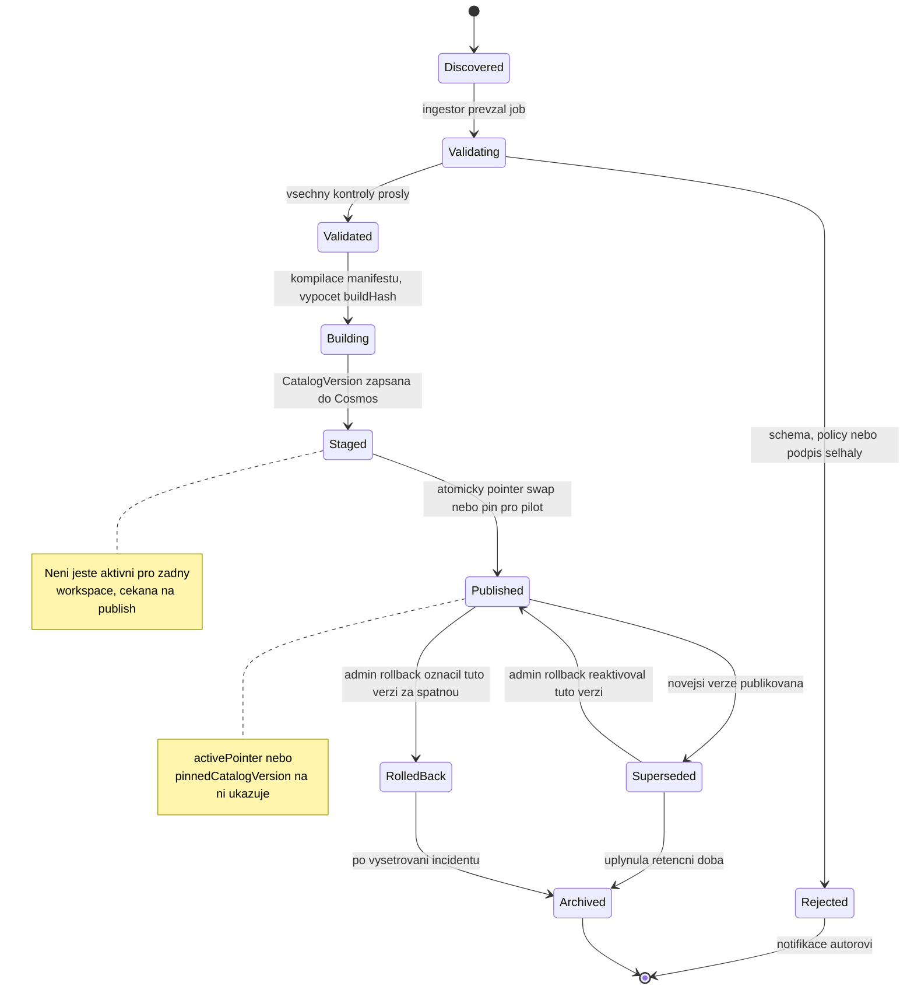
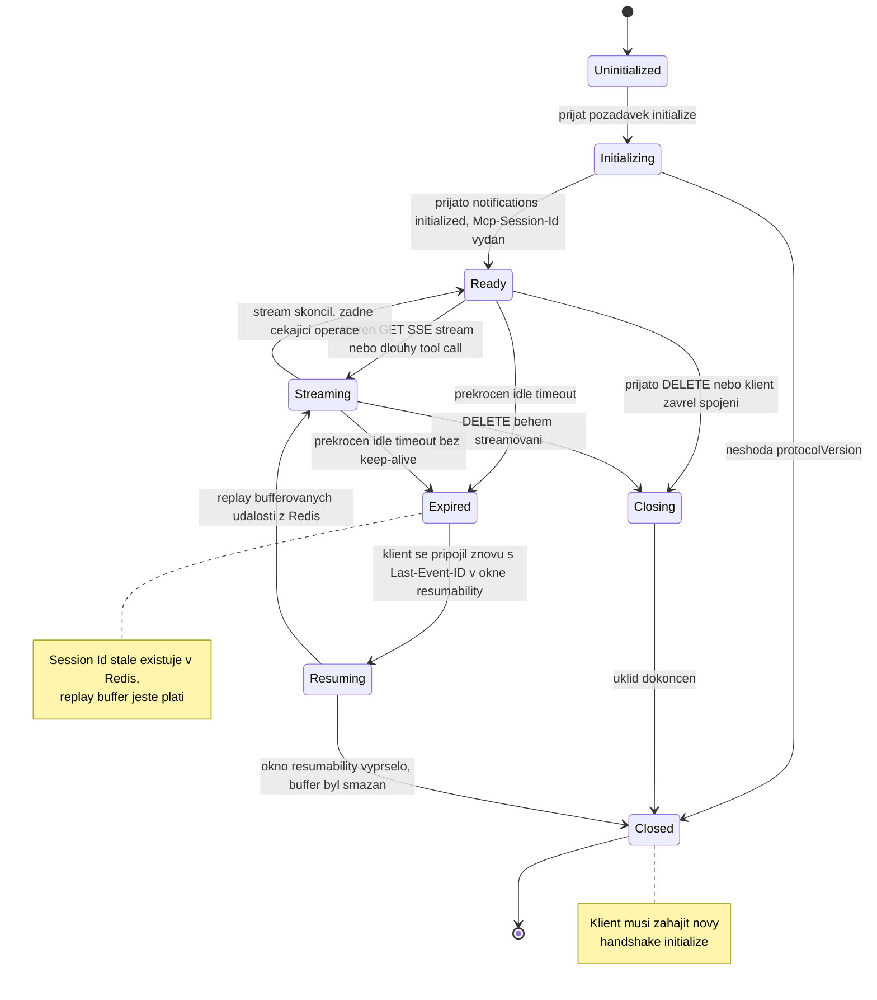
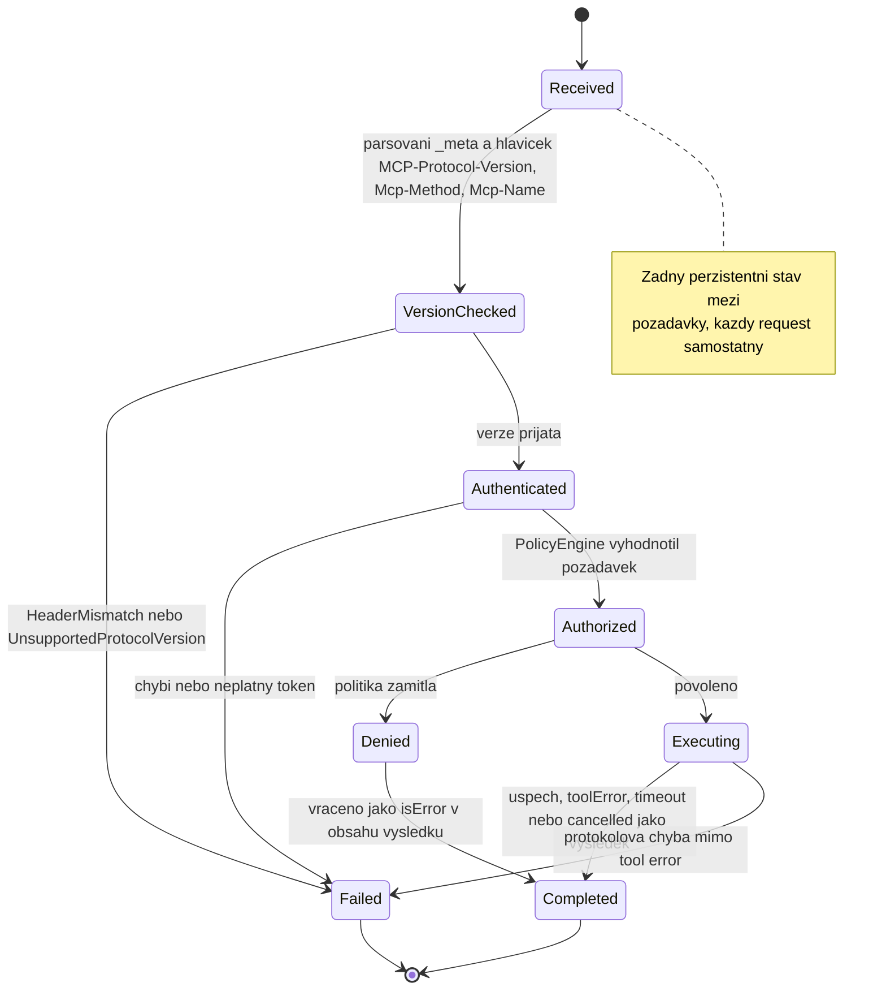
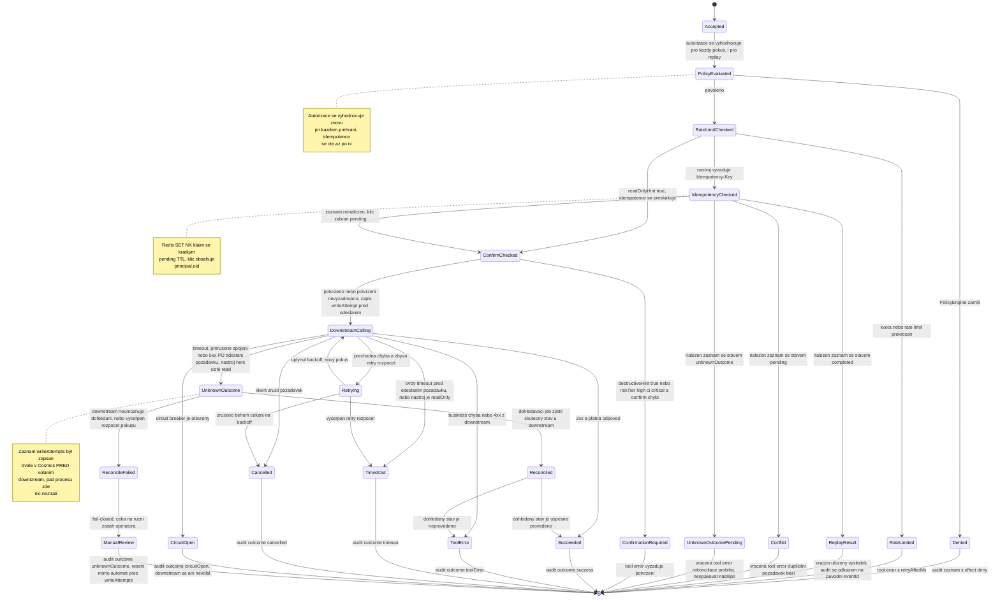
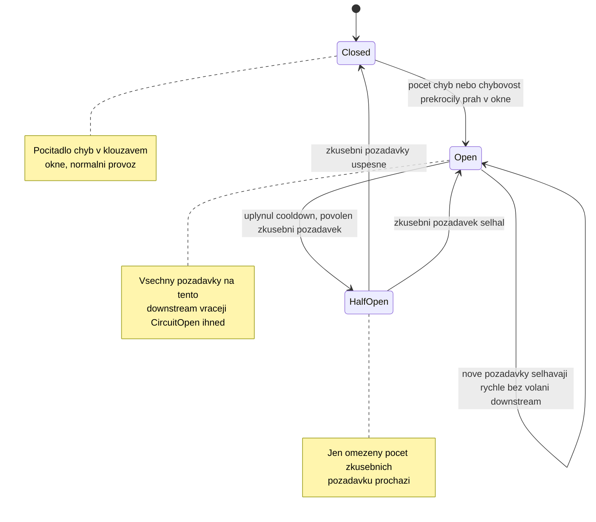
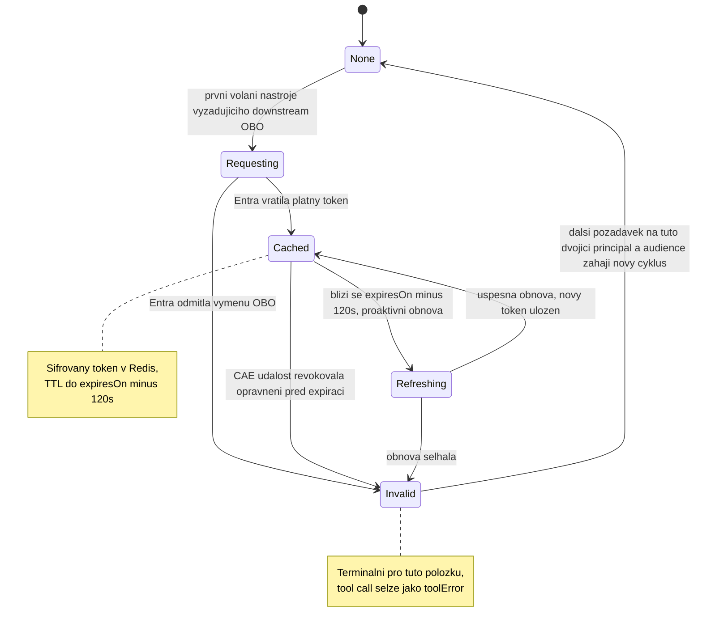
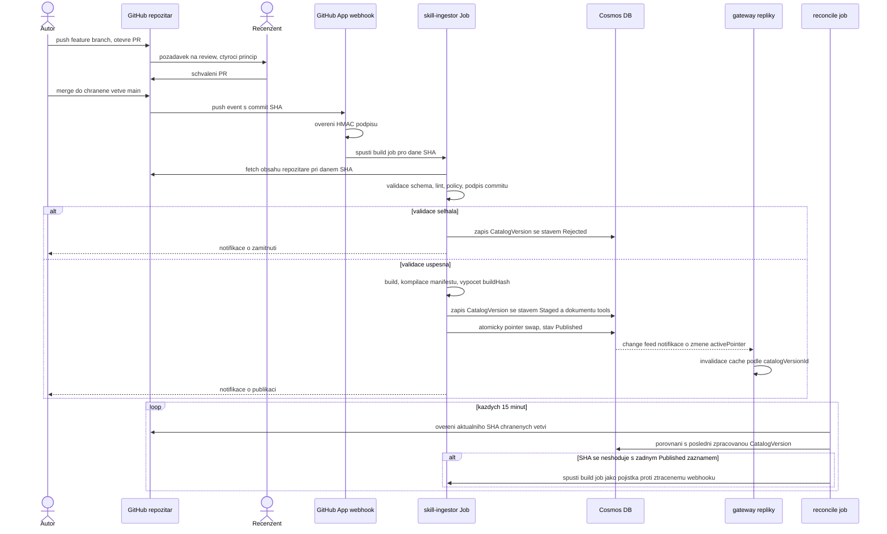

# 06 — Stavová logika a workflow

Verze 1.0 · 2026-09-17 · Stav: Návrh
Vztahuje se k: ADR-001 (dual-era), ADR-008 (OBO), ADR-011 (skill ingestion), ADR-012 (immutabilní katalog), ADR-016 (idempotence), ADR-017 (rate limiting), ADR-018 (fázový rollout)
Navazuje na: [`./02-architektura-reseni.md`](./02-architektura-reseni.md), [`./03-kodova-architektura.md`](./03-kodova-architektura.md) (moduly `protocol/`, `session/`, `execution/`), [`./04-datova-architektura.md`](./04-datova-architektura.md) (úložiště, do kterých automaty zapisují), [`./07-bezpecnost-a-autorizace.md`](./07-bezpecnost-a-autorizace.md) (PolicyEngine detail)

Timeouty uvedené v tomto dokumentu jsou **výchozí hodnoty k ladění**, ne závazné SLA — označeny „(návrh)" u prvního výskytu v každé sekci.

---

# Část A — Stavové automaty

Návrh popisuje sedm stavových automatů: životní cyklus katalogové verze, MCP spojení éry A, request éry B, tool invocation, circuit breaker downstream APIM, OBO token lifecycle a rollout gate. Všech sedm má vlastní `.mmd` diagram v `diagramy/` — soubory `10`–`14`, `21` a `22`. Rollout gate je navíc popsán stavovou tabulkou v [`./08-provoz-observabilita-rollout.md`](./08-provoz-observabilita-rollout.md) §9, kde je i jeho vizuální `stateDiagram-v2` (`22-stav-rollout-gate.mmd`) spolu s navazujícími metrikami a exit kritérii. Soubor `19-rollout-faze.mmd` **není** stavový diagram rolloutu — je to flowchart fází rolloutu (posloupnost kroků, ne stavy a přechody) a je součástí dokumentu `08` §9 vedle stavového automatu `22`.

## 1. Katalogová verze



**Co diagram říká.** Většina toku je lineární (Discovered → … → Published), ale kritická je dvojice zpětných hran kolem `RolledBack`/`Superseded`: rollback nikdy nemutuje data, jen **přehazuje dva ukazatele současně** — verze, která byla `Published` a ukázala se jako vadná, jde do `RolledBack`, zatímco verze, na kterou se vrací provoz, jde ze `Superseded` zpět do `Published`. Obě verze existují v Cosmos po celou dobu nezměněné (immutabilita, ADR-012) — mění se jen to, na kterou z nich ukazuje `activePointer`. To je přesně důvod, proč je rollback katalogu (W4) otázkou sekund, ne rebuildů.

| Stav | Význam | Invariant | Povolené přechody | Kdo spouští |
|---|---|---|---|---|
| `Discovered` | Nová Git SHA zaznamenána (webhook nebo reconcile) | Dokument ještě neexistuje v Cosmos | → `Validating` | `apps/ingestor` (automaticky) |
| `Validating` | Probíhá schema/lint/policy/signature kontrola | Žádný `tools` dokument zatím nevznikl | → `Validated`, → `Rejected` | ingestor |
| `Validated` | Kontroly prošly | — | → `Building` | ingestor |
| `Rejected` | Kontrola selhala | Terminální, žádný `CatalogVersion` dokument nikdy nebyl `Staged`/`Published` | žádné (terminál) | — |
| `Building` | Kompilace manifestů na `tools`, výpočet `buildHash` | — | → `Staged` | ingestor |
| `Staged` | `CatalogVersion` + `tools` zapsány, ale žádný ukazatel na ně neukazuje | Immutabilní od tohoto okamžiku | → `Published` | ingestor (`publish/`) |
| `Published` | `activePointer` (nebo `pinnedCatalogVersion` pilotního workspace) ukazuje na tuto verzi | Nejvýše jedna verze `Published` per ukazatel | → `Superseded`, → `RolledBack` | ingestor / admin |
| `Superseded` | Byla `Published`, nahradila ji novější verze | Dokument zůstává čitelný, jen na něj nic neukazuje | → `Published` (rollback), → `Archived` | admin (rollback) / retence |
| `RolledBack` | Byla `Published`, admin ji explicitně označil za vadnou | — | → `Archived` | retence |
| `Archived` | Konec životního cyklu v Cosmos | Data zůstávají rekonstruovatelná z Gitu | žádné (terminál) | GC job (volitelný, viz [`./04-datova-architektura.md#44-ttl`](./04-datova-architektura.md#44-ttl)) |

| Z → Do | Událost | Podmínka | Akce / side effect | Audit záznam |
|---|---|---|---|---|
| `Discovered → Validating` | ingestor job start | — | fetch obsahu repa při dané SHA | operační log, ne tool-invocation audit |
| `Validating → Rejected` | kontrola selhala | schema/lint/policy/signature chyba | zápis `status:Rejected`, notifikace autorovi | ano — administrativní událost |
| `Validating → Validated` | vše prošlo | — | — | ano |
| `Validated → Building` | — | — | kompilace, `buildHash` | ne (interní krok) |
| `Building → Staged` | zápis dokončen | — | `CatalogVersion`+`tools`+`skillManifests` v Cosmos | ano |
| `Staged → Published` | `POST /admin/catalog/publish` nebo automatický publish po merge | commit signature ověřena (ADR-011) | atomický pointer swap | ano, app role `Mcp.CatalogAdmin` |
| `Published → Superseded` | nová verze dosáhla `Published` | — | change feed invalidace cache (viz [`./04-datova-architektura.md#9-cache-strategie-a-invalidace`](./04-datova-architektura.md#9-cache-strategie-a-invalidace)) | ano |
| `Published → RolledBack` | `POST /admin/catalog/rollback` | cíl rollbacku existuje a není `Rejected` | pointer swap zpět | ano, app role `Mcp.CatalogAdmin` |
| `Superseded → Published` | rollback reaktivace | — | pointer swap | ano |
| `Superseded/RolledBack → Archived` | uplynula retence / uzavřen incident | žádný workspace verzi nepinuje | volitelné smazání dokumentu | ano |

**Recovery při pádu procesu.** Ingestor běží jako Container Apps Job (bezstavový) — pád v `Validating`/`Building` znamená jen nedokončený job; **žádný částečný zápis nikdy nevznikne v `Staged`**, protože `publish/` krok zapisuje `CatalogVersion` dokument až po úspěšném dokončení buildu. Reconcile job (ADR-011, běží každých 15 min) detekuje, že daná Git SHA nemá odpovídající `CatalogVersion`, a spustí build znovu — idempotentně, protože `id = {gitSha}-{buildHash}` zaručuje, že opakovaný běh nad stejným vstupem buď vytvoří identický dokument, nebo (při nedeterministickém buildu) je to signál k vyšetření. Pád mezi zápisem `Staged` a `Published` (během `publish/` kroku) je zachycen tím, že `activePointer` swap je jedna atomická operace nad jedním dokumentem — buď proběhla, nebo ne, žádný mezistav neexistuje na úrovni Cosmos zápisu.

**Timeouty (návrh).** Validace + build: měkký limit 5 min na Git repo běžné velikosti, tvrdý limit 15 min (Container Apps Job timeout) → po překročení job selže a je považován za `Rejected` s důvodem `buildTimeout`. Reconcile interval: 15 min (dáno ADR-011).

## 2. MCP spojení éry A



**Co diagram říká.** `Expired` je záměrně oddělený stav od `Closed` — session, která přestala být aktivní, ještě není nutně ztracená. Dokud existuje replay buffer v Redis (`sess:{sessionId}:events`, TTL dle [`./04-datova-architektura.md#54-session-store-ery-a`](./04-datova-architektura.md#54-session-store-ery-a)), klient se může vrátit přes `Resuming` a pokračovat bez nového handshake. Teprve po vypršení tohoto okna je jediná cesta zpět `Closed → [*] → Uninitialized`, tedy kompletně nová `initialize`. **Tento automat popisuje jen jednu ze dvou plnohodnotných variant éry A — tu stavovou (`stateful`).** Éra B tuto vrstvu vůbec nemá (viz automat 3); to je přímý důsledek ADR-001: session vrstva je „volitelný modul", ne jádro, dokonce i uvnitř éry A samotné.

### 2.1 Oprava F1 — bezstavová varianta éry A je spec-konformní, ne provizorium

Specifikace `2025-11-25`, kapitola Session Management, říká doslova: *„A server using the Streamable HTTP transport **MAY** assign a session ID at initialization time."* [10] — `MAY`, ne `MUST`. Server éry A smí `Mcp-Session-Id` vůbec nevydávat, nic si mezi požadavky nepamatovat, a být přitom plně spec-konformní; jediná povinnost je korektně zodpovědět `initialize`/`notifications/initialized` handshake při každém logickém navázání. Dřívější formulace v tomto návrhu (a v ADR-001), že éra A session store *vyžaduje*, byla nesprávná — opraveno zde a v [`./03-kodova-architektura.md`](./03-kodova-architektura.md) i [`./04-datova-architektura.md`](./04-datova-architektura.md).

Volba se řídí konfigurací `protocol.eraA.sessionMode` (viz [`./03-kodova-architektura.md#91-typovaná-validovaná-při-startu`](./03-kodova-architektura.md#91-typovaná-validovaná-při-startu)):

| `sessionMode` | Co dělá | Kdy zvolit |
|---|---|---|
| `stateless` (**výchozí, doporučeno**) | `initialize` se zpracuje normálně, ale `Mcp-Session-Id` se nevydává a nic se nezapisuje do Redis. Automat se zploští na `Uninitialized → Initializing → Ready → Closed` bez `Streaming`(jako sdíleného stavu napříč requesty)/`Expired`/`Resuming` — každý následující POST je nezávislý a chová se fakticky jako automat 3 (request éry B), jen bez hlavičkových kontrol specifických pro éru B. Streamovaná odpověď v rámci **jednoho** `tools/call` (progress notifikace, dlouhá odpověď) funguje beze změny — to není závislé na session store. Ztrácí se: GET SSE stream se server-iniciovanými zprávami mezi requesty a `Resuming` po výpadku spojení (klient musí place `initialize` znovu). | **Výchozí volba pro nasazení.** Zjednodušuje provoz (o jednu komponentu v kritické cestě méně), zjednodušuje DR (Redis výpadek se éry A vůbec netýká) a je dostatečná pro klienty, kteří GET SSE stream mezi requesty nevyužívají. |
| `stateful` | Plný automat výše — `Mcp-Session-Id`, Redis session store (§5.4 dok. 04), replay buffer pro `Resuming`. | Zapnout **jen** když konkrétní připojený klient prokazatelně využívá GET SSE stream pro server-iniciované notifikace mezi requesty, nebo potřebuje `Resuming` po výpadku spojení uprostřed dlouhého tool callu. K datu tohoto návrhu není potvrzeno, že to Claude nebo ChatGPT v éře A dělají — ⚠️ TODO, viz Otevřené otázky. Dokud potřeba není doložená konkrétním klientem, zůstává vypnuté. |

Přepnutí je feature flag, ne architektonická změna — `session/` modul v kódové základně (`03`) zůstává připravený, jen se za `stateless` konfigurace nevolá; přechod na `stateful` u konkrétního workspace nevyžaduje redeploy jiných částí gateway.

**Tabulky níže popisují `stateful` variantu.** Ve `stateless` (výchozí) módu existují jen `Uninitialized → Initializing → Ready(bez sdíleného stavu mezi requesty) → Closing → Closed`; `Initializing → Ready` přechod nezapisuje nic do Redis a řádky týkající se `Streaming`/`Expired`/`Resuming` neplatí.

| Stav | Význam | Invariant | Povolené přechody | Kdo spouští |
|---|---|---|---|---|
| `Uninitialized` | Žádné spojení | — | → `Initializing` | klient (`initialize`) |
| `Initializing` | Handshake probíhá | `Mcp-Session-Id` ještě nevydán | → `Ready`, → `Closed` | gateway `protocol/` |
| `Ready` | Session aktivní, žádný otevřený stream | `Mcp-Session-Id` platný v Redis | → `Streaming`, → `Closing`, → `Expired` | klient / gateway |
| `Streaming` | Otevřený SSE stream nebo probíhající dlouhý tool call | — | → `Ready`, → `Closing`, → `Expired` | gateway |
| `Closing` | Probíhá řízené ukončení | — | → `Closed` | klient (`DELETE`) / gateway |
| `Expired` | Idle timeout, session „spí" | Redis klíč i replay buffer ještě žijí | → `Resuming`, → `Closed` (po vypršení bufferu) | gateway (pasivně, dle TTL) |
| `Resuming` | Klient se vrací s `Last-Event-ID` | Uvnitř okna resumability | → `Streaming`, → `Closed` | klient |
| `Closed` | Konec | Terminální | žádné | — |

| Z → Do | Událost | Podmínka | Akce / side effect | Audit záznam |
|---|---|---|---|---|
| `Uninitialized → Initializing` | `initialize` request | — | detekce éry (viz [`./02-architektura-reseni.md`](./02-architektura-reseni.md) §EraAdapter) | ne (protokolová událost, ne tool call) |
| `Initializing → Ready` | `notifications/initialized` | protokolová verze podporovaná | vydání `Mcp-Session-Id`, zápis do Redis | ne |
| `Initializing → Closed` | neshoda verze | — | chybová odpověď dle [`./05-api-a-protokoly.md`](./05-api-a-protokoly.md) | ne |
| `Ready → Streaming` | GET SSE nebo dlouhý `tools/call` | — | otevření streamu | ne (audit je na úrovni tool invocation, automat 4) |
| `Streaming → Ready` | stream skončil | žádné pending operace | — | — |
| `Ready/Streaming → Closing` | `DELETE` nebo klient zavřel | — | úklid session objektů | ano — administrativní ukončení |
| `Ready/Streaming → Expired` | idle timeout | žádná aktivita po dobu timeoutu | Redis klíč zůstává do vypršení TTL | ne |
| `Expired → Resuming` | reconnect s `Last-Event-ID` | uvnitř okna resumability | replay bufferu | ne |
| `Resuming → Closed` | okno vypršelo | buffer smazán (TTL) | klient musí `initialize` | ne |

**Recovery při pádu procesu.** Session stav žije v Redis, ne v paměti gateway repliky — pád jedné repliky uprostřed `Streaming` znamená, že **jiná replika může session převzít** při dalším requestu (stav je sdílený, ne per-instance), ale **otevřené SSE spojení samotné se ztratí** (TCP socket byl vázán na mrtvou repliku). Klient uvidí přerušený stream a musí se pokusit o `Resuming` s posledním `Last-Event-ID` — pokud buffer v Redis přežil (Redis je nezávislá služba), obnova proběhne bez ztráty dat; pokud vypršel mezitím TTL, klient dostane `Closed` a musí od začátku. Pád **celé Redis instance** posouvá všechny aktivní session rovnou do efektivního `Closed` — viz degradační chování v [`./04-datova-architektura.md#54-session-store-ery-a`](./04-datova-architektura.md#54-session-store-ery-a).

**Timeouty (návrh, platí pro `stateful` variantu).** Idle timeout `Ready`/`Streaming` → `Expired`: **kanonicky 600 s (10 min)**. Container Apps ve výchozím (non-Premium) ingress módu má idle timeout pevných 240 s, stejně jako App Service — samo o sobě to tedy ACA žádnou výhodu nedává. Výhodu dává **Premium ingress mode**, kde je `idleRequestTimeout` konfigurovatelný v rozsahu **4–30 minut (240–1800 s)** [^aca-ingress]; **1800 s je horní mez tohoto rozsahu, ne kanonická hodnota návrhu** — gateway ho nastavuje na **600 s**, což pokrývá dlouhoběžící nástroje éry A (SSE, dlouhé tool calls) s bezpečnou rezervou, aniž by držela spojení zbytečně dlouho. Kanonická konfigurace drží Premium ingress **zapnutý bez ohledu na `sessionMode`** — pokrývá i jednotlivou dlouhoběžící streamovanou odpověď `tools/call` ve `stateless` módu, ne jen `Resuming`/session continuity. **Oprava F1**: dřívější formulace „Premium ingress je nutný kvůli session store éry A" byla nepřesná — session store (§2.1 výše) je nezávisle volitelný a jeho vypnutím K8 nijak neomezuje; jediné, co se touto opravou mění, je zda a proč gateway drží Redis session store, ne konfigurace ingressu. Okno resumability `Expired → Resuming`: **300 s (5 min)** — kratší než idle timeout, protože resumability je určena pro krátké výpadky sítě, ne pro dlouhou nečinnost; ve `stateless` módu tento parametr nemá význam.

## 3. Request éry B



**Co diagram říká.** Klíčová nuance je odbočka `Authorized → Denied → Completed` — zamítnutí autorizace **není** `Failed`. Podle architektonických rozhodnutí v [`09-adr-a-zdroje.md`](./09-adr-a-zdroje.md) je autorizační odmítnutí tool error (`isError:true` uvnitř úspěšné JSON-RPC odpovědi), ne HTTP/protokolová chyba, protože agent na straně klienta potřebuje čitelný, actionable důvod v obsahu odpovědi, ne holé selhání protokolu. `Failed` je vyhrazen jen pro skutečně protokolové chyby (verze, autentizace, malformed request). Tento automat je bezstavový v doslovném smyslu — žádný z jeho stavů se nikde nepersistuje mezi requesty; „stav" tady popisuje jen průchod jedním požadavkem od přijetí po dokončení. Druhá nuance je v `Received → VersionChecked`: ověřují se tu **tři** povinné hlavičky éry B (`MCP-Protocol-Version`, `Mcp-Method`, `Mcp-Name`), ne jen jedna — `Mcp-Method`/`Mcp-Name` jsou čitelné bez parsování těla požadavku, takže `edge/` vrstva a WAF na nich mohou routovat, měřit a rate-limitovat per-metodu a per-nástroj ještě před deserializací JSON-RPC obálky.

| Stav | Význam | Invariant | Povolené přechody | Kdo spouští |
|---|---|---|---|---|
| `Received` | HTTP POST přijat | — | → `VersionChecked` | `edge/` |
| `VersionChecked` | `_meta` a hlavičky `MCP-Protocol-Version`/`Mcp-Method`/`Mcp-Name` ověřeny a shodné | — | → `Authenticated`, → `Failed` | `protocol/` |
| `Authenticated` | JWT ověřen | — | → `Authorized`, → `Failed` | `identity/` |
| `Authorized` | PolicyEngine rozhodl | — | → `Executing`, → `Denied` | `authz/` |
| `Denied` | Zamítnuto politikou | — | → `Completed` | `authz/` |
| `Executing` | Probíhá provedení nástroje (viz automat 4) | — | → `Completed`, → `Failed` | `execution/` |
| `Completed` | Úspěšná JSON-RPC odpověď (i s `isError:true` uvnitř) | Terminální | žádné | — |
| `Failed` | Protokolová chyba (JSON-RPC `error`) | Terminální | žádné | — |

| Z → Do | Událost | Podmínka | Akce / side effect | Audit záznam |
|---|---|---|---|---|
| `Received → VersionChecked` | parsování | — | — | ne |
| `VersionChecked → Failed` | `HeaderMismatch` (-32020) / `UnsupportedProtocolVersion` (-32022) | některá z hlaviček `MCP-Protocol-Version`/`Mcp-Method`/`Mcp-Name` chybí nebo neodpovídá `_meta`/volané metodě, nebo verze nepodporovaná | HTTP 400 | ne (protokolová chyba, ne tool invocation) |
| `VersionChecked → Authenticated` | — | token platný | — | ne |
| `Authenticated → Failed` | chybí/neplatný token | — | HTTP 401 + `WWW-Authenticate` | ne |
| `Authenticated → Authorized` | — | — | vyhodnocení `PolicyEngine` | ano — `policyDecisions` zápis (viz [`./04-datova-architektura.md#37-policydecisions`](./04-datova-architektura.md#37-policydecisions)) |
| `Authorized → Denied` | `effect: deny` | — | — | ano, součást auditu tool invocation |
| `Authorized → Executing` | `effect: allow` | — | vstup do automatu 4 | — |
| `Executing → Completed/Failed` | výsledek provedení | — | viz automat 4 | ano |

**Recovery při pádu procesu.** Neexistuje nic k obnovení — pokud replika spadne uprostřed zpracování, klient (nebo Front Door) uvidí selhané spojení a **celý request se opakuje od nuly** na jiné replice. Protože éra B nemá session ani server-side stav vázaný na tuto konkrétní repliku, opakování je bezpečné samo o sobě z pohledu protokolu; bezpečnost opakování z pohledu byznys logiky (duplicitní zápis) řeší samostatně idempotency vrstva v automatu 4.

**Timeouty (návrh).** Celkový request timeout (od `Received` po `Completed`/`Failed`): měkký 30 s, tvrdý 60 s pro read-only nástroje; delší, per-tool nakonfigurovatelný strop až 120 s pro nástroje s pomalým downstream (deklarováno v `tools` dokumentu, ne globálně).

## 4. Tool invocation



**Co diagram říká.** Toto je nejsložitější automat záměrně — protínají se v něm autorizace (`PolicyEvaluated`), rate limiting (`RateLimitChecked`), idempotence (`IdempotencyChecked`), potvrzovací brána (`ConfirmChecked`), retry/circuit breaker (`Retrying`/`CircuitOpen`) a audit (každý terminální stav zapisuje záznam). Pořadí `Accepted → PolicyEvaluated → RateLimitChecked → IdempotencyChecked → ConfirmChecked → DownstreamCalling` je závazné a odpovídá krokům 12–17 kanonické request pipeline — normativní tabulka je v [`./03-kodova-architektura.md#7-zpracování-requestu-krok-za-krokem`](./03-kodova-architektura.md#7-zpracování-requestu-krok-za-krokem); [`07-bezpecnost-a-autorizace.md §5`](./07-bezpecnost-a-autorizace.md) tuto tabulku jen cituje pro krok 12 — **autorizace se vyhodnocuje jako první a znovu při každém pokusu, včetně přehrání (replaye) z idempotency cache**. Kdyby idempotence běžela před autorizací, vznikla by bezpečnostní díra: uživatel, kterému bylo oprávnění mezitím odebráno, by mohl po celou 24h TTL idempotency cache přehrávat starý uložený výsledek, aniž by systém znovu ověřil, že k němu ještě má přístup — zrušené oprávnění by se tak projevilo až po vypršení TTL, ne okamžitě. Proto je pořadí opačné a `IdempotencyChecked` navíc čte cache, jejíž klíč nese `principal.oid` (viz [`./04-datova-architektura.md#51-idempotency-cache-adr-016`](./04-datova-architektura.md#51-idempotency-cache-adr-016)) — ani stejný `idempotencyKey` od jiného principála nemůže vrátit cizí uložený výsledek. `ConfirmChecked` vynucuje pravidlo ADR-016 na straně serveru: potvrzení je povinné právě tehdy, když `annotations.destructiveHint === true` **NEBO** `riskTier ∈ {high, critical}` — nezávisle na tom, jestli klientský UX dialog proběhl. `Conflict` (souběžný duplicitní požadavek) je odlišen od `ReplayResult` (již dokončený požadavek) díky krátkému `pending` TTL popsanému v [`./04-datova-architektura.md#51-idempotency-cache-adr-016`](./04-datova-architektura.md#51-idempotency-cache-adr-016) — bez něj by druhý souběžný požadavek čekal donekonečna nebo by idempotence nefungovala vůbec.

**Oprava D1 — `UnknownOutcome` uzavírá dřívější mezeru u `TimedOut`.** Dřívější verze tohoto automatu končila u `DownstreamCalling → TimedOut` jako terminálu bez ohledu na to, jestli byl request na downstream vůbec odeslán, a bez místa, kam zapsat „nevíme, jestli zápis proběhl". To je nejdražší třída incidentu v agentním prostředí s automatickými retry (duplicitní zápis, nebo naopak uživateli oznámený neúspěch operace, která ve skutečnosti proběhla). Automat teď rozlišuje dvě situace u `DownstreamCalling`:

1. **Selhání PŘED odesláním požadavku** (DNS/TLS/connect selhal, nebo nástroj je čistě `readOnlyHint: true`) → `TimedOut` zůstává bezpečný terminál, protože se downstream vůbec nedotkl — opakování je bez rizika.
2. **Timeout, přerušené spojení nebo 5xx PO odeslání požadavku, u nástroje s `readOnlyHint` jiným než `true`** → `UnknownOutcome`. **Invariant**: do tohoto stavu se smí přejít, jen když existuje trvale zapsaný záznam `writeAttempts` (Cosmos, [`./04-datova-architektura.md#316-writeattempts`](./04-datova-architektura.md#316-writeattempts)) založený **před** voláním downstream (na přechodu `ConfirmChecked → DownstreamCalling`) — takže i pád procesu přesně v okamžiku selhání nikdy neztratí důkaz, že se o zápis vůbec pokusilo. `UnknownOutcome` samo o sobě **není** terminál — vede do rekonciliace: `Reconciled` (downstream potvrdil, co se stalo) nebo `ReconcileFailed` (nelze dohledat) → `ManualReview`. Nová větev `IdempotencyChecked → UnknownOutcomePending` navíc uzavírá zpětnou vazbu: pokud agent zopakuje `tools/call` se stejným `Idempotency-Key`, zatímco předchozí pokus ještě čeká na rekonciliaci, dostane jasnou tool error zprávu „rekonciliace probíhá, neopakovat naslepo" místo toho, aby buď dostal `Conflict` s krátkým TTL (které mezitím vyprší a dovolí nebezpečný druhý pokus), nebo aby idempotence cache o probíhající rekonciliaci vůbec nevěděla.

| Stav | Význam | Invariant | Povolené přechody | Kdo spouští |
|---|---|---|---|---|
| `Accepted` | Požadavek prošel autentizací a routováním na nástroj, vstupuje do orchestrace | — | → `PolicyEvaluated` | `execution/` |
| `PolicyEvaluated` | `authz/` rozhodl — vyhodnoceno pro každý pokus, i pro replay | — | → `Denied`, → `RateLimitChecked` | `authz/` |
| `Denied` | Zamítnuto | Terminální | žádné | — |
| `RateLimitChecked` | Kontrola token bucketu (per principal, per nástroj) | — | → `RateLimited`, → `IdempotencyChecked`, → `ConfirmChecked` | `execution/` |
| `RateLimited` | Kvóta/rate limit překročen | Terminální | žádné | — |
| `IdempotencyChecked` | Kontrola Redis idempotency cache | Jen pro nástroje bez `readOnlyHint: true` (viz kanonická podmínka u přechodu níže — oprava S11, jednotný spouštěč napříč `03`, `04` a diagramem 13) | → `ReplayResult`, → `Conflict`, → `ConfirmChecked` | `execution/` |
| `ReplayResult` | Nalezen dokončený záznam | Terminální | žádné | — |
| `Conflict` | Nalezen `pending` záznam jiného requestu | Terminální | žádné | — |
| `ConfirmChecked` | Kontrola parametru `confirm` dle pravidla ADR-016 | Jen pro nástroje, kde `destructiveHint:true` nebo `riskTier ∈ {high,critical}` | → `ConfirmationRequired`, → `DownstreamCalling` | `execution/` |
| `ConfirmationRequired` | Chybí povinné potvrzení nevratné/citlivé akce | Terminální | žádné | — |
| `UnknownOutcomePending` | Nalezen idempotency záznam s předchozím pokusem ve stavu `unknownOutcome` (rekonciliace ještě neskončila) | Terminální pro tento request | žádné | — |
| `DownstreamCalling` | Probíhá získání OBO tokenu (automat 6) a volání skillu/connectoru; `writeAttempts` záznam byl založen před vstupem do tohoto stavu pro nástroje s `readOnlyHint !== true` | — | → `Succeeded`, `ToolError`, `Retrying`, `TimedOut`, `UnknownOutcome`, `CircuitOpen`, `Cancelled` | `identity/` + `adapters/` |
| `Retrying` | Čeká na backoff před dalším pokusem | Zbývá retry rozpočet; retry se vůbec provádí jen pro nástroje s `readOnlyHint:true` nebo `idempotentHint:true` (viz [`./03-kodova-architektura.md#102-retry`](./03-kodova-architektura.md#102-retry)) — proto tato větev nikdy nepotřebuje `UnknownOutcome` | → `DownstreamCalling`, → `TimedOut`, → `Cancelled` | `execution/` |
| `UnknownOutcome` | Downstream write, jehož výsledek gateway nezná — timeout/přerušení/5xx nastal **po** odeslání požadavku | **Invariant**: existuje trvale zapsaný `writeAttempts` záznam v Cosmos založený před `DownstreamCalling`; pád procesu v tomto stavu nic neztrácí | → `Reconciled`, → `ReconcileFailed` | rekonciliační worker (samostatný proces, §12 dok. 04) |
| `Reconciled` | Rekonciliační worker dohledal skutečný stav u downstreamu (idempotency-key nebo korelační lookup) | — | → `Succeeded`, → `ToolError` | rekonciliační worker |
| `ReconcileFailed` | Downstream neumožňuje dohledání, nebo dohledání vyčerpalo rozpočet pokusů | Fail-closed — nikdy se netváří jako úspěch bez důkazu | → `ManualReview` | rekonciliační worker |
| `ManualReview` | Čeká na ruční zásah operátora (mimo tento automat, přes `writeAttempts` admin rozhraní) | Terminální pro tento automat; `writeAttempts.state` zůstává otevřený do ručního vyřešení | žádné | operátor (mimo automat) |
| `Succeeded`/`ToolError`/`TimedOut`/`Cancelled`/`CircuitOpen` | Terminální výsledky | Každý zapisuje audit záznam | žádné | — |

| Z → Do | Událost | Podmínka | Akce / side effect | Audit záznam |
|---|---|---|---|---|
| `Accepted → PolicyEvaluated` | vstup do orchestrace | — | vyhodnocení `PolicyEngine` (viz [`./07-bezpecnost-a-autorizace.md#53-vyhodnocovaci-algoritmus`](./07-bezpecnost-a-autorizace.md#53-vyhodnocovaci-algoritmus)) | ano — `policyDecisions` zápis |
| `PolicyEvaluated → Denied` | `effect:deny` | — | — | ano |
| `PolicyEvaluated → RateLimitChecked` | `effect:allow` | — | — | — |
| `RateLimitChecked → RateLimited` | token bucket vyčerpán | — | tool error s `retryAfterMs` v `_meta` | ano |
| `RateLimitChecked → IdempotencyChecked` | nástroj vyžaduje `Idempotency-Key` | `readOnlyHint !== true` (tj. `readOnlyHint: false` — jediná kanonická podmínka, shodně s diagramem 13 a `03` krok 14) | Redis lookup | ne |
| `RateLimitChecked → ConfirmChecked` | čistě čtecí nástroj | `readOnlyHint:true` | přeskočení idempotence | ne |
| `IdempotencyChecked → ReplayResult` | cache hit, `completed` | — | vrácen uložený výsledek | ano, s odkazem na původní `eventId` |
| `IdempotencyChecked → Conflict` | cache hit, `pending` | jiný request stejný klíč | tool error „duplicate in flight" | ano |
| `IdempotencyChecked → UnknownOutcomePending` | cache hit, `unknownOutcome` | předchozí pokus se stejným klíčem čeká na rekonciliaci | tool error „výsledek předchozího pokusu se ověřuje, neopakovat" s odkazem na `attemptId` | ano |
| `IdempotencyChecked → ConfirmChecked` | cache miss | — | `SET NX` klaim, pending TTL 90 s | ne |
| `ConfirmChecked → ConfirmationRequired` | chybí/neplatné potvrzení | `destructiveHint:true` nebo `riskTier ∈ {high,critical}` a `arguments.confirm !== true` | tool error „vyžaduje potvrzení" | ano |
| `ConfirmChecked → DownstreamCalling` | potvrzeno nebo nevyžadováno | — | ** trvalý zápis `writeAttempts` v Cosmos, stav `dispatching`, PŘED voláním downstream** pro nástroje s `readOnlyHint !== true`; poté získání OBO tokenu, volání adaptéru | ne (samotný zápis `writeAttempts` není tool-invocation audit, ale nese vlastní `createdAt`) |
| `DownstreamCalling → Succeeded` | 2xx | — | zápis idempotency výsledku (`completed`); `writeAttempts.state → succeeded` | ano |
| `DownstreamCalling → ToolError` | business chyba / 4xx (deterministická odpověď — request byl vždy odeslán a downstream odpověděl, žádná nejistota) | — | zápis idempotency výsledku; `writeAttempts.state → failed` | ano |
| `DownstreamCalling → Retrying` | přechodná chyba (5xx/timeout) **u nástroje, kde je retry vůbec povolen** (`readOnlyHint:true` nebo `idempotentHint:true`) | retry rozpočet > 0 | exponenciální backoff | ne (jen finální pokus se auditje) |
| `DownstreamCalling → TimedOut` | tvrdý timeout **před odesláním požadavku**, nebo nástroj je `readOnlyHint:true` | — | — | ano |
| `DownstreamCalling → UnknownOutcome` **(D1, nová větev)** | timeout, přerušené spojení nebo 5xx **PO odeslání požadavku**, u nástroje s `readOnlyHint !== true` a bez povoleného automatického retry | `writeAttempts` záznam existuje (zapsán na přechodu výše) | `writeAttempts.state → unknownOutcome`, idempotency klíč přepsán na stav `unknownOutcome` (místo `pending`, aby replay dostal `UnknownOutcomePending`, ne `Conflict`) | ano, outcome `unknownOutcome` |
| `DownstreamCalling → CircuitOpen` | breaker otevřený | viz automat 5 | downstream se vůbec nevolá | ano |
| `DownstreamCalling → Cancelled` | klient zrušil (uzavření SSE streamu = signál zrušení na Streamable HTTP [^mcp-cancellation]) | — | — | ano |
| `Retrying → DownstreamCalling` | uplynul backoff | — | nový pokus | ne |
| `Retrying → TimedOut/Cancelled` | vyčerpán rozpočet / zrušeno v čekání | — | — | ano |
| `UnknownOutcome → Reconciled` **** | rekonciliační worker dohledal stav u downstreamu | downstream nabízí lookup podle `downstream_idempotency_key`/korelačního ID (viz [`./04-datova-architektura.md#12-rekonciliace-nejistych-zapisu-unknownoutcome`](./04-datova-architektura.md#12-rekonciliace-nejistych-zapisu-unknownoutcome)) | `writeAttempts.evidence` zapsán z odpovědi lookupu | ano, na `writeAttempts.resolvedAt` |
| `UnknownOutcome → ReconcileFailed` **** | downstream neumožňuje dohledání, nebo dohledání vyčerpalo rozpočet pokusů | — | fail-closed, žádný domnělý výsledek | ano |
| `Reconciled → Succeeded` **** | dohledaný stav = zápis proběhl | — | idempotency výsledek přepsán na `completed` | ano |
| `Reconciled → ToolError` **** | dohledaný stav = zápis neproběhl | — | idempotency výsledek přepsán na `failed`, klíč uvolněn pro nový pokus | ano |
| `ReconcileFailed → ManualReview` **** | fail-closed | — | `writeAttempts.state → manualReview`, zařazení do fronty operátora | ano, outcome zůstává `unknownOutcome` až do ručního vyřešení |

**Recovery při pádu procesu.** Pád gateway repliky uprostřed `DownstreamCalling` je nejcitlivější bod celého systému — proto existuje idempotence: klient (agent) po timeoutu/chybě spojení **zopakuje** `tools/call` se stejným `Idempotency-Key`. Repríza projde znovu celým automatem od `Accepted` — včetně nového autorizačního rozhodnutí v `PolicyEvaluated` — než se vůbec dostane k `IdempotencyChecked`. Pokud downstream volání ve skutečnosti proběhlo (jen odpověď se ztratila spolu s mrtvou replikou), Redis klíč zůstává ve stavu `pending` až do vypršení jeho krátkého TTL (90 s, viz [`./04-datova-architektura.md#51-idempotency-cache-adr-016`](./04-datova-architektura.md#51-idempotency-cache-adr-016)) — opakovaný požadavek uvnitř tohoto okna dostane `Conflict`, ne duplicitní provedení; po vypršení okna se považuje původní pokus za mrtvý a nový požadavek smí proběhnout (vědomý kompromis: krátké okno nekonzistence je přijatelnější než trvalý zámek). Pro nástroje bez idempotence (čistě read-only) je opakování bezpečné samo o sobě.

** Recovery specificky pro `UnknownOutcome`/`writeAttempts` — proč pád procesu tady nic neztrácí.** Redisové 90s okno výše řeší jen souběh dvou téměř současných requestů, ne nejistotu trvající minuty až dny. Pro tu existuje samostatný mechanismus: `writeAttempts` záznam v Cosmos se zapisuje **synchronně před** voláním downstream (na přechodu `ConfirmChecked → DownstreamCalling`), ne až po selhání — takže i když gateway replika spadne přesně uprostřed volání downstream (mezi odesláním požadavku a přijetím odpovědi), `writeAttempts` dokument už existuje ve stavu `dispatching`. Rekonciliační worker (samostatný Container Apps Job, §12 dok. 04) periodicky/eventově (Cosmos change feed) dohledává záznamy ve stavu `dispatching` starší než jejich vlastní timeout i záznamy ve stavu `unknownOutcome` — obojí zpracovává stejně, protože z pohledu workeru nejde rozlišit „proces spadl po odeslání" od „proces běží dál, ale request timeoutoval": obojí končí u stejné rekonciliace podle `downstream_idempotency_key`/korelačního ID. To je přesně důvod, proč `UnknownOutcome` (a jeho perzistovaný protějšek `writeAttempts`) žije **mimo** samotný požadavek/repliku — na rozdíl od zbytku automatu 4, který je vázaný na životnost jednoho HTTP requestu, rekonciliace pokračuje nezávisle na tom, jestli klient ještě čeká na odpověď.

**Timeouty (návrh).** Pending idempotency claim: **90 s** (musí být delší než tvrdý downstream timeout, aby nezanikl dřív, než reálně běžící volání skončí). Downstream tvrdý timeout: **30–60 s** dle rizikové třídy nástroje. Retry backoff: exponenciální s jitterem, počáteční 200 ms, max 3 pokusy (návrh). **** Rekonciliace `UnknownOutcome`: až **5 automatických pokusů dohledání** s exponenciálním backoff (počáteční 2 s, strop 60 s) během **5 minut** od vzniku `UnknownOutcome`; pokud downstream operace vůbec nedeklaruje podporu dohledání (`downstreamOperation.reconciliationSupported: false`, viz [`./04-datova-architektura.md#12-rekonciliace-nejistych-zapisu-unknownoutcome`](./04-datova-architektura.md#12-rekonciliace-nejistych-zapisu-unknownoutcome)), přechod do `ReconcileFailed` je okamžitý, bez čekání na pokusy. `ManualReview` nemá automatický timeout — čeká na operátora; eskalační alert (viz [`./08-provoz-observabilita-rollout.md`](./08-provoz-observabilita-rollout.md)) se spouští, pokud `writeAttempts` zůstane v `manualReview` déle než **4 hodiny** (návrh, ⚠️ TODO potvrdit s provozním týmem).

## 5. Circuit breaker downstream APIM



**Co diagram říká.** Breaker je počítaný **per downstream cíl** (per `apimApiId`/`operationId`, ne globálně za celou gateway) — jinak by výpadek jednoho backendu (např. CRM) mohl zbytečně blokovat volání jiného, zdravého backendu (např. Finance). `Open → Open` smyčka v diagramu zdůrazňuje, že v tomto stavu se **downstream vůbec nevolá** — to je podstata ochrany: gateway přestane bušit do už tak přetíženého/spadlého systému a šetří vlastní i cizí kapacitu, za cenu okamžitého `CircuitOpen` výsledku pro volajícího (viz automat 4).

| Stav | Význam | Invariant | Povolené přechody | Kdo spouští |
|---|---|---|---|---|
| `Closed` | Normální provoz | Počítadlo chyb v klouzavém okně | → `Open` | `adapters/connector` |
| `Open` | Downstream se nevolá | Všechny požadavky okamžitě `CircuitOpen` | → `HalfOpen` | časovač cooldown |
| `HalfOpen` | Zkušební provoz | Jen omezený počet zkušebních požadavků prochází | → `Closed`, → `Open` | `adapters/connector` |

| Z → Do | Událost | Podmínka | Akce / side effect | Audit záznam |
|---|---|---|---|---|
| `Closed → Open` | práh překročen | návrh: 5 po sobě jdoucích chyb NEBO ≥50 % chybovost v okně 20 požadavků | zápis metriky, alert (viz [`./08-provoz-observabilita-rollout.md`](./08-provoz-observabilita-rollout.md)) | ne (stav breakeru sám není tool invocation) |
| `Open → HalfOpen` | uplynul cooldown | 30 s (návrh) | povolení 1–3 zkušebních požadavků | ne |
| `HalfOpen → Closed` | zkušební požadavky uspěly | — | reset počítadla | ne |
| `HalfOpen → Open` | zkušební požadavek selhal | — | nový cooldown | ne |

**Recovery při pádu procesu.** Stav breakeru je **v paměti procesu** (per replika, ne sdílený přes Redis) — jde o vědomé zjednodušení: každá replika má vlastní pohled na zdraví downstreamu. Pád repliky znamená, že nová/škálovaná replika startuje v `Closed` (optimistický default) a učí se stav znovu z vlastních volání. Riziko „stádového efektu" (více replik zkouší HalfOpen současně po škálování) je přijatelné, protože počet zkušebních požadavků je malý a downstream (APIM + vlastní rate limiting, ADR-017) má vlastní ochranu jako další vrstvu.

**Timeouty (návrh).** Klouzavé okno pro počítání chyb: 20 posledních požadavků nebo 30 s, podle toho, co nastane dřív. Cooldown `Open → HalfOpen`: 30 s. Počet zkušebních požadavků v `HalfOpen`: 3.

## 6. OBO token lifecycle

Sekvenční tok získání OBO tokenu je zachycen v diagramu [`08-obo-downstream-sekvence.mmd`](./diagramy/08-obo-downstream-sekvence.mmd) (vlastněném dokumentem [`07-bezpecnost-a-autorizace.md`](./07-bezpecnost-a-autorizace.md)); tento automat popisuje stavy samotné cache položky v Redis (§5.3 dok. 04).



**Co diagram říká.** Hlavní tok `None → Requesting → Cached` je jednorázové získání OBO tokenu při prvním volání nástroje, který potřebuje downstream identitu; `Cached → Refreshing → Cached` je opakovaný cyklus proaktivní obnovy před přirozeným vypršením. Dvě odbočky do `Invalid` mají různý charakter: `Requesting/Refreshing → Invalid` je selhání výměny/obnovy na straně Entra (odvolaný souhlas, expirovaný refresh token, chyba AS) a gateway se o něm dozví reaktivně — až se o token pokusí. `Cached → Invalid` je naproti tomu odbočka pro **revokaci přes Continuous Access Evaluation (CAE)** — pokud je CAE pro tuto app registration zapnuté, Entra může zneplatnit vydaný token dřív, než přirozeně vyprší (např. při odebrání role, zablokování účtu, změně sítě mimo Conditional Access politiku), a cache položka se stane neplatnou, aniž by proběhl `Refreshing`. Bez CAE tato odbočka fakticky nenastává a token zůstává v `Cached` platný až do `expiresOn` bez ohledu na mezitímní revokaci na straně Entra — to je přesně asymetrie revokace popsaná ve W2; pokrytí CAE pro tuto app registration je `⚠️ TODO`, neověřeno v rešerši (viz Otevřené otázky). `Invalid` je vždy terminální jen pro danou cache položku — další request pro stejnou dvojici principal/audience zahájí nový cyklus od `None`, ne pokračování z `Invalid`.

| Stav | Význam | Invariant | Povolené přechody | Kdo spouští |
|---|---|---|---|---|
| `None` | Žádný token pro dvojici principal/audience v cache | — | → `Requesting` | `identity/` OBO service, při prvním volání |
| `Requesting` | Probíhá `AcquireTokenOnBehalfOf` (MSAL) vůči Entra | — | → `Cached`, → `Invalid` | `identity/` |
| `Cached` | Platný token v Redis (§5.3 dok. 04) | Šifrovaný, TTL do `expiresOn - 120s` | → `Refreshing`, → `Invalid` | — |
| `Refreshing` | Proaktivní obnova před vypršením | Starý token stále platný do dokončení | → `Cached`, → `Invalid` | `identity/` (na pozadí, ne v request cestě) |
| `Invalid` | Token nelze získat/obnovit, nebo byl revokován přes CAE | Terminální pro danou položku — další pokus vytváří nový cyklus od `None` | → `None` (nový pokus) | — |

| Z → Do | Událost | Podmínka | Akce / side effect | Audit záznam |
|---|---|---|---|---|
| `None → Requesting` | první volání nástroje vyžadujícího downstream OBO | — | MSAL OBO výměna | ne (samo o sobě), ale chyba se promítne do `execution.outcome` tool invocation |
| `Requesting → Cached` | Entra vrátila token | — | šifrovaný zápis do Redis | ne |
| `Requesting → Invalid` | Entra odmítla (např. odvolaný souhlas, expirovaný refresh) | — | tool call selže s `toolError`, ne tichým fallbackem na jinou identitu | ano, jako součást tool invocation auditu |
| `Cached → Refreshing` | blíží se `expiresOn - 120s` | — | pozadí refresh, nezpomaluje aktuální request | ne |
| `Cached → Invalid` | CAE událost (revokace role, disable účtu, mimo Conditional Access) | jen pokud je CAE pro app registration aktivní — `⚠️ TODO` ověřit pokrytí | příští použití zjistí neplatnost při volání downstream, ne proaktivně | ano, jako součást tool invocation auditu |
| `Refreshing → Cached` | úspěšná obnova | — | — | ne |
| `Refreshing → Invalid` | obnova selhala | — | příští request spustí `None → Requesting` znovu (reaktivní fallback) | ne |

**Recovery při pádu procesu.** Token je v Redis, ne v paměti procesu — pád repliky nic neztrácí. Pád/výpadek celé Redis instance degraduje **na reaktivní získávání tokenu při každém volání** (viz [`./04-datova-architektura.md#53-obo-token-cache-adr-008`](./04-datova-architektura.md#53-obo-token-cache-adr-008)) — funkčně správné, ale pomalejší a rizikovější vůči Entra throttlingu.

**Timeouty (návrh).** Proaktivní refresh: 120 s před `expiresOn`. Timeout samotného MSAL OBO volání: 10 s (v souladu s limitem discovery/token endpointů, který Anthropic dokumentuje pro vlastní OAuth flow [^claude-oauth-timeout] jako obecně rozumný řád velikosti pro token operace v hot path).

## 7. Rollout gate

Bez samostatného `.mmd` diagramu v tomto dokumentu — fázový diagram rolloutu (`19-rollout-faze.mmd`) je vlastněn dokumentem [`./08-provoz-observabilita-rollout.md`](./08-provoz-observabilita-rollout.md), kam patří i konkrétní metriky SLO. Zde je stavová tabulka jako doplněk pro workflow W1–W6, které na fázi rolloutu odkazují.

| Stav | Význam | Invariant | Povolené přechody | Kdo spouští |
|---|---|---|---|---|
| `Phase0` | Lokální PoC (stdio + docker compose, mock APIM, fake katalog) | Žádný produkční provoz | → `Gate0` | vývojový tým |
| `Gate0` | Vyhodnocení exit kritérií PoC | — | → `Phase1Pilot` (splněno) / zpět do `Phase0` (nesplněno) | vlastník produktu + bezpečnostní review |
| `Phase1Pilot` | ≤25 uživatelů, skupina `MCP-Gateway-Pilot`, jen read-only nástroje. Izolace je **autorizační, ne traffic-splitting** — všichni uživatelé sdílí stejnou nasazenou revizi gateway, přístup mimo pilotní skupinu je uzavřen nepřiřazenou app rolí | Write nástroje nejsou v katalogu pro pilotní workspace povoleny | → `Gate1` | — |
| `Gate1` | Vyhodnocení exit kritérií pilotu | — | → `Phase2Rollout` (splněno) / zpět do `Phase1Pilot` (nesplněno, s nápravou) | vlastník produktu + bezpečnost |
| `Phase2Rollout` | Write nástroje zapínány postupně, per-role | — | → `Steady` | provozní tým |
| `Steady` | Ustálený provoz | Průběžný monitoring, žádná další formální brána | — (další změny jdou přes W1/W4/W5, ne přes rollout gate) | — |

| Z → Do | Událost | Podmínka (exit kritéria, návrh) | Akce / side effect | Audit záznam |
|---|---|---|---|---|
| `Phase0 → Gate0` | PoC dokončen | — | vyhodnocení | operační log |
| `Gate0 → Phase1Pilot` | kritéria splněna | 100 % `testkit` contract testů prochází; bezpečnostní review sandboxu skillů (ADR-013) provedena; verifikace hash chainu (§6.4 dok. 04) běží úspěšně na testovacích datech | vytvoření `MCP-Gateway-Pilot` skupiny a přiřazení app role jejím členům (autorizační brána, ne traffic split) | ano — administrativní |
| `Gate0 → Phase0` | kritéria nesplněna | — | náprava, opakování | ano |
| `Phase1Pilot → Gate1` | uplynula minimální doba pilotu | ⚠️ TODO — konkrétní počet dní/volání potvrdit s vlastníkem produktu; návrh: ≥10 pracovních dní bez P1 incidentu | vyhodnocení metrik | operační log |
| `Gate1 → Phase2Rollout` | kritéria splněna | chybovost (toolError+timeout)/total < 1 % za posledních 7 dní (návrh); denied rate anomálie vysvětleny; rollback cesta (W4/W5) alespoň jednou otestována | postupné zapínání write nástrojů per-role | ano |
| `Gate1 → Phase1Pilot` | kritéria nesplněna | — | náprava, pilot pokračuje | ano |
| `Phase2Rollout → Steady` | metriky stabilní napříč rolemi | ⚠️ TODO potvrdit prahové hodnoty | — | ano |
| `Phase2Rollout → Phase1Pilot` | vážný incident během rolloutu | — | stažení write nástrojů, návrat na read-only pilotní rozsah | ano |

**Recovery při pádu procesu.** Fáze rolloutu není runtime stav v paměti — je to konfigurace (které workspace/skupiny mají které nástroje povolené, na kterou revizi jde traffic). Pád jakéhokoliv procesu nic neztrácí, protože zdrojem pravdy je konfigurace v `workspaceBindings`/`entitlements` (Cosmos) a traffic-split nastavení Container Apps revizí — obojí je perzistentní samo o sobě. „Recovery" zde znamená jen opětovné vyhodnocení gate kritérií z uložených metrik (Log Analytics), ne obnovu nějakého ztraceného stavu.

**Timeouty (návrh).** Minimální doba `Phase1Pilot`: 10 pracovních dní (⚠️ TODO potvrdit). Žádný automatický timeout mezi fázemi neexistuje — přechod je vždy explicitní lidské rozhodnutí na základě metrik, ne automat řízený časem.

---

# Část B — Workflow

## W1 — Publikace skillu



**Co diagram říká.** Cesta „přes webhook" (horní část) a cesta „přes reconcile" (spodní smyčka) jsou **nezávislé a redundantní** — reconcile neví ani nepotřebuje vědět, jestli webhook proběhl; prostě periodicky porovnává Git realitu s Cosmos realitou a dorovnává rozdíl. To je přímý důsledek ADR-011 (pull+push hybrid) a znamená, že ztracený webhook (síťový výpadek, GitHub incident) vede nanejvýš k 15minutovému zpoždění publikace, ne k tichému rozjetí katalogu od Gitu.

**Kdo co dělá a jaké brány.** Autor (skill engineer) nikdy nemerguje vlastní PR — **čtyřoký princip** je vynucen branch protection pravidlem na chráněné větvi (vyžadovaný review od jiné osoby než autora, povinné status checky including CI schema lint, vyžadované podepsané commity). Ingestor je jediný proces, který smí zapisovat do `catalogVersions`/`tools` — žádná lidská ruka nikdy needituje tyto Cosmos dokumenty přímo (viz [`./04-datova-architektura.md#2-zasada-git-je-zdroj-pravdy`](./04-datova-architektura.md#2-zasada-git-je-zdroj-pravdy)).

**Jak dlouho to trvá a jak se to pozná.** Typická cesta webhookem: merge → nástroj dostupný v `tools/list` v řádu sekund až jednotek minut (čas buildu + čas invalidace cache dle [`./04-datova-architektura.md#9-cache-strategie-a-invalidace`](./04-datova-architektura.md#9-cache-strategie-a-invalidace), návrh 5–15 s). Nejhorší případ (ztracený webhook, doběhne až reconcile): do 15 minut. Pozná se to podle `status` pole na `CatalogVersion` dokumentu (admin UI/CLI) a podle `diffSummary`; `publish/` krok navíc posílá notifikaci (kanál je konfigurační detail, mimo rozsah tohoto dokumentu).

**Jak se to vrátí zpět.** Viz W4 — rollback katalogu je nezávislý workflow, protože jde jen o přesun ukazatele mezi již existujícími immutabilními verzemi, ne o opakování téhle sekvence pozpátku.

## W2 — Přidání uživatele / změna oprávnění

Dvě nezávislé vrstvy musí souhlasit, aby uživatel mohl nástroj zavolat (ADR-007): **hrubá vrstva** (Entra app role/group → `workspaceBindings`, „smí se vůbec dostat na tento workspace") a **jemná vrstva** (`entitlements`, „smí volat tento konkrétní nástroj"). Obě mají **různou rychlost propagace** a to je nejčastější zdroj stížností typu „právě mě přidali, proč to nefunguje" — proto je popsáno poctivě, i s neověřenými čísly:

| Krok | Kdo | Co se změní | Za jak dlouho se projeví |
|---|---|---|---|
| Žádost o přístup | uživatel/manažer, mimo scope gateway (interní ITSM proces) | — | — |
| Přiřazení Entra app role / skupiny | Entra admin | claim `roles`/`groups` v budoucích tokenech | **Až s dalším vydáním tokenu** — existující access token uživatele nese starý obsah `roles`/`groups` do svého vypršení. Přesná délka access tokenu je řízena tenant Conditional Access/token-lifetime politikou organizace, typicky řádově desítky minut až jednotky hodin — ⚠️ TODO ověřit konkrétní hodnotu pro tento tenant. Do té doby uživatel dostává `Denied`, i když je administrativně už schválen. |
| Vytvoření `workspaceBindings` záznamu | gateway admin | povolení dosahu na workspace | propagace stejná jako u entitlements níže (cache TTL), typicky rychlejší než čekání na nový token |
| Vytvoření `entitlements` záznamu | gateway admin | konkrétní tool-level povolení | v řádu **jednotek minut** — omezeno TTL Redis cache entitlements (návrh ≤5 min, viz [`./04-datova-architektura.md#9-cache-strategie-a-invalidace`](./04-datova-architektura.md#9-cache-strategie-a-invalidace)), ne čekáním na token |

**Revokace je stejně asymetrická, a bezpečnostně citlivější.** Odebrání ze skupiny v Entra **nezneplatní už vydaný access token** — bez Continuous Access Evaluation (CAE) může odvolaný uživatel fakticky pokračovat v přístupu až do přirozeného vypršení svého aktuálního tokenu (⚠️ TODO — potvrdit pokrytí CAE pro tuto app registration, neověřeno v rešerši). Naproti tomu zápis `deny` entitlement (jemná vrstva, deny má v deny-by-default modelu přednost) se projeví rychle, v řádu cache TTL. **Doporučení pro urgentní odebrání přístupu**: nespoléhat jen na odebrání z Entra skupiny — vytvořit explicitní `deny` entitlement a počkat na cache TTL, případně (kde je k dispozici) vynutit revokaci tokenu/CAE na straně Entra pro skutečně okamžitý efekt.

## W3 — Incident „nástroj vrací chyby"

**Triage rozhodovací strom** (v pořadí, jak postupovat):

1. **Je to autorizace, nebo skutečná chyba?** Zvýšený podíl `denied` bez odpovídajícího nárůstu `toolError`/`timeout` typicky znamená problém v entitlements nebo drift katalogové verze (přejmenovaný/odebraný nástroj, na který stará entitlement ještě míří), ne problém downstream.
2. **Je to jeden downstream, nebo všechno najednou?** Chyby koncentrované na jednom `apimApiId`/`operationId` → downstream/APIM problém. Chyby napříč všemi nástroji a workspacy najednou → pravděpodobně gateway-wide (JWKS refresh selhal, Redis/Cosmos výpadek) → zkontrolovat `/readyz`.
3. **Je circuit breaker otevřený?** Nárůst `outcome:circuitOpen` znamená, že ochrana už zafungovala — kořenová příčina je stále downstream, ale gateway teď aktivně chrání, ne že by sama selhávala.
4. **Je to OBO/identita?** `toolError` s `httpStatus:401` z downstreamu → problém získání/platnosti OBO tokenu, ne problém samotného downstream API.
5. **Je to gateway samotná?** Vysoká gateway-interní latence (rozdíl mezi celkovým `durationMs` a downstream latencí hlášenou APIM) bez chyb → zkontrolovat saturaci replik/KEDA škálování, ne downstream.

**KQL dotazy** (tabulka `McpToolInvocation_CL`, vždy nejdřív časový filtr hned po názvu tabulky, teprve pak deduplikace podle `eventId` — viz [`./04-datova-architektura.md#65-dual-sink-zapis-a-outbox-pattern`](./04-datova-architektura.md#65-dual-sink-zapis-a-outbox-pattern)). **Pořadí je důležité pro výkon**: `where TimeGenerated > ago(…)` využije časový index a omezí objem dat, nad kterým vůbec běží `summarize arg_max(...) by eventId` — v opačném pořadí (jak byly dotazy dřív) by se `arg_max` počítal nad celou tabulkou v rámci celé retenční doby (90 dní), než by se výsledek teprve ořízl na požadované okno, což je řádově dražší a pomalejší dotaz. Dedup okno je navíc o něco širší než analyzované okno (viz komentáře u jednotlivých dotazů), protože duplicitní doručení eventu z outboxu (at-least-once, §6.5 dokumentu `04`) může s malým zpožděním dorazit i s `TimeGenerated` z těsně před hranicí okna:

```kql
// 1) Chybovost podle nástroje za poslední hodinu — kde vůbec hledat
// Dedup okno o 5 min širší (1h5m) než analyzované okno (1h), aby duplicitní pozdní doručení
// eventu z outboxu s TimeGenerated těsně před hranicí "ago(1h)" nebylo omylem počítáno dvakrát.
McpToolInvocation_CL
| where TimeGenerated > ago(1h5m)
| summarize arg_max(TimeGenerated, *) by eventId
| where TimeGenerated > ago(1h)
| summarize total = count(), errors = countif(execution_outcome_s in ("toolError", "timeout")) by tool_name_s
| extend errorRate = round(100.0 * errors / total, 1)
| where total > 5
| order by errorRate desc
```

```kql
// 2) Je to autorizace? Rozpad zamitnuti podle duvodu a workspace
// execution_outcome_s == "denied" presunuto pred summarize arg_max, aby se deduplikoval
// jen relevantni podmnozinu radku (denied), ne cela tabulka vcetne allow vysledku, ktere
// tento dotaz stejne zahodi — snizuje objem dat vstupujici do arg_max.
McpToolInvocation_CL
| where TimeGenerated > ago(1h5m)
| where execution_outcome_s == "denied"
| summarize arg_max(TimeGenerated, *) by eventId
| where TimeGenerated > ago(1h)
| summarize deniedCount = count() by tool_name_s, decision_reason_s, workspaceSlug_s
| order by deniedCount desc
```

```kql
// 3) Drift katalogove verze mezi replikami — pokud se rozpocet trva dele nez cache TTL, je to anomalie
McpToolInvocation_CL
| where TimeGenerated > ago(20m)
| summarize arg_max(TimeGenerated, *) by eventId
| where TimeGenerated > ago(15m)
| summarize count() by tool_catalogVersionId_s
```

```kql
// 4) Downstream korelace — je to konkretni APIM operace?
// execution_outcome_s in (...) presunuto pred summarize arg_max ze stejneho duvodu jako v (2).
McpToolInvocation_CL
| where TimeGenerated > ago(1h5m)
| where execution_outcome_s in ("toolError", "timeout")
| summarize arg_max(TimeGenerated, *) by eventId
| where TimeGenerated > ago(1h)
| summarize count() by execution_downstream_apimApiId_s, execution_downstream_httpStatus_d
| order by count_ desc
```

```kql
// 5) Gateway-interni vs downstream latence pro konkretni nastroj
// tool_name_s == "crm_get_account" presunuto pred summarize arg_max — filtrovani na jeden
// nastroj drasticky snizuje objem dat pred deduplikaci, misto deduplikace celeho okna
// napric vsemi nastroji a zahozeni vetsiny radku az posledni "where".
McpToolInvocation_CL
| where TimeGenerated > ago(1h5m) and tool_name_s == "crm_get_account"
| summarize arg_max(TimeGenerated, *) by eventId
| where TimeGenerated > ago(1h)
| summarize p50 = percentile(execution_durationMs_d, 50),
    p95 = percentile(execution_durationMs_d, 95),
    p99 = percentile(execution_durationMs_d, 99)
    by bin(TimeGenerated, 5m)
| order by TimeGenerated asc
```

## W4 — Rollback katalogu

1. Z incidentu (W3) identifikovat, že příčinou je konkrétní `CatalogVersion` (např. chybná transformace skillu, špatně namapovaná APIM operace).
2. Dohledat poslední známou dobrou verzi (`diffSummary`/historie stavů v `catalogVersions`).
3. `POST /admin/catalog/rollback` s cílovým `id`, autentizováno app rolí `Mcp.CatalogAdmin`.
4. Gateway ověří, že cíl existuje a není `Rejected`; provede atomický pointer swap (`Superseded → Published`, aktuální `Published → RolledBack` — automat 1).
5. Cache invalidace proběhne stejným mechanismem jako při běžné publikaci (change feed + krátký TTL ukazatele, viz [`./04-datova-architektura.md#9-cache-strategie-a-invalidace`](./04-datova-architektura.md#9-cache-strategie-a-invalidace)) — rollback **není** speciální cesta, je to jen publikace „staré" verze.
6. Ověřit přes KQL dotaz #1 (W3), že chybovost klesla zpět na baseline.
7. Kořenová příčina vadné verze se vyšetřuje samostatně (postmortem) a rollback na ni nečeká — to je přímý přínos immutabilního katalogu (ADR-012): oprava dat trvá dny, přepnutí ukazatele trvá sekundy.

## W5 — Rollback deploymentu (revision traffic split)

Odlišit od W4: toto řeší vadný **kód** gateway (nový image), ne vadný obsah katalogu.

1. Container Apps běží v `multiple` revision módu (ADR-004/ADR-018) — poslední známá dobrá revize má label (např. `stable`).
2. `az containerapp ingress traffic set --label-weight stable=100 <bad-revision>=0` [^aca-traffic-splitting] — traffic se přesměruje na úrovni Envoy ingress prakticky okamžitě, nové požadavky jdou na dobrou revizi; requesty rozpracované na vadné revizi doběhnou nebo se ztratí podle jejich vlastního stavu (viz automaty 2–4, recovery sekce).
3. Ověřit SLO dashboardy ([`./08-provoz-observabilita-rollout.md`](./08-provoz-observabilita-rollout.md)).
4. Po potvrzení stability škálovat vadnou revizi na nulu / odstranit.

**Proč je to jiný mechanismus než W4.** Katalog je data-plane pointer swap nad immutabilními Cosmos dokumenty; deployment je control-plane traffic-split mezi dvěma běžícími revizemi kódu. Incident může vyžadovat jeden, druhý, nebo oba současně — triage (W3) musí nejdřív určit, který z nich, protože nástroje na nápravu jsou zcela odlišné.

## W6 — Onboarding nového workspace

Příklad: přidání ChatGPT Business vedle existujícího Claude workspace.

1. Ověřit/rozšířit Entra app registration gateway (ADR-015: workspace = cesta `/mcp/{workspaceSlug}` + app role; **stejná** resource app registration a **stejný** Application ID URI/audience pro nový klient jako pro stávající workspace, viz [`07-bezpecnost-a-autorizace.md#41-app-registration-pro-gateway-resource-server`](./07-bezpecnost-a-autorizace.md#41-app-registration-pro-gateway-resource-server) — nová aplikace ani nová audience se nezakládá).
2. Vytvořit `workspaces` dokument (`slug`, `clientType:"chatgpt"`, `audience`, `pinnedCatalogVersion` = aktuální `Published`, `protocolEras`, `limits`).
3. Vytvořit `workspaceBindings` pro příslušné Entra skupiny.
4. Vytvořit baseline `entitlements` — začít **read-only** sadou nástrojů, zrcadlí filozofii ADR-018 i pro nově přidávanou platformu, ne jen pro nové uživatele.
5. Zaregistrovat endpoint gateway (`https://<gateway>/mcp/<workspaceSlug>`) v ChatGPT Business Developer Mode konfiguraci; statický `client_id` (ADR-006, žádná DCR).
6. Ověřit dostupnost PRM na workspace-scoped cestě `/.well-known/oauth-protected-resource/mcp/{workspaceSlug}` (viz [`./05-api-a-protokoly.md`](./05-api-a-protokoly.md)).
7. Smoke test: `server/discover`/`initialize` → `tools/list` → jedno neškodné read-only `tools/call`.
8. Burn-in období s monitoringem přes `toolUsageStats` a audit trail pro tento `workspaceSlug`, než se sada nástrojů rozšíří.
9. Zdokumentovat specifika klienta (ChatGPT Developer Mode podporuje SSE i Streamable HTTP [^chatgpt-devmode]; `readOnlyHint` řídí UX potvrzení zápisu) v konfiguračním návodu — vlastní deliverable mimo tento dokument.

---

## Otevřené otázky

1. Přesná délka platnosti Entra access tokenu pro tento tenant (relevantní pro W2 propagaci) — ⚠️ TODO ověřit Conditional Access/token-lifetime politiku.
2. Pokrytí Continuous Access Evaluation (CAE) pro tuto app registration, relevantní pro rychlost revokace ve W2 a pro odbočku `Cached → Invalid` v automatu 6 — ⚠️ TODO, neověřeno v rešerši.
3. Konkrétní číselné prahy pro Gate0/Gate1 exit kritéria (počet dní pilotu, chybovost) jsou návrh a čekají na potvrzení vlastníkem produktu a bezpečnostním týmem.
4. Timeouty uvedené v celém dokumentu (idle timeout, cooldown breakeru, retry rozpočet, idempotency pending TTL) jsou navržené výchozí hodnoty — vyžadují zátěžové ladění na reálném provozu PoC/pilotu, ne jen návrh na papíře.
5. **** Zda Claude nebo ChatGPT v éře A skutečně využívají GET SSE stream se server-iniciovanými notifikacemi mezi requesty nebo `Resuming` po výpadku spojení — dokud to není doloženo konkrétním klientem, `sessionMode` zůstává `stateless` (výchozí). ⚠️ TODO, viz §2.1.
6. **** Práh 4 hodiny pro eskalační alert u `writeAttempts` uvízlých v `manualReview` a rozpočet 5 pokusů/5 minut pro automatickou rekonciliaci jsou návrh k potvrzení provozním týmem po prvním PoC/pilotu, ne závazné SLA.

## Zdroje

1.  — závazný rámec (§6 stavová logika, ADR-001, ADR-008, ADR-011, ADR-012, ADR-016, ADR-017, ADR-018).
2. modelcontextprotocol.io — Cancellation pattern (uzavření SSE streamu jako implicitní signál zrušení). https://modelcontextprotocol.io/specification/2026-07-28/basic/patterns/cancellation
3. modelcontextprotocol.io — Streamable HTTP transport (2026-07-28, zpětná kompatibilita s érou A). https://modelcontextprotocol.io/specification/2026-07-28/basic/transports/streamable-http
4. Microsoft Learn — Traffic splitting in Azure Container Apps. https://learn.microsoft.com/azure/container-apps/traffic-splitting
5. Microsoft Learn — Blue-green deployment to Azure Container Apps. https://learn.microsoft.com/azure/spring-apps/migration/migrate-to-azure-container-apps-blue-green
6.  — interní rešeršní poznámky (Container Apps ingress idle timeout rozsah).
7.  — interní rešeršní poznámky (éry A/B, OpenAI Developer Mode transporty, Anthropic OAuth timeouty).
8. Claude connector building docs (citováno v interní rešerši) — discovery/token endpoint timeouty 10 s/30 s. https://claude.com/docs/connectors/building/authentication
9. [`./04-datova-architektura.md`](./04-datova-architektura.md) — úložiště, TTL a cache mechanismy, na které se automaty a workflow odkazují.
10. modelcontextprotocol.io — Streamable HTTP transport (2025-11-25), Session Management: „A server using the Streamable HTTP transport MAY assign a session ID at initialization time." — oprava F1, session store éry A je volitelný, ne povinný. https://modelcontextprotocol.io/specification/2025-11-25/basic/transports

[^aca-ingress]: Microsoft Learn / interní rešerše — Container Apps ingress idle timeout, zdroj 4/6 výše; přesný rozsah 4–30 min u Premium ingress je v research poznámkách označen jako doporučeno re-verifikovat.
[^mcp-cancellation]: modelcontextprotocol.io, Cancellation — zdroj 2.
[^claude-oauth-timeout]: interní rešerše `mcp-spec.md`, Claude connector building docs — zdroj 7/8.
[^aca-traffic-splitting]: Microsoft Learn, Traffic splitting in Azure Container Apps — zdroj 4.
[^chatgpt-devmode]: interní rešerše `mcp-spec.md`, OpenAI Developer Mode transporty (SSE i Streamable HTTP) — zdroj 7.
