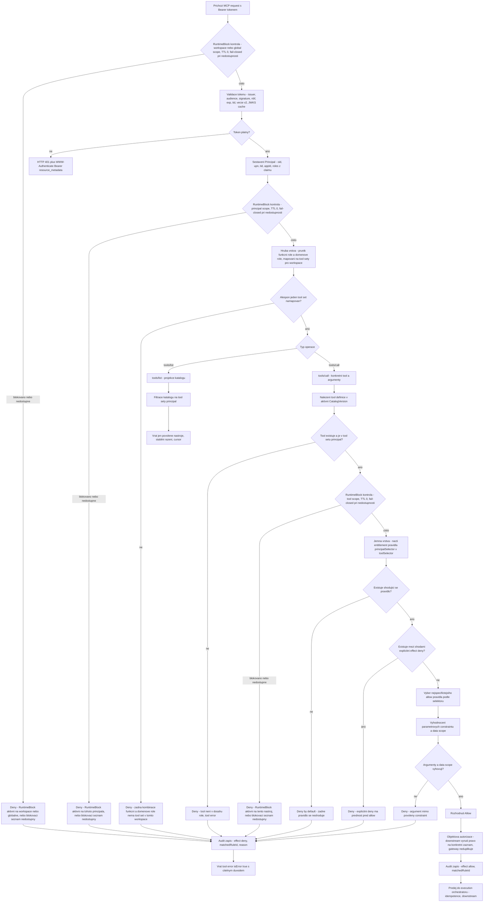
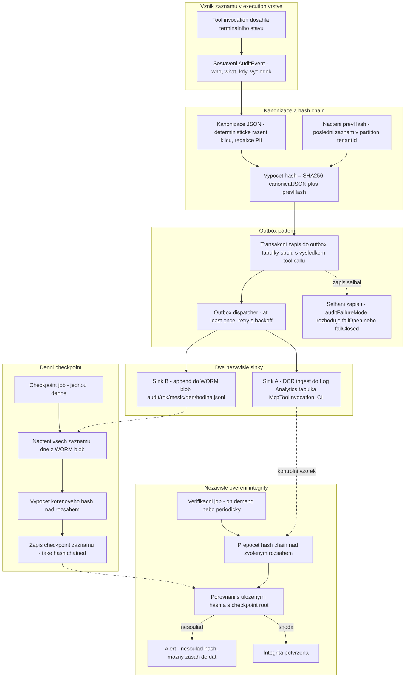

# 07 — Bezpečnost a autorizace

**Verze:** 1.0 · **Datum:** 2026-09-17 · **Stav:** Návrh
**Týká se ADR:** ADR-005, ADR-006, ADR-007, ADR-008, ADR-010, ADR-013, ADR-016, ADR-017

Tento dokument je bezpečnostní a autorizační specifikace MCP-Azure Gateway. Navazuje na komponentovou dekompozici v [`03-kodova-architektura.md`](./03-kodova-architektura.md) (moduly `identity/`, `authz/`, `audit/`) a na datový model v [`04-datova-architektura.md`](./04-datova-architektura.md) (kontejnery `entitlements`, `policyDecisions`). Cílová čtenářská skupina: bezpečnostní architekt, implementátor modulu `authz/`, auditor.

---

## 1. Rozsah a předpoklady

Gateway je OAuth 2.1 Resource Server před Microsoft Entra ID jako Authorization Server (ADR-005). Autorizace je dvouvrstvá (ADR-007): hrubá vrstva Entra app roles → tool sety, jemná vrstva policy engine nad katalogem s parametrovými constrainty. Downstream identita je OBO nebo Managed Identity, nikdy token passthrough (ADR-008). Audit trail je dual-sink, hash-chained, append-only (ADR-010). Skill repozitář je sandboxovaný — žádný spuštěný uživatelský kód v procesu gateway (ADR-013).

---

## 2. Model hrozeb (STRIDE)

Tabulka pokrývá architekturu jako celek — edge, protocol, identity, authz, adapters, audit i CI/CD skill repozitáře. Sloupec „Zbytkové riziko" je hodnocení PO aplikaci uvedeného protiopatření, ne před ním.

| # | STRIDE | Hrozba | Vektor | Dopad | Protiopatření | Zbytkové riziko |
|---|---|---|---|---|---|---|
| 1 | Spoofing / Elevation | **Confused deputy — token passthrough** | Gateway by přeposlal příchozí uživatelský token beze změny do APIM; downstream API by věřilo, že token byl vydán přímo pro něj | Downstream API provede akci s oprávněním gateway, ne uživatele; audience konfuze umožní volání API, pro které token nebyl určen | ADR-008: nikdy token passthrough. Pro downstream s uživatelským kontextem výhradně OBO (nový token, nová audience). RFC 8707 `resource` indicator vynucen na vstupu i výstupu OBO výměny | Nízké — zbývá riziko chyby v konfiguraci `resource` parametru při onboardingu nového downstream API |
| 2 | Spoofing | **Replay ukradeného access tokenu** | Token unikne (log, proxy, XSS na klientovi) a je znovu použit útočníkem v okně platnosti | Neautorizovaný přístup pod identitou oběti do doby expirace | Krátká platnost access tokenu (řízeno Entra, typicky desítky minut), `aud`/`nbf`/`exp` validace na každém requestu, TLS everywhere, tokeny nikdy v query stringu (MCP spec MUST), zákaz logování Authorization hlavičky | Střední — replay v rámci platnosti tokenu je z principu bearer-token modelu nezastavitelný bez mTLS/DPoP; DPoP není v MCP 2025-11-25/2026-07-28 vyžadován |
| 3 | Tampering | **Nepřímá prompt injection ve výsledku nástroje** | Downstream data (CRM poznámka, e-mail, dokument) obsahují text vydávající se za systémovou instrukci, který se vrátí v `tool_result` a LLM ho interpretuje jako pokyn | Exfiltrace dat, neautorizované volání dalších nástrojů, obejití entitlements skrz „přesvědčení" modelu, ne systému | Výsledky nástrojů se vždy vrací jako `content` typu `text`/`resource`, nikdy neinjektují do systémového promptu gateway; `_meta` označení provenience (`untrusted-downstream`); limity velikosti výsledku; zákaz automatického řetězení write nástrojů bez `confirm` (ADR-016) — viz §6 | Střední — obrana je na úrovni gateway a orchestrace, finální rozhodnutí model provést/neprovést další akci zůstává na klientovi (Claude/ChatGPT); nelze garantovat 100% odolnost LLM |
| 4 | Information Disclosure | **Exfiltrace dat kombinací nástrojů** ⚠️ **viz shrnutí pro sponzora níže** | Uživatel s legitimním přístupem ke čtecímu nástroji A a zápisovému/externímu nástroji B je zmanipulován (prompt injection nebo vlastní úmysl) ke zřetězení: přečti citlivá data → zapiš je do externího systému | Únik dat mimo organizaci i bez jediného „zakázaného" volání — každé volání jednotlivě bylo autorizované | **Preventivní (nové, viz §6): zákaz kombinace** širokého čtecího přístupu (žádný/`all` `dataScope`) a `openWorldHint: true` nástroje v jednom efektivním tool setu principal, vynucený jako blokující kontrola při publikaci entitlements, dokud kombinaci výslovně neschválí bezpečnostní review. **Detekční/limitní (stávající):** data scope v entitlements (např. `own-region`), audit koreluje sekvenci volání v rámci `traceId` pro zpětnou detekci, rate limiting omezuje objem exfiltrovatelných dat za jednotku času | Vysoké → **Střední po nasazení preventivní kontroly** — nová kontrola blokuje nejběžnější neúmyslnou cestu (širokým čtením + libovolným externím zápisem najednou), ale nemůže zabránit zneužití kombinace, kterou review vědomě schválil, ani zneužití v rámci jediného nástroje s `openWorldHint: true`, který sám čte i zapisuje; zůstává systémové riziko agentních systémů obecně |
| 5 | Elevation of Privilege | **Škodlivý skill v repozitáři** | Útočník (insider nebo kompromitovaný účet přispěvatele) přidá do skill manifestu volání na neschválený downstream host nebo se pokusí propašovat spustitelný kód | Neautorizovaný odchozí HTTP požadavek z gateway, potenciální SSRF nebo exfiltrace přes gateway identitu | ADR-013: skill smí deklarovat jen `http` (whitelistovaný APIM backend) nebo `transform` (JSONata/JMESPath), nikdy kód. Branch protection, povinný review, CODEOWNERS, signed commits, validace manifestu jako gate v ingestor pipeline — viz §7 | Nízké — reziduální riziko je chyba v samotném validátoru (schema bypass) |
| 6 | Elevation of Privilege | **Kompromitace GitHub App** (credentials/private key skill-ingestoru) | Únik privátního klíče GitHub App umožní útočníkovi simulovat legitimní webhook nebo číst/měnit obsah repozitáře v rozsahu oprávnění App | Publikace škodlivé `CatalogVersion` vypadající jako legitimní, obejití review procesu | Privátní klíč GitHub App v Key Vault, rotace klíče, webhook HMAC ověření nezávislé na App klíči, nezávislý reconcile job (15 min) porovnává publikovaný katalog s aktuálním stavem chráněné větve a signed commits — anomálie (katalog neodpovídá žádnému podepsanému commitu) spustí alert | Střední — kompromitace App s právy na merge do chráněné větve zůstává vážným incidentem vyžadujícím lidskou revizi |
| 7 | Spoofing | **Krádež client secret konektoru** (Claude/ChatGPT app registration v Entra) | Client secret unikne z konfigurace connectoru nebo z Key Vault | Útočník může iniciovat OAuth flow jako legitimní klient a po získání souhlasu uživatele/adminu obdržet tokeny | Client secret v Key Vault s RBAC, rotace dle §8, monitoring blížící se expirace, „Assignment required" na enterprise app omezuje, kdo se vůbec může přihlásit i se znalostí client_id/secret, Conditional Access (MFA, lokalita) na uživatelské přihlášení | Střední — client secret sám o sobě bez uživatelského souhlasu nevede k přístupu k datům (confidential client + user consent flow), ale umožňuje impersonaci klienta vůči AS |
| 8 | Spoofing | **SSRF přes parametr nástroje** | Tool argument obsahující URL/hostname je použit connector adapterem k sestavení odchozího požadavku bez validace, útočník nasměruje na interní endpoint (např. Azure IMDS `169.254.169.254`) | Únik Managed Identity tokenů, přístup k interním službám mimo zamýšlený downstream | ConnectorAdapter volá výhradně preregistrovanou APIM `operationId`, nikdy URL sestavenou z argumentu; pokud tool argument nese URL jako doménová data (ne cíl volání), validace proti allow-listu hostů a blokace loopback/link-local/metadata rozsahů — viz §6 | Nízké — architektonicky vyloučeno tím, že adapter nekonstruuje cílovou URL z uživatelského vstupu |
| 9 | Elevation of Privilege | **Nadměrná oprávnění downstream (over-privileged Managed Identity/OBO scope)** | Managed Identita gateway nebo OBO scope má širší oprávnění, než který tool skutečně potřebuje | Kompromitace gateway procesu (např. RCE v závislosti) vede k plnému přístupu k downstream datům, ne jen k té podmnožině, kterou gateway legitimně používá | Princip nejmenších oprávnění per role assignment, samostatné scopes/role per downstream API, pravidelný přezkum (§10), žádné `Owner`/`Contributor` role na datových rovinách, jen specifické RBAC role (Key Vault Secrets User, ne Administrator, pro runtime) | Střední — vyžaduje disciplínu při onboardingu nových downstream API, degraduje bez pravidelného přezkumu |
| 10 | Spoofing / Tampering | **Session hijacking v éře A** | `Mcp-Session-Id` (éra A, legacy klienti) je bearer-like identifikátor; jeho únik (log, proxy, XSS) umožní útočníkovi pokračovat v cizí relaci | Přístup k probíhající konverzaci/výsledkům bez nutnosti vlastnit access token | Session ID není samostatný autentizační faktor — každý request v éře A i tak nese Bearer token, session je jen korelační, ne autorizační. Session store (Redis) má TTL, session neposkytuje širší oprávnění než aktuální token. Session je volitelný modul (ADR-001), po odchodu éry A mizí zcela | Nízké — session sama o sobě bez platného tokenu nic neumožní |
| 11 | Denial of Service | **DoS přes drahé nástroje** | Uživatel (nebo zacyklený agent) opakovaně volá nástroj s vysokou downstream latencí/cenou (např. velký report), vyčerpá kapacitu APIM nebo backend | Degradace pro ostatní uživatele, zvýšené náklady na downstream, možný cirkuit breaker trip pro všechny | Třívrstvý rate limiting (ADR-017): Front Door WAF → gateway per-user/per-tool token bucket → APIM `rate-limit-by-key`/`quota-by-key`. `riskTier` na nástroji řídí přísnější limit. Circuit breaker izoluje postižený downstream | Nízké — zbývá riziko koordinovaného zneužití více účtů současně (mitigace: Front Door WAF rate limiting na IP/geo úrovni) |
| 12 | Information Disclosure | **Únik PII do logů** | Argumenty tool callu nebo výsledek obsahují osobní údaje, které skončí v nekontrolovaném logu (stdout, APM trace) | Porušení GDPR, rozšíření okruhu osob s přístupem k PII nad rámec nutnosti | Strukturované logování s explicitní redakcí (`argumentsRedacted` pole, ne raw `arguments`), audit ukládá jen `argumentsHash` + redigovaná podmnožina, zákaz logování celého response body v APIM diagnostice (viz §8), seznam zakázaných polí v redakčním filtru (hesla, tokeny, čísla dokladů) | Střední — redakční filtr je udržovaný seznam, nové PII pole v novém downstream API může uniknout, dokud není přidáno do filtru |
| 13 | Elevation of Privilege | **Insider s právy na katalog** | Osoba s rolí `Mcp.CatalogAdmin` zneužije administrativní právo k publikaci nástroje, který obchází entitlements (např. nástroj bez `riskTier`, tichý downgrade constraintů) | Insider threat s legitimním přístupem, obtížně odlišitelné od běžné administrace | Publikace katalogu vyžaduje současně (a) prošlou CI validaci (§7), (b) `Mcp.CatalogAdmin` app roli s „Assignment required", (c) je nevratně auditovaná a immutable (ADR-012) — žádná verze katalogu nejde tiše přepsat, jen nahradit novou s vlastním záznamem. Čtyřoké principy (povinný review v GitHub) platí i pro admin změny | Střední — insider s dostatečným přístupem může nadále publikovat škodlivou, ale validní verzi; detekce je post-hoc přes audit a diff proti Git SHA |
| 14 | Tampering | **Tool poisoning / schema confusion** | Škodlivý nebo chybný skill deklaruje `inputSchema`/`outputSchema`, které se neshodují se skutečným chováním (např. `readOnlyHint: true` na ve skutečnosti zápisovém volání), aby obešel UX potvrzení na straně klienta | Klient (Claude/ChatGPT) důvěřuje anotaci a nezobrazí potvrzovací dialog pro destruktivní akci | Anotace `readOnlyHint`/`destructiveHint` z gateway katalogu jsou důvěryhodné jen do té míry, do jaké prošly review procesem (§7); gateway navíc nezávisle vynucuje `confirm` parametr pro nástroje, kde `destructiveHint: true` nebo `riskTier ∈ {high, critical}`, na straně serveru (ADR-016), ne jen spoléhá na klientský hint. Conformance testy v `testkit` ověřují shodu schématu s chováním adapteru | Nízké — serverová vynucení `confirm` je nezávislé na tom, zda klient hint respektuje |
| 15 | Repudiation | **Popření provedené akce uživatelem** | Uživatel tvrdí, že tool call neprovedl on, ale např. sdílený účet nebo unikátní token | Nemožnost přiřadit odpovědnost, ztráta důvěryhodnosti auditu | Audit váže `principal{oid,upn,tid,appId}` z immutable claimů tokenu, ne jen aplikační session; hash chain (ADR-010) znemožňuje dodatečnou úpravu záznamu; `oid` je stabilní přes celou dobu života identity v tenantu | Nízké — zbývá organizační riziko sdílených service principal identit mimo kontrolu gateway |
| 16 | Denial of Service | **Zahlcení webhook endpointu ingestoru** | Útočník posílá velký objem falešných/validních webhook požadavků na `/webhooks/github` | Vyčerpání kapacity ingestoru, zpoždění legitimní publikace katalogu | HMAC ověření podpisu jako první krok (levná operace, odmítne nevalidní požadavky rychle), rate limiting na úrovni Front Door/APIM před endpointem, ingestor běží jako Container Apps Job odděleně od request-path gateway (izolace dopadu) | Nízké |
| 17 | Elevation of Privilege | **Zneužití OBO tokenu s nesprávnou audience** | Chyba v implementaci OBO výměny přiřadí token pro downstream API A k volání downstream API B | Cross-API elevation, přístup k datům mimo zamýšlený scope | RFC 8707 `resource` indicator povinný při každé OBO výměně, downstream API samo validuje `aud` (obrana do hloubky — gateway nespoléhá jen na vlastní správnost), token cache klíčovaný `(principal, resource)` páru, ne jen principal | Nízké |
| 18 | Information Disclosure | **JWKS cache poisoning / zastaralý klíč** | Gateway cachuje JWKS déle, než je bezpečné, a přijímá tokeny podepsané již odvolaným klíčem po kompromitaci Entra tenantu (extrémní scénář) nebo neobnoví cache po rotaci a začne odmítat validní tokeny (dostupnostní, ne bezpečnostní dopad) | Nízká pravděpodobnost, ale u prvního scénáře vysoký dopad | JWKS cache s rozumným TTL (desítky minut) a fallback fetch při neznámém `kid`, ne pouze při expiraci cache — viz §3.5 | Nízké |
| 19 | Tampering | **Zneužití rollbacku katalogu** | Útočník s admin přístupem (nebo skrz zneužitý `/admin/catalog/rollback`) vrátí katalog na starší verzi se známou zranitelností (např. nástroj bez constraintů) | Downgrade attack — obejití nedávno opravené bezpečnostní chyby | `/admin/catalog/rollback` vyžaduje `Mcp.CatalogAdmin`, je auditovaný jako jakákoli jiná admin akce, `CatalogVersion` je immutable takže rollback je viditelný jako změna `activePointer` s plnou historií, ne skrytá mutace | Nízké |
| 20 | Denial of Service | **Vyčerpání idempotence cache** | Útočník generuje velké množství unikátních `Idempotency-Key` hodnot pro zápisové nástroje, aby zahltil Redis | Degradace idempotence mechanismu pro legitimní provoz, případně pád Redis instance | TTL 24 h na idempotence klíčích (ADR-016) omezuje neomezený růst, per-principal kvóta na počet aktivních idempotence klíčů, Redis metriky a alerting na paměťové využití | Nízké |
| 21 | Information Disclosure | **Cross-workspace únik dat** | Chyba v projekci `tools/list`/`tools/call` smísí katalog nebo entitlements mezi workspacy (Claude vs. ChatGPT vs. budoucí) | Uživatel jednoho workspace uvidí nebo zavolá nástroj patřící jinému workspace s jinými daty/oprávněními | Workspace identifikován kombinací cesty `/mcp/{workspaceSlug}` a přiřazené app role (ADR-015; audience je záměrně sdílená napříč všemi workspace, viz §4.1); partition key `/tenantId` v Cosmos zabraňuje cross-tenant query bez explicitního filtru; contract testy pokrývají izolaci workspaců | Nízké |
| 22 | Elevation of Privilege | **Eskalace přes chybně specifikovaný entitlement selektor** | Administrátor omylem napíše příliš široký `toolSelector` glob (např. `*` místo `crm_*`), nechtěně otevře všechny nástroje dané roli | Nadměrný přístup vzniklý lidskou chybou, ne útokem | Povinný review entitlement změn (stejný gate jako skill repo — entitlements verzované v Gitu, ne editované přímo v UI produkce), automatizovaný test „diff dopadu" před publikací (kolik nových tool×principal kombinací pravidlo otevírá), pravidelný přezkum (§10) | Střední — lidská chyba v konfiguraci zůstává nejčastější třídou autorizačních incidentů napříč odvětvím |

> ### ⚠️ Shrnutí pro sponzora: zbytkové riziko exfiltrace řetězením nástrojů (hrozba #4)
>
> Toto je jediná položka v tabulce výše, kde gateway **nemůže technicky zaručit prevenci** — jen ji učinit méně pravděpodobnou a detekovatelnou po faktu. Pokud uživatel s legitimním přístupem k čtecímu i „open world" (externě komunikujícímu) nástroji tyto dva nástroje zřetězí — ať už zmanipulován prompt injection, nebo úmyslně — může přečíst citlivá data a odeslat je mimo organizaci, aniž by jediné jednotlivé volání bylo „zakázané". Tento návrh nyní přidává preventivní kontrolu (§6: zákaz kombinace širokého čtecího přístupu a `openWorldHint: true` nástroje v jednom entitlement bundlu bez explicitního schválení), která nejběžnější neúmyslnou cestu k tomuto riziku blokuje. **Nejde ale o úplnou prevenci** — schválené kombinace a nástroje, které samy čtou i zapisují, riziko dál nesou. **Pro nasazení nad firemní data doporučujeme, aby toto zbytkové riziko bylo vědomě akceptováno sponzorem/bezpečnostním architektem projektu jako explicitní rozhodnutí** (kdo schvaluje výjimky z preventivní kontroly, jaká data smí být vystavena nástrojům s `openWorldHint: true` vůbec), ne přehlédnuto jako řádek v tabulce hrozeb.

---

## 3. Autentizace — OAuth 2.1 detailně

### 3.1 Role AS vs. RS

Microsoft Entra ID je **Authorization Server (AS)**, gateway je **OAuth 2.1 Resource Server (RS)** — nikdy ne AS (ADR-005). Gateway nikdy nevydává vlastní tokeny, jen je validuje. MCP klient (Claude, ChatGPT) je OAuth **Client**. Tento model je popsaný v MCP autorizační specifikaci: MCP server = Resource Server, samostatná, protokolem neuvedená Authorization Server vydává tokeny [Z11].

### 3.2 PKCE S256

MCP autorizační specifikace vyžaduje, aby AS podporoval a advertisoval `code_challenge_methods_supported: ["S256"]` [Z11]. Claude v praxi vždy posílá `code_challenge_method=S256` bez ohledu na registrační mechanismus [Z16]. Entra ID PKCE S256 podporuje nativně jako součást OAuth 2.0/2.1 autorizačního code flow. Gateway sama PKCE neimplementuje (to dělá AS a klient), ale **musí** ověřit, že Entra app registration pro daného klienta nemá povolený implicit/legacy flow bez PKCE.

### 3.3 `resource` indicator (RFC 8707) — obrana proti confused deputy

MCP klient **musí** poslat parametr `resource` na autorizační i token endpoint, nastavený na kanonickou URI MCP serveru, bez ohledu na to, zda AS podporu RFC 8707 deklaruje [Z11]. V Entra ID modelu se tato hodnota porovná s **Application ID URI** (identifier URI) registrace gateway — musí se shodovat přesně, jinak token request selže [Z6].

Toto je klíčová obrana proti confused deputy útoku (hrozba #1 v §2): bez `resource` parametru by mohl klient obdržet token s obecnou audience, kterou by pak bylo možné přehrát vůči jinému API se stejným AS. S vynuceným `resource` je token vydán s audience specifickou pro tuto instanci gateway a downstream API ho odmítne, pokud se pokusí projít dál beze změny — proto ADR-008 zakazuje token passthrough a vyžaduje OBO výměnu s vlastním `resource` pro každý downstream.

### 3.4 Validace tokenu

Gateway (modul `identity/`) validuje na **každém** požadavku:

| Kontrola | Detail |
|---|---|
| `iss` (issuer) | Musí odpovídat v2.0 issuer (`https://login.microsoftonline.com/{tid}/v2.0`); v1 issuer (`sts.windows.net/...`) je odmítnut — RS pracuje výhradně s v2 tokeny [Z6] |
| `aud` (audience) | Musí odpovídat Application ID URI gateway (RFC 8707 §2 — server MUST validovat, že audience je on sám) [Z11] |
| `signature` | Ověření proti JWKS klíči odpovídajícího `kid` z hlavičky tokenu |
| `nbf`/`exp` | Standardní časová platnost, s dovoleným clock skew (viz §3.6) |
| `tid` | Tenant ID — musí odpovídat očekávanému tenantu (ochrana proti cross-tenant tokenům u multi-tenant app registrace) |
| verze tokenu | `ver: "2.0"` v claimu — RS odmítá v1 tokeny |
| `roles` | Extrahováno pro hrubou autorizační vrstvu (§5) |

Neplatný nebo chybějící token → HTTP `401` s `WWW-Authenticate: Bearer resource_metadata="https://<host>/.well-known/oauth-protected-resource"` (§5 API dokumentu [`05-api-a-protokoly.md`](./05-api-a-protokoly.md) uvádí přesný tvar). Toto je jediná výjimka z pravidla „autorizační odmítnutí = tool error, ne HTTP chyba" (architektonických rozhodnutí v [`09-adr-a-zdroje.md`](./09-adr-a-zdroje.md)) — chybějící/neplatný token musí být HTTP 401, protože jinak by OAuth flow na straně klienta nemohl proběhnout [Z16]. Žádný JSON-RPC chybový kód se v tomto dokumentu pro autentizační ani autorizační scénář nepoužívá — kanonická tabulka „situace → HTTP status → JSON-RPC kód nebo tool error" (včetně rozsahu `-32000`…`-32019`, který se v nových implementacích nepoužívá) je v [`05-api-a-protokoly.md`](./05-api-a-protokoly.md); tento dokument z ní jen cituje.

### 3.5 JWKS caching a rotace klíčů

Gateway cachuje JWKS dokument z Entry discovery endpointu s TTL v řádu desítek minut (přesná hodnota `⚠️ TODO — určit v provozní konfiguraci na základě zátěžového testu`). Klíčová zásada: pokud token nese `kid`, který není v aktuální cache, gateway provede **okamžitý fallback fetch** JWKS dokumentu (ne čeká na vypršení TTL) — to pokrývá běžnou rotaci klíčů Entrou bez výpadku validace. Opakovaný neúspěch i po fallback fetchi znamená skutečně neplatný klíč → `401`.

### 3.6 Clock skew

Standardní tolerance clock skew pro `nbf`/`exp` validaci se doporučuje v řádu jednotek minut (typická praxe JWT knihoven, konkrétní hodnota `⚠️ TODO — potvrdit doporučenou výchozí hodnotu pro zvolenou JWT knihovnu MCP TypeScript SDK/Node`). Příliš velká tolerance prodlužuje okno pro replay (hrozba #2), příliš malá způsobuje falešná odmítnutí při nesynchronizovaných hodinách mezi klientem a AS.

### 3.7 Proč není DCR (ADR-006)

Entra ID **nepublikuje RFC 7591 Dynamic Client Registration endpoint** — potvrzeno napříč pěti nezávislými MS Learn zdroji [Z7], [Z8], [Z9]. MCP autorizační specifikace (2026-07-28) navíc DCR sama deprecuje ve prospěch **Client ID Metadata Documents (CIMD)**, s DCR zachovaným jen pro zpětnou kompatibilitu s AS, které CIMD nepodporují [Z12]. Entra CIMD také nepodporuje coby AS mechanismus registrace v tomto smyslu — klienti se tedy registrují **staticky**.

**Praktický důsledek pro Claude a ChatGPT connector:**

- Administrátor vytvoří v Entra ID samostatnou app registration pro Claude connector a samostatnou pro ChatGPT connector (§4).
- `client_id` (a u confidential clientů `client_secret`) se zadává **ručně** do konfigurace connectoru na straně Claude (Organization settings → Connectors → custom connector, pole client ID/secret) a ChatGPT Business (Workspace settings → Connectors/Developer mode).
- Gateway nemusí implementovat `/register` endpoint. Nemusí řešit neomezený růst klientů, který DCR jinak přináší — to byl i jeden z důvodů zamítnutí DCR proxy/shim varianty (architektonických rozhodnutí v [`09-adr-a-zdroje.md`](./09-adr-a-zdroje.md)): udržovat vlastní shim před Entrou by znamenalo duplikovat bezpečnostní rozhodování bez skutečného přínosu, protože Entra beztak DCR nepodporuje.
- Claude sama dokumentuje, že pro servery s vysokou návštěvností doporučuje CIMD/staticky drženou identitu **místo** DCR, právě kvůli neomezenému růstu klientů [Z16] — což je konzistentní s tím, co Entra vynucuje strukturálně.

**Protected Resource Metadata (RFC 9728)** — gateway **musí** hostovat tento dokument, protože MCP klient ho používá k nalezení správného AS [Z11], [Z6]. Konkrétní obsah pro `/.well-known/oauth-protected-resource`:

```json
{
  "resource": "https://mcp.contoso.com/mcp",
  "authorization_servers": [
    "https://login.microsoftonline.com/<tenant-id>/v2.0"
  ],
  "scopes_supported": [
    "mcp.invoke"
  ],
  "bearer_methods_supported": [
    "header"
  ]
}
```

Per-workspace varianta na `/.well-known/oauth-protected-resource/mcp/{workspaceSlug}` vrací **stejnou hodnotu `resource`** (`https://mcp.contoso.com/mcp` — jeden Application ID URI pro celou gateway, viz §4.1) a liší se jen případně odlišnými `scopes_supported`/`resource_documentation`, pokud workspace vyžaduje jiný scope set. Klíčová pravidla:

- `authorization_servers` **musí** být v2.0 issuer URL odpovídající `iss` claimu vydávaných tokenů — v1 issuer (`sts.windows.net/...`) nesedí [Z6].
- Claude používá **jen první položku** pole `authorization_servers` a nefallbackuje na další — primární issuer musí být uveden jako první [Z16].
- 401 odpověď nese `WWW-Authenticate: Bearer resource_metadata="https://mcp.contoso.com/.well-known/oauth-protected-resource"` — gateway **musí vždy** vracet 401 s touto hlavičkou, nikdy 200 s chybou uvnitř těla, jinak Claude nenajde PRM dokument [Z16], [Z6].
- Gateway musí PRM zpřístupnit i bez ohledu na to, jestli přístup přišel z cesty za WAF/reverse proxy — jinak se discovery tiše rozbije [Z16].

---

## 4. Registrace klientů v Entra ID krok za krokem

### 4.1 App registration pro gateway (Resource Server)

1. Vytvořit novou app registration `mcp-gateway-prod` (jednotlivě pro non-prod prostředí analogicky, `mcp-gateway-pilot` apod.) — **jednu** pro celou gateway, ne jednu per workspace (viz bod 3).
2. V manifestu nastavit `requestedAccessTokenVersion: 2` v sekci `api` — **musí** být nastaveno **před** krokem 3, jinak nelze nastavit HTTPS Application ID URI odpovídající URL serveru [Z6].
3. Nastavit **Application ID URI** = `https://mcp.contoso.com/mcp` (musí to být **ověřená vlastní doména**, ne `*.azurewebsites.net`/`*.azurecontainerapps.io` — jinak selže token request s `AADSTS9010010` [Z16]). Tato hodnota je zároveň kanonický `resource` indikátor (RFC 8707, §3.3), kanonický PRM `resource` (RFC 9728) a hodnota `aud` claimu ve vydaných tokenech — všechny čtyři musí být bajtově identické, jinak token request selže.

 **Proč `https://`, ne `api://`.** Entra běžně nabízí jako default tvar Application ID URI `api://{appId}` nebo `api://{doména}`. MCP klient ale posílá `resource` parametr jako kanonickou URL MCP serveru (§3.3), a ta je `https://`. Kdyby bylo Application ID URI ve tvaru `api://...`, muselo by se od hodnoty `resource`, kterou klient skutečně posílá, lišit — a Entra by token nevydala (`AADSTS9010010`, viz krok výše). Proto je `https://` forma jediná, která drží `resource`, PRM `resource` a `aud` v jedné hodnotě.

 **Proč workspace nemají vlastní audience.** Jeden Application ID URI, jedna app registration pro celou gateway — Claude, ChatGPT i případné další workspace sdílejí **stejnou** hodnotu `https://mcp.contoso.com/mcp` jako audience (viz `workspaces.audience` v [`04-datova-architektura.md#34-workspaces`](./04-datova-architektura.md#34-workspaces), kde je hodnota shodná ve všech řádcích). Workspace se rozlišuje cestou (`/mcp/{workspaceSlug}`) a přiřazenou app rolí, nikdy audience — vlastní audience per workspace by vyžadovala samostatnou app registration a samostatný admin consent pro každý nový klient, což je přesně provozní zátěž, kterou návrh chce vyhnout (ADR-015).
4. Pod **Expose an API** → **Add a scope** definovat delegated scope `mcp.invoke` — plná hodnota scope je `https://mcp.contoso.com/mcp/mcp.invoke` (Application ID URI + `/mcp.invoke`), v tokenu se objeví jako `scp: "mcp.invoke"` (display name, admin/user consent popisky).
5. Pod **App roles** definovat role z ADR-007 (§5.1): funkční role `Mcp.Reader`, `Mcp.Operator`, `Mcp.Approver`, `Mcp.CatalogAdmin`, `Mcp.Auditor` a doménové role `Mcp.Domain.<Domena>.<Read|Write>` (§5.1). `Allowed member types`: `Users/Groups` (přiřazení uživatelům a bezpečnostním skupinám), případně i `Applications` pokud plánujeme service-principal klienty (budoucí rozšíření).
6. Na Enterprise Application (service principal) gateway zapnout **„Assignment required"** = Yes — token se pak nevydá bez explicitního přiřazení role [Z6].

### 4.2 App registration pro Claude connector

1. Vytvořit app registration `mcp-gateway-claude-connector` (samostatná identita klienta, ne stejná jako gateway).
2. Typ: confidential client (Claude connector podporuje `client_secret`) — vygenerovat client secret, uložit do Key Vault, nikdy neposílat kanálem mimo bezpečnou konfiguraci connectoru.
3. **Redirect URI**: pro hostované Claude (web/desktop/mobile/Cowork) je to `https://claude.ai/api/mcp/auth_callback` [Z16] — potvrzeno přímo z Anthropic dokumentace. Pro Claude Code (lokální CLI) je to RFC 8252 loopback redirect (`http://localhost:<ephemeral-port>/callback`) — AS musí akceptovat `localhost`/`127.0.0.1` s libovolným portem [Z16].
4. API permissions: delegated `mcp.invoke` na gateway app registration, s admin consent.
5. Přiřadit uživatele/skupiny na příslušné app role gateway (krok 4.1.5) — samotná registrace klienta neuděluje roli, to je vždy vázáno na přihlašujícího se uživatele přes assignment na gateway service principal.
6. V Claude Organization settings → Connectors zadat MCP endpoint URL, `client_id`, `client_secret` tohoto app registration.

### 4.3 App registration pro ChatGPT connector

1. Vytvořit app registration `mcp-gateway-chatgpt-connector`, analogicky k 4.2.
2. **Redirect URI pro ChatGPT Business developer mode**: `⚠️ TODO — ověřit v aktuálním UI ChatGPT Business (Workspace settings → Connectors/Developer mode)`. Výzkum nepotvrdil konkrétní callback URL pro OpenAI stranu (na rozdíl od Claude, kde je URL zdokumentovaná přímo Anthropicem [Z16]) — před nasazením nutno ověřit v developer mode UI při zakládání konektoru.
3. Autentizační mechanismy podporované ChatGPT developer mode: OAuth včetně CIMD (public client `none` token-auth nebo `private_key_jwt`), DCR pokud AS podporuje, no-auth, nebo statické přihlašovací údaje [Z18]. Vzhledem k ADR-006 (Entra nepodporuje DCR) bude ChatGPT connector použit se staticky zadaným `client_id`/`client_secret` stejně jako Claude.
4. API permissions a admin consent analogicky ke kroku 4.2.4.

### 4.4 Admin consent

Pro oba connectory (Claude i ChatGPT) je nutný **admin consent** na delegated scope `mcp.invoke`, protože jde o firemní nasazení, ne individuální souhlas každého uživatele s neznámou aplikací. Provede tenant admin v Entra admin center → Enterprise applications → [connector app] → Permissions → Grant admin consent. Bez tohoto kroku by každý uživatel musel scope odsouhlasit individuálně při prvním přihlášení, což je nežádoucí pro řízené nasazení (a v mnoha tenantech je user consent pro nové aplikace stejně zakázaný organizační politikou).

### 4.5 „Assignment required" a řízení přístupu

„Assignment required" (§4.1.6) je primární mechanismus, kterým organizace řídí, **kdo se vůbec může přihlásit** přes daný connector — nezávisle na app rolích, které řídí **co smí dělat** po přihlášení. Bez tohoto nastavení by se mohl přihlásit kdokoliv v tenantu se znalostí `client_id` (pokud by public client flow byl povolen) nebo kdokoliv, komu admin scope odsouhlasil. S „Assignment required" musí být uživatel/skupina explicitně přiřazena k enterprise application gateway — to je oddělený administrativní krok od přiřazení app role.

### 4.6 Podmíněný přístup (Conditional Access)

Doporučená baseline politika: **Require multifactor authentication** cílená na `Resources` = gateway enterprise application, se standardní výjimkou pro break-glass účty [Z13]. Pro citlivější role (`Mcp.CatalogAdmin`, `Mcp.Approver`) zvážit dodatečnou politiku vyžadující compliant/hybrid-joined zařízení nebo vyšší authentication strength — konfigurováno přes **Filter for applications** s custom security attributem na service principal, pokud je potřeba odlišit politiku per-role (Conditional Access sama o sobě netarguje app role, jen celou aplikaci; diferenciace per-role vyžaduje buď separátní enterprise applications, nebo kombinaci s Privileged Identity Management pro `Mcp.CatalogAdmin`) [Z14]. `⚠️ TODO — potvrdit konkrétní návrh politik s bezpečnostním týmem organizace, zejména zda CatalogAdmin vyžaduje PIM just-in-time aktivaci`.

---

## 5. Autorizační model (ADR-007)

### 5.1 Role a tool sety

Entra app role tvoří **dvě nezávislé osy**, které se v hrubé vrstvě průnikem — principal potřebuje **obě**, aby vůbec dosáhl na konkrétní nástroj: **funkční role** určuje, jaký *typ* operace smí principal typově provádět (čtení, zápis, schvalování, administrace), **doménová role** určuje, *nad kterými daty* to smí dělat. `Mcp.Operator` bez jakékoli `Mcp.Domain.*` role nemá přístup k žádnému doménovému nástroji, přestože obecně smí zapisovat — a naopak `Mcp.Domain.Crm.Write` bez funkční role vyšší než `Mcp.Reader` k zápisu neopravňuje. **Efektivní oprávnění principal je průnik funkční role a doménové role**, ne sjednocení.

**Funkční role (platformní):**

| App role (`value` v Entra) | Popis | Výchozí tool sety (mapování) |
|---|---|---|
| `Mcp.Reader` | Čtecí přístup k business datům přes read-only nástroje | `ts-read-*` (všechny nástroje s `readOnlyHint: true` napříč doménami, dle jemné vrstvy dále zúžené) |
| `Mcp.Operator` | Běžný operativní přístup — čtení plus doménově specifický zápis | `ts-read-*` + `ts-write-<domain>` dle jemné vrstvy a dle přiřazené doménové role (typicky jedna nebo více domén, ne automaticky všechny) |
| `Mcp.Approver` | Schvaluje/provádí nástroje s `riskTier: high`/`critical`, vyžadující `confirm` | `ts-write-*` včetně nástrojů s `riskTier: high`/`critical`, podléhá stejným jemným constraintům a doménovým rolím jako Operator |
| `Mcp.CatalogAdmin` | Administrace katalogu a publikace | `ts-admin-catalog` (`/admin/catalog/publish`, `/admin/catalog/rollback`) — **ne** business tool sety automaticky, doménové role se na ni nevztahují |
| `Mcp.Auditor` | Čtecí přístup k audit/decision datům, ne k business nástrojům | `ts-audit-readonly` (dotazy nad `policyDecisions`, exportní nástroje auditu) |

**Doménové role (rozsah dat):** konvence `Mcp.Domain.<Domena>.<Read|Write>`, kde `<Domena>` je PascalCase název domény. V tomto návrhu se používají `Mcp.Domain.Crm.Read`, `Mcp.Domain.Crm.Write`, `Mcp.Domain.Finance.Read`, `Mcp.Domain.Finance.Write`, `Mcp.Domain.Hr.Read`. `Write` implikuje `Read` v rámci stejné domény (kdo smí zapisovat, smí i číst), takže se obě role zpravidla nepřiřazují současně.

**Mapování `riskTier` → minimální funkční role** (ADR-016): nástroje `low`/`medium` smí volat `Mcp.Operator`, nástroje `high`/`critical` vyžadují `Mcp.Approver` — viz vynucení `confirm` v §6.

**Zakázané tvary rolí** — v žádném dokumentu ani konfiguraci se nesmí objevit jiná konvence pojmenování (např. `Catalog.Admin`, `FinanceReader`, `Finance.Writer`, `MCP_Reader`, `mcp.reader`, `Gateway.Operator`); jediná platná je `Mcp.<Role>` pro funkční role a `Mcp.Domain.<Domena>.<Read|Write>` pro doménové role, obojí definované v tomto dokumentu.

Hrubá vrstva (průnik funkční role a doménové role → tool set) odpovídá na otázku „má vůbec principal šanci na tento nástroj dosáhnout". Bez namapovaného tool setu je `tools/list` prázdný pro danou kategorii a `tools/call` vrací deny dřív, než se vůbec dotkne jemné vrstvy — viz diagram 17 v §5.6.

### 5.2 Jemná vrstva — formát entitlement pravidla

Entitlement je dokument v kontejneru `entitlements` (`/tenantId`), viz [`04-datova-architektura.md`](./04-datova-architektura.md). Struktura:

```json
{
  "id": "ent-crm-operator-own-region",
  "principalSelector": {
    "type": "appRole",
    "value": "Mcp.Operator"
  },
  "toolSelector": {
    "type": "prefix",
    "pattern": "crm_"
  },
  "effect": "allow",
  "constraints": {
    "parameters": {
      "region": { "in": ["CZ", "SK"] }
    },
    "dataScope": "own-region"
  },
  "priority": 100,
  "validFrom": "2026-01-01T00:00:00Z",
  "validTo": null
}
```

Podporované `principalSelector.type`: `appRole` (odpovídá claimu `roles`), `groupOid` (konkrétní bezpečnostní skupina), `userOid` (konkrétní uživatel — výjimky). Podporované `toolSelector.type`: `exact` (přesný název nástroje), `prefix`/`glob` (např. `crm_*`), `tag` (metadata štítek na nástroji v katalogu, např. `finance-sensitive`).

Příklad explicitního deny pravidla (kontraktor bez přístupu k finančním nástrojům i přes obecně širší Operator roli):

```json
{
  "id": "ent-deny-finance-contractor-group",
  "principalSelector": {
    "type": "groupOid",
    "value": "11111111-2222-3333-4444-555555555555"
  },
  "toolSelector": {
    "type": "prefix",
    "pattern": "finance_"
  },
  "effect": "deny",
  "constraints": {},
  "priority": 10,
  "validFrom": "2026-01-01T00:00:00Z",
  "validTo": null
}
```

Ekvivalentní YAML reprezentace (formát pro review v Gitu — entitlements jsou verzované stejně jako skill manifesty, ne editované přímo v produkční databázi):

```yaml
id: ent-crm-approver-delete
principalSelector:
  type: appRole
  value: Mcp.Approver
toolSelector:
  type: exact
  pattern: crm_delete_account
effect: allow
constraints:
  requiresConfirm: true
priority: 200
validFrom: "2026-01-01T00:00:00Z"
validTo: null
```

### 5.3 Vyhodnocovací algoritmus

Tento algoritmus implementuje krok 12 (Autorizace) kanonické request pipeline — proběhne až po autentizaci (kroky 6–7), resolutionu workspace a routingu metody (kroky 8–9) a dohledání nástroje s validací argumentů proti `inputSchema` (kroky 10–11), a před rate limitem, kontrolou idempotence a potvrzovací branou (kroky 13–15, viz automat 4 v [`06-stavova-logika-a-workflow.md#4-tool-invocation`](./06-stavova-logika-a-workflow.md#4-tool-invocation)). Při přehrání požadavku z idempotency cache se vyhodnocuje **znovu**, nikdy se nepřeskakuje — viz bezpečnostní invariant tamtéž.

Vstup: `principal` (z tokenu), `tool` (požadovaný nástroj), `arguments` (argumenty volání, jen pro `tools/call`).

1. **Hrubá vrstva**: pokud `principal.roles` nemá žádnou **funkční** roli namapovanou na typ operace nástroje (čtení/zápis/schválení), **nebo** nemá žádnou **doménovou** roli odpovídající doméně nástroje (§5.1) — efektivní tool set je průnik obou — **deny**, důvod `toolset_not_mapped`. Konec.
2. **Nalezení kandidátních pravidel**: všechna entitlements, kde `principalSelector` odpovídá principal (roli, skupině nebo přímo uživateli) **a** `toolSelector` odpovídá `tool.name` **a** aktuální čas leží v `[validFrom, validTo)`.
3. Pokud žádné pravidlo neodpovídá → **deny by default**, důvod `no_matching_entitlement`. Konec.
4. Rozdělit kandidáty na `denyMatches` a `allowMatches`.
5. Pokud `denyMatches` neprázdné → **deny**, důvod `explicit_deny_rule`, `matchedRuleId` = nejspecifičtější z `denyMatches` (viz skóre specificity níže). **Explicitní deny má vždy přednost před allow**, bez ohledu na specificitu allow pravidel.
6. Jinak vybrat z `allowMatches` pravidlo s nejvyšším skóre specificity. Skóre = specificita `principalSelector` (userOid=3, groupOid=2, appRole=1) + specificita `toolSelector` (exact=3, prefix/glob=2, tag=1). Při shodě skóre rozhoduje vyšší `priority` pole (explicitní tie-break); pokud i to je shodné, je to konfigurační chyba odhalená validačním testem (§10), ne runtime nedeterminismus.
7. Vyhodnotit `constraints` vybraného allow pravidla proti `arguments` a datovému kontextu (např. region účtu na straně downstream, pokud constraint typu `dataScope` vyžaduje ověření proti skutečnému záznamu — to může vyžadovat dodatečné volání do APIM před finálním rozhodnutím, viz poznámka níže). Pokud constraint neprojde → **deny**, důvod `parameter_constraint_violated`.
8. Jinak **allow**.

Poznámka ke kroku 7: `dataScope` typu `own-region` u `crm_get_account` vyžaduje znát region cílového účtu, ne jen argument volání — pokud argument je `accountId`, ne přímo `region`, gateway buď (a) vyžaduje, aby `region` byl explicitní povinný parametr ve schématu nástroje (preferovaná varianta — constraint se vyhodnotí čistě nad argumenty bez extra volání), nebo (b) provede lehké pre-flight ověření. Doporučení: návrh nástrojů v katalogu tak, aby atributy potřebné pro constrainty byly vždy explicitní parametry (varianta a) — jednodušší, rychlejší, bez závislosti na downstream dostupnosti v době autorizačního rozhodnutí.

Diagram rozhodovacího toku:



**Co diagram říká:** Rozhodnutí prochází dvěma zcela odlišnými branami, než dojde k výsledku. První (`401`) je čistě autentizační a nemá nic společného s rolí — bez platného tokenu se dál nepokračuje. Druhá brána, hrubá vrstva, je levná a rychlá (jedno porovnání seznamu rolí s mapou tool setů) a slouží jako filtr, který u naprosté většiny nerelevantních požadavků (např. pokus zavolat finanční nástroj čistě čtecím uživatelem) rozhodne bez nutnosti načítat a vyhodnocovat entitlement dokumenty. Teprve nástroje, které projdou hrubým filtrem, se dostanou k jemné vrstvě, kde exploduje počet možných deny větví — chybějící pravidlo, explicitní deny i porušený constraint jsou tři odlišné důvody, každý s vlastním kódem, protože ladění „proč mi to zakázalo" (§5.8) závisí na přesném rozlišení. Všechny deny větve se sbíhají do jednoho auditního zápisu předtím, než se výsledek promění v `tool error` — audit tedy zachycuje i zamítnutí, ne jen úspěchy.

### 5.4 Tabulka principal × tool → rozhodnutí (9 scénářů)

| # | Principal | Tool + argumenty | Rozhodnutí | Důvod |
|---|---|---|---|---|
| 1 | `Mcp.Reader` + `Mcp.Domain.Crm.Read` | `crm_get_account` (account region = CZ) | **Allow** | Nástroj je v `ts-read-*` pro doménu CRM, žádný constraint blokující čtení |
| 2 | `Mcp.Reader` + `Mcp.Domain.Crm.Read` | `crm_delete_account` | **Deny** | Hrubá vrstva — nástroj s `riskTier: critical` a `destructiveHint: true` vyžaduje `Mcp.Approver`, není v `ts-read-*` žádné domény |
| 3 | `Mcp.Operator` + `Mcp.Domain.Crm.Read` (constraint region=CZ) | `crm_get_account` (account region = CZ) | **Allow** | Jemná vrstva — `dataScope: own-region` splněn |
| 4 | `Mcp.Operator` + `Mcp.Domain.Crm.Read` (constraint region=CZ) | `crm_get_account` (account region = SK) | **Deny** | `parameter_constraint_violated` — argument mimo povolený region |
| 5 | `Mcp.Operator` + `Mcp.Domain.Crm.Write` + explicitní deny pravidlo na `crm_delete_account` | `crm_delete_account` | **Deny** | `explicit_deny_rule` — přebíjí i kdyby jiné allow pravidlo pro Operator existovalo (nástroj je navíc `riskTier: critical`, viz #2) |
| 6 | `Mcp.Approver` + `Mcp.Domain.Crm.Write` | `crm_delete_account` s `confirm: true` | **Allow** | Nástroj v `ts-write-*` pro Approver a doménu CRM, `requiresConfirm` constraint splněn, ADR-016 |
| 7 | `Mcp.Operator` + `Mcp.Domain.Finance.Read` (kontraktor, člen skupiny s explicitním deny na `finance_*`) | `finance_list_invoices` | **Deny** | `explicit_deny_rule` skupinového pravidla přebíjí obecné oprávnění role Operator k `finance_*`, přestože doménová role `Mcp.Domain.Finance.Read` je přiřazena |
| 8 | `Mcp.CatalogAdmin` | `POST /admin/catalog/publish` | **Allow** | Administrativní endpoint mimo běžný tool katalog, vlastní entitlement vázaný na `ts-admin-catalog` — doménové role se na `Mcp.CatalogAdmin` nevztahují |
| 9 **(D2/D3)** | `Mcp.Operator` + `Mcp.Domain.Hr.Read`, principal je `RuntimeBlock` cílem (probíhající HR incident) | `hr_search_employees` (`objectAuthorization.mode: hard_scope_filter`, filtr na vlastní oddělení) | **Deny** | `runtime_block_active` — zamítnuto ještě před hrubou vrstvou (§5.6), takže se vrstvy 1–3 vůbec nevyhodnocují. **Bez** aktivního RuntimeBlock by stejný request prošel vrstvami 1–2 (Allow), ale `hard_scope_filter` u `hr_search_employees` by výsledek omezil jen na záznamy vlastního oddělení principal (D3, §5.7) — a i to je jen hrubší přiblížení, ne plná objektová autorizace, protože gateway nezná HR přístupová pravidla nad rámec oddělení |

### 5.5 Vztah tří autorizačních vrstev a RuntimeBlock

Scénáře v §5.4 ilustrují **dvě** vrstvy autorizačního modelu — hrubou (tool set) a jemnou (entitlement + parametrové constrainty). Zbytek §5 doplňuje dva mechanismy, které nejsou třetí a čtvrtou vrstvou téhož žebříčku, ale **ortogonální** doplňky s jiným účelem:

- **§5.6 RuntimeBlock** není vrstva vyhodnocující *oprávnění* — je to nouzový **override**, který se ptá na úplně jinou otázku („je tento scope právě teď z bezpečnostních důvodů zastaven, bez ohledu na to, co by jinak vyhodnotily vrstvy níže?") a vyhodnocuje se **před** hrubou i jemnou vrstvou, na třech různých bodech pipeline podle toho, jaký scope blokace řeší.
- **§5.7 Objektová autorizace** je skutečně **třetí vrstva** v tom smyslu, že přichází na řadu až po úspěšném průchodu hrubou i jemnou vrstvou — ale na rozdíl od nich ji **nevyhodnocuje gateway**, vyhodnocuje ji downstream systém; gateway jen deklaruje v katalogu, jak (pokud vůbec) je vynucená.

Scénář #9 v tabulce výše ukazuje obě zároveň: RuntimeBlock zamítne dřív, než se cokoli dalšího vyhodnotí, a i kdyby nebyl aktivní, objektová vrstva by dál omezila výsledek `hr_search_employees` nad rámec toho, co by samotná jemná vrstva (region/doména) sama o sobě zachytila.

### 5.6 RuntimeBlock — nouzové zablokování s okamžitým účinkem

*(D2 — doplnění podle `10-srovnani-navrhu.md`.)*

**Problém, který entitlements a app role neřeší.** Standardní autorizační model (§5.1–§5.3) je navržený na *plánované* změny oprávnění — nová role, nové entitlement pravidlo, odebraná doménová role. Žádný z těchto mechanismů ale neřeší situaci, kde je potřeba okamžitě, v řádu sekund, zastavit konkrétního principala/nástroj/workspace **bez ohledu na to, co říká token nebo entitlement dokument** — protože **token samotný zůstává platný** až do své `exp` (typicky desítky minut až jednotky hodin, viz §5.6 dokumentu `04`, degradace při výpadku Entra) a zrušení app role assignmentu v Entra ID se do už vydaného access tokenu nepropíše, dokud si klient nevyžádá nový (refresh token flow, mimo kontrolu gateway). Scénáře, kde na tohle běžný model nestačí: kompromitovaný účet zaměstnance (probíhající incident, čeká se na formální offboarding), nástroj s objeveným zranitelným chováním u konkrétní downstream verze (potřeba stáhnout z provozu dřív, než projde standardním katalogovým rollbackem, §2 dokumentu `06`), celý workspace pod bezpečnostním vyšetřováním.

**Mechanismus.** `RuntimeBlock` je záznam se `scope` (`global`, `workspace`, `principal`, `tool`), `reason`, `setBy`, volitelným `expiresAt` a bez jakéhokoli TTL na straně čtení — „TTL 0" neznamená, že záznam sám nemá TTL (viz §3.17 a §4.4 dokumentu `04`, kde `runtimeBlocks` TTL řídí retenci po zrušení, ne platnost při čtení), ale že **žádná čtecí cesta hodnotu necachuje s platností delší, než je aktuální stav** — na rozdíl od entitlements cache (TTL až 5 min, §9 dokumentu `04`), kde je zastaralost do 5 minut akceptované riziko, tady je nepřijatelná záměrně, protože celý smysl mechanismu je „rychleji než cokoli jiného v systému". Fyzická realizace (Redis pracovní sada seedovaná z Cosmos, fail-closed při nedostupnosti obou) je popsaná v `04-datova-architektura.md` §3.17 a §4.1 — tento dokument popisuje **kdy a proč** se kontrola volá a **kdo** ji smí ovlivnit, `04` popisuje **jak** je uložená.

**Kdy se vyhodnocuje — tři checkpointy, ne jeden.** Diagram v §5.3 (uzly `RTBGLOBAL`, `RTBPRINCIPAL`, `RTBTOOL`) ukazuje tři různá místa v pipeline, protože každý scope potřebuje jinou informaci, aby vůbec šel vyhodnotit:

| Scope | Kdy se kontroluje | Proč tam |
|---|---|---|
| `global` / `workspace` | Hned na začátku requestu, **před validací tokenu** (před krokem 6 kanonické pipeline, `03` §7) | Nepotřebuje token ani principal — nejrychlejší možný kill-switch, zbytečné utrácet cyklus na validaci tokenu, který stejně povede k zamítnutí |
| `principal` | Hned po sestavení `Principal` z claimů (po kroku 7), před hrubou vrstvou | Potřebuje `principal.oid` z tokenu, ale nemá smysl čekat až na dohledání nástroje |
| `tool` | Po dohledání nástroje v katalogu (po kroku 11), před jemnou vrstvou | Potřebuje znát konkrétní `tool.name` |

**Fail-closed při nedostupnosti.** Pokud kontrola neumí s jistotou odpovědět „není blokováno" (Redis pracovní sada nedostupná **a** fallback point-read do Cosmos také selže — viz `04` §3.17), výsledek je **deny**, ne allow. Toto je jediné místo v celém autorizačním modelu, kde nedostupnost úložiště vede k zamítnutí namísto degradovaného provozu (srovnej s entitlements cache, kde stale-read je akceptovaný kompromis) — zdůvodnění: mechanismus existuje **výhradně** pro bezpečnostní zadržení, takže „neumím ověřit, jestli je blokováno" musí znamenat totéž, jako by blokováno bylo. Cenou je dostupnost (výpadek RuntimeBlock úložiště zastaví celý provoz gateway), což je vědomý kompromis ve prospěch bezpečnosti pro tento konkrétní, malý a kriticky důležitý mechanismus — ne obecný vzor uplatněný jinde v návrhu.

**Kdo smí nastavit/zrušit blokaci.** Explicitně **ne** další `Mcp.*` app role z tabulky v §5.1 — K2 (`CANONICAL-DECISIONS.md`) fixuje pětici funkčních rolí a přidání šesté by ji rozporovalo. Místo toho: dedikovaná Entra bezpečnostní skupina `sg-mcpgw-security-response`, členství **PIM-aktivované** (časově omezená eskalace, ne trvalé členství — Privileged Identity Management, §4.6, [Z20]), typicky obsazená security/on-call rolí organizace, ne vlastníky gateway provozu. Administrativní endpoint (`POST /admin/runtime-block`, `DELETE /admin/runtime-block/{id}`) vyžaduje členství v této skupině nezávisle na jakékoli `Mcp.*` roli — `Mcp.CatalogAdmin` sama o sobě nestačí, protože katalogová administrace a bezpečnostní zadržení jsou různé odpovědnosti s různým purview (viz i D5, §8.0, kde `break-glass admin` identita pokrývá související, ale ne identický scénář — RuntimeBlock je operace nad *provozem* gateway, break-glass identita je krajní nouzový přístup k *infrastruktuře* gateway).

**Auditování.** Každé nastavení i zrušení blokace je vlastní auditní záznam (`auditOutbox`, `04` §3.12/§5.7) s `principal.oid` toho, kdo akci provedl, `reason` polem povinným (ne volitelným — administrativní rozhraní odmítne prázdný důvod), a `expiresAt`, pokud je blokace časově omezená. Toto je odlišná kategorie auditu od `denied` rozhodnutí `PolicyEngine` (§5.3–5.5) — RuntimeBlock audit zaznamenává **administrativní akci**, `denied` audit zaznamenává **důsledek** této akce při dalším requestu (`reason: 'runtime_block_active'` v `AuditEvent.decision`, nová hodnota vedle `toolset_not_mapped`/`no_matching_entitlement`/`explicit_deny_rule`/`parameter_constraint_violated` z §5.3).

**Jak to řeší problém „token uživatele zůstává platný".** Bez RuntimeBlock je jediná cesta, jak okamžitě zastavit kompromitovaný účet, revokace na straně Entra (Conditional Access session revocation, nebo přímé zneplatnění refresh tokenů) — což je nástroj identity platformy, ne gateway, s vlastní latencí propagace a mimo kontrolu bezpečnostního týmu gateway, pokud nemá práva v Entra ID. RuntimeBlock dává gateway **vlastní**, nezávislý mechanismus zadržení, který nepotřebuje čekat na Entra ani na vypršení tokenu — token zůstává technicky platný (validace podpisu projde), ale **žádný request s tímto principalem/nástrojem/workspace neprojde přes krok RuntimeBlock kontroly**. Je to defense-in-depth vrstva navíc k Entra revokaci, ne její náhrada — doporučený postup při incidentu je obojí současně (RuntimeBlock pro okamžitý efekt v gateway, Entra revokace pro plošné zneplatnění napříč všemi aplikacemi, které principal používá).

### 5.7 Třetí stupeň — autorizace na úrovni objektu

*(D3 — doplnění podle `10-srovnani-navrhu.md`.)*

**Co první dva stupně neřeší.** Hrubá vrstva (§5.1) rozhoduje o tool setu, jemná vrstva (§5.2–5.3) rozhoduje o konkrétním nástroji a jeho argumentech (constraint typu `dataScope: own-region` v příkladu #3/#4 z §5.4 je omezení na *tvar argumentu*, ne na *konkrétní záznam*). Ani jeden stupeň neodpovídá na otázku: „smí principal X vidět/měnit konkrétní záznam Y, který existuje v downstream systému?" — to je **objektová (record-level) autorizace**, třetí, oddělený stupeň.

**Kdo rozhoduje — a proč to NENÍ gateway.** Gateway **nesmí** duplikovat business pravidla vlastnictví záznamů. Důvody jsou stejné jako obecný princip „Git je zdroj pravdy" pro katalog (§2 dokumentu `04`) aplikovaný na jinou entitu: (a) downstream systém (CRM, HR systém, finanční systém) **už** vlastní pravidla přístupu k záznamu — vlastník účtu, region, organizační hierarchie schvalování — a duplikovat je v gateway entitlement pravidlech znamená dvě místa pravdy, která se časem rozejdou (downstream pravidlo se změní, gateway kopie ne, a naopak); (b) gateway nemá a nemá mít přístup k plnému byznys kontextu potřebnému pro rozhodnutí (např. „je tento uživatel manažer vlastníka účtu" může záviset na datech, která gateway vůbec nevidí); (c) downstream systém je již dnes tím, kdo objektovou autorizaci fakticky vynucuje pro **jiné**, ne-MCP klienty stejného API (interní portál, jiná integrace) — gateway přidáním vlastní kopie pravidel by riskovala nekonzistenci právě vůči těmto ostatním klientům. **Downstream je tedy zdroj pravdy** pro objektovou autorizaci; gateway roli `OBJAUTH` v diagramu §5.3 popisuje jako vynucovanou downstreamem, ne jako vlastní rozhodovací krok gateway.

**Deklarace v katalogu.** Každá `tools` definice nese pole `objectAuthorization` (`03-kodova-architektura.md` §4, `ToolDefinition`) s jednou ze tří hodnot:

| `mode` | Význam | Kdy použít |
|---|---|---|
| `downstream_enforced` | Downstream API samo vynucuje přístup k záznamu (typicky: API vrací `403`/`404` pro záznam mimo oprávnění volajícího, nebo `list`/`search` endpoint sám filtruje výsledky podle identity volajícího) | Výchozí a preferovaná volba — většina dobře navržených downstream API toto už dělá, protože to potřebují pro své vlastní, ne-MCP klienty |
| `hard_scope_filter` | Gateway přidává **pevný** filtr do každého volání (např. vždy `tenantId`/`workspaceSlug` daného principal jako povinný parametr, který nejde argumentem přebít) | Jen když downstream nenabízí per-principal filtrování, ale nabízí alespoň filtrování podle hrubšího, gateway-known atributu (typicky tenant/workspace) — **není** to totéž jako plná objektová autorizace, je to hrubší přiblížení, které musí být v manifestu i dokumentaci explicitně označené jako takové |
| `not_applicable` | Nástroj nevrací/nemění záznamy, ke kterým by mohl mít přístup jen podmnožina principals (např. čistě agregovaný/statistický výstup bez identifikovatelných záznamů) | Vyžaduje `reason` pole — validátor manifestu (ingestor, ADR-011) **odmítne** publikaci s `not_applicable` bez zdůvodnění |

Katalogový validátor **odmítne** publikaci nástroje s `annotations.openWorldHint: true`, nebo jehož název/manifest indikuje `list`/`search` sémantiku (heuristika: `binding.apiId`/`operationId` odpovídá vzoru list/search operace v OpenAPI definici importované do APIM), pokud nemá vyplněné `objectAuthorization` pole vůbec — mlčení není povolená hodnota, jedna ze tří výše uvedených vždy musí být explicitní.

**Problém `list`/`search` filtrování — proč je jiný než jednotlivý záznam.** Nástroj, který vrací **jeden** záznam podle ID (`crm_get_account(accountId)`), je jednoduchý případ: downstream buď vrátí záznam (principal na něj má právo), nebo `403`/`404` (nemá) — gateway prostě předá odpověď dál. Nástroj, který vrací **množinu** záznamů (`crm_search_accounts(query)`), je jiný problém: downstream musí sám **filtrovat výsledkovou množinu** podle identity volajícího (typicky předané jako OBO token nebo identifikátor v hlavičce, ne jako parametr, který by šel zfalšovat) — **gateway to udělat nemůže**, protože gateway nezná úplnou množinu záznamů ani pravidlo, podle kterého by je měla filtrovat (to je přesně důvod (b) výše). Pokud downstream `list`/`search` endpoint filtrování nenabízí (vrací **všechny** záznamy bez ohledu na volajícího a spoléhá, že filtrování udělá klient/UI), nastávají přesně dvě legitimní možnosti, a gateway musí zvolit jednu z nich explicitně, ne mlčky nástroj publikovat s falešným pocitem bezpečnosti:

1. **Nepublikovat nástroj vůbec** (preferováno, pokud množina záznamů může obsahovat citlivá data mimo oprávnění některých principals) — katalogový validátor toto vynutí odmítnutím publikace, pokud vlastník downstream API nepotvrdí jednu z níže uvedených alternativ.
2. **Publikovat s tvrdým scope filtrem** (`hard_scope_filter`) — gateway omezí dotaz na hrubší, bezpečně dostupný rozsah (typicky: jen záznamy vlastního tenanta/workspace principal, pokud downstream alespoň tento filtr podporuje jako parametr) — to snižuje, ale **nemusí zcela odstranit** riziko, pokud by v rámci jednoho tenanta/workspace existovaly záznamy mimo oprávnění konkrétního principal (např. HR záznamy jiného oddělení) — v takovém případě `hard_scope_filter` **nestačí** a platí bod 1.

**Doplnění do tabulky scénářů (§5.4, scénář #9).** Viz řádek 9 níže — ilustruje `list`/`search` nástroj s `hard_scope_filter`, kde jemná vrstva (region) projde, ale objektová vrstva by u jiného principal-datového páru zablokovala i po úspěšném průchodu vrstev 1–2.

⚠️ TODO — přesná heuristika pro detekci `list`/`search` sémantiky nástroje ve validátoru katalogu (dnes navržena jako vzor v `operationId`/`pathTemplate`) není ověřena proti reálné sadě OpenAPI definic downstream API tohoto nasazení; může vyžadovat explicitní manifestové pole místo heuristiky.

### 5.8 Projekce do `tools/list` a `tools/call`, auditovatelnost

**`tools/list`**: gateway nikdy nevrací plný katalog všem. Projekce filtruje aktivní `CatalogVersion` (per workspace `pinnedCatalogVersion` nebo aktuální `activePointer`) na průnik s tool sety principal (hrubá vrstva) — jemná vrstva se u `tools/list` typicky nevyhodnocuje per-argument (argumenty ještě nejsou známy), ale **může** odfiltrovat nástroje, pro které existuje jednoznačné blanket `deny` bez constraintů (např. celý `finance_*` prefix zakázaný kontraktorovi z příkladu #7 se v `tools/list` vůbec neobjeví — ne jen skryje na úrovni `tools/call`). Nástroje s constrainty závislými na argumentech (jako region v příkladu #3/#4) se v `tools/list` **zobrazí** (protože obecně dosažitelné jsou), ale konkrétní volání může být zamítnuto při `tools/call` podle skutečných argumentů. Toto je záměrný kompromis — uživatel vidí, že nástroj existuje a je v zásadě pro jeho roli, ale ne nutně že projde pro každý možný argument.

**`tools/call`**: plné vyhodnocení algoritmu z §5.3 včetně constraintů nad konkrétními argumenty. Zamítnutí se vrací jako **tool error** (`isError: true` v JSON-RPC výsledku), ne jako HTTP 403 — to je záměr z architektonických rozhodnutí v [`09-adr-a-zdroje.md`](./09-adr-a-zdroje.md): agent dostane strojově čitelný, actionable důvod (jeden z kódů `toolset_not_mapped`, `no_matching_entitlement`, `explicit_deny_rule`, `parameter_constraint_violated`, nebo **** `runtime_block_active` v `reason` poli, viz §5.8 níže) místo neprůhledné HTTP chyby, kterou model nemusí umět interpretovat. Kanonická tabulka „situace → HTTP status → JSON-RPC kód nebo tool error" je v [`05-api-a-protokoly.md`](./05-api-a-protokoly.md) — tento dokument z ní pro autorizační a autentizační scénáře jen cituje.

**Auditovatelnost a ladění „proč mi to zakázalo":** každé rozhodnutí (allow i deny) se zapisuje do `policyDecisions` (TTL 90 dní, viz [`04-datova-architektura.md`](./04-datova-architektura.md)) s poli `effect`, `matchedRuleId`, `reason` (jeden z kódů: `toolset_not_mapped`, `no_matching_entitlement`, `explicit_deny_rule`, `parameter_constraint_violated`, **** `runtime_block_active`, nebo `ALLOWED`) a plným `traceId`/`spanId` pro korelaci s OTel trace (viz [`08-provoz-observabilita-rollout.md`](./08-provoz-observabilita-rollout.md)). Support/administrátor ladí konkrétní odmítnutí dotazem na `policyDecisions` podle `traceId` z chybové zprávy vrácené uživateli, případně podle `(principalOid, toolName, časové okno)`. Tento záznam je oddělený od finálního `auditEvents` hash-chain streamu (ten je pro compliance/nezměnitelnost), `policyDecisions` je operativní diagnostický nástroj s kratší retencí.

---

## 6. Ochrana proti prompt injection a exfiltraci

**Sanitizace a označení nedůvěryhodného obsahu:** výsledky nástrojů pocházející z downstream (connector) nebo ze skill transformace nesou v `_meta` gateway rozšíření (klíč `com.contoso.mcpgw/contentTrust: "untrusted-downstream"`) signalizující klientovi, že obsah pochází z vnějšího systému a neměl by být interpretován jako instrukce od operátora gateway. `com.contoso.mcpgw/` je kanonický jmenný prostor pro všechna vlastní rozšíření gateway (spolu s `retryAfterMs`, `catalogVersionId`, `policyDecisionId`, `requiresConfirmation` — viz [`05-api-a-protokoly.md`](./05-api-a-protokoly.md)) — **ne** `io.mcp.*`. Podle MCP spec 2026-07-28 (`_meta`) je rezervovaný jakýkoli prefix, jehož **druhý label je `mcp` nebo `modelcontextprotocol`** (např. spec sama uvádí `dev.mcp/` a `com.mcp.tools/` jako příklady rezervovaných tvarů); vlastní rozšíření proto musí mít v prefixu jiný druhý label než `mcp`, a `com.contoso.mcpgw` (druhý label `contoso`) toto pravidlo dodržuje. Toto je hint, ne bezpečnostní hranice — finální obrana proti prompt injection stojí na straně LLM klienta, gateway poskytuje jen metadata k tomu, aby klient (pokud to respektuje) mohl zacházet s obsahem obezřetněji.

**Limity velikosti výsledku:** každý `riskTier` má strop na velikost vráceného `content` (konkrétní hodnoty `⚠️ TODO — stanovit po zátěžovém testu a podle typických payloadů downstream API`, princip: menší strop pro nástroje s `openWorldHint: true`, protože ty typicky vrací nestrukturovaná data s vyšším rizikem injektované instrukce). Překročení stropu vede k oříznutí s `result.truncated: true` v audit záznamu (viz datový model), ne k tichému zahození.

**Preventivní opatření proti exfiltraci řetězením nástrojů (hrozba #4, §2) — zákaz nekontrolované kombinace širokého čtení a otevřeného zápisu.** Dosavadní opatření proti hrozbě #4 (data scope, audit korelace přes `traceId`, rate limiting) jsou výhradně **detekční a limitní** — fungují až po faktu nebo omezují objem, ne pravděpodobnost. Návrh proto doplňuje jednu **preventivní** kontrolu na úrovni publikace entitlements:

- Nástroj s `annotations.openWorldHint: true` (komunikuje s libovolným/vnějším cílem — typicky obecné HTTP volání, odeslání e-mailu, zápis do externího systému mimo uzavřenou množinu preregistrovaných downstream API) se **nesmí** ocitnout ve stejném efektivním tool setu principal jako čtecí nástroj s **širokým** data scope (žádný `dataScope` constraint, nebo `dataScope` typu `all`) — pokud tato kombinace není **explicitně** schválena.
- Vynucuje se jako **blokující kontrola v CI validaci při publikaci entitlements** (rozšíření stejného „diff dopadu" testu, který už existuje pro hrozbu #22 — viz řádek 22 tabulky výše): PR, který by takovou kombinaci nově otevřel pro libovolného principal, selže v CI, dokud autor PR nepřidá explicitní schvalovací label/poznámku a druhý review od bezpečnostního týmu tuto konkrétní kombinaci neschválí jako záměrnou.
- Toto je nezávislé na pravidle pro `confirm` (destructiveHint/riskTier, viz níže) — týká se **kombinace oprávnění** (co principal smí mít najednou), ne jednotlivého volání za běhu. Nerozšiřuje ani nemění kanonickou `confirm` podmínku definovanou jinde v návrhu.
- **Co tato kontrola nepokryje** (viz shrnutí pro sponzora v §2): kombinace, kterou review vědomě schválí, a jednotlivý nástroj, který sám čte i zapisuje ven (open-world nástroj s vlastním širokým čtením). Pro tyto zbývající případy je jediná obrana detekční (audit) — proto zbytkové riziko zůstává „Střední", ne „Nízké".

**Vynucení potvrzení (`confirm`), přesné pravidlo:** orchestrátor (`execution/`) nedovolí, aby jedno volání `tools/call` proběhlo bez explicitního `confirm` parametru, právě když `annotations.destructiveHint === true` **NEBO** `riskTier ∈ {"high","critical"}` (ADR-016) — ne jedna podmínka samostatně, obě jsou nezávislé spouštěče. Toto je vynuceno **na straně serveru**, nezávisle na tom, zda klient (Claude/ChatGPT) svůj vlastní UX confirm dialog zobrazí — dvojitá obrana, protože klientská UX vrstva může být obejita (např. přímé API volání bez interaktivního uživatele) nebo spoléhá jen na anotace, které mohou být (viz hrozba #14) nesprávné.

**`confirm` parametr (ADR-016) v praxi:** SkillAdapter i ConnectorAdapter při sestavování `inputSchema` pro nástroj splňující pravidlo výše automaticky injektují povinný parametr:

```json
{
  "confirm": {
    "type": "boolean",
    "description": "Musi byt true pro provedeni nevratne nebo citlive akce. Nastavte az po explicitnim potvrzeni uzivatelem."
  }
}
```

Pokud `arguments.confirm !== true`, `execution/` vrátí tool error „vyžaduje potvrzení" **před** voláním downstream. Přesné pořadí v rámci kanonické request pipeline (viz automat 4 v [`06-stavova-logika-a-workflow.md#4-tool-invocation`](./06-stavova-logika-a-workflow.md#4-tool-invocation)) je: autorizace (allow) → rate limit → kontrola idempotence → kontrola `confirm` → získání OBO tokenu → volání downstream. Kontrola `confirm` tedy proběhne **po** idempotenci — nemá smysl vyžadovat potvrzení pro požadavek, který se stejně jen přehraje z cache jako již dokončený.

**Allow-list downstream hostů a ochrana proti SSRF:** `adapters/connector` nikdy nesestavuje cílovou URL z argumentů tool callu. Každý connector nástroj je za návrhu svázán s konkrétní preregistrovanou APIM `operationId` (statická konfigurace v katalogu, ne runtime vstup). Pokud tool argument sám o sobě nese hodnotu, která vypadá jako URL/hostname (např. „zkontroluj tento web"), tato hodnota jde jako **datový** parametr do těla požadavku na již pevně daný downstream endpoint, nikdy se nepoužije k sestavení nové HTTP cílové adresy. Pro edge případy, kdy business logika skutečně vyžaduje, aby nástroj sám navštívil URL zadanou uživatelem (např. „stáhni obsah tohoto odkazu"), platí přísnější politika: validace proti allow-listu schválených domén, odmítnutí loopback/link-local/privátních rozsahů a zejména Azure Instance Metadata Service endpointu `169.254.169.254`, bez sledování přesměrování (redirect) na hostname mimo allow-list.

**Sandboxing deklarativního `transform` v skillech — proč to patří i sem, ne jen do `03`.** Kompletní technické guardraily (evaluační timeout, limity velikosti/hloubky, allowlist funkcí, povinný `outputSchema`) jsou v [`03-kodova-architektura.md`](./03-kodova-architektura.md) §10.6 — zde je jejich **hrozbový** rámec, ne duplicitní specifikace hodnot. Skill manifest s `binding.kind: 'transform'` prochází stejným repo-gating procesem jako každý jiný skill (§7 níže — PR review, branch protection), ale JSONata/JMESPath výraz je **spustitelný artefakt**, ne pasivní konfigurace, a proto nese vlastní podmnožinu rizik hrozby #4 (STRIDE, §2) i mimo klasický kanál „čtení + otevřený zápis": (a) **DoS jedné repliky** — výraz navržený (úmyslně, nebo nedopatřením autora skillu) k runaway evaluaci nebo katastrofickému regex backtrackingu by bez guardrailů zablokoval Node.js event loop worker vlákna, což by degradovalo **všechny** requesty na té replice, ne jen volání daného nástroje — proto `worker_thread` izolace a tvrdý `terminate()` timeout (§10.6 dokumentu `03`) nejsou jen otázka výkonu, ale dostupnosti pro ostatní principals; (b) **nekontrolovaný výstup jako exfiltrační kanál** — výraz, který z výstupu `source` nástroje odvodí něco jiného, než deklaruje `outputSchema`, může (v kombinaci s hrozbou #4, řetězení nástrojů) posunout data mimo očekávaný tvar způsobem, který CI diff kontrola (§7) neodhalí, protože se dívá na *deklarovaný* tvar manifestu, ne na *skutečné* chování výrazu za běhu — proto je vynucení `outputSchema` u `transform` bindingu bezpečnostní kontrola, ne jen kontrola kvality. Sandboxing `transform` bindingu je tedy nutná doplňková vrstva k repo-gatingu (§7): repo-gating brání **neschválenému** kódu vstoupit do katalogu, sandboxing brání **schválenému, ale chybnému nebo zneužitému** výrazu poškodit provoz nebo uniknout se strukturovanými daty mimo očekávaný tvar.

---

## 7. Ochrana skill repozitáře

Skill repozitář je vstup do produkčního systému bez jediného manuálního kroku mezi mergem a publikací (ADR-011) — proto nese stejnou úroveň kontroly jako kód gateway samotné.

| Kontrola | Implementace |
|---|---|
| Branch protection | Chráněná větev (`main`/`release`), zákaz force-push, zákaz přímého push, povinné projití status checks před mergem |
| Povinný review | Minimálně jeden schvalující review od jiné osoby než autor, vynuceno GitHub branch protection rules |
| Signed commits | Vyžadován ověřitelný podpis commitu (GPG/SSH); ingestor při `validate/` kroku ověří `commit.verification.verified` přes GitHub API a odmítne publikaci, pokud commit v head chráněné větve není podepsaný |
| CODEOWNERS | Definuje, kdo musí schválit změny v citlivých cestách (např. manifesty s `riskTier: high`/`critical`, nebo změny cílových APIM backendů) — širší tým pro běžné skilly, užší bezpečnostní tým pro cíle/anotace |
| Validace manifestu jako gate | `validate/` krok v ingestoru: JSON Schema validace manifestu, lint pojmenování (`{domain}_{action}_{object}`), povinné anotace (`readOnlyHint`/`destructiveHint` musí být explicitně uvedené, ne spoléhat na defaulty), kontrola že deklarovaný cíl (`http` binding) je na whitelistu APIM backendů — selhání kterékoli kontroly zastaví publikaci (viz diagram 18 v [`08-provoz-observabilita-rollout.md`](./08-provoz-observabilita-rollout.md)) |
| Podpis katalogové verze | `CatalogVersion.signature` pole (dle datového modelu) — build krok počítá a ukládá podpis/hash celé sestavené verze, umožňuje ověřit integritu mezi build a publish krokem a detekovat, pokud by artefakt byl pozměněn mimo pipeline |
| Zákaz spouštění kódu (ADR-013) | Strukturálně vynuceno JSON Schema manifestu — povolené typy bindingu jsou výhradně `http` (whitelistovaný APIM backend) a `transform` (deklarativní JSONata/JMESPath výraz); jakékoli pole odkazující na spustitelný skript, binární artefakt nebo `eval`-like konstrukci způsobí selhání schema validace |

Reconcile job (nezávislý na webhooku, běží každých 15 minut dle ADR-011) navíc porovnává SHA aktivní `CatalogVersion` s aktuálním stavem chráněné větve — pokud katalog neodpovídá žádnému legitimně mergnutému a podepsanému commitu, jde o anomálii hodnou alertu (viz hrozba #6, #19).

---

## 8. Tajemství a certifikáty

### 8.0 Rozpad na oddělené identity

*(D5 — doplnění podle `10-srovnani-navrhu.md`.)*

**Problém se sdílenou identitou.** Dřívější verze tohoto návrhu (a stále běžný výchozí reflex u Container Apps nasazení) používá **jednu** Managed Identitu pro „gateway" jako celek — čte Key Vault, čte/zapisuje Cosmos, čte/zapisuje Managed Redis, a typicky i publikuje katalog. To je pohodlné k rozjetí, ale znamená, že **RCE v gateway runtime (nejexponovanější, internet-facing komponentě celého systému) dědí zároveň práva, která gateway runtime za normálního provozu vůbec nepotřebuje** — konkrétně právo publikovat novou `CatalogVersion` (tedy měnit, jaké nástroje jsou vůbec nabízeny všem principalům napříč workspacy), právo zasahovat do audit outboxu způsobem, který by mohl ovlivnit, co se doručí do Log Analytics/WORM (viz `04` §6.5), a v mnoha nasazeních i právo číst/měnit infrastrukturu samotnou, pokud identita nese i deploymentová oprávnění. Princip nejmenších oprávnění (least privilege) požaduje, aby komponenta s největší útočnou plochou (přijímá netriviální vstup z internetu, i když jde „jen" o autentizované MCP klienty) měla **nejmenší** možnou množinu práv, ne největší.

**Řešení: pět samostatných identit**, každá vázaná na jinou komponentu s jiným provozním profilem a jinou útočnou plochou:

| # | Identita | Komponenta | Přístup (co smí) | RBAC role (Azure) | Scope | Vlastník / kdo schvaluje | Rotace |
|---|---|---|---|---|---|---|---|
| 1 | `id-mcpgw-gateway` | `apps/gateway` (Container App, internet-facing) | Číst secrety/certifikáty z Key Vault; číst/zapisovat `catalogVersions`/`tools`/`skillManifests`/`workspaces`/`workspaceBindings`/`entitlements`/`policyDecisions`/`toolUsageStats`/`writeAttempts`/`runtimeBlocks` v Cosmos (žádný jiný kontejner); číst/zapisovat idempotence/rate-limit/OBO/session/JWKS/audit-outbox klíče v Redis; **NE** psát do `auditCheckpoints` (to dělá jen checkpoint job), **NE** publikovat `CatalogVersion` (to dělá jen ingestor) | `Key Vault Secrets User`, `Key Vault Certificate User` (jen čtení); vlastní Cosmos data-plane RBAC role omezená na vyjmenované kontejnery (ne `Cosmos DB Built-in Data Contributor` na celý účet, [Z21]); Redis data-access role | Konkrétní Key Vault instance; konkrétní Cosmos kontejnery (ne celý účet); Redis instance | Platformní tým gateway (provoz) | System-assigned Managed Identity — rotace řeší platforma automaticky (žádné dlouhověké tajemství k rotaci) |
| 2 | `id-mcpgw-ingestor` | `apps/ingestor` (Container Apps Job, spouští se po GitHub webhooku/schedulu) | Číst GitHub App private key z Key Vault; číst/zapisovat **jen** `catalogVersions`/`tools`/`skillManifests` v Cosmos (atomický pointer swap); **NE** má přístup k `entitlements`, `writeAttempts`, `runtimeBlocks`, audit datům ani k Redis vůbec | `Key Vault Secrets User` (jen GitHub App klíč); Cosmos data-plane role omezená na katalogové kontejnery | Konkrétní Key Vault secret; konkrétní tři Cosmos kontejnery | Platformní tým (vlastník publikačního procesu, ADR-011) | System-assigned Managed Identity; GitHub App private key samotný rotován podle GitHub App politiky, sledováno stejným Event Grid mechanismem jako client secrety (§8 níže) |
| 3 | `id-mcpgw-audit-shipper` | `apps/audit-dispatcher` (Container Apps Job — D5, viz `03` §3 adresářová struktura) | Číst z `auditOutbox` (Redis Stream, K5, `04` §5.7); zapisovat do Log Analytics (DCR ingest) a do WORM Blob kontejneru (append); **NE** má přístup ke Cosmos katalogovým datům, entitlements, `writeAttempts` ani `runtimeBlocks` | Vlastní DCR ingest role (`Monitoring Metrics Publisher` analogicky pro logs ingest); `Storage Blob Data Contributor` **jen** na WORM kontejner (append, ne delete — WORM politika to stejně na úrovni storage vynucuje nezávisle na RBAC, ale RBAC scope je druhá vrstva obrany) | Konkrétní Log Analytics workspace/DCR; konkrétní WORM blob kontejner; Redis instance (jen čtení streamu) | Bezpečnostní/compliance tým (vlastník integrity audit trailu — záměrně **ne** stejný tým jako vlastník gateway provozu, viz zdůvodnění níže) | System-assigned Managed Identity |
| 4 | `id-mcpgw-deploy` | CI/CD pipeline (GitHub Actions, OIDC federace — žádné uložené Azure credentials) | Zapisovat infrastrukturu (Bicep deployment), aktualizovat revize Container Apps, nastavovat konfiguraci (ne tajemství samotná — ta jdou přes Key Vault reference, pipeline je nezapisuje přímo) | `Contributor` scoped na resource group prostředí (ne subscription-wide); `User Access Administrator` **jen** pokud pipeline sama přiřazuje RBAC role identitám 1–3 při provisioningu (⚠️ TODO potvrdit, zda je role-assignment součástí pipeline, nebo odděleného, ručně schvalovaného kroku — pokud odděleného, pipeline `User Access Administrator` nepotřebuje vůbec) | Resource group per prostředí (dev/pilot/prod) | Platformní tým + povinný schvalovací gate na `prod` prostředí (branch protection na deployment workflow) | OIDC federace s GitHub Actions — **žádný dlouhověký secret k rotaci** (krátkodobý token per run, federovaná identita) |
| 5 | `id-mcpgw-breakglass` | Krajní nouzový lidský přístup (ne služba) — pro incident, kdy standardní cesty (1–4) samy selhávají nebo jsou podezřelé z kompromitace | Široký, ale **PIM-aktivovaný a časově omezený** přístup k celé resource group prostředí | `Owner` nebo `Contributor` scoped na resource group, aktivace **jen** přes PIM (§4.6, [Z20]) s povinným zdůvodněním a schválením druhou osobou (approval workflow) | Resource group per prostředí | Bezpečnostní tým (`sg-mcpgw-security-response` — stejná skupina jako u RuntimeBlock administrace, §5.6, ale toto je oprávnění na infrastrukturu, ne na runtime chování gateway) | Není co rotovat (žádný stálý secret) — PIM aktivace sama má max. dobu trvání (návrh 8 h), po které přístup automaticky vyprší; každá aktivace je vlastní auditovaná událost v Entra PIM |

** Poznámka nad rámec původních pěti.** Rekonciliační worker (`apps/reconciliation-worker`, `04` §12.4) vznikl jako součást tohoto průchodu **po** té, co byla potřeba rozpadu identit poprvé zaznamenána — dostává **vlastní**, šestou identitu `id-mcpgw-reconciliation` stejnou logikou jako identity 1–3: čte/zapisuje **jen** `writeAttempts` v Cosmos a volá downstream stejným OBO/APIM kontraktem jako běžný tool call (potřebuje tedy i přístup k OBO token cache/Entra scope, analogicky identitě 1, ale **ne** k entitlements, katalogu ani auditu). Sdílet identitu s `id-mcpgw-gateway` by dávalo rekonciliačnímu workeru zbytečný přístup k entitlements/katalogu; sdílet s `id-mcpgw-ingestor` by mu dávalo zbytečný přístup ke katalogové publikaci. Princip „pět identit" z tohoto podnadpisu je tedy **vzor**, ne uzavřený seznam — každá nová samostatně nasazená komponenta (Container Apps Job nebo App) dostává vlastní identitu podle stejného pravidla, ne automaticky nejbližší existující.

**Proč to musí být takto — konkrétně, ne jen „least privilege" jako heslo.** Kdyby identity 1 a 2 byly sdílené: útočník s RCE v gateway runtime (např. přes zranitelnost v parsování JSON-RPC rámce, nebo v transform evaluaci bez guardrailů — D4) by zdědil právo zapisovat do `catalogVersions`/`tools` — tedy by mohl **přidat vlastní, škodlivý nástroj do katalogu** (persistentní backdoor, přežívající restart gateway repliky) nebo **odstranit/pozměnit existující nástroj** tak, aby prováděl něco jiného, než deklaruje. Kdyby identity 1 a 3 byly sdílené: stejné RCE by dalo útočníkovi právo ovlivnit, co se dostane do Log Analytics/WORM blobu — tedy schopnost **zahladit stopy vlastního průniku** přímo v systému, který má sloužit jako nezávislý, nezměnitelný důkaz. Oddělení identit neznamená, že RCE v gateway runtime je neškodné (útočník pořád může číst/zapisovat business data přes legitimní nástroje s oprávněním kompromitovaného principal-in-flight requestu), ale **omezuje blast radius na to, co gateway runtime skutečně za provozu potřebuje** — ne na součet oprávnění všech komponent systému.

**Key Vault s RBAC:** doporučené role pro data-plane operace — `Key Vault Administrator` (jen pro plně privilegovanou administraci, ideálně přes PIM), `Key Vault Secrets Officer` (správa secretů z CI/CD), `Key Vault Secrets User`/`Key Vault Certificate User` (runtime čtení pro gateway Managed Identity — **jen čtení**, nikdy zápis z produkčního runtime) [Z2]. Od API verze 2026-02-01 je Azure RBAC výchozím access control modelem pro nově vytvářené vaulty [Z2] — pro tento návrh RBAC model explicitně, ne legacy access policies.

**Managed Identity:** každá komponenta popsaná v §8.0 (`id-mcpgw-gateway`, `id-mcpgw-ingestor`, `id-mcpgw-audit-shipper`, `id-mcpgw-reconciliation`) používá **vlastní** system-assigned Managed Identitu pro čtení secretů/certifikátů z Key Vault a pro přístup ke Cosmos DB/Storage/Managed Redis — nikdy uložené connection stringy nebo klíče v konfiguraci, a nikdy jednu sdílenou identitu napříč komponentami (D5, §8.0 vysvětluje proč). CI/CD pipeline (`id-mcpgw-deploy`) používá federovanou OIDC identitu, ne Managed Identitu v klasickém smyslu (žádný běžící Azure resource, ke kterému by šla přiřadit).

**Rotace client secretů a monitoring expirace:** client secrety (Claude connector, ChatGPT connector app registrations) mají definovanou platnost v Entra ID. Key Vault emituje Event Grid eventy `Microsoft.KeyVault.SecretNearExpiry` 30 dní před vypršením a `Microsoft.KeyVault.SecretExpired` po vypršení [Z3] — tyto eventy jsou navázané na alerting (viz [`08-provoz-observabilita-rollout.md`](./08-provoz-observabilita-rollout.md) §5, alert „blíží se expirace client secretu"). Doporučený postup rotace: nový secret vygenerován a uložen do Key Vault min. 14 dní před expirací starého, connector konfigurace aktualizována, starý secret ponechán platný do potvrzeného přechodu (překrývací okno), pak revokován.

**TLS certifikáty:** custom doména gateway (`mcp.contoso.com`, nutná pro Application ID URI dle §4.1.3) může používat buď Container Apps managed certificate (automatická obnova platformou), nebo vlastní certifikát importovaný do Key Vault s automatickým rotačním pravidlem (`lifetimeActions` policy, obnova typicky při dosažení ~80 % životnosti certifikátu) [Z4]. Doporučení: managed certificate, pokud platforma podporuje custom doménu bez dalších omezení — méně provozní zátěže. Vlastní certifikát jen tam, kde organizační PKI/CA politika vyžaduje jinak.

**mTLS k downstream:** APIM **podporuje** mutual TLS mezi APIM a backend službou přes `authentication-certificate` policy a konfiguraci klientského certifikátu na backend entitě, s doporučením reference certifikátu z Key Vault (automatická rotace do 4 hodin od aktualizace v Key Vaultu) [Z5]. Pro spojení gateway → APIM (downstream hop z pohledu gateway) lze analogicky nasadit klientský certifikát, pokud to organizační politika API governance vyžaduje nad rámec OAuth OBO tokenu — v základním návrhu je primární autentizační mechanismus k APIM OBO token (ADR-008), mTLS je doplňková vrstva defense-in-depth, ne náhrada. `⚠️ TODO — potvrdit s vlastníkem APIM vrstvy, zda je mTLS mezi gateway a APIM organizačně vyžadován, nebo zda OBO token samotný postačuje`.

---

## 9. Compliance a soulad

Toto je mapování protiopatření na obecné kontrolní rámce, ne tvrzení o certifikaci. `⚠️ TODO — potvrdit, který konkrétní rámec (ISO 27001, CIS Azure Foundations Benchmark, jiný) organizace formálně vyžaduje a v jaké verzi.`

| Oblast návrhu | Orientační mapování (ISO 27001 Annex A) | Orientační mapování (CIS Azure Foundations Benchmark) |
|---|---|---|
| Autentizace, MFA, Conditional Access (§3–4) | A.5 (Organizační politiky přístupu), A.9 (Access control) | Sekce Identity and Access Management |
| Autorizační model, deny-by-default (§5) | A.9 (Access control), princip least privilege | Sekce IAM — role assignments |
| Audit trail, hash chain (ADR-010) | A.12 (Operations security — logging), A.18 (Compliance) | Sekce Logging and Monitoring |
| Key Vault RBAC, rotace (§8) | A.10 (Cryptography), A.9 | Sekce Key Vault |
| Skill repo gating (§7) | A.14 (System acquisition, development, maintenance) | — (mimo přímý rozsah CIS Azure benchmarku, jde o SDLC kontrolu) |
| Síťová izolace, WAF, Private Link | A.13 (Communications security) | Sekce Networking |

**GDPR aspekty:**

- **Záznamy o činnostech zpracování (ROPA):** audit trail obsahuje osobní údaje (`oid`, `upn` v `principal` objektu) — musí být zahrnut do organizačního ROPA jako samostatný záznam zpracování, s uvedeným účelem (bezpečnostní audit, non-repudiation), právním základem (typicky oprávněný zájem/plnění smlouvy zaměstnance) a retenční politikou.
- **Minimalizace:** audit ukládá `argumentsHash` a `argumentsRedacted`, ne surová `arguments` — cílem je, aby obsah tool volání (který může nést business PII třetích stran, ne jen identitu volajícího zaměstnance) nezůstával v auditním záznamu v plném rozsahu. Redakční filtr (§2, hrozba #12) musí být udržovaný seznam citlivých polí.
- **Výmaz vs. WORM:** toto je otevřené napětí, ne vyřešený problém. WORM politika na Blob Storage (immutabilita 1 den až 146 000 dní/400 let po zamčení politiky [Z10]) strukturálně znemožňuje smazání jednotlivého záznamu ani na žádost subjektu údajů. Mitigace v tomto návrhu: audit záznam odkazuje na principal přes `oid` (pseudonymní, stabilní technický identifikátor), ne přes jméno/e-mail — skutečný výmaz osobních údajů (jméno, e-mail) probíhá ve zdrojovém systému identity (Entra ID) nezávisle na auditním záznamu, který zůstává jako pseudonymizovaný technický log. I tak zůstává `oid` sám o sobě nepřímo identifikující údaj u malých organizací/rolí s jediným held­erem. `⚠️ TODO — toto je právní otázka vyžadující stanovisko DPO organizace, ne čistě technické rozhodnutí; předpokládaná mitigace (pseudonymizace přes oid) musí být DPO explicitně posouzena jako dostatečná před produkčním nasazením.`

---

## 10. Bezpečnostní testování

**Co nechat penetrovat:** edge vrstva (Front Door WAF, Private Link konfigurace), OAuth flow (zejména správnost `resource` indicator vynucení a nemožnost token passthrough), authz bypass pokusy (přímé volání `tools/call` s manipulovanými claimy, zkouška obejít hrubou vrstvu přímým voláním interní cesty), SSRF povrch (§6), skill repo gate (pokus propašovat spustitelný kód přes manifest, pokus obejít branch protection).

**MCP-specifické testy** (nad rámec obecného webového pentestu):

- **Tool poisoning:** test, že škodlivě formulovaný popis/anotace nástroje v katalogu nemůže ovlivnit chování gateway samotné (gateway netraktuje `description` pole jako spustitelný nebo řídicí vstup, jen jako data předaná klientovi) a že server-side `confirm` vynucení funguje nezávisle na hodnotě `destructiveHint`.
- **Schema confusion:** conformance harness (`packages/testkit`) ověřuje, že `outputSchema` deklarovaný v katalogu skutečně odpovídá tomu, co adapter vrací za běhu — rozpor je bug, ne jen kosmetická vada, protože klient se schématem řídí při interpretaci výsledku.
- **Over-permissive tools:** automatizovaný test pro každou roli z §5.1 porovnává očekávanou množinu nástrojů v `tools/list` s aktuálním stavem katalogu + entitlements; jakýkoli nástroj navíc oproti očekávání selže build/deploy gate (viz hrozba #22).
- **Entitlement fuzzing:** generování náhodných kombinací principal × tool × argumenty a ověření, že žádná kombinace nevede k nedeterministickému výsledku (stejný vstup musí vždy dát stejné rozhodnutí — kritické pro auditovatelnost).

**Pravidelný přezkum entitlements:** čtvrtletní recertifikace (doporučeno navázat na fázi Steady state rolloutu, viz [`08-provoz-observabilita-rollout.md`](./08-provoz-observabilita-rollout.md) §8) — vlastníci jednotlivých doménových tool setů (např. vlastník CRM integrace) znovu potvrzují, že přiřazení rolí a entitlement pravidla odpovídají aktuální organizační realitě. Diff report mezi po sobě jdoucími přezkumy zvýrazňuje nově přidaná allow pravidla se širokým dosahem (glob/tag selektory) jako prioritní položky k ověření.

---

## 11. Audit trail — vynucení, selhání a integrita

Plné schéma audit záznamu, kanonizace a hash chain jsou v [`04-datova-architektura.md#6-audit-trail-navrh-do-detailu`](./04-datova-architektura.md#6-audit-trail-navrh-do-detailu) (ADR-010). Tato kapitola shrnuje, co z toho je bezpečnostně závazné pro modul `authz/`/`execution/`: kdy zápis auditu smí, a kdy nesmí, dovolit provedení nástroje.

**Dvoustupňový model.** Audit zápis má dva stupně, které se liší tím, zda blokují odpověď klientovi:

1. **Synchronní zápis do outboxu** — proběhne **před** vydáním odpovědi klientovi a nelze ho přeskočit.
2. **Asynchronní doručení** z outboxu do obou finálních sinků (Log Analytics, WORM blob) — běží mimo hot path požadavku a odpověď neblokuje.

Formulace „audit je plně asynchronní a nikdy neblokuje odpověď" i „odpověď se nevydá, dokud není audit zapsán v Log Analytics" jsou obě nesprávné zjednodušení — synchronní je jen krok 1 (rychlý zápis do outboxu), ne doručení do finálních sinků.

**Chování při selhání kroku 1** rozhoduje konfigurace `auditFailureMode`, vyhodnocovaná per nástroj podle jeho anotací a `riskTier`:

| Podmínka | Výchozí chování | Odpověď klientovi |
|---|---|---|
| `readOnlyHint: true` a `riskTier ∈ {low, medium}` | `failOpen` — odpověď se vydá, incident se zaznamená do telemetrie a spustí alert | normální výsledek nástroje |
| `readOnlyHint: false` nebo `riskTier ∈ {high, critical}` | `failClosed` — nástroj se **neprovede**, downstream se vůbec nevolá | `isError: true`, důvod „audit nedostupný" |

Obě hodnoty jsou konfigurovatelné; výchozí nastavení musí před produkčním nasazením potvrdit compliance (`⚠️ TODO`). Volba kopíruje stejnou logiku jako vynucení `confirm` v §6 — čím vyšší riziko nástroje, tím méně je gateway ochotná provést akci bez zaručeného auditního záznamu. Toto pravidlo je bezpečnostní kontrola stejné úrovně jako autorizace samotná: bez auditu není akce s vysokým rizikem dokazatelná, a nedokazatelná akce s vysokým rizikem se v tomto návrhu neprovede.

**Hash chain a tamper-evidence:**



**Co diagram říká.** Levá část (`GEN`, `HC`) je synchronní a rychlá — sestavení záznamu a výpočet hashe nad kanonizovaným JSON, řetězeného přes `prevHash` na poslední záznam téhož tenanta. `OUT` je hranice mezi synchronním a asynchronním světem: zápis do outboxu je krok, po kterém je záznam „bezpečný" i při pádu procesu, a je to jediné místo, kde selhání může (podle `auditFailureMode`) zablokovat samotné provedení nástroje — proto z něj vede odbočka `FAILMODE`. Vše napravo od outboxu (`DISPATCH`, `SINKS`) je at-least-once doručení, které neblokuje nic a smí se opakovat — proto obě datové tabulky (`McpToolInvocation_CL`, WORM blob) musí počítat s duplicitami podle `eventId`. `CHK` a `VER` jsou nezávislé na hot path úplně — denní checkpoint dává rychlou kotvu pro verifikaci bez nutnosti číst celý řetězec od začátku, a verifikační job dokáže odhalit jak technickou chybu v dual-sink zápisu, tak skutečný neoprávněný zásah do dat (`TAMPER`), přičemž rozlišení mezi nimi je věcí vyšetřování, ne automatu samotného.

---

## Otevřené otázky

1. Konkrétní TTL JWKS cache a tolerance clock skew — závisí na zvolené JWT knihovně v Node.js implementaci, `⚠️ TODO`.
2. Konkrétní limity velikosti výsledku nástroje per `riskTier` — vyžaduje zátěžový test s reprezentativními payloady, `⚠️ TODO`.
3. Redirect URI pro ChatGPT Business developer mode connector — nepotvrzeno z veřejné dokumentace, `⚠️ TODO — ověřit v UI`.
4. Zda je mTLS mezi gateway a APIM organizačně vyžadován nad rámec OBO tokenu — závisí na politice vlastníka APIM vrstvy.
5. Který compliance framework (ISO 27001, CIS Azure Foundations Benchmark, jiný) organizace závazně vyžaduje — ovlivňuje prioritizaci kontrol v §9.
6. Právní posouzení DPO k napětí mezi WORM retencí audit logu a právem na výmaz (§9).
7. Zda `Mcp.CatalogAdmin` vyžaduje Privileged Identity Management (PIM) just-in-time aktivaci místo trvalého přiřazení role.
8. Výchozí hodnoty `auditFailureMode` (§11) jsou návrh — musí je potvrdit compliance před produkčním nasazením.
9. **** Přesná heuristika pro detekci `list`/`search` sémantiky nástroje (katalogový validátor, §5.7) — dnes návrh vzoru v `operationId`/`pathTemplate`, neověřeno proti reálné sadě OpenAPI definic downstream API tohoto nasazení.
10. **** Přesná doba PIM aktivace pro `sg-mcpgw-security-response` (návrh 8 h u break-glass identity `id-mcpgw-breakglass`, §8.0) — potvrdit s bezpečnostním týmem, případně odlišit dobu pro RuntimeBlock administraci (§5.6) od doby pro infrastrukturní break-glass přístup (§8.0), pokud by měly být různé.
11. **** Zda `id-mcpgw-deploy` skutečně potřebuje `User Access Administrator` (přiřazování RBAC rolí ostatním identitám jako součást pipeline), nebo je role-assignment oddělený, ručně schvalovaný krok — pokud oddělený, pipeline identita tuto roli nepotřebuje vůbec a scope se dál zužuje.
12. **** Pro každý existující `list`/`search` nástroj v počáteční sadě katalogu potvrdit s vlastníkem downstream API, zda nabízí per-principal filtrování (→ `downstream_enforced`), jen hrubší scope filtr (→ `hard_scope_filter`), nebo žádné (→ nepublikovat) — toto je inventarizační úkol nad reálným katalogem, ne návrhové rozhodnutí tohoto dokumentu.

---

## Zdroje

1. [Z1] Secure backend services by using client certificate authentication in Azure API Management — https://learn.microsoft.com/azure/api-management/api-management-howto-mutual-certificates (přístup 2026-09-17)
2. [Z2] Azure RBAC pro Key Vault, výchozí model od API 2026-02-01 — https://learn.microsoft.com/azure/key-vault/general/access-control-default (přístup 2026-09-17)
3. [Z3] Azure Key Vault as Event Grid source — near-expiry eventy — https://learn.microsoft.com/azure/event-grid/event-schema-key-vault (přístup 2026-09-17)
4. [Z4] Secure your Azure Key Vault certificates — lifecycle management, auto-rotace — https://learn.microsoft.com/azure/key-vault/certificates/secure-certificates (přístup 2026-09-17)
5. [Z5] Backends in API Management — konfigurace klientských certifikátů pro backend mTLS — https://learn.microsoft.com/azure/api-management/backends (přístup 2026-09-17)
6. [Z6] Secure a Model Context Protocol (MCP) server with Microsoft Entra ID — https://learn.microsoft.com/entra/agent-id/secure-mcp-server-with-entra-id (přístup 2026-09-17)
7. [Z7] Configure dynamic client registration (Microsoft 365 Copilot extensibility) — https://learn.microsoft.com/microsoft-365/copilot/extensibility/plugin-authentication-dynamic-client-registration (přístup 2026-09-17)
8. [Z8] Configure OAuth 2.0 authentication — Entra ID considerations — https://learn.microsoft.com/microsoft-365/copilot/extensibility/plugin-authentication-oauth#microsoft-entra-id-considerations (přístup 2026-09-17)
9. [Z9] Register the remote Power BI MCP server with external MCP clients — https://learn.microsoft.com/power-bi/developer/mcp/remote-mcp-server-external-clients (přístup 2026-09-17)
10. [Z10] Immutable storage for Azure Blob Storage — WORM retenční politiky — https://learn.microsoft.com/azure/storage/blobs/immutable-storage-overview (přístup 2026-09-17)
11. [Z11] MCP Authorization specification (2026-07-28) — https://modelcontextprotocol.io/specification/2026-07-28/basic/authorization (přístup 2026-09-17)
12. [Z12] MCP Deprecated features — DCR deprecated ve prospěch CIMD — https://modelcontextprotocol.io/specification/2026-07-28/deprecated (přístup 2026-09-17)
13. [Z13] Conditional Access policy templates — https://learn.microsoft.com/entra/identity/conditional-access/concept-conditional-access-policy-common (přístup 2026-09-17)
14. [Z14] Conditional Access — Filter for applications — https://learn.microsoft.com/entra/identity/conditional-access/concept-filter-for-applications (přístup 2026-09-17)
15. [Z15] MCP Authorization Server Discovery — https://modelcontextprotocol.io/specification/2026-07-28/basic/authorization/authorization-server-discovery (přístup 2026-09-17)
16. [Z16] Anthropic — Authenticating MCP connectors — https://claude.com/docs/connectors/building/authentication (přístup 2026-09-17)
17. [Z17] MCP Tool definitions a ToolAnnotations — https://modelcontextprotocol.io/specification/2026-07-28/server/tools (přístup 2026-09-17)
18. [Z18] OpenAI — Developer mode and MCP apps in ChatGPT — https://help.openai.com/en/articles/12584461-developer-mode-and-mcp-apps-in-chatgpt (přístup 2026-09-17)
19. [Z19] Azure Verified Modules — Bicep — https://azure.github.io/Azure-Verified-Modules/ (přístup 2026-09-17)
20. [Z20] Microsoft Entra — Privileged Identity Management (PIM), just-in-time aktivace rolí a schvalovací workflow (D2, D5) — https://learn.microsoft.com/entra/id-governance/privileged-identity-management/pim-configure (přístup 2026-09-17)
21. [Z21] Azure Cosmos DB — Role-Based Access Control data-plane role definitions (D5, custom scoped role místo `Cosmos DB Built-in Data Contributor` na celý účet) — https://learn.microsoft.com/azure/cosmos-db/role-based-access-control (přístup 2026-09-17)
