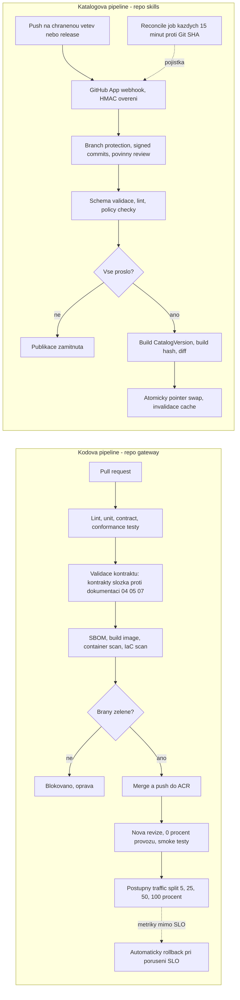
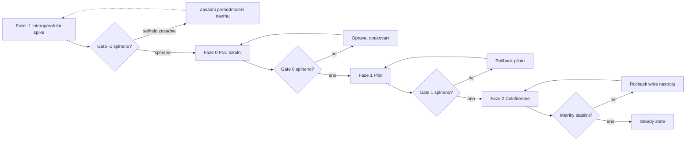
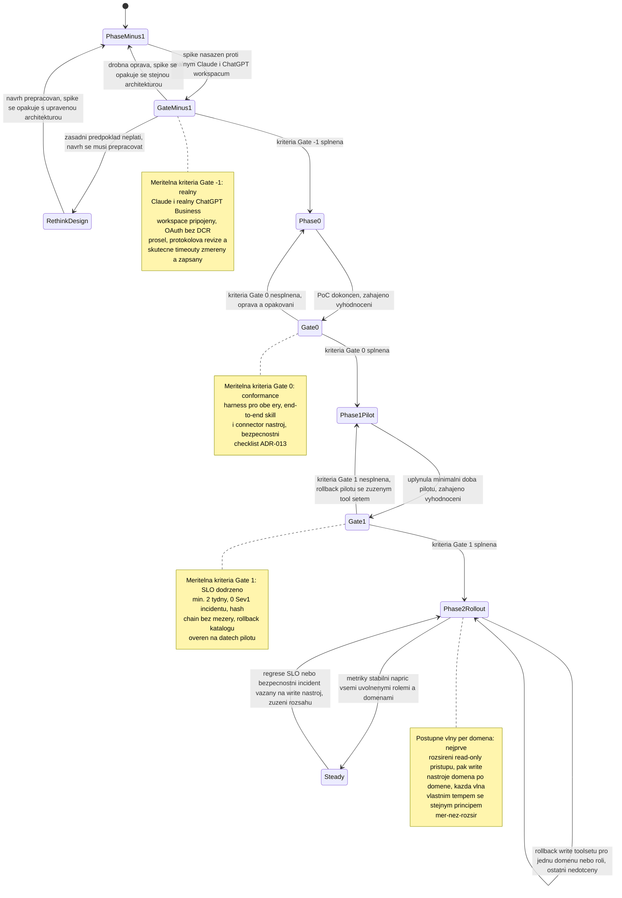

# 08 — Provoz, observabilita a rollout

**Verze:** 1.0 · **Datum:** 2026-09-17 · **Stav:** Návrh
**Týká se ADR:** ADR-004, ADR-009, ADR-010, ADR-014, ADR-015, ADR-016, ADR-017, ADR-018

Provozní specifikace MCP-Azure Gateway — SLO/SLI, telemetrie, dashboardy, alerting, runbooky, škálování, CI/CD a fázovaný rollout. Navazuje na komponentovou dekompozici v [`03-kodova-architektura.md`](./03-kodova-architektura.md) a bezpečnostní model v [`07-bezpecnost-a-autorizace.md`](./07-bezpecnost-a-autorizace.md). Cílová čtenářská skupina: SRE/provozní tým, interní IT přebírající handover.

---

## 1. SLO a SLI

| SLI | Definice | Měřicí okno | SLO cíl | Zdroj |
|---|---|---|---|---|
| Dostupnost | Podíl requestů na `/mcp*` bez 5xx odpovědi a bez timeoutu gateway vrstvy | Klouzavé 30 dní | ≥ 99,9 % | architektonických rozhodnutí v [`09-adr-a-zdroje.md`](./09-adr-a-zdroje.md) |
| Latence `tools/list` | p95 doby zpracování od přijetí requestu po odeslání odpovědi | Klouzavé 5 minut, agregace denně | p95 < 300 ms | architektonických rozhodnutí v [`09-adr-a-zdroje.md`](./09-adr-a-zdroje.md) |
| Latence `tools/call` — režie gateway | p95 doby gateway zpracování **bez** doby stráven v downstream volání (authz + orchestrace + audit zápis) | Klouzavé 5 minut, agregace denně | p95 < 150 ms | architektonických rozhodnutí v [`09-adr-a-zdroje.md`](./09-adr-a-zdroje.md) |
| Úspěšnost tool volání | Podíl `tools/call` s `outcome: success` z celkového počtu ne-denied volání | Klouzavé 24 hodin | `⚠️ TODO — stanovit cílovou hodnotu, závisí na charakteru downstream API` | — |
| Čerstvost katalogu | Rozdíl mezi `activePointer.createdAt` a aktuálním časem, pokud odpovídající SHA existuje v Gitu déle | Kontinuální | < 20 minut (navazuje na 15minutový reconcile cyklus ADR-011 plus rezerva) | ADR-011 |

**Error budget:** při SLO dostupnosti 99,9 % měsíčně je měsíční error budget 43,2 minuty nedostupnosti (0,1 % z ~30 dní). Politika error budgetu:

### 1.1 Složené (composite) SLA a závislost na Entra ID

SLO 99,9 % je cíl pro **gateway samotnou**, ale požadavek `tools/call` prochází řetězcem závislostí: Front Door → Container Apps (gateway) → Entra ID (validace tokenu, OBO) → Redis (idempotence, rate limit, cache) → Cosmos DB (katalog/entitlements při cache miss) → APIM/downstream (mimo rozsah tohoto SLI, viz níže). Publikované SLA jednotlivých závislostí (ověřeno k datu tohoto dokumentu, zdroje viz [`09-adr-a-zdroje.md`](./09-adr-a-zdroje.md)):

| Závislost | Publikované SLA | Zdroj/poznámka |
|---|---|---|
| Azure Front Door (Premium) | 99,99 % | Oficiální SLA dokument Azure Front Door |
| Azure Container Apps | **Není jedno pevné číslo** — SLA závisí na zvolené konfiguraci (zone-redundant prostředí, minimální počet replik ≥ 2). Microsoft dokumentace to výslovně popisuje jako sdílenou odpovědnost, ne fixní garanci. `⚠️ TODO — dopočítat SLA pro konkrétní zvolenou konfiguraci (Ingress-D4 profil, min. 2 instance, zone-redundant) podle aktuální Microsoft metodiky` | learn.microsoft.com/azure/reliability/reliability-container-apps |
| Microsoft Entra ID | 99,99 % | Oficiálně navýšeno na 99,99 % (Microsoft Entra blog) |
| Azure Cosmos DB (single-region, tento návrh nepoužívá multi-region write) | 99,99 % | Oficiální SLA dokument Cosmos DB |
| Azure Managed Redis | `⚠️ TODO — ověřit přesnou hodnotu pro Managed Redis konkrétně`; klasické Azure Cache for Redis (Basic/Standard/Premium) má publikováno 99,9 % konektivity — použito jako konzervativní zástupná hodnota, dokud není potvrzena hodnota pro Managed Redis | Oficiální SLA dokument Azure Cache for Redis |
| Azure API Management | 99,9 % (baseline; vyšší tiery/multi-region mohou mít vyšší SLA, `⚠️ TODO — ověřit pro zvolený tier`) | Oficiální SLA dokument API Management — **mimo tento SLI**, viz níže |

**Naivní násobná kompozice** (worst-case: každá závislost je striktně sériová, každý výpadek závislosti = výpadek gateway) s dostupnými čísly (Container Apps a Managed Redis dosazeny konzervativním odhadem 99,9 %, dokud nejsou TODO hodnoty potvrzeny):

`0,9999 (Front Door) × 0,999 (Container Apps, odhad) × 0,9999 (Entra) × 0,9999 (Cosmos) × 0,999 (Redis, odhad) ≈ 99,77 %`

**Toto je pod cílem 99,9 %** — samotné násobení publikovaných SLA závislostí by SLO gateway nesplnilo. Proto tento návrh **záměrně nezachází se všemi závislostmi jako se sériovými**: fail-open/fail-closed rozhodnutí (K5, §1 výše), stale-JWKS fallback a lokální validace tokenu bez volání Entra (viz [`04-datova-architektura.md §5.6`](./04-datova-architektura.md#56-degradacni-chovani-pri-vypadku-entra-id-oprava-s17)) a skutečnost, že selhání downstream/APIM se vrací jako tool error `200`, ne `5xx` (K7, §3.3 dokumentu `05`) — to vše **odstraňuje APIM/downstream a částečně i Entra z kritické cesty SLI „dostupnost"**, jak je definováno výše (jen `5xx`/timeout gateway vrstvy se počítá). Realisticky dosažitelná dostupnost proto leží mezi naivním composite (99,77 %) a horní mezí danou jen Front Door + Container Apps + Cosmos/Redis v částech, kde skutečně blokují odpověď — přesné číslo **vyžaduje ověření game-day testem** (Runbook 6, DR test) simulujícím výpadek každé závislosti zvlášť, ne jen teoretický výpočet. `⚠️ TODO — potvrdit po prvním game-day testu před Gate 1`.

**Degradační chování při výpadku Entra ID** (nejvýznamnější jednotlivá závislost, protože bez ní nelze validovat žádný nový token ani získat OBO) je popsáno detailně v [`04-datova-architektura.md §5.6`](./04-datova-architektura.md#56-degradacni-chovani-pri-vypadku-entra-id-oprava-s17): krátký výpadek je pro už přihlášené uživatele s cachovaným JWKS prakticky neviditelný, dopad roste s délkou výpadku a je okamžitě plný jen pro nové přihlášení a pro OBO cache miss.


- Budget se sleduje jako klouzavý 30denní úhrn, ne kalendářní měsíc — zabraňuje efektu „reset 1. dne v měsíci".
- Při vyčerpání **50 %** budgetu: freeze na non-kritických feature nasazeních do produkce zůstává v platnosti, ale bezpečnostní a bugfix nasazení pokračují; platformní tým dostává týdenní report.
- Při vyčerpání **80 %** budgetu: povinný change-advisory review před každým produkčním nasazením (i bugfix), prioritizace práce se přesouvá na stabilizaci.
- Při vyčerpání **100 %** budgetu: formální incident review (postmortem) povinný bez ohledu na to, zda šlo o jeden velký výpadek nebo součet drobných; nová produkční nasazení vyžadují schválení vlastníka platformy, dokud není budget částečně obnoven (klouzavé okno se posouvá) nebo není identifikována a nasazena náprava.

**Sémantika selhání auditu:** audit zápis má dva kroky. (1) Synchronní zápis do durable outboxu (append do Redis Streamu s AOF, plus lokální fallback na disk repliky) proběhne **před** vydáním odpovědi klientovi — tento krok se nepřeskakuje. (2) Asynchronní doručení z outboxu do Log Analytics (přes DCR) a do WORM blobu neblokuje odpověď, běží v odděleném pracovníkovi, at-least-once, s deduplikací podle `eventId`. Když selže krok (1), rozhoduje konfigurace `auditFailureMode`: pro nástroje s `readOnlyHint: true` a `riskTier ∈ {"low", "medium"}` je výchozí chování `failOpen` (odpověď se vydá, incident se zaznamená do telemetrie a spustí alert); pro nástroje s `readOnlyHint: false` nebo `riskTier ∈ {"high", "critical"}` je výchozí chování `failClosed` (nástroj se **neprovede**, odpověď je tool error `isError: true` s důvodem „audit nedostupný"). Obojí je konfigurovatelné; volbu výchozích hodnot musí potvrdit compliance (`⚠️ TODO`). Selhání v režimu `failClosed` se u write nástrojů neprojeví jako 5xx (a tedy se nepočítá do SLI dostupnosti výše), ale je to reálný výpadek funkčnosti pro dotčené nástroje — sledováno samostatně alertem #18 a [Runbookem 7](#runbook-7-audit-outbox-nedostupny) v §5–§6.

---

## 2. Telemetrie

**OTel model:** gateway propaguje jeden `traceId` z příchozího požadavku (nebo generuje nový, pokud klient žádný nenese) skrz celé zpracování — `edge/` → `protocol/` → `identity/` → `authz/` → `adapters/` → downstream volání do APIM. `traceparent` hlavička (W3C Trace Context) se propaguje do APIM při každém downstream volání, MCP `_meta` rezervovaná klíč `traceparent`/`tracestate`/`baggage` je standardizovaná i uvnitř JSON-RPC payloadu (SEP-414) [Z1] — gateway ji nastavuje na výstupu, pokud klient sám trace kontext nepřenáší.

| Vrstva/komponenta | Span | Klíčové atributy |
|---|---|---|
| `edge/` | `http.server.request` | `http.method`, `http.route`, `mcp.protocol_era` (`legacy`/`stateless`), `mcp.workspace_slug` |
| `protocol/` | `mcp.request.parse` | `mcp.method` (`tools/list`, `tools/call`,...), `mcp.protocol_version`, `mcp.request_id` |
| `identity/` | `mcp.auth.validate_token` | `mcp.principal.oid` (hashováno pro nízkou kardinalitu v metrikách, plná hodnota jen ve span atributu s omezeným přístupem), `mcp.principal.tid`, `mcp.auth.outcome` |
| `authz/` | `mcp.authz.evaluate` | `mcp.tool.name`, `mcp.authz.effect`, `mcp.authz.reason`, `mcp.authz.matched_rule_id` |
| `adapters/skill`, `adapters/connector` | `mcp.tool.invoke` | `mcp.tool.kind` (`skill`/`connector`), `mcp.catalog_version_id`, `mcp.tool.risk_tier` |
| downstream volání | `http.client.request` (do APIM) | `http.method`, `http.url` (bez query stringu s citlivými parametry), `apim.operation_id`, `traceparent` propagováno v hlavičce |
| `audit/` | `mcp.audit.emit` | `mcp.audit.event_id`, `mcp.audit.sink` (`log_analytics`/`worm_blob`), `mcp.audit.outcome` |

Atributy sledují obecný duch OpenTelemetry semantic conventions pro `http.*` a `rpc.*`, s vlastním jmenným prostorem `mcp.*` a `apim.*` pro doménově specifické hodnoty — MCP nemá vlastní ustálenou OTel sémantickou konvenci nad rámec `_meta` trace propagace, proto jsou `mcp.*` názvy návrhem tohoto dokumentu, ne citací standardu.

**`Mcp-Method` a `Mcp-Name` jako signál bez parsování těla:** éra B vyžaduje na každém POST požadavku hlavičku `Mcp-Method` (vždy) a `Mcp-Name` u `tools/call`/`resources/read`/`prompts/get` (viz [`05-api-a-protokoly.md`](./05-api-a-protokoly.md)). Protože jsou čitelné přímo z HTTP hlaviček ještě před deserializací JSON-RPC těla, `edge/` vrstva na ně může navázat metriky a rate limiting **per-metodu a per-nástroj** (dimenze `method` u metrik č. 1–2 níže, dimenze `tool_name` u metrik č. 4–5 a 7, a rate limiting ADR-017 v §5) dřív, než dojde na plný parse požadavku a autorizaci — snižuje se tak náklad na odmítnutí nadměrného provozu proti konkrétnímu nástroji nebo metodě.

### Seznam metrik (RED + business)

| # | Název | Typ | Dimenze | Účel |
|---|---|---|---|---|
| 1 | `mcp_gateway_requests_total` | counter | `method`, `era`, `workspace`, `status` | Rate |
| 2 | `mcp_gateway_request_duration_ms` | histogram | `method`, `era`, `workspace` | Latence (Duration) |
| 3 | `mcp_gateway_errors_total` | counter | `error_code`, `error_kind` (`protocol`/`tool`) | Errors |
| 4 | `mcp_tool_calls_total` | counter | `tool_name`, `outcome`, `workspace` | Business — objem volání |
| 5 | `mcp_tool_call_duration_ms` | histogram | `tool_name`, `kind` | Business latence |
| 6 | `mcp_authz_decisions_total` | counter | `effect`, `reason`, `role` | Business/bezpečnost |
| 7 | `mcp_denied_total` | counter | `reason`, `tool_name` | Bezpečnost — trend zamítnutí |
| 8 | `mcp_downstream_call_duration_ms` | histogram | `apim_api_id`, `operation_id` | Downstream latence |
| 9 | `mcp_downstream_errors_total` | counter | `apim_api_id`, `http_status` | Downstream chybovost |
| 10 | `mcp_circuit_breaker_state` | gauge (0/1/2) | `backend_id` | Reliabilita downstream |
| 11 | `mcp_catalog_version_active_info` | gauge (info) | `catalog_version_id`, `workspace` | Business — verze v provozu |
| 12 | `mcp_catalog_staleness_seconds` | gauge | `workspace` | Drift katalogu vs. Git SHA |
| 13 | `mcp_idempotency_replay_total` | counter | `tool_name` | Reliabilita zápisů |
| 14 | `mcp_rate_limit_rejections_total` | counter | `layer` (`frontdoor`/`gateway`/`apim`), `role` | Bezpečnost/kapacita |
| 15 | `mcp_obo_token_cache_hit_ratio` | gauge | `downstream_resource` | Efektivita OBO cache |
| 16 | `mcp_obo_token_requests_total` | counter | `outcome` (`hit`/`miss`/`refresh`/`invalid`) | OBO lifecycle |
| 17 | `mcp_jwks_refresh_total` | counter | `outcome` | Zdraví validace tokenů |
| 18 | `mcp_active_replicas` | gauge | `revision` | Kapacita |
| 19 | `mcp_keda_scale_events_total` | counter | `direction` (`up`/`down`) | Kapacita/škálování |
| 20 | `mcp_audit_write_failures_total` | counter | `sink` (`log_analytics`/`worm_blob`) | Spolehlivost auditu — asynchronní doručení (fáze 2 outboxu) |
| 21 | `mcp_audit_hash_chain_verify_status` | gauge (`0` = `ok`, `1` = `broken`, `2` = `pending`) | `result` (stejný enum jako číselná hodnota, jen jako čitelný string pro filtrování v KQL) | Integrita auditu — hodnoty shodné s `auditCheckpoints.verificationStatus` v [`04-datova-architektura.md §3.11`](./04-datova-architektura.md#311-auditcheckpoints) |
| 22 | `mcp_webhook_processing_duration_ms` | histogram | `outcome` | Ingestor výkon |
| 23 | `mcp_ingestor_publish_total` | counter | `outcome` (`success`/`rejected`) | Katalogová pipeline |
| 24 | `mcp_session_active_count` | gauge | `workspace` | Éra A — aktivní relace |
| 25 | `mcp_client_secret_days_to_expiry` | gauge | `connector` | Bezpečnost — rotace secretů |
| 26 | `mcp_audit_outbox_write_failures_total` | counter | `riskTier`, `readOnlyHint` | Spolehlivost auditu — synchronní zápis do outboxu (fáze 1, blokující krok dle §1) |

---

## 3. Logování

**Úrovně:** `debug` (jen non-produkční prostředí), `info` (běžný provozní tok — přijetí requestu, rozhodnutí, dokončení), `warn` (degradovaný, ale zotavitelný stav — retry, cache miss vyžadující fallback), `error` (selhání vyžadující pozornost — downstream 5xx, neočekávaná výjimka), `fatal` (proces nemůže pokračovat).

**Strukturovaný formát** — JSON schéma jednoho log záznamu:

```json
{
  "timestamp": "2026-09-17T14:32:01.123Z",
  "level": "info",
  "message": "tool_call_completed",
  "traceId": "4bf92f3577b34da6a3ce929d0e0e4736",
  "spanId": "00f067aa0ba902b7",
  "workspaceSlug": "claude",
  "protocolEra": "legacy",
  "principalOidHash": "sha256:9f86d0...",
  "toolName": "crm_get_account",
  "catalogVersionId": "a1b2c3d-7f9e2a1",
  "authzEffect": "allow",
  "outcome": "success",
  "durationMs": 87,
  "downstream": {
    "apimApiId": "crm-api",
    "operationId": "getAccount",
    "httpStatus": 200
  },
  "service": "mcp-gateway",
  "revision": "mcp-gateway--0042"
}
```

**Korelační pole:** `traceId`, `spanId`, `workspaceSlug`, `catalogVersionId` — umožňují spojit log záznam s OTel trace v Application Insights a s auditním záznamem (`policyDecisions`/`auditEvents`) přes stejný `traceId`.

**Co se nikdy nesmí objevit v logu:** hodnota `Authorization` hlavičky nebo access/refresh tokenu, plný obsah `arguments` tool volání (jen `argumentsHash`), client secrety, obsah odpovědí downstream API nad rámec metadat (status kód, délka), plný `upn`/e-mail v běžném provozním logu (jen `principalOidHash` — plné `oid`/`upn` patří výhradně do auditního záznamu s řízeným přístupem, ne do obecného aplikačního logu prohledávatelného širším okruhem SRE).

**Vzorkování:** `error`, `warn` a všechny `denied`/`toolError` výsledky se logují **100 %**. Úspěšné `info` záznamy vysokoobjemových read nástrojů podléhají vzorkování (výchozí návrh 10 %, `⚠️ TODO — doladit podle skutečného provozního objemu po pilotní fázi`) — trace sampling na úrovni OTel (head-based) zajišťuje, že vzorkované requesty mají kompletní trace, ne useknutý span.

---

## 4. Dashboardy

**Schéma:** Application Insights běží ve **workspace-based** módu (§5 dokumentu `02`, potvrzeno v resource tabulce `02` — Application Insights sdílí úložiště a redundanci s Log Analytics workspace). Všechny dotazy v tomto dokumentu proto používají **workspace-based tabulky**: `AppRequests` pro HTTP požadavky, `AppMetrics` pro custom metriky (sloupce `Name`, `TimeGenerated`, `Sum`, `Properties` — `Properties` je dynamický sloupec s vlastními dimenzemi, ekvivalent klasického `customDimensions`; pro jednohodnotové metriky odpovídá naměřené hodnotě `Sum`, protože `ItemCount` je 1 na odeslání), `AppEvents` pro custom eventy (`Name`, `TimeGenerated`, `Properties`) a `McpToolInvocation_CL` pro auditní/execution telemetrii z DCR (vlastní custom tabulka, mimo Application Insights). **Klasické (non-workspace-based) tabulky `customMetrics`/`customEvents`/`customDimensions`/`timestamp` v tomto prostředí neexistují** — jsou to tabulky classic Application Insights resource, který zde není nasazen; dotaz proti nim by nevrátil žádná data.

Stejně jako u KQL v [`06-stavova-logika-a-workflow.md §W3`](./06-stavova-logika-a-workflow.md#w3-incident-nastroj-vraci-chyby) platí, že **časový filtr musí být první operace po názvu tabulky** — i tam, kde předchozí verze dotazů (`arg_max`/agregace „aktuální stav") žádný explicitní `ago()` neměla, je teď doplněn, protože bez něj by dotaz procházel celou retenční dobu Log Analytics místo jen relevantního okna.

### Dashboard 1 — Provozní zdraví

| Dlaždice | KQL |
|---|---|
| Request rate a chybovost (RED) | ```AppRequests | where TimeGenerated > ago(1h) | summarize Total = count(), Errors = countif(ResultCode >= 500) by bin(TimeGenerated, 1m) | extend ErrorRate = round(100.0 * Errors / Total, 2)``` |
| p50/p95/p99 latence podle metody | ```AppRequests | where TimeGenerated > ago(6h) | summarize p50 = percentile(DurationMs, 50), p95 = percentile(DurationMs, 95), p99 = percentile(DurationMs, 99) by Name, bin(TimeGenerated, 5m)``` |
| Počet aktivních replik v čase | ```AppMetrics | where TimeGenerated > ago(6h) | where Name == "mcp_active_replicas" | summarize avg(Sum) by tostring(Properties.revision), bin(TimeGenerated, 5m)``` |
| Stav circuit breakeru | ```AppMetrics | where TimeGenerated > ago(1h) | where Name == "mcp_circuit_breaker_state" | summarize arg_max(TimeGenerated, Sum) by tostring(Properties.backend_id)``` |

### Dashboard 2 — Adopce a využití

| Dlaždice | KQL |
|---|---|
| Volání nástrojů podle workspace v čase | ```AppEvents | where TimeGenerated > ago(24h) | where Name == "tool_call_completed" | summarize Count = count() by tostring(Properties.workspaceSlug), bin(TimeGenerated, 1h)``` |
| Top 10 nástrojů podle objemu (7 dní) | ```AppEvents | where TimeGenerated > ago(7d) | where Name == "tool_call_completed" | summarize Count = count() by tostring(Properties.toolName) | top 10 by Count desc``` |
| Denní počet unikátních principal | ```AppEvents | where TimeGenerated > ago(30d) | where Name == "tool_call_completed" | summarize UniquePrincipals = dcount(tostring(Properties.principalOidHash)) by bin(TimeGenerated, 1d)``` |
| Distribuce aktivní verze katalogu podle workspace | ```AppMetrics | where TimeGenerated > ago(1h) | where Name == "mcp_catalog_version_active_info" | summarize arg_max(TimeGenerated, Sum) by tostring(Properties.workspace), tostring(Properties.catalog_version_id)``` |

### Dashboard 3 — Bezpečnost a odmítnutí

| Dlaždice | KQL |
|---|---|
| Zamítnutí podle důvodu v čase | ```AppEvents | where TimeGenerated > ago(6h) | where Name == "authz_decision" and tostring(Properties.effect) == "deny" | summarize Count = count() by tostring(Properties.reason), bin(TimeGenerated, 15m)``` |
| Podíl 401 vs. celkem | ```AppRequests | where TimeGenerated > ago(1h) | summarize Total = count(), Unauthorized = countif(ResultCode == 401) by bin(TimeGenerated, 5m) | extend Pct = round(100.0 * Unauthorized / Total, 2)``` |
| Odmítnutí rate limitu podle vrstvy | ```AppMetrics | where TimeGenerated > ago(6h) | where Name == "mcp_rate_limit_rejections_total" | summarize sum(Sum) by tostring(Properties.layer), bin(TimeGenerated, 15m)``` |
| Stav ověření integrity hash chain | ```AppMetrics | where TimeGenerated > ago(30d) | where Name == "mcp_audit_hash_chain_verify_status" | summarize arg_max(TimeGenerated, Sum) by bin(TimeGenerated, 1d)``` |

### Dashboard 4 — Downstream a náklady

| Dlaždice | KQL |
|---|---|
| Latence downstream podle APIM operace | ```AppMetrics | where TimeGenerated > ago(6h) | where Name == "mcp_downstream_call_duration_ms" | summarize p95 = percentile(Sum, 95) by tostring(Properties.operation_id), bin(TimeGenerated, 15m)``` |
| Chybovost downstream podle backendu | ```AppMetrics | where TimeGenerated > ago(24h) | where Name == "mcp_downstream_errors_total" | summarize sum(Sum) by tostring(Properties.apim_api_id), tostring(Properties.http_status), bin(TimeGenerated, 1h)``` |
| Počet otevření circuit breakeru (7 dní) | ```AppEvents | where TimeGenerated > ago(7d) | where Name == "circuit_breaker_opened" | summarize Count = count() by tostring(Properties.backend_id)``` |
| Proxy objemu pro odhad nákladů (počet tool volání jako vstup do cenové kalkulačky) | ```AppEvents | where TimeGenerated > ago(30d) | where Name == "tool_call_completed" | summarize CallVolume = count() by tostring(Properties.tool_name)``` — konkrétní ceny `⚠️ TODO — ověřit v Azure Pricing Calculator`, dle architektonických rozhodnutí v [`09-adr-a-zdroje.md`](./09-adr-a-zdroje.md) a §12 tohoto dokumentu, **včetně dodatečného nákladu Premium ingress módu** (viz §7 tohoto dokumentu a ADR-004 v [`09-adr-a-zdroje.md`](./09-adr-a-zdroje.md)) |

---

## 5. Alerting

| # | Alert | Podmínka | Práh | Závažnost | Komu | Runbook |
|---|---|---|---|---|---|---|
| 1 | Gateway vysoká chybovost 5xx | KQL dlaždice D1.1 | > 2 % po dobu 5 min | Sev1 | On-call SRE (pager) | [Runbook 1](#runbook-1-gateway-vraci-5xx) |
| 2 | Prudký nárůst denied | Metrika `mcp_denied_total`, rate-of-change | > 3× oproti 1h baseline po dobu 10 min | Sev2 | Platformní tým (Teams/e-mail) | [Runbook 2](#runbook-2-prudky-narust-denied) |
| 3 | Downstream latence vysoká | `mcp_downstream_call_duration_ms` p95 | > 2 s po dobu 5 min | Sev2 | On-call SRE | [Runbook 3](#runbook-3-downstream-apim-pomaly--circuit-open) |
| 4 | Circuit breaker otevřen | `mcp_circuit_breaker_state == open` | okamžitě | Sev2 | On-call SRE | [Runbook 3](#runbook-3-downstream-apim-pomaly--circuit-open) |
| 5 | Katalog starší než Git SHA | `mcp_catalog_staleness_seconds` | > 1200 s (20 min) | Sev2 | Platformní tým | [Runbook 4](#runbook-4-ingestor-selhal-a-katalog-je-zastaraly) |
| 6 | Selhání ingestoru (publish rejected/job failure) | `mcp_ingestor_publish_total{outcome="rejected"}` nebo job exit code ≠ 0 | jakýkoli výskyt | Sev2 | Platformní tým | [Runbook 4](#runbook-4-ingestor-selhal-a-katalog-je-zastaraly) |
| 7 | Blížící se expirace client secretu | `mcp_client_secret_days_to_expiry` | < 14 dní | Sev3 | Vlastník connectoru + platformní tým | Rotace dle [`07-bezpecnost-a-autorizace.md`](./07-bezpecnost-a-autorizace.md) §8 |
| 8 | Blížící se expirace TLS certifikátu | Key Vault `CertificateNearExpiry` event | 30 dní před expirací | Sev3 | Platformní tým | [`07-bezpecnost-a-autorizace.md`](./07-bezpecnost-a-autorizace.md) §8 |
| 9 | Opakované selhání JWKS refresh | `mcp_jwks_refresh_total{outcome="fail"}` | ≥ 3 za 10 min | Sev2 | On-call SRE | Diagnostika Entra dostupnosti, eskalace na identity tým |
| 10 | Cosmos DB throttling (429) | Diagnostické logy Cosmos, `TotalRequestUnits` vs. provisioned | opakované 429 po dobu 5 min | Sev2 | On-call SRE | Navýšení RU / revize hot partition |
| 11 | Redis paměťová tíseň | Metrika Managed Redis `used_memory` / evictions | evictions > 0 po dobu 5 min | Sev2 | On-call SRE | Navýšení SKU / revize TTL politik |
| 12 | Max replicas dosaženo trvale | `mcp_active_replicas == maxReplicas` | po dobu 15 min | Sev3 | Platformní tým | Revize kapacitního plánu §6 |
| 13 | Selhání zápisu auditu | `mcp_audit_write_failures_total` | jakýkoli výskyt | Sev1 | On-call SRE + compliance kontakt | Okamžitá eskalace — riziko výpadku auditní stopy |
| 14 | Detekován nesoulad hash chain | `mcp_audit_hash_chain_verify_status == 1` (hodnota `broken`, shodně s `auditCheckpoints.verificationStatus` v [`04-datova-architektura.md §3.11`](./04-datova-architektura.md#311-auditcheckpoints)) | okamžitě | Sev1 | Bezpečnostní tým (security incident proces) | [Runbook 5](#runbook-5-podezreni-na-kompromitaci-klienta) (obdobný postup eskalace) |
| 15 | Nárůst selhání HMAC ověření webhooku | Log query na `webhook_hmac_failed` eventy | > 10 za 5 min | Sev2 | Platformní tým + bezpečnostní tým | Možný pokus o útok na `/webhooks/github`, revize Front Door WAF logů |
| 16 | Porušení SLO latence gateway režie | `mcp_gateway_request_duration_ms` p95 pro `tools/call` bez downstream | > 150 ms po dobu 15 min | Sev3 | Platformní tým | Revize error budgetu §1 |
| 17 | Vysoké tempo čerpání error budgetu | Výpočet nad Dashboard 1 daty, burn rate | projekce vyčerpání do 7 dní při aktuálním tempu | Sev2 | Vlastník platformy | Postup dle §1 politiky error budgetu |
| 18 | Selhání zápisu do audit outboxu (synchronní krok, §1) | `mcp_audit_outbox_write_failures_total` | jakýkoli výskyt | Sev1 | On-call SRE + compliance kontakt | [Runbook 7](#runbook-7-audit-outbox-nedostupny) |

---

## 6. Runbooky

### Runbook 1: Gateway vrací 5xx

1. **Detekce:** Alert #1 spuštěn, nebo hlášení uživatelů.
2. **Triage:** Otevřít Dashboard 1, zjistit zda chybovost je plošná (všechny nástroje/workspacy) nebo lokalizovaná (jeden tool, jeden downstream).
3. **Diagnóza:** Zkontrolovat, zda jde o novou revizi (korelace s časem posledního deploymentu — pokud ano, jde pravděpodobně o regresi). Zkontrolovat `/readyz` stav (Cosmos, Redis, JWKS dostupnost). Projít poslední `error`-úrovně logy s korelací na `traceId` z několika postižených requestů.
4. **Mitigace:** Pokud korelováno s nedávným nasazením → okamžitý rollback traffic split na předchozí revizi (viz §8, automatický rollback by měl zasáhnout sám, ověřit že proběhl). Pokud korelováno se závislostí (Cosmos/Redis) → postupovat dle specifického runbooku té závislosti (mimo rozsah tohoto dokumentu, řídit se standardním Azure troubleshooting postupem pro danou službu).
5. **Ověření:** Chybovost klesla pod práh alertu, `/readyz` zelený.
6. **Post-incident:** Zápis do incident logu, pokud Sev1 → postmortem dle organizačního procesu.

### Runbook 2: Prudký nárůst denied

1. **Detekce:** Alert #2.
2. **Triage:** Dashboard 3, dlaždice „Zamítnutí podle důvodu" — rozlišit, zda jde o `explicit_deny_rule`/`parameter_constraint_violated` (pravděpodobně chyba v nedávné změně entitlements) vs. `toolset_not_mapped`/`no_matching_entitlement` koncentrované na jednu roli/skupinu (pravděpodobně chybějící přiřazení role po organizační změně) vs. plošný nárůst napříč vším (pravděpodobně bug v `authz/` modulu nebo poškozená entitlements data).
3. **Diagnóza:** Zkontrolovat poslední publikovanou verzi entitlements (Git historie) — korelovat čas nárůstu s časem poslední změny.
4. **Mitigace:** Pokud jde o chybnou entitlements změnu → revert v Gitu, projít stejnou CI gate jako běžná změna (nezkracovat proces ani v incidentu, akorát urychleně). Pokud jde o chybějící přiřazení role → eskalace na Entra ID admina k nápravě přiřazení.
5. **Ověření:** Dotčení uživatelé potvrzují obnovený přístup, míra denied klesla na baseline.
6. **Post-incident:** Pokud šlo o chybu v review procesu entitlements, revize CODEOWNERS/review checklistu.

### Runbook 3: Downstream APIM je pomalý / circuit open

1. **Detekce:** Alert #3 nebo #4.
2. **Triage:** Dashboard 4 — identifikace postiženého `apim_api_id`/`operation_id`.
3. **Diagnóza:** Zkontrolovat APIM diagnostiku a Azure Monitor pro daný backend (vlastní infrastruktura, mimo přímou správu gateway týmu — kontaktovat vlastníka APIM vrstvy). Ověřit, zda nejde o problém na straně gateway (např. špatně nastavený timeout).
4. **Mitigace:** Circuit breaker již automaticky izoluje postižený backend (stav `open` → requesty selhávají rychle místo čekání na timeout, ostatní nástroje nejsou ovlivněny). Pokud má postižený nástroj `riskTier` dovolující degradovanou odpověď (cache/stale data), zvážit dočasné přepnutí. Eskalace na vlastníka APIM/downstream API.
5. **Ověření:** Circuit breaker se vrátil do `half-open` a poté `closed` (automaticky, dle §6 [`06-stavova-logika-a-workflow.md`](./06-stavova-logika-a-workflow.md)), latence downstream v normě.
6. **Post-incident:** Pokud šlo o opakovaný problém s konkrétním downstream, zvážit revizi timeoutů/retry politiky pro daný backend.

### Runbook 4: Ingestor selhal a katalog je zastaralý

1. **Detekce:** Alert #5 nebo #6.
2. **Triage:** Zkontrolovat poslední běh Container Apps Job `skill-ingestor` (logy, exit kód).
3. **Diagnóza:** Rozlišit tři příčiny: (a) webhook nedorazil (GitHub App problém, síťová chyba) — reconcile job by měl toto sám zachytit při dalším 15minutovém běhu, zkontrolovat, zda reconcile běží; (b) validace v `validate/` kroku selhala na legitimní změně (chyba v manifestu) — zkontrolovat CI log, informovat autora skillu; (c) infrastrukturní chyba (Cosmos nedostupný pro `publish/` krok).
4. **Mitigace:** Pro (a) — ruční spuštění reconcile jobu mimo plán. Pro (b) — oprava manifestu autorem, standardní CI cyklus. Pro (c) — postupovat dle dostupnosti Cosmos DB.
5. **Ověření:** `mcp_catalog_staleness_seconds` klesl pod práh, poslední `CatalogVersion.status == Published` odpovídá aktuálnímu Git SHA chráněné větve.
6. **Post-incident:** Pokud šlo o (a), zkontrolovat konfiguraci GitHub App webhooku (secret, endpoint dostupnost).

### Runbook 5: Podezření na kompromitaci klienta

1. **Detekce:** Anomální vzorec chování principal (neobvyklý objem/čas/sekvence volání), nebo externí signál (nahlášený únik client secretu, neobvyklé přihlášení hlášené Entra ID Identity Protection — mimo přímý dohled gateway, ale vstup do tohoto runbooku).
2. **Triage:** Dotaz do `policyDecisions`/`auditEvents` na dotčený `principalOid`/`appId` za posledních 24–72 hodin — sestavit časovou osu volání.
3. **Diagnóza:** Určit rozsah — jde o kompromitovaný uživatelský účet (OAuth delegated flow), nebo o unikátní `client_secret` connectoru (dopad na všechny uživatele daného connectoru)?
4. **Mitigace (uživatelský účet):** Eskalace na Entra ID admina k okamžitému odebrání přiřazení role / vynucení revoke refresh tokenů daného uživatele (samostatný proces v Entra ID, mimo gateway). **Mitigace (client secret connectoru):** Okamžitá rotace client secretu (§8 dokumentu 07) a invalidace starého — od tohoto okamžiku nový OAuth handshake vyžaduje nový secret, staré access tokeny doběhnou do přirozené expirace (krátká, viz [`07-bezpecnost-a-autorizace.md`](./07-bezpecnost-a-autorizace.md) §2 hrozba #2).
5. **Ověření:** Žádná další podezřelá aktivita po mitigaci, audit trail zachovává plnou historii pro forenzní analýzu.
6. **Post-incident:** Formální bezpečnostní incident review, posouzení nutnosti notifikace dle GDPR (pokud došlo k úniku osobních údajů), aktualizace entitlements/rate limitů pokud incident odhalil mezeru.

### Runbook 6: Obnova po výpadku regionu

1. **Detekce:** Regionální Azure incident (Azure Service Health) nebo plošná nedostupnost primárního regionu napříč metrikami.
2. **Triage:** Potvrdit rozsah (jde o gateway compute, nebo i o Cosmos/Redis/Front Door origin)?
3. **Diagnóza:** Ověřit stav pasivního regionu (pokud multi-region DR je nasazeno — viz architektonických rozhodnutí v [`09-adr-a-zdroje.md`](./09-adr-a-zdroje.md) a [`02-architektura-reseni.md`](./02-architektura-reseni.md), RPO/RTO `⚠️ TODO — konkrétní hodnoty doplnit dle zvoleného DR modelu`). Katalog je reprodukovatelný z Gitu (primární zdroj pravdy) — i při ztrátě Cosmos dat v postiženém regionu lze katalog znovu sestavit z posledního known-good Git SHA.
4. **Mitigace:** Failover DNS/Front Door origin na pasivní region (mechanismus dle zvoleného DR modelu). Pokud Cosmos geo-redundance je aktivní, čtecí provoz automaticky směřuje do dostupné repliky. Spustit ruční `publish` katalogu v novém aktivním regionu, pokud replikace Cosmos nepokrývá i tento kontejner s dostatečnou čerstvostí.
5. **Ověření:** `/readyz` zelený v novém aktivním regionu, `tools/list`/`tools/call` funkční, dostupnost obnovena.
6. **Post-incident:** Failback plán zpět do primárního regionu po jeho obnovení, postmortem, aktualizace DR runbooku o skutečně naměřený RTO oproti cíli.

### Runbook 7: Audit outbox nedostupný

1. **Detekce:** Alert #18 spuštěn — synchronní zápis do durable audit outboxu (Redis Stream s AOF, plus lokální fallback na disk repliky, viz [`04-datova-architektura.md`](./04-datova-architektura.md)) selhává.
2. **Triage:** Ověřit na Dashboardu 1 stav Redis/`/readyz` — jde o výpadek primárního cíle outboxu (Redis), nebo selhává i lokální fallback na disk repliky?
3. **Diagnóza:** Podle konfigurace `auditFailureMode` (viz §1) gateway v tomto okamžiku pro nástroje s `readOnlyHint: true` a `riskTier ∈ {"low", "medium"}` běží v `failOpen` (odpovídá normálně, incident je jen v telemetrii), zatímco pro nástroje s `readOnlyHint: false` nebo `riskTier ∈ {"high", "critical"}` běží v `failClosed` — tyto nástroje aktivně vrací `isError: true` s důvodem „audit nedostupný", i když gateway samotná je jinak funkční. To je očekávaný, ne chybný stav.
4. **Mitigace:** Obnovit dostupnost Redis podle standardního postupu pro Azure Managed Redis (mimo přímou správu gateway týmu, koordinace s platformním týmem). Ověřit, že lokální fallback na disk repliky mezitím přebírá zápisy, pokud je Redis nedostupný. Dokud outbox neběží, write nástroje v `failClosed` zůstávají záměrně blokované — neobcházet mitigaci ručním přepnutím `auditFailureMode` bez schválení bezpečnostního/compliance kontaktu.
5. **Ověření:** `mcp_audit_outbox_write_failures_total` kleslo na nulu, dotčené write nástroje se vrátily k normálním výsledkům (žádné „audit nedostupný" odpovědi).
6. **Post-incident:** Zápis do incident logu; Sev1 → postmortem. Zvážit, zda výchozí hodnoty `auditFailureMode` (viz §1) odpovídají skutečnému rizikovému apetitu organizace pro dotčené nástroje — formální potvrzení compliance zůstává `⚠️ TODO`.

---

## 7. Škálování a kapacita

**Container Apps ingress mode.** Produkční prostředí běží s **Premium ingress** módem výslovně zapnutým. Výchozí (non-Premium) ingress mode Container Apps má idle timeout pevných 240 s — shodně s App Service — a sám o sobě by tedy negoval hlavní argument ADR-004 pro volbu Container Apps (viz [`09-adr-a-zdroje.md`](./09-adr-a-zdroje.md) ADR-004: bez Premium ingress by volba mezi ACA a App Service stála jen na revisions, KEDA a scale-to-zero). Premium ingress umožňuje `idleRequestTimeout` v rozsahu **4–30 minut (240–1800 s)**; kanonická konfigurace tohoto návrhu nastavuje `idleRequestTimeout = 600` s (10 minut) pro éru A / dlouhotrvající SSE spojení — éra B s cílovou dobou odpovědi < 120 s vystačí i s výchozí hodnotou. Premium ingress má vlastní cenový dopad — `⚠️ TODO — ověřit v Azure Pricing Calculator`. Zdroj: https://learn.microsoft.com/azure/container-apps/premium-ingress

**KEDA HTTP scaling rule** (návrh konkrétních hodnot, viz architektonických rozhodnutí v [`09-adr-a-zdroje.md`](./09-adr-a-zdroje.md) pro min/max):

```json
{
  "minReplicas": 2,
  "maxReplicas": 30,
  "rules": [
    {
      "name": "http-concurrency-rule",
      "http": {
        "metadata": {
          "concurrentRequests": "50"
        }
      }
    }
  ]
}
```

Vyhodnocení konkurentních požadavků probíhá v 15sekundových oknech (platformní chování Container Apps HTTP scaleru) [Z2]. Hodnota `concurrentRequests: 50` je návrh vycházející z předpokladu, že jeden replika zvládne desítky souběžných `tools/call` operací dřív, než latence začne degradovat — **konkrétní číslo musí být potvrzeno zátěžovým testem** (`⚠️ TODO`), protože skutečná kapacita repliky závisí na poměru čtecích/zápisových nástrojů, latenci downstream a paměťové náročnosti connector adapterů.

**Kapacitní model (předpoklad k ověření):** jedna replika s výchozí alokací zdrojů zvládá orientačně 50 souběžných `tools/call` požadavků při p95 downstream latenci pod 500 ms, než dojde ke škálování. Při 30 replikách je teoretický strop souběžnosti cca 1500 požadavků — toto číslo je **předpoklad**, ne naměřená hodnota, a musí být potvrzeno zátěžovým testem před tím, než se stane závazným kapacitním plánem (`⚠️ TODO`).

**Co škáluje jako první:** gateway Container App (stateless, škáluje nejrychleji přes KEDA HTTP rule). Cosmos DB škáluje přes autoscale RU/s nezávisle. Managed Redis je vertikálně škálovaný (změna SKU), ne horizontálně — je proto potenciálním hrdlem při extrémním růstu provozu a musí být sledován samostatně (alert #11). APIM/downstream škáluje mimo přímou kontrolu tohoto návrhu (vlastní tým).

**Limity:** max 30 replik v prod (revize `properties.template.scale.maxReplicas`), Cosmos autoscale strop `⚠️ TODO — stanovit dle rozpočtu a očekávaného provozu`, Redis SKU strop paměti dle zvolené úrovně Azure Managed Redis (`⚠️ TODO — potvrdit konkrétní SKU`, viz [`07-bezpecnost-a-autorizace.md`](./07-bezpecnost-a-autorizace.md) pro obecné doporučení nahradit Azure Cache for Redis Azure Managed Redis).

### 7.1 Upozornění: rate limit počítaný per-replika násobí skutečný limit (doplněno po nezávislém srovnání návrhu)

**Riziko:** gateway škáluje horizontálně na 2–30 replik (výše) přes KEDA. Pokud by token bucket pro per-uživatelský/per-nástrojový rate limit (ADR-017, [`05-api-a-protokoly.md` §1.2](./05-api-a-protokoly.md#12-co-z-toho-vyplývá-pro-implementaci)) žil v paměti jednotlivé repliky místo ve sdíleném úložišti, byl by efektivní limit, který uživatel skutečně zažije, roven **nakonfigurovanému limitu × aktuální počet replik** — při běžném provozu (2 repliky) dvojnásobek zamýšlené hodnoty, při plném rozšíření (30 replik) až třicetinásobek, protože KEDA rozděluje provoz mezi repliky přibližně rovnoměrně a každá by počítala vlastní, na ostatních nezávislý counter. To by tiše podkopalo hrozbu #11 (DoS přes drahé nástroje, [`07-bezpecnost-a-autorizace.md` §2](./07-bezpecnost-a-autorizace.md)) přesně v okamžiku, kdy je autoscaling nejagresivnější — tedy při vysokém/podezřelém provozu.

**Proto:** counter druhé vrstvy rate limitingu (gateway token bucket, ADR-017) **musí** žít ve sdíleném Redis (`rl:{tenantId}:{workspaceSlug}:{principalOid}:{toolName}` nebo obdobný klíč, viz [`04-datova-architektura.md §5.2`](./04-datova-architektura.md#52-rate-limit-token-bucket-adr-017)), ne v paměti procesu — to je již takto navrženo (§5.2 dokumentu 04) a toto upozornění jen činí důsledek explicitním, aby ho žádná budoucí optimalizace „pro rychlost" tiše nezvrátila zpět na in-memory řešení.

**Chování při výpadku Redis — rozhodnuto (fail-closed na přísnější limit):** obecný princip pro bezpečnostně relevantní sdílený stav je degradace **fail-closed**, ne fail-open — při ztrátě sdíleného počítadla je bezpečnější dočasně omezit provoz víc, než riskovat neomezený průchod na produkční downstream systémy. Fallback proto není per-replika limiter s plnou globální kvótou, ale per-replika limiter s kvótou **`globalLimit / maxReplicas`**: součet napříč replikami nikdy nepřekročí původní globální limit a při běhu na menším počtu replik je fallback přísnější než normální provoz. Plná specifikace včetně konfiguračního přepínače `rateLimitFallbackMode` je v [`04-datova-architektura.md §5.2`](./04-datova-architektura.md#52-rate-limit-token-bucket-adr-017). APIM `quota-by-key` (ADR-017, třetí vrstva) zůstává tvrdým backstopem nezávisle na Redis. Vědomý důsledek: při výpadku Redis mohou uživatelé narazit na limit dřív, než odpovídá jejich nominální kvótě — to je přijato jako správná volba.

### 7.2 Souhrnná tabulka číselných provozních parametrů (doplněno po nezávislém srovnání návrhu)

Parametry níže jsou rozptýlené napříč dokumenty `02`–`09` — tabulka je sbírá na jedno místo pro provozní tým. Hodnoty jsou **opsané** z dokumentu uvedeného ve sloupci „Zdroj", ne nově vymyšlené; kde zdrojový dokument uvádí `⚠️ TODO`, je to zachováno beze změny. PoC (Fáze 0) běží s částí parametrů zjednodušenou nebo vypnutou (mock/fake závislosti) — sloupec „Hodnota v PoC" to odráží.

| # | Parametr | Hodnota PoC (Fáze 0) | Hodnota produkce | Kde se nastavuje | Na čem závisí | Jak se ladí |
|---|---|---|---|---|---|---|
| 1 | Container Apps ingress idle timeout | výchozí non-Premium, 240 s (mock prostředí bez Premium ingress) | **600 s** (Premium ingress, `requestIdleTimeout: 10` min) | Bicep `managedEnvironments.properties.ingressConfiguration` | éra A / dlouhotrvající SSE spojení (ADR-004) | ruční změna v IaC, rozsah 240–1800 s |
| 2 | `timeouts.edgeRequestMs` (tvrdý strop celého requestu) | 120 000 ms (stejné jako prod) | **120 000 ms** | `Config.timeouts.edgeRequestMs`, [`03` §9.1](./03-kodova-architektura.md#91-typovaná-validovaná-při-startu) | musí být < Front Door origin timeout | env proměnná, redeploy |
| 3 | `timeouts.toolCallMs` (deadline celého tool callu) | 60 000 ms | **60 000 ms** | `Config.timeouts.toolCallMs`, `03` §9.1/§10.1 | < edgeRequestMs, zahrnuje retry | env proměnná, redeploy |
| 4 | `timeouts.downstreamMs` (jeden HTTP pokus na APIM) | mock APIM, řádově ms | **30 000 ms** | `Config.timeouts.downstreamMs`, `03` §10.1 | < toolCallMs; per-nástroj `binding.timeoutMs` smí jen snížit | env proměnná; per-nástroj v manifestu (max 30 000 ms, `kontrakty/skill-manifest.schema.json`) |
| 5 | `timeouts.oboTokenMs` (výměna OBO tokenu) | mock identity, řádově ms | **5 000 ms** | `Config.timeouts.oboTokenMs`, `03` §10.1 | < downstreamMs | env proměnná, redeploy |
| 6 | `timeouts.catalogReadMs` (čtení z Cosmos) | in-memory fake katalog, ~0 ms | **2 000 ms** | `Config.timeouts.catalogReadMs`, `03` §10.1 | latence Cosmos point-read | env proměnná, redeploy |
| 7 | `timeouts.jwksFetchMs` | mock JWT, neaplikovatelné | **3 000 ms** | `Config.timeouts.jwksFetchMs`, `03` §10.1 | Claude drží 10 s na discovery/token — zůstat hluboko pod tím | env proměnná, redeploy |
| 8 | Front Door origin timeout | neaplikovatelné (PoC běží lokálně bez Front Door) | `⚠️ TODO — ověřit` | Front Door Premium konfigurace | musí být > `edgeRequestMs` | Azure portál / IaC |
| 9 | OAuth discovery/registration/token timeout (klient → gateway/Entra) | neaplikovatelné | **10 s** | klientská implementace (Claude), [`05` §mimo rozsah gateway](./05-api-a-protokoly.md) | Anthropic building-connectors doporučení | mimo kontrolu gateway |
| 10 | OAuth refresh timeout (klient) | neaplikovatelné | **30 s** | klientská implementace (Claude) | totéž | mimo kontrolu gateway |
| 11 | Retry — max pokusů | 3 | **3** | `RETRY.maxAttempts`, `03` §10.2 | jen pro readOnly/idempotentní nástroje | konstanta v kódu |
| 12 | Retry — základní interval | 200 ms | **200 ms** | `RETRY.baseMs`, `03` §10.2 | full jitter exponenciální backoff | konstanta v kódu |
| 13 | Retry — strop intervalu | 4 000 ms | **4 000 ms** | `RETRY.maxMs`, `03` §10.2 | — | konstanta v kódu |
| 14 | Circuit breaker — klouzavé okno | 30 s (stejné, se scriptovaným adaptérem v testech) | **30 s** | per `(apiId, operationId)`, `03` §10.3 | — | konstanta v kódu, `⚠️ TODO` kalibrace zátěžovým testem |
| 15 | Circuit breaker — min. počet vzorků | 20 | **20** | `03` §10.3 | — | konstanta v kódu |
| 16 | Circuit breaker — práh selhání | 50 % | **50 %** | `03` §10.3 | — | konstanta v kódu |
| 17 | Circuit breaker — doba `Open` | 15 s | **15 s** | `03` §10.3 | `retryAfterMs` vrácený klientovi = zbývající čas | konstanta v kódu |
| 18 | Circuit breaker — zkušební požadavky v `HalfOpen` | 3 | **3** | `03` §10.3 | všechny 3 musí uspět pro návrat do `Closed` | konstanta v kódu |
| 19 | Bulkhead — souběžnost per `apiId` | 5 (mock, sníženo) | **20** (fronta 50) | `03` §10.4 | jeden pomalý backend nesmí usmýkat repliku | konstanta v kódu, `⚠️ TODO` zátěžový test před Gate 1 |
| 20 | Bulkhead — souběžnost OBO výměn | 5 (mock) | **30** (fronta 100) | `03` §10.4 | — | konstanta v kódu |
| 21 | Bulkhead — souběžnost Cosmos čtení | 5 (in-memory fake) | **50** (fronta 200) | `03` §10.4 | — | konstanta v kódu |
| 22 | Bulkhead — celkem in-flight tool callů na repliku | 20 (mock) | **100** | `03` §10.4 | při přeplnění HTTP `429` na edge, signál pro KEDA | konstanta v kódu |
| 23 | KEDA HTTP scaling — `concurrentRequests` na repliku | neaplikovatelné (docker compose, bez KEDA) | **50** (návrh) | `properties.template.scale`, tento dokument §7 | vyhodnoceno v 15s oknech (platformní chování) | IaC, `⚠️ TODO` potvrdit zátěžovým testem |
| 24 | KEDA — `minReplicas` / `maxReplicas` | 1 / 1 (docker compose) | **2 / 30** | `properties.template.scale`, tento dokument §7 | teoretický strop souběžnosti ~1500 požadavků při 30 replikách (nepotvrzeno měřením) | IaC |
| 25 | Idempotence cache TTL — `pending` | 90 s | **90 s** | Redis `idem:*`, [`04` §5.1](./04-datova-architektura.md#51-idempotence-cache-adr-016) | chrání proti zaseknutému zámku po pádu procesu | konstanta v kódu (ADR-016) |
| 26 | Idempotence cache TTL — `completed` | 24 h (zkráceno v testech dle potřeby) | **24 h** | Redis `idem:*`, `04` §5.1 | ADR-016 | konstanta v kódu |
| 27 | Idempotence — `unknownOutcome` TTL / rekonciliace | 24 h, prodlužováno | **24 h**, prodlužováno do terminálního stavu | Redis `idem:*` + Cosmos `writeAttempts`, `04` §5.1/§8 | rekonciliační worker, 5 pokusů / 5 minut pak `ReconcileFailed` | konstanta v kódu, `⚠️ TODO` přesné parametry backoff |
| 28 | Rate limit token bucket — refill window | 60 s (návrh) | **60 s** (návrh) | Redis `rl:*`, [`04` §5.2](./04-datova-architektura.md#52-rate-limit-token-bucket-adr-017) | — | konfigurace per `riskTier`/roli, `⚠️ TODO` finální hodnoty |
| 29 | Rate limit token bucket — Redis klíč TTL | 120 s (2× refill window) | **120 s** | Redis `rl:*`, `04` §5.2 | nečinné buckety samy zaniknou | odvozeno od refill window |
| 30 | OBO token cache — proaktivní refresh okno | 300 s (5 min) | **300 s** | Redis, [`05` §OBO](./05-api-a-protokoly.md), `04` §5.3 | symetrie s oknem, které používá Claude pro své tokeny | konstanta v kódu |
| 31 | JWKS cache TTL | mock, neaplikovatelné | řádově desítky minut, přesná hodnota `⚠️ TODO` | `Config.identity.jwksCacheTtlSeconds` (default 3600 s), `03` §9.1, [`07` §3.5](./07-bezpecnost-a-autorizace.md#35-jwks-cache) | fallback fetch při neznámém `kid` nezávisle na TTL | env proměnná, `⚠️ TODO` potvrdit zátěžovým testem |
| 32 | Session TTL éry A (volitelný modul) | 3600 s (default) | **3600 s** (default, `sessionTtlSeconds`) | `Config.protocol.eraA.sessionTtlSeconds`, `03` §9.1, [`06`](./06-stavova-logika-a-workflow.md#2-mcp-spojeni-ery-a) | idle timeout korespondující se session store | env proměnná, jen pokud je modul zapnutý (F3, ADR-001) |
| 33 | Entitlements cache TTL | 0 (mock, přímé čtení) | **až 5 min** | in-process/Redis cache entitlements, [`04` §5.4/§9](./04-datova-architektura.md) | oproti tomu `runtimeBlocks` má TTL 0 (bez staleness) záměrně | konfigurace, `⚠️ TODO` přesná hodnota |
| 34 | `server.bodyLimitBytes` (globální strop velikosti requestu) | 1 048 576 B (1 MiB) | **1 048 576 B (1 MiB)** | `Config.server.bodyLimitBytes`, `03` §9.1 | HTTP `413` při překročení | env proměnná, redeploy |
| 35 | `tools/list` stránkování — `limit` | max 100, default 25 | **max 100, default 25** | `05` §pagination, `03` §9 (`z.number().int().min(1).max(100).default(25)`) | — | per-request parametr, strop v kódu |
| 36 | Katalog reconcile interval (webhook pojistka) | 15 min (stejné) | **15 min** | `ingestor` job, ADR-011 | webhooky mohou být ztraceny | konstanta v kódu |
| 37 | Čerstvost katalogu — SLO práh | neaplikovatelné | **< 20 min** | §1 tohoto dokumentu | 15min reconcile + rezerva | SLO konfigurace |
| 38 | Audit outbox TTL (pojistka) | 86 400 s (24 h) | **86 400 s (24 h)** | Cosmos `auditOutbox.ttl`, [`04` §4.4](./04-datova-architektura.md#44-ttl) | reálně mazáno dispatcherem hned po doručení | konstanta v kódu |
| 39 | `policyDecisions` retence (TTL) | 90 dní (stejné) | **90 dní** | Cosmos TTL, `04` §3.7/§4.4 | návrhová hodnota | konstanta v kódu |
| 40 | Audit WORM blob retence (compliance) | neaplikovatelné | **7 let** (výchozí, konfigurovatelné) | Blob immutable storage policy, ADR-010 | `⚠️ TODO` potvrdit compliance | politika úložiště, ne kód |
| 41 | Reconcile job pro škodlivý/drift katalog | 15 min | **15 min** | `07` §hrozba 6, ADR-011 | signed commits proti chráněné větvi | konstanta v kódu |
| 42 | Canary traffic split — vyčkávací doba mezi kroky | neaplikovatelné | **15–30 min na krok** (návrh) | CI/CD pipeline, tento dokument §8 | dostatek na zachycení SLO regrese | `⚠️ TODO` stanovit přesně |
| 43 | Reconcile pro rekonciliaci nejistého zápisu (`writeAttempts`) | 5 pokusů / 5 min (stejné) | **5 pokusů / 5 min**, pak `ReconcileFailed` | `04` §8, [`06`](./06-stavova-logika-a-workflow.md#4-tool-invocation) | exponenciální backoff | konstanta v kódu |
| 44 | Nástroj `timeoutMs` per-binding — rozsah povolený manifestem | 1000–30000 ms | **1000–30000 ms** | `kontrakty/skill-manifest.schema.json`, `05` §9.4 | nesmí překročit globální `downstreamMs` strop | validace ingestorem při publikaci |

**Co v tabulce chybí a proč:** řádky, kde zdrojový dokument sám nemá konkrétní číslo (jen `⚠️ TODO`), jsou zahrnuty s hodnotou `⚠️ TODO` beze změny — tato tabulka žádnou z nich nevyplňuje vlastním odhadem, protože by tím vytvořila zdání potvrzené hodnoty, která ve zdrojovém dokumentu neexistuje. Limit velikosti **výsledku** nástroje (na rozdíl od `sizeBytes`/`truncated`, což je jen popis skutečnosti, ne konfigurovatelný strop) není v žádném zdrojovém dokumentu číselně stanoven — zaznamenáno jako `⚠️ TODO` #27 v [`09-adr-a-zdroje.md`](./09-adr-a-zdroje.md).

---

## 8. Nasazení a CI/CD



**Co diagram říká:** dráhy jsou nezávislé nejen procesně, ale i časově — publikace nové verze katalogu nevyžaduje nasazení nového kódu gateway a naopak. To je přímý důsledek ADR-012 (katalog je immutable, verzovaný, publikace je jen atomický přepis ukazatele) — pilot může dostat nový nástroj bez rizika, že se zároveň nasazuje netestovaná verze kódu, a naopak bezpečnostní patch kódu nemusí čekat na dokončení review skillu. Obě dráhy sdílejí stejný princip „gate před akcí, ne po ní" — v kódové dráze je to `GATE_CODE` před mergem, v katalogové `GATE_CAT` před `BUILDCAT`; v žádné dráze se nepublikuje nic, co neprošlo validací jako první krok, ne až jako kontrola po faktu.

**Gating v kódové pipeline:** lint/typecheck (ESLint, TypeScript strict), unit testy, contract testy (`packages/testkit` — sdílená Zod schémata mezi gateway a ingestorem musí zůstat konzistentní), MCP conformance harness (ověřuje chování vůči éře A i éře B, viz [`06-stavova-logika-a-workflow.md`](./06-stavova-logika-a-workflow.md)), SBOM generování, container scan (zranitelnosti závislostí a base image), IaC scan (Bicep šablony). Žádný krok se nepřeskakuje, i pro hotfix — jen se urychlí lidský review, ne automatizované brány.

**Validace kontraktu (`KONTRAKTY`, doplněno po nezávislém srovnání návrhu, viz [`10-srovnani-navrhu.md`](./10-srovnani-navrhu.md) §5):** samostatná brána mezi `CHECKS` a `SUPPLYCHAIN`, nad adresářem [`kontrakty/`](./kontrakty/), který formalizuje jako strojově validovatelné soubory to, co je jinde v dokumentaci jen próza a příklady — `kontrakty/skill-manifest.schema.json` (JSON Schema manifestu skillu, musí přesně odpovídat mapování v `05` §9), `kontrakty/audit-event.schema.json` (JSON Schema jednoho `AuditEvent`, musí přesně odpovídat `04` §6.1 a `07` §11) a `kontrakty/gateway-admin.openapi.yaml` (OpenAPI 3.1 kontrakt administrativních/webhook/health/discovery endpointů, musí přesně odpovídat tabulce HTTP povrchu v `05` §2 — `/mcp*` samotné záměrně mimo, zdůvodnění viz [`kontrakty/README.md`](./kontrakty/README.md)). Krok ověří čtyři věci na každý pull request: (1) všechny tři soubory jsou syntakticky validní (JSON Schema draft 2020-12 přes `jsonschema`, OpenAPI 3.1 přes `yaml.safe_load` + validace struktury), (2) `skill-manifest.schema.json` přijme referenční manifesty z `05` §9.2–9.3 a odmítne syntetický neplatný manifest, (3) `audit-event.schema.json` přijme referenční `AuditEvent` z `04` §6.1, (4) `gateway-admin.openapi.yaml` popisuje přesně tu množinu cest, která je v tabulce HTTP povrchu `05` §2 — ani cesta navíc, ani chybějící. **Rozchod mezi kontraktem a dokumentací shodí build**, ne jen vypíše varování — smysl brány je, že se schéma a próza nemohou tiše rozejít; viz [`kontrakty/README.md`](./kontrakty/README.md) pro plné zdůvodnění a lokální spouštěcí příkaz.

**Deployment strategie na Container Apps:** multiple revision mode [Z3], nová revize nejprve nasazena s 0 % provozu a projde smoke testy proti přímému revision label URL, poté postupný traffic split 5 % → 25 % → 50 % → 100 % [Z4] s vyčkávací dobou mezi kroky dostatečnou k zachycení SLO regrese (konkrétní doba `⚠️ TODO — stanovit, návrh 15–30 minut na krok`). Container Apps environment je nasazeno s **Premium ingress** módem a `idleRequestTimeout = 600` s (viz §7 a ADR-004 v [`09-adr-a-zdroje.md`](./09-adr-a-zdroje.md)) — IaC scan v kroku `SUPPLYCHAIN` (viz diagram níže) tuto hodnotu kontroluje, aby nebyla v Bicep šabloně omylem vynechána nebo tiše přepsána na výchozí non-Premium ingress, protože bez ní ztrácí ADR-004 svůj hlavní argument. **Automatický rollback** je realizován jako akční skupina Azure Monitor alertu navázaná na SLO metriky (chybovost, latence) z §5 — při porušení prahu **během aktivního canary** spustí webhook/Function, který přenastaví traffic split zpět na 100 % předchozí revize přes `az containerapp ingress traffic set` [Z5]. Toto není nativní vestavěná funkce Container Apps, ale kompozice platformní funkce traffic-splittingu s vlastní alertingovou logikou — je nutné explicitně implementovat a otestovat v `apps/gateway` CI/CD definici.

**Katalog spravován odděleně od kódu:** viz diagram výše — potvrzuje ADR-011/ADR-012, žádné duplicitní vysvětlení zde není nutné nad rámec diagramu.

---

## 9. Rollout (ADR-018)



**Co diagram říká:** žádná fáze nemá jen jeden výstup vpřed — každá brána má i cestu zpět, která nekončí v „začít znovu od nuly", ale ve zúžení rozsahu poslední fáze (oprava PoC zůstává v PoC, rollback pilotu zůstává v pilotu se zúženým tool setem, rollback write nástrojů se vrací do fáze 2 s menším rozsahem rolí, ne zpět do pilotu). Rollout je tedy navržený jako postupné rozšiřování expozice s možností couvnout o jeden krok, ne binární přepínač zapnuto/vypnuto. Fáze −1 (doplněno po nezávislém srovnání návrhu, viz [`10-srovnani-navrhu.md`](./10-srovnani-navrhu.md) §6 a §8) je jediná výjimka z tohoto vzorce „couvni o jeden krok": selhání `Gate -1` nezužuje rozsah v rámci stejné architektury, ale vrací se k **zásadnímu přehodnocení návrhu** (`RETHINK`, čárkovaná hrana), protože ověřuje předpoklady, na kterých stojí úplně vše ostatní — viz zdůvodnění a exit kritéria níže.

Doplňkový pohled na stejný rollout jako stavový automat (s branami jako rozhodovacími stavy a s explicitními podmínkami přechodu) je v `diagramy/22-stav-rollout-gate.mmd`:



**Co diagram říká:** oproti flowchartu výše modeluje brány (`Gate0`, `Gate1`) jako samostatné rozhodovací stavy, ne jako pouhé šipky s podmínkou, a dělá výslovným, že `Phase2Rollout` má vlastní smyčku — rollback konkrétního write toolsetu pro jednu doménu/roli je přechod stavu **do sebe sama** (zbytek fáze 2 zůstává nedotčen), zatímco propad ze `Steady` zpět do `Phase2Rollout` je jediná cesta zpět z ustáleného provozu a vždy zužuje rozsah, nikdy nekončí v `Phase1Pilot` ani `Phase0`. Přechod `Phase2Rollout → Steady` je podmíněný stejně jako obě brány (metriky stabilní napříč všemi doménami a rolemi uvolněnými do dané chvíle), i když v tomto diagramu není samostatným pojmenovaným stavem — jde o stejnou bránu, jakou flowchart výše kreslí jako `G2`. `GateMinus1` je jediná brána v celém automatu se **třemi** výstupy místo dvou: drobná oprava opakuje `PhaseMinus1` beze změny architektury, ale skutečné selhání předpokladu (klient nemluví protokol, který návrh čekal; OAuth bez DCR nefunguje s reálným tenantem; skutečné timeouty neodpovídají tomu, s čím počítají §7 a §10.1 dokumentu `03`) vede do `RethinkDesign` — stavu mimo lineární posloupnost fází, který se vrací zpět do `PhaseMinus1` až po přepracování návrhu, nikoli jen po opravě implementace.

### Fáze −1 — Interoperabilní spike (Gate −1) (doplněno po nezávislém srovnání návrhu)

**Proč tato fáze musí přijít první, před vlastním PoC.** Fáze 0 (níže) staví na mock APIM a fake katalogu — ověřuje vnitřní logiku gateway, ne to, zda předpoklady o **vnějším světě**, na kterých celý návrh stojí, skutečně platí. Tři z těchto předpokladů jsou zvlášť nákladné na to zjistit pozdě, protože se jich dotýká skoro každá kapitola tohoto souboru dokumentů:

1. **Kterou revizi MCP protokolu klienti v praxi posílají a jak se chovají k `MCP-Protocol-Version`, éře A/B a mechanismu vyjednávání** (ADR-001, [`05-api-a-protokoly.md` §1](./05-api-a-protokoly.md), [`06-stavova-logika-a-workflow.md`](./06-stavova-logika-a-workflow.md)) — dokumentace klientů i spec se mění rychleji, než tento návrh stihne reagovat, a rozdíl mezi tím, co spec dovoluje, a tím, co konkrétní nasazený klient skutečně dělá, je přesně ten typ chyby, který popisuje `10-srovnani-navrhu.md` (F3: session store MAY, ne MUST).
2. **Zda OAuth flow bez Dynamic Client Registration skutečně projde end-to-end s reálným Entra ID tenantem a reálným connector nastavením u obou platforem** (ADR-005, ADR-006, [`07-bezpecnost-a-autorizace.md`](./07-bezpecnost-a-autorizace.md)) — statická registrace, PRM discovery (RFC 9728) a resource indicators (RFC 8707) jsou navržené podle publikované dokumentace klientů, ne podle pozorovaného chování; teoretický soulad se specifikací negarantuje, že konkrétní verze Claude connectoru a ChatGPT Business connectoru v praxi udělají přesně to, co dokumentace popisuje.
3. **Jaké jsou skutečné timeouty a chování při přerušení spojení u obou klientů** (vstup do §10.1 dokumentu `03`, tabulka „Timeouty po vrstvách" a řádek 9–10 tabulky v §7.2 tohoto dokumentu — 10 s/30 s pro Claude jsou z veřejné dokumentace, ne z měření) — pokud se skutečné chování liší (např. klient ukončí spojení dřív, nebo naopak čeká déle a generuje duplicitní retry), ovlivňuje to přímo kalibraci `edgeRequestMs`, `toolCallMs` a rozhodnutí o idempotenci (ADR-016), ne jen kosmetický detail.

Objevit nesoulad v kterémkoli z těchto tří bodů **po** vybudování celé Fáze 0–2 (odhad ≈ 165–180 člověkodnů, [`01-analyza-zadani-a-plan.md` §6](./01-analyza-zadani-a-plan.md#6-plán-prací-work-breakdown-structure)) by znamenalo předělávat architekturu na hotovém kódu. Objevit to na **nejmenším možném MCP serveru** před tím, než vznikne cokoli dalšího, stojí řádově dny, ne týdny — proto je Fáze −1 dřív než Fáze 0, ne její součást.

- **Rozsah:** nejmenší možný MCP server (jeden triviální read-only nástroj, žádný katalog, žádný Cosmos, žádný Redis) nasazený na veřejně dostupné HTTPS URL (postačí dočasný Azure Container App nebo i jednodušší PaaS — infrastrukturní přesnost zde není cíl) s funkčním OAuth 2.1 Resource Server flow proti reálnému, i když třeba dočasnému, Entra ID tenantu (RFC 9728 PRM, bez DCR, jak popisuje ADR-006).
- **Připojení:** ke spiku se připojí **skutečný** Claude workspace (ne jen MCP Inspector) **a** **skutečný** ChatGPT Business workspace (developer mode / custom connector) — obě platformy, ne jen jedna, protože se od sebe mohou v přesně těch třech bodech výše lišit.
- **Co se měří a zapisuje:** (a) kterou hodnotu `MCP-Protocol-Version` každý klient skutečně posílá a jak se chová při vyjednávání revize; (b) zda OAuth handshake bez DCR projde bez chyby u obou klientů, a pokud ne, přesná chybová zpráva; (c) skutečně pozorované HTTP timeouty a chování klienta při uměle vyvolaném zpoždění odpovědi serveru (např. `sleep` v triviálním nástroji delší než předpokládaný timeout); (d) chování klienta při přerušeném/resetovaném spojení uprostřed volání nástroje (replay? nový request? chyba uživateli?).
- **Kdo:** stejné jádro vývojového týmu jako Fáze 0 — tato fáze nevyžaduje dodatečné role, jen musí proběhnout **první**.
- **Délka:** `⚠️ TODO — orientační odhad k potvrzení s projektovým vedením, návrh řádu jednotek dnů (2–5)` — záměrně krátké, protože rozsah je minimální.
- **Exit kritéria Gate −1 (měřitelná):**
  1. Triviální nástroj úspěšně zavolán ze skutečného Claude workspace přes veřejnou HTTPS URL, s výsledkem zaznamenaným včetně vyjednané `MCP-Protocol-Version`.
  2. Totéž ze skutečného ChatGPT Business workspace.
  3. OAuth flow bez DCR úspěšně proběhl u obou klientů bez ruční obezličky mimo to, co ADR-005/ADR-006 popisují jako produkční mechanismus.
  4. Naměřené timeouty a chování při přerušení spojení u obou klientů zapsané a porovnané s hodnotami předpokládanými v `03` §10.1 a `08` §7.2 — každý nesoulad výslovně zaznamenán, ne mlčky ignorován.
  5. Písemné rozhodnutí (i jednořádkové), zda zjištění potvrzují architekturu beze změny, vyžadují drobnou kalibraci (např. jiná výchozí hodnota timeoutu), nebo vyžadují přehodnocení návrhu (viz níže).
- **Co se stane, když spike selže:** pokud se ukáže, že klient nemluví žádnou z podporovaných revizí protokolu, že OAuth flow bez DCR nelze s daným klientem vůbec dokončit, nebo že skutečné timeouty/chování zásadně nesedí s architekturou (např. klient neumožňuje streamovanou odpověď, na které staví éra A) — **celý návrh se vrací k přehodnocení** (`RethinkDesign` ve stavovém diagramu níže), ne jen k parametrické kalibraci. To je záměrně přísnější práh než u Gate 0/1 (jejichž selhání vede jen zpět do stejné fáze) — Gate −1 ověřuje předpoklady, na kterých stojí ADR-001, ADR-005 i ADR-006 zároveň, a jejich pád znamená, že tyto ADR (ne jen jejich implementace) je nutné přehodnotit.

### Fáze 0 — PoC lokální

- **Rozsah:** stdio transport, docker compose, mock APIM (statické fixture odpovědi místo skutečného downstream), fake katalog (ručně sestavené `CatalogVersion` fixture s reprezentativním mixem skill/connector nástrojů).
- **Prostředí:** lokální vývojářský stroj nebo izolovaný dev sandbox, žádná produkční Azure infrastruktura.
- **Kdo:** jádro vývojového týmu (`⚠️ TODO — konkrétní počet a jména mimo rozsah tohoto dokumentu`).
- **Délka:** `⚠️ TODO — orientační odhad k potvrzení s projektovým vedením, návrh řádu týdnů`.
- **Exit kritéria Gate 0 (měřitelná):**
  1. MCP conformance harness zelený pro éru A i éru B proti lokální instanci.
  2. Alespoň jeden skill nástroj, jeden connector nástroj a administrativní endpoint (`/admin/catalog/publish`) fungují end-to-end proti mock/fake datům.
  3. Sada testů rozhodovací matice autorizace (analogická tabulce v [`07-bezpecnost-a-autorizace.md`](./07-bezpecnost-a-autorizace.md) §5.4) prochází kompletně.
  4. Ověřovací skript integrity hash chain (§6 dokumentu 07, diagram 16) úspěšně ověří lokálně vygenerovaný audit log.
  5. `docker compose up` reprodukovatelně spustí celé PoC prostředí bez ruční intervence — základní kritérium pro předání dalšímu vývojáři/reviewerovi.

### Fáze 1 — Pilot

- **Výběr pilotní skupiny:** Entra ID bezpečnostní skupina `MCP-Gateway-Pilot`, max. 25 uživatelů (ADR-018) — doporučeno vybrat napříč 2–3 týmy s odlišným profilem využití (např. jeden tým primárně čtecí dotazy, jeden tým očekávající brzké zapojení zápisových nástrojů po fázi 2), aby zpětná vazba pokryla různorodé scénáře.
- **Komunikace:** oznámení pilotní skupině s vysvětlením rozsahu (jen read-only nástroje), očekávání (aktivní zpětná vazba), a kanálu pro hlášení problémů (dedikovaný Teams kanál nebo intake formulář, `⚠️ TODO — konkrétní kanál určí platformní tým`).
- **Omezený tool set:** jen nástroje s `readOnlyHint: true` napříč katalogem — write nástroje zůstávají mimo dosah entitlements pro `MCP-Gateway-Pilot` bez ohledu na jinak přiřazenou roli.
- **Sběr zpětné vazby:** strukturovaný týdenní check-in s pilotní skupinou, plus pasivní sběr přes Dashboard 2 (adopce) a Dashboard 3 (zamítnutí — vysoký počet `toolset_not_mapped` u pilotní skupiny značí buď příliš úzký tool set, nebo nejasná očekávání uživatelů, co mohou volat).
- **Canary revision:** 100 % provozu pilotní skupiny směřuje na aktuální revizi, 0 % ostatních uživatelů má vůbec přístup (mimo `MCP-Gateway-Pilot` skupinu není app role přiřazena — toto je autorizační, ne traffic-splitting izolace, protože všichni pilotní i budoucí uživatelé sdílí stejnou nasazenou revizi gateway).
- **Exit kritéria Gate 1 (měřitelná):**
  1. SLO dostupnosti a latence (§1) splněno po dobu min. 2 po sobě jdoucích týdnů pilotního provozu.
  2. Nula Sev1 bezpečnostních incidentů během pilotního okna.
  3. Alespoň `⚠️ TODO — stanovit cílový podíl` pilotních uživatelů aktivně použilo alespoň jeden nástroj týdně (indikátor skutečného přijetí, ne jen technické funkčnosti).
  4. Zpětná vazba nezaznamenala blokující UX problém (např. nejasné chybové zprávy při zamítnutí, matoucí popisy nástrojů).
  5. Žádný neplánovaný rollback katalogu ani kódu během posledního týdne pilotu.

### Fáze 2 — Celofiremně

- **Postupné uvolňování:** nejprve rozšíření read-only přístupu na další role/oddělení (fáze 2a), poté postupné zapnutí write nástrojů per role (fáze 2b) — write nástroje se neuvolňují plošně all-at-once, ale doménu po doméně (např. nejprve CRM zápis, po stabilizaci finance zápis), s každou doménou jako samostatným mini-rolloutem sledujícím stejný princip měř-než-rozšiř. Uvnitř každé domény se navíc postupuje podle `riskTier`: nejprve nástroje `riskTier: "medium"` (vratný dopad), teprve po jejich stabilizaci nástroje `riskTier: "high"`/`riskTier: "critical"` (obtížně vratný nebo nevratný dopad), kde je vždy vynucen server-side `confirm` — povinný právě když `annotations.destructiveHint === true` nebo `riskTier ∈ {"high", "critical"}` (ADR-016, [`09-adr-a-zdroje.md`](./09-adr-a-zdroje.md)).
- **Školení:** cílené na role s nově uvolněným write přístupem — vysvětlení `confirm` mechanismu (ADR-016), kam hlásit problém, jak číst zamítavou zprávu nástroje.
- **Podpora:** eskalační cesta na platformní tým definovaná v §10 (Handover).
- **Co se měří:** stejné SLO jako pilot, navíc trend `mcp_denied_total` po každém uvolnění nové domény/role (očekávaný krátkodobý nárůst při learning curve, sledovat že klesá do baseline do ~1–2 týdnů), error budget burn rate (§1).
- **Stop signál:** porušení SLO error budgetu nad 80% čerpání (§1), Sev1/Sev2 bezpečnostní incident vázaný na nově uvolněný write tool set, signifikantní nárůst `explicit_deny_rule`/`parameter_constraint_violated` naznačující chybnou konfiguraci entitlements pro novou doménu.
- **Rollback cesta:** vypnutí konkrétního write tool setu pro postiženou roli/doménu (úprava entitlements přes standardní Git review proces, ne ruční databázový zásah) — návrat do stavu „jen čtení" pro danou doménu, ostatní domény a role zůstávají nedotčené. Katalog lze navíc `pin`nout na předchozí verzi per workspace bez nutnosti zásahu do kódu (ADR-012).

### Akceptační testovací matice (doplněno po nezávislém srovnání návrhu)

Matice níže sbírá na jedno místo testy, které jsou jinak rozptýlené implicitně napříč `03`–`08` jako podmínky jednotlivých ADR a exit kritérií — účel je mít jeden seznam, proti kterému lze odškrtávat před každou bránou, ne rekonstruovat pokrytí z prózy. `Éra` značí, zda test běží proti éře A (`2025-11-25` a starší), éře B (`2026-07-28`), nebo je na éře nezávislý (`—`).

| ID | Co ověřuje | Jak (stručně) | Očekávaný výsledek | Éra | Vyžadující brána |
|---|---|---|---|---|---|
| T01 | Základní handshake a `tools/list`/`tools/call` proti éře A | MCP conformance harness proti lokální/pilotní instanci se session store zapnutým i vypnutým | Úspěch v obou konfiguracích session store | A | Gate −1, Gate 0 |
| T02 | Základní handshake a `tools/list`/`tools/call` proti éře B | MCP conformance harness, stateless per-request metadata | Úspěch, žádná závislost na `Mcp-Session-Id` | B | Gate −1, Gate 0 |
| T03 | Vyjednávání revize protokolu při chybějící/neznámé `MCP-Protocol-Version` | Request bez hlavičky i s neznámou hodnotou hlavičky | Gateway se chová podle `assumeLegacyVersionWhenHeaderMissing` (`03` §9.1), ne pádem | — | Gate −1 |
| T04 | OAuth flow bez DCR proti reálnému Claude workspace | Skutečné připojení, ne jen mock token | Úspěšné vydání a použití access tokenu, `resource` odpovídá K1 | — | Gate −1 |
| T05 | OAuth flow bez DCR proti reálnému ChatGPT Business workspace | Skutečné připojení | Úspěšné vydání a použití access tokenu | — | Gate −1 |
| T06 | Skutečné timeouty a chování klienta při umělém zpoždění odpovědi | Triviální nástroj s vestavěným `sleep` delším než předpokládaný timeout | Zaznamenané skutečné chování porovnáno s `03` §10.1 | — | Gate −1 |
| T07 | Chování klienta při přerušeném spojení uprostřed volání | Umělý reset spojení serverem během zpracování | Zaznamenané chování (replay/nový request/chyba) — u éry B žádný předpoklad resumability | A, B | Gate −1 |
| T08 | End-to-end skill nástroj přes mock/fake katalog | Volání skill nástroje s deklarativním `transform`, ověření výstupu | Výsledek odpovídá `outputSchema`, žádný spuštěný uživatelský kód (ADR-013) | — | Gate 0 |
| T09 | End-to-end connector nástroj přes mock APIM | Volání connector nástroje, OBO výměna (mock), mapování HTTP stavu na MCP výsledek | Tool error/success mapování odpovídá tabulce `05` §3.3 | — | Gate 0 |
| T10 | Administrativní endpoint `/admin/catalog/publish` end-to-end | Publikace nové `CatalogVersion` proti fake katalogu, `Idempotency-Key` opakovaně | Atomický přepis `activePointer`, opakování s týmž klíčem idempotentní | — | Gate 0 |
| T11 | Rozhodovací matice autorizace (deny-by-default) | Sada případů analogická `07` §5.4 — role bez entitlement, explicitní deny, `riskTier` bez role | Deny s korektním `DenyReason` v každém případě, žádný implicitní allow | — | Gate 0 |
| T12 | Integrita hash chain auditu | Ověřovací skript (`07` §6, diagram 16) nad lokálně vygenerovaným logem | Řetěz bez mezery, `prevHash`/`hash` navazují | — | Gate 0 |
| T13 | Odmítnutí volání mimo entitlements (negativní autorizační test) | Principal s rolí `Mcp.Finance.Read` volá `crm_write_*` | `403`/tool error `deny`, `reason: no_matching_entitlement` nebo `toolset_not_mapped` | — | Gate 0, Gate 1 |
| T14 | Idempotence — replay stejného `Idempotency-Key` | Dvojí volání write nástroje se stejným klíčem a stejným principal | Druhé volání vrátí `replay` výsledek prvního, downstream zavolán jen jednou | — | Gate 0, Gate 1 |
| T15 | Idempotence — replay jiným principal se stejným klíčem | Stejné jako T14, ale druhé volání jiným `principal.oid` | Odmítnuto/nenalezeno — klíč je vázán na `principal.oid`, nelze přehrát cizím principálem | — | Gate 1 |
| T16 | Timeout s nejistým výsledkem zápisu (`UnknownOutcome`) | Write nástroj, downstream timeout po odeslání požadavku | `writeAttempts` záznam vznikne, odpověď klientovi nese `retryAfterMs`, rekonciliační worker záznam později vyřeší | — | Gate 1 |
| T17 | Rekonciliace vyčerpá pokusy | Simulace trvale nedostupného downstream pro `UnknownOutcome` záznam | Po 5 pokusech/5 minutách přechod do `ReconcileFailed`, alert spuštěn | — | Gate 1 |
| T18 | Rollback katalogové verze | `/admin/catalog/rollback` na dřívější `CatalogVersion` pro workspace s daty z pilotu | `activePointer` přepnut, `previous`/`current` v odpovědi odpovídají skutečnosti | — | Gate 1 |
| T19 | Integrita hash chain na produkčních/pilotních datech | Ověřovací skript nad reálným auditním logem z pilotu | Řetěz bez mezery napříč celým oknem pilotu | — | Gate 1 |
| T20 | Rate limit — vyčerpání a `retryAfterMs` | Opakované volání nad rámec token bucket limitu jedním principal | `429`/tool error `rate_limit_exceeded`, `_meta.retryAfterMs` vyplněno | — | Gate 0, Gate 1 |
| T21 | Rate limit — sdílený counter napříč replikami | Stejný principal směrován na dvě různé repliky (min. 2 repliky v prostředí), limit ověřen jako společný, ne součet obou | Efektivní limit odpovídá nakonfigurované hodnotě, ne dvojnásobku (viz §7.1 tohoto dokumentu) | — | Gate 1 |
| T22 | Výpadek Redis — degradace rate limitingu | Simulovaný výpadek Redis, opakované volání nad limit | Chování odpovídá rozhodnutí zaznamenanému v `⚠️ TODO` #25 (`09-adr-a-zdroje.md`) — test se aktualizuje, jakmile je rozpor vyřešen | — | Gate 1 |
| T23 | Výpadek Cosmos DB — degradační chování | Simulovaný výpadek/nedostupnost Cosmos | Fail-closed pro `runtimeBlocks`/autorizaci závislou na čerstvých datech, `503` na `/readyz`, žádný tichý allow | — | Gate 1 |
| T24 | Výpadek Entra ID — stale-JWKS fallback | Simulovaný výpadek Entra, token s `kid` už v cache vs. token s neznámým `kid` | Známý `kid`: validace pokračuje lokálně. Neznámý `kid`: `401`, žádný fallback allow (viz `04` §5.6) | — | Gate 1 |
| T25 | Circuit breaker otevření a zotavení | Scriptovaný adaptér `[ok, 500, 500,..., timeout]` nad prahem selhání | Přechod `Closed → Open → HalfOpen → Closed`/zpět dle `03` §10.3 prahových hodnot | — | Gate 0 |
| T26 | `confirm` vynucen u destruktivních/vysoko-rizikových nástrojů | Volání nástroje s `destructiveHint: true` nebo `riskTier: critical` bez `confirm: true` | Tool error „vyžaduje potvrzení" před voláním downstream, žádný side-effect | — | Gate 1, Fáze 2 |
| T27 | Audit `failClosed` pro write/vysoko-rizikové nástroje při výpadku outboxu | Simulovaný výpadek synchronního zápisu do outboxu, volání write nástroje | Nástroj se **neprovede**, tool error „audit nedostupný", žádný downstream side-effect | — | Gate 1 |
| T28 | Interoperabilní spike smoke test v CI (regresní ochrana Gate −1) | Conformance harness zahrnuje minimální scénář T01–T07 jako regresní sadu, ne jen jednorázový manuální spike | Zelené na každém PR, ne jen jednou před Gate −1 | A, B | trvale (CI) |

**Co matice nepokrývá a proč:** zátěžové/kapacitní testy (KEDA škálovací práh, bulkhead limity, propustnost `auditChainCursor`) jsou samostatná kategorie s vlastní metodikou (load test, ne funkční test) a zůstávají tam, kde už jsou zdokumentované — `03` §10.4, §11.5, [`04-datova-architektura.md`](./04-datova-architektura.md) §6.2 (propustnost hash chain) a tento dokument §7 (`⚠️ TODO` položky) — matice na ně jen odkazuje, aby se nezdvojovaly dvě různé definice stejného testu.

---

## 10. Konfigurační návod pro připojení klientů

> ⚠️ **Nejčastější chyba prvního připojení: `AADSTS9010010`.** Hodnota `resource`, kterou klient (Claude i ChatGPT) posílá v token requestu, je vždy **jediná kanonická hodnota** `https://mcp.contoso.com/mcp` — bez ohledu na to, na kterou cestu (`/mcp` nebo per-workspace `/mcp/{workspaceSlug}`) se klient fakticky připojuje. Workspace se rozlišuje cestou endpointu a přiřazenou app rolí, **nikdy** hodnotou `resource`/audience — gateway má **jednu app registration a jeden Application ID URI** pro všechny workspacy (K1, [`07-bezpecnost-a-autorizace.md §4.1`](./07-bezpecnost-a-autorizace.md)). Tato jediná hodnota musí **přesně** odpovídat Application ID URI zaregistrovanému u této app registration v Entra ID. Při jakémkoli nesouladu (jiná hodnota, `api://` místo `https://`, jiná doména) Entra token nevydá a vrátí chybu `AADSTS9010010`; konektor se nepřipojí. Toto je první věc, kterou zkontrolovat při troubleshootingu neúspěšného OAuth handshake.

### Claude (custom connector)

1. Přihlásit se jako vlastník/admin organizace na claude.ai.
2. **Organization settings → Connectors → Add custom connector.**
3. Zadat MCP endpoint URL gateway (`https://mcp.contoso.com/mcp` nebo per-workspace cestu `https://mcp.contoso.com/mcp/claude`, dle rozhodnutí ADR-015 pro dedikovanou cestu).
4. Zvolit autentizační typ OAuth (`custom_connection` — organizace zadává vlastní `client_id`/`client_secret`) [Z6].
5. Zadat `client_id` a `client_secret` z app registration vytvořené v [`07-bezpecnost-a-autorizace.md`](./07-bezpecnost-a-autorizace.md) §4.2.
6. Uložit a otestovat spojení — Claude iniciuje OAuth flow, ověří PRM dokument, provede token exchange.
7. **Nastavit oprávnění nástrojů org-wide** (Always allow / Needs approval / Blocked) dle doporučení bezpečnostního týmu — pro nástroje s `riskTier: "high"` nebo `riskTier: "critical"` (kde je dle kanonického pravidla `confirm` vynucen i server-side) doporučeno minimálně „Needs approval" jako výchozí, i když gateway server-side `confirm` vynucení funguje nezávisle na klientském nastavení.
8. Povolit connector pro cílovou skupinu uživatelů (pilotní skupina ve fázi 1, postupně širší v fázi 2) — připojení samotné je řízené Entra ID app role přiřazením (§4 dokumentu 07), ne Claude UI, takže i povolený connector nebude fungovat pro uživatele bez přiřazené role.

### ChatGPT Business (connector / developer mode)

1. Přihlásit se jako workspace admin/owner (v Business plánu je developer mode omezen na adminy/vlastníky, nelze delegovat) [Z7].
2. **Workspace settings → Connectors** (nebo **Developer mode**, dle aktuálního UI — `⚠️ TODO — ověřit přesné umístění v aktuálním UI ChatGPT Business`).
3. Přidat vlastní MCP app/connector, zadat MCP server URL a zvolit transport (Streamable HTTP, podporováno developer mode) [Z8].
4. Zadat autentizaci OAuth s `client_id`/`client_secret` z app registration vytvořené v §4.3 dokumentu 07.
5. **Redirect URI pro tuto app registration:** `⚠️ TODO — ověřit v aktuálním UI při zakládání connectoru` — hodnota nebyla potvrzena z veřejné dokumentace OpenAI v době psaní tohoto dokumentu.
6. Otestovat spojení.
7. Nastavit action permissions (read-only vs. write) a případně schvalovací workflow pro „important actions" — ChatGPT-side analog Claude Always allow/Needs approval [Z9].
8. Přiřadit přístup cílovým uživatelům dle plánu (Business: jen adminové mohou developer mode používat přímo; Enterprise: granulárnější RBAC umožňuje přiřadit přístup konkrétním uživatelům) [Z7].

---

## 11. Handover pro interní IT

**Co musí IT tým umět:** základy Azure Container Apps (revize, traffic split, škálování), čtení Application Insights/Log Analytics dashboardů a KQL na základní úrovni, orientace v Entra ID app registrations a RBAC přiřazeních, základní GitHub workflow (review PR, branch protection), rozpoznání a eskalace bezpečnostního incidentu dle Runbooku 5.

**Přístupová práva (návrh, `⚠️ TODO — formálně schválit s vlastníkem IAM procesu organizace`):**

| Role/tým | Azure RBAC | Entra ID | GitHub |
|---|---|---|---|
| On-call SRE | Reader na resource group `rg-mcpgw-*`, Monitoring Contributor | — | Read na oba repozitáře |
| Platformní tým (vlastník) | Contributor na resource group, Key Vault Secrets Officer | `Mcp.CatalogAdmin` app role, správce app registrations connectorů | Admin na `mcp-gateway` a `skills` repozitáře, CODEOWNERS člen |
| Bezpečnostní tým | Reader napříč, přístup do `policyDecisions`/`auditEvents` | Conditional Access administrátor (nebo koordinace s identity týmem) | Read, povinný reviewer na CODEOWNERS pro citlivé cesty |
| Identity/IAM tým organizace | — | Vlastník app registrations gateway a connectorů, správa Conditional Access | — |

**Pravidelné úkoly:**

- **Týdenní:** revize Dashboardu 1 a 3 (provozní zdraví, bezpečnostní trendy), triage otevřených alertů Sev2/Sev3, kontrola, že reconcile job ingestoru běží bez chyb.
- **Měsíční:** kontrola blížících se expirací (certifikáty, client secrety) i přes automatický alerting — druhá kontrola snižuje riziko přehlédnutého alertu, revize kapacitního využití (Dashboard 1 replika trendy) vůči nastaveným limitům, revize nákladů (Dashboard 4).
- **Čtvrtletní:** recertifikace entitlements (§10 dokumentu 07), DR/failover test (game day) proti Runbooku 6, revize bezpečnostního testování (§10 dokumentu 07) a otevřených zjištění z posledního pentestu.

**Kontakty a eskalace:** `⚠️ TODO — doplnit konkrétní jména/distribuční seznamy/on-call rotaci organizace`. Obecná eskalační cesta: On-call SRE (první linie, pager) → Platformní tým (vlastník řešení) → Bezpečnostní tým (pro cokoliv s bezpečnostním rozměrem, viz Runbook 5) → Identity/IAM tým (pro cokoliv vyžadující zásah v Entra ID nad rámec přiřazení role, např. Conditional Access změny).

**Kde co najde:** tato dokumentace ([`00-README.md`](./00-README.md) jako rozcestník), dashboardy v Application Insights/Azure Monitor workspace `⚠️ TODO — doplnit konkrétní odkaz po nasazení`, runbooky v §6 tohoto dokumentu (doporučeno zrcadlit i do interního IT knowledge base nástroje organizace, pokud runbook vyžaduje rychlý přístup i při výpadku tohoto repozitáře), skill repozitář a jeho CODEOWNERS soubor pro otázky ohledně konkrétních nástrojů.

---

## 12. Nákladová struktura po komponentách

Zadání požaduje orientační strukturu nákladů po komponentách bez konkrétních cen. Tabulka níže mapuje každou placenou Azure službu na jejího nákladového driver, na to, co konkrétně náklad žene nahoru v tomto návrhu, a na páky, kterými se dá náklad snížit. Konkrétní ceny nejsou k dispozici — všechny číselné hodnoty jsou `⚠️ TODO — ověřit v Azure Pricing Calculator` (viz i TODO #13 a #18 v [`09-adr-a-zdroje.md`](./09-adr-a-zdroje.md)).

| Azure služba | Nákladový driver | Co náklad žene nahoru v tomto návrhu | Jak se optimalizuje |
|---|---|---|---|
| Container Apps — gateway container app | vCPU-s a GB-s spotřebované × počet aktivních replik × doba běhu | Vysoký souběžný provoz (až 30 replik, viz §7); dlouhotrvající SSE spojení éry A drží repliku alokovanou po dobu `idleRequestTimeout` | KEDA scale-to-zero mimo pracovní dobu v non-prod prostředích, ladění `concurrentRequests` prahu (TODO #11) tak, aby se neškálovalo zbytečně brzy |
| Container Apps — Premium ingress workload profil (`Ingress-D4`) | Fixní běh min. 2 instance vyhrazeného profilu (D4 nebo vyšší), nezávisle na provozu — nesmí se sdílet s aplikační container app (architektonických rozhodnutí v [`09-adr-a-zdroje.md`](./09-adr-a-zdroje.md)) | Volba vyššího SKU než D4, zvýšení `minimumCount` nad požadované 2 bez měřeného důvodu | Ponechat nejmenší dostatečné SKU a `minimumCount: 2` (jen HA minimum), nezvyšovat bez zátěžového testu |
| Front Door Premium | Fixní měsíční poplatek za Premium tier + přenesená data (GB) + počet WAF pravidel vyhodnocených na request | Vysoký objem provozu přes edge, WAF custom rules na `MCP-Protocol-Version`/`Mcp-Method`/`Mcp-Name` (§K10), Private Link k origin | Standard tier nepřipadá v úvahu, pokud org bezpečnostní politika vyžaduje Private Link/WAF (viz `02`) — optimalizace je hlavně v minimalizaci zbytečných WAF pravidel a v cachování, kde je to u dynamického MCP provozu možné jen okrajově |
| Cosmos DB (katalog, entitlements, audit metadata, `auditOutbox`, `auditChainCursor`) | Provisioned/autoscale RU/s + uložený storage GB | Vysoká frekvence append-only zápisů auditu (každý `tools/call` write), sekvenční aktualizace `auditChainCursor` (§6.3/§3.13 dokumentu `04`, S7), velké katalogové manifesty | Autoscale RU/s místo provisioned, TTL 24 h na `auditOutbox` kontejneru (§4.1 dokumentu `04`) tak, aby nerostl neomezeně, volba partition key minimalizující hot partition, dávkové zápisy kde protokol dovolí |
| Azure Managed Redis | Zvolený SKU (paměť, propustnost) | Idempotency cache (TTL 24 h na položku), rate-limit token buckety, OBO token cache — všechny s vysokou frekvencí GET/SET na každý `tools/call` | Vertikální škálování jen podle měřené paměťové špičky (Redis je jediná horizontálně neškálovaná komponenta — potenciální hrdlo, alert #11), tuning TTL a eviction policy |
| Azure Storage (WORM blob pro audit) | Uložený objem (GB-měsíc) × retenční doba (7 let, immutabilní) | Kumulativní objem audit záznamů, který se nikdy nemaže — roste monotónně po celou dobu provozu | Access tier přechod na Cool/Archive po prvních N dnech (pokud WORM policy a compliance požadavky dovolí), komprese, dávkování více audit eventů do jednoho blobu místo 1:1 |
| Log Analytics workspace | GB ingestovaných dat/den × zvolený table plan (Analytics vs. Basic Logs) | Vysoký objem telemetrie (`AppTraces`/`AppEvents`/`AppRequests`/audit tabulky — schéma sjednoceno v §4 výše), vzorkování logů pro vysokoobjemové read nástroje zatím nenastavené (TODO #10) | Basic Logs plan pro tabulky bez potřeby real-time alertingu/JOINů, agresivnější vzorkovací poměr po pilotní fázi, retenční politika per tabulka místo jednotné |
| Application Insights (workspace-based, sdílí účtování s Log Analytics) | Součást stejného GB-ingest účtování jako Log Analytics výše | Distributed tracing na každý request (`traceId` propagace přes OBO až do APIM), vysoká kardinalita dimenzí (`tool_name`, `workspace`, `principal.oid`) u custom metrik | Sampling rate na úrovni OpenTelemetry SDK, omezení kardinality dimenzí (např. neagregovat přímo podle `principal.oid`) |
| Key Vault | Počet transakcí (get secret/certificate/key) | Časté čtení client secretů/podpisových klíčů, pokud by je aplikace nekešovala | Cachování v paměti procesu s krátkým TTL místo čtení Key Vaultu na každý request |
| Container Registry | Uložený storage (image vrstvy) + throughput přenosu | Časté buildy bez čištění starých tagů, geo-replikace mezi regiony (pokud zvolena) | Retention policy mažící staré/needeployed tagy, Basic/Standard tier dokud škála nevyžaduje Premium geo-replikaci |

**Nákladově nejcitlivější volby návrhu** (v pořadí očekávaného dopadu, k potvrzení Azure Pricing Calculator): **Premium ingress mode** je jediný způsob, jak dostat `idleRequestTimeout` nad 240 s (§7, ADR-004), ale platí se za něj fixním vyhrazeným workload profilem bez ohledu na provoz — je to jediná položka v tabulce, která negeneruje náklad úměrně provozu, ale úměrně samotné existenci návrhu. **Cosmos RU spotřeba** roste s objemem write nástrojů (každý zápis = katalogové čtení + entitlements čtení + audit append + případná aktualizace `auditChainCursor`), takže je citlivá na to, jak rychle organizace rozšíří tool set nad `riskTier: medium`/`high` ve Fázi 2 — je to jediná komponenta, kde růst provozu přímo znamená růst nákladu bez horního stropu kromě autoscale limitu. **Log Analytics ingest** roste s mírou telemetrie a auditu a je snadné ho nechat neúmyslně narůst (verbose logging, chybějící vzorkování) — jde o komponentu, kde je nejjednodušší dopustit se zbytečného přeplacení bez odpovídajícího provozního přínosu. **Front Door Premium** má nejvyšší fixní vstupní náklad ze čtveřice (platí se tier samotný, ne jen spotřeba), ale je to zároveň bezpečnostní požadavek (WAF, Private Link, mirrorované hlavičky), takže prostor pro optimalizaci je omezený na objem přenesených dat, ne na volbu tieru.

---

## Otevřené otázky

1. Konkrétní RPO/RTO cíle a DR model (aktivní/pasivní vs. jiný) — závisí na rozhodnutí v [`02-architektura-reseni.md`](./02-architektura-reseni.md).
2. Cílová hodnota „úspěšnost tool volání" SLI — závisí na charakteru konkrétních downstream API.
3. Vzorkovací poměr logů pro vysokoobjemové read nástroje — doladit po pilotní fázi.
4. Konkrétní hodnota `concurrentRequests` KEDA pravidla a kapacitní model repliky — vyžaduje zátěžový test.
5. Doba čekání mezi kroky canary traffic split (5/25/50/100 %) — návrh 15–30 min/krok, k potvrzení.
6. Redirect URI pro ChatGPT Business developer mode connector — ověřit v aktuálním UI.
7. Konkrétní jména/kontakty pro eskalační matici — mimo rozsah technického návrhu.
8. Cílový podíl aktivních pilotních uživatelů pro Gate 1 — stanovit s produktovým vlastníkem.

---

## Zdroje

1. [Z1] MCP `_meta` a OpenTelemetry trace propagace (SEP-414) — https://modelcontextprotocol.io/specification/2026-07-28/basic/index#meta (přístup 2026-09-17)
2. [Z2] Set scaling rules in Azure Container Apps — HTTP concurrency, vyhodnocovací okno 15 s — https://learn.microsoft.com/azure/container-apps/scale-app (přístup 2026-09-17)
3. [Z3] Update and deploy changes in Azure Container Apps — revision modes — https://learn.microsoft.com/azure/container-apps/revisions (přístup 2026-09-17)
4. [Z4] Traffic splitting in Azure Container Apps — https://learn.microsoft.com/azure/container-apps/traffic-splitting (přístup 2026-09-17)
5. [Z5] `az containerapp ingress traffic set` — traffic splitting CLI — https://learn.microsoft.com/azure/container-apps/traffic-splitting#configure-traffic-splitting (přístup 2026-09-17)
6. [Z6] Anthropic — Authentication types pro custom connectory — https://claude.com/docs/connectors/building/authentication (přístup 2026-09-17)
7. [Z7] OpenAI — Developer mode and MCP apps in ChatGPT, dostupnost dle plánu — https://help.openai.com/en/articles/12584461-developer-mode-and-mcp-apps-in-chatgpt (přístup 2026-09-17)
8. [Z8] OpenAI — Developer mode guide, podporované transporty — https://developers.openai.com/api/docs/guides/developer-mode (přístup 2026-09-17)
9. [Z9] OpenAI — Connectors in ChatGPT, action permissions a approval workflow — https://help.openai.com/en/articles/11487775-connectors-in-chatgpt (přístup 2026-09-17)
10. [Z10] Blue-green deployment to Azure Container Apps — https://learn.microsoft.com/azure/container-apps/blue-green-deployment (přístup 2026-09-17)
11. [Z11] Premium ingress for Azure Container Apps — https://learn.microsoft.com/azure/container-apps/premium-ingress (přístup 2026-09-17)
